<div align="center">
  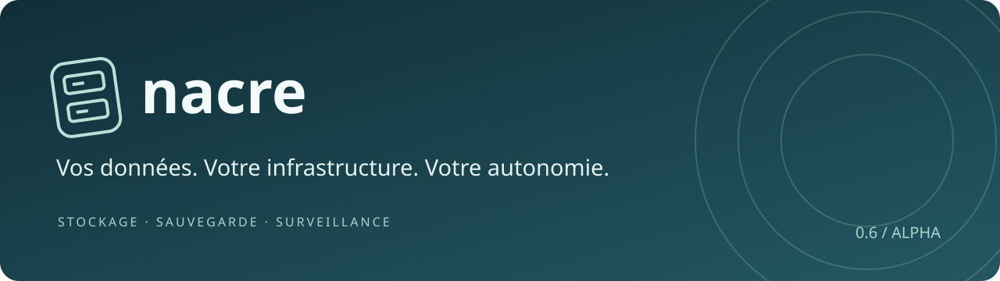
  <p><strong>Une console indépendante pour administrer stockage, sauvegardes et vidéosurveillance depuis le navigateur.</strong></p>
  <p><a href="https://github.com/Tarzzan/nacre/actions/workflows/ci.yml"></a>  </p>
  <p><a href="#découvrir-nacre">Découvrir</a> · <a href="docs/INSTALLATION.md">Installation</a> · <a href="docs/ARCHITECTURE.md">Architecture</a> · <a href="docs/VALIDATION.md">Validation</a> · <a href="docs/ROADMAP.md">Feuille de route</a></p>
</div>

## Découvrir Nacre

Nacre réunit l’administration des fichiers, des partages réseau, des volumes, des sauvegardes et d’une caméra dans une interface locale cohérente. Le projet vise une alternative indépendante aux usages courants de DSM/QTS et Surveillance Station, avec une architecture portable et des composants éprouvés.

**État actuel : prototype fonctionnel 0.8 alpha, destiné au laboratoire.** Ce dépôt marque le début de son historique Git ; les versions précédentes sont décrites rétrospectivement dans le changelog. Nacre ne constitue pas encore un OS NAS complet, ni une garantie de compatibilité avec les boîtiers Synology/QNAP. Aucun code propriétaire de ces systèmes n’est livré ici.

> **Notre ambition :** rendre une infrastructure de stockage et de surveillance compréhensible, administrable et récupérable par son propriétaire, sans dépendance obligatoire à un service cloud. Voir le [cadrage du produit](docs/VISION.md).

## Dans le navigateur

### Maîtriser la conservation des sauvegardes

**Choisir quand le nettoyage démarre.** Réservez la rétention automatique à un créneau quotidien. Les captures en attente sont regroupées et le navigateur distingue l’attente d’un échec ; une opération commencée termine son contrôle. [Créneau de maintenance](docs/MAINTENANCE-WINDOW.md).

L’[aperçu des ouvertures](docs/OPENING-PREVIEW.md) montre les plages autorisées sur les sept prochains jours, dans le fuseau de la règle, sans enregistrer ni activer le calendrier.

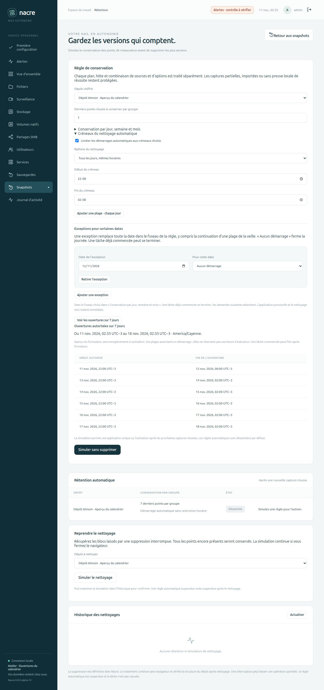

Les [plages multiples et exceptions datées](docs/DATE-EXCEPTIONS.md) permettent plusieurs ouvertures par jour et la fermeture ou le remplacement des horaires d’une date précise.

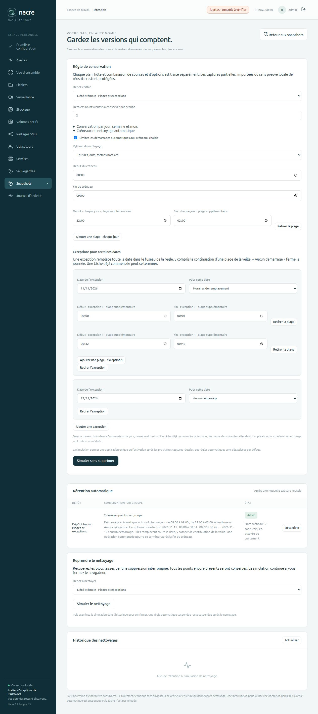

Les [créneaux par jour de la semaine](docs/WEEKLY-WINDOWS.md) permettent des horaires distincts, avec continuation nocturne explicite et conservation des règles quotidiennes existantes.

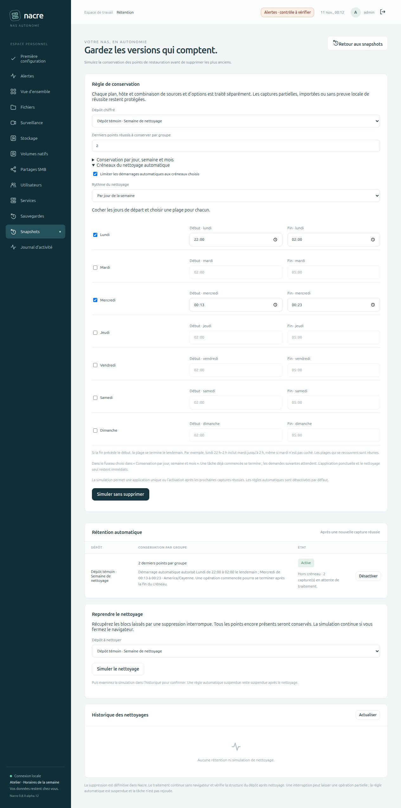

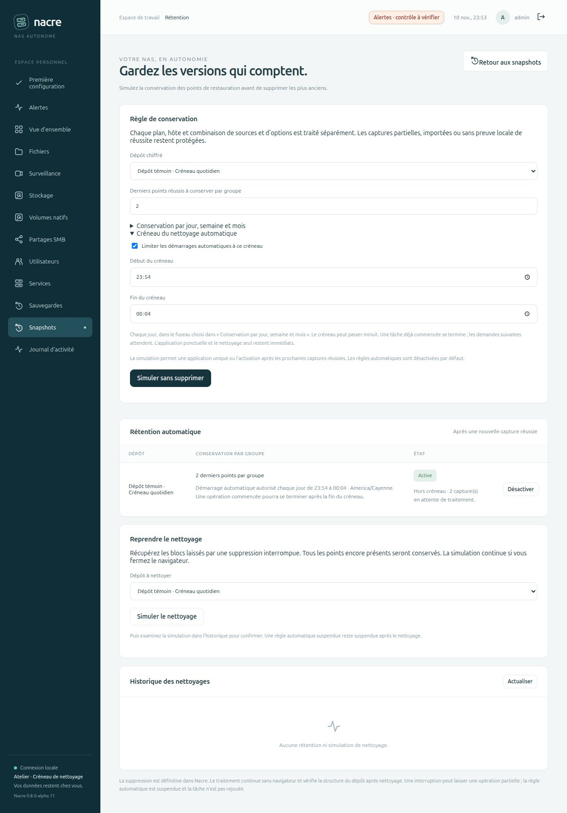

**Garder des repères dans le temps.** Combinez les derniers points avec le dernier point de chaque jour, semaine ou mois demandé. La simulation précise les motifs de conservation et le fuseau utilisé avant toute application ponctuelle ou automatique. [Règles calendaires](docs/CALENDAR-RETENTION.md).

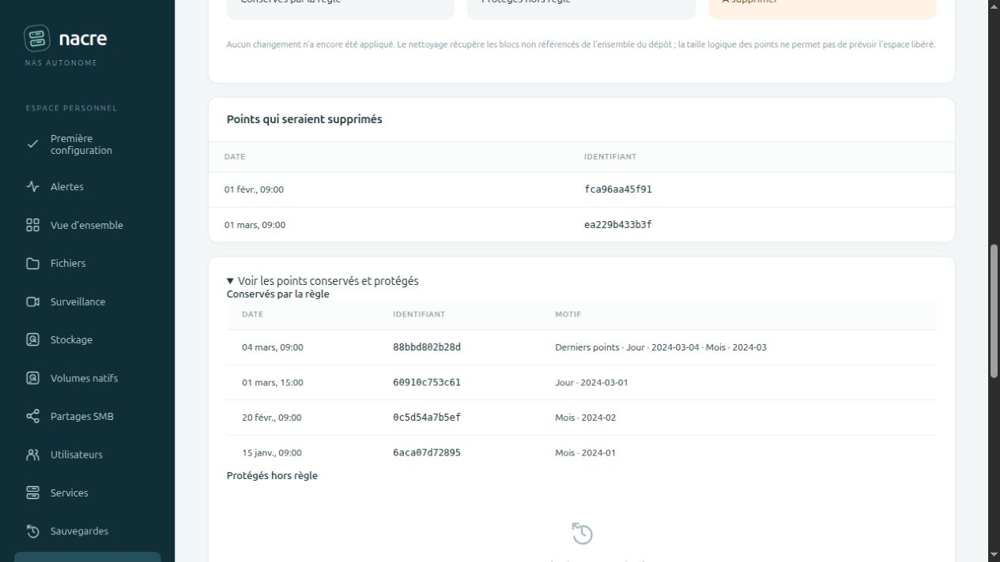

**Reprendre un nettoyage interrompu.** Lancez une simulation en tâche de fond, examinez les points conservés puis confirmez le nettoyage seul. Aucun snapshot encore présent n’est supprimé et une règle automatique suspendue reste suspendue. [Guide de reprise du nettoyage](docs/REPOSITORY-CLEANUP.md).

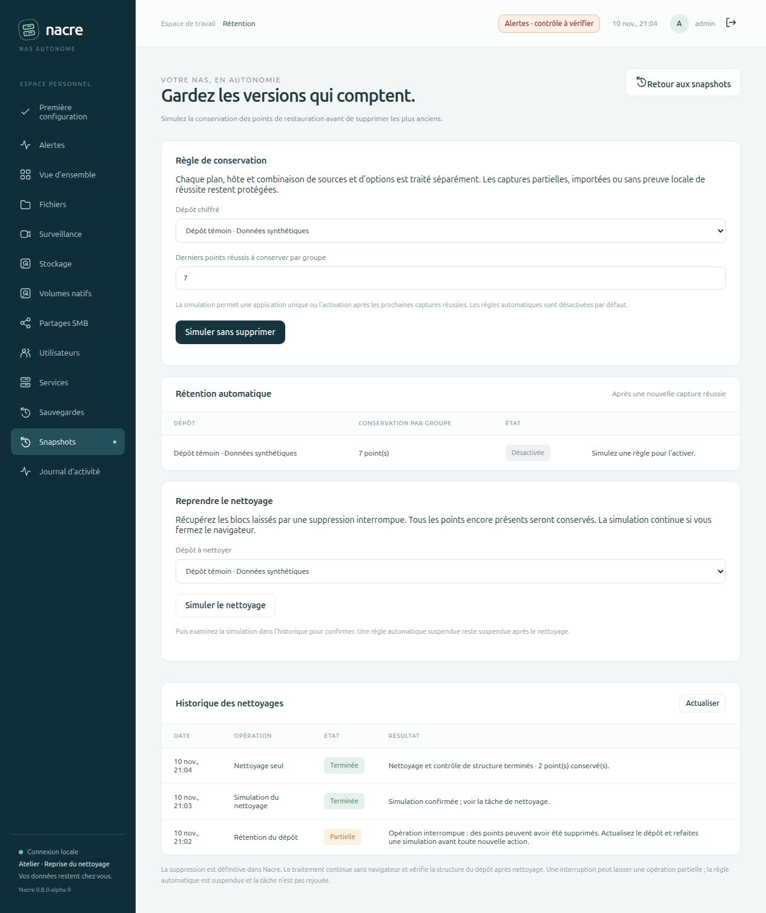

**Après chaque nouvelle capture réussie.** Une règle par dépôt peut être activée après simulation et confirmation. Nacre recalcule les points à supprimer, nettoie, puis suspend la règle avec une alerte en cas d’incident. Les règles restent désactivées par défaut et lors d’une reprise d’installation. [Rétention automatique](docs/AUTOMATIC-RETENTION.md).

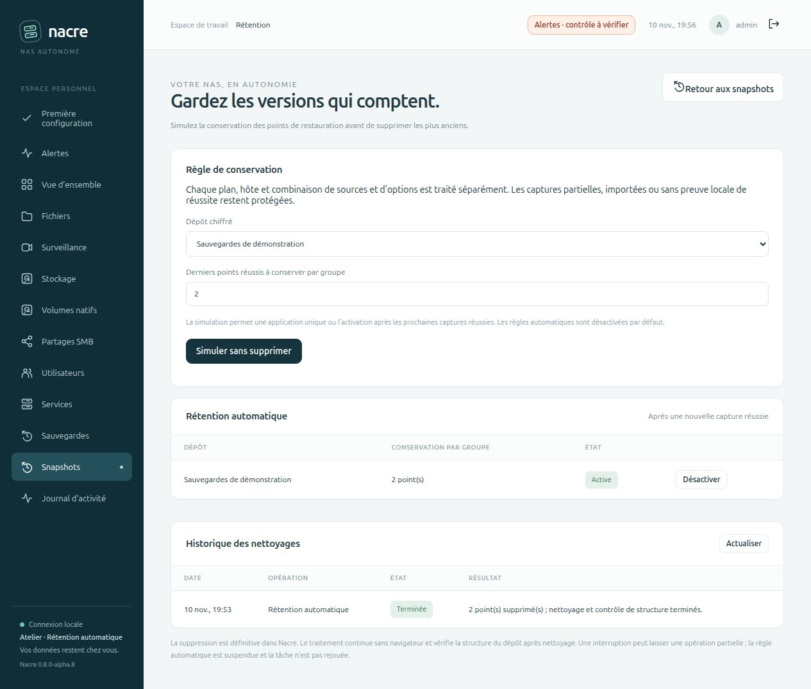

**Simuler avant de supprimer.** Depuis Snapshots, choisir combien de points réussis conserver par groupe, examiner les versions concernées puis confirmer le nettoyage. Les points partiels, importés ou sans preuve locale de réussite restent protégés. La tâche continue sans navigateur ; une application ponctuelle n’active pas de règle automatique. [Guide de rétention](docs/BACKUP-RETENTION.md).

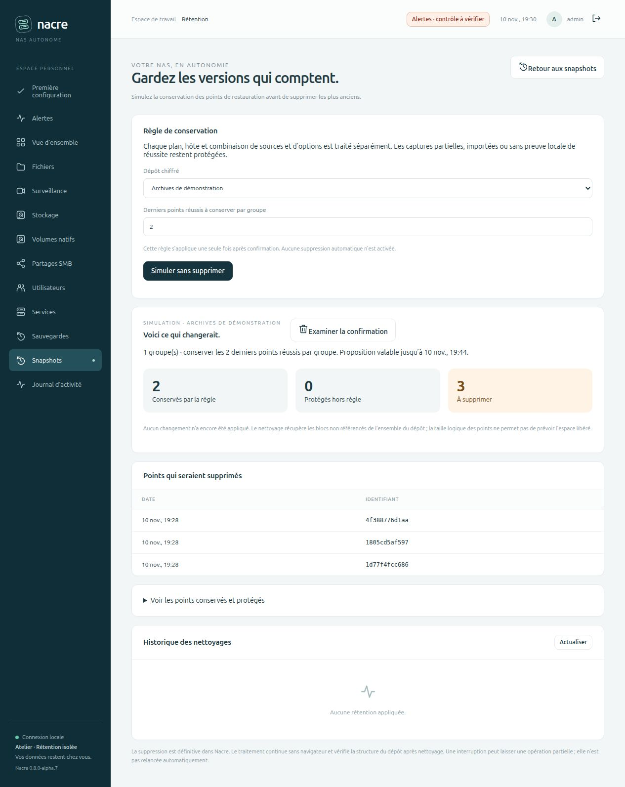

### Repérer les incidents et suivre leur résolution

**Les alertes aussi par email.** Le profil SMTP se configure depuis le navigateur avec STARTTLS ou TLS direct, test manuel et suivi des livraisons. Les reprises conservent le même identifiant de message. [Configurer les emails](docs/SMTP-NOTIFICATIONS.md).

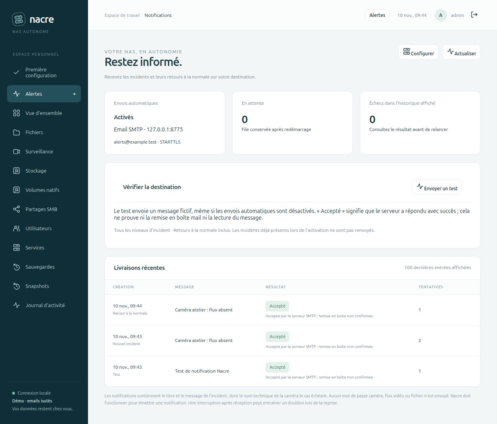

**Recevoir les alertes à distance.** Une destination ntfy ou webhook JSON se configure depuis le navigateur, avec test manuel, filtre de gravité, retours à la normale et suivi des livraisons. Les tentatives reprennent après redémarrage ; les envois sont désactivés par défaut. [Configurer les notifications](docs/EXTERNAL-NOTIFICATIONS.md).

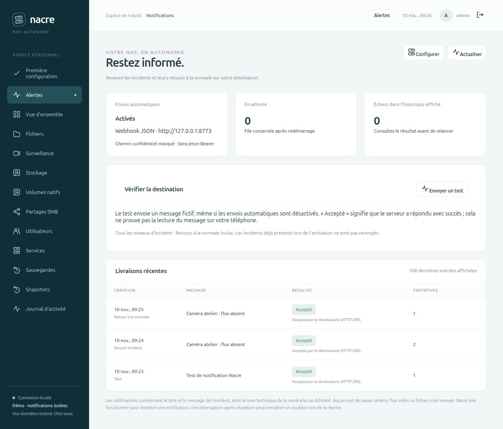

Un centre **Alertes** rassemble les incidents locaux, leur prise en compte et les retours à la normale. Le compteur reste accessible dans la console ; aucun envoi extérieur n’est activé par défaut. [Périmètre et fonctionnement](docs/LOCAL-ALERTS.md).

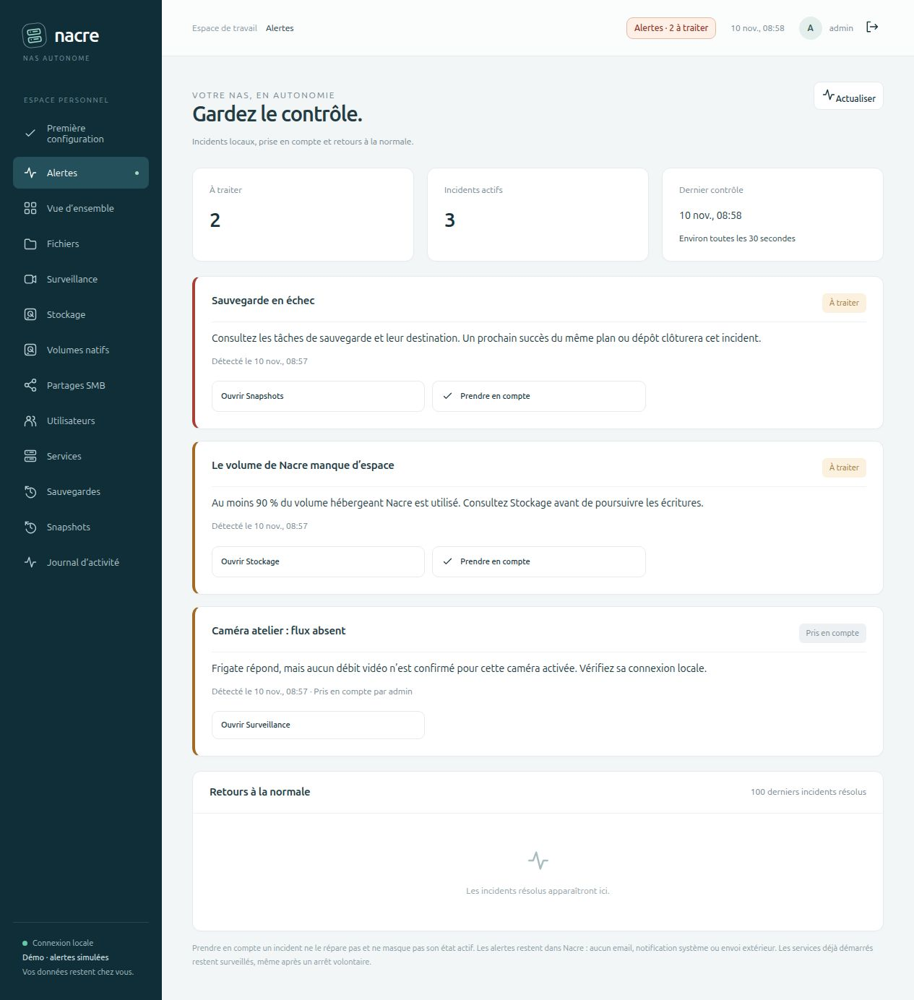

### Prendre les commandes au premier démarrage

**Nouveau : préparation Ubuntu et démarrage persistant.** Examiner le plan des prérequis, l’appliquer sur un hôte neuf, puis lancer `python3 installer.py --service`. Nacre revient automatiquement après redémarrage lorsque le maintien de session est configuré. [Parcours illustré et limites](docs/HOST-BOOTSTRAP.md).

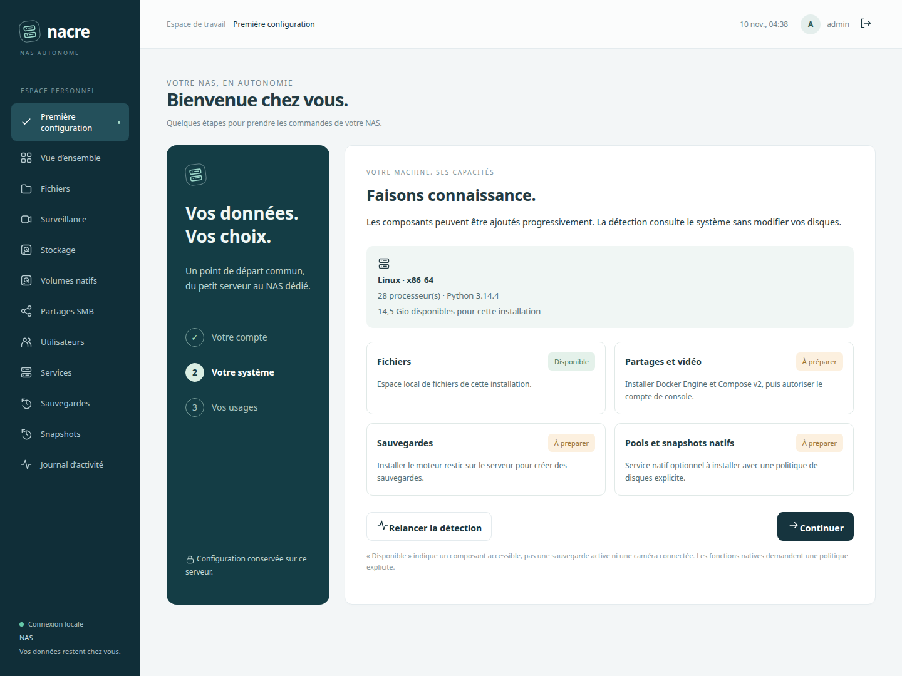

*Capture réelle de Chrome sur une installation locale isolée, sans caméra ni données utilisateur. L’assistant sécurise le compte initial, présente les composants disponibles et enregistre le nom du NAS et son fuseau. [Parcours de démarrage](docs/FIRST-RUN.md).*

### Voir toutes les caméras

**Un état clair avant d’ouvrir le direct.** La vue Surveillance distingue flux reçu, débit nul, pause et mesure inconnue. Ouvrez ensuite une caméra pour son direct, ses clips et son PTZ. [Fonctionnement et limites](docs/CAMERA-OVERVIEW.md).

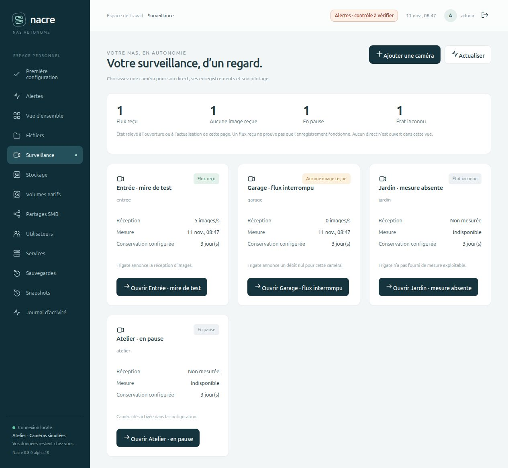

### Installer les composants et connecter les caméras

**Samba et Frigate : installation réelle vérifiée sur Linux ARM64 neuf.** Déclenchement depuis Services, suivi nommé, contrôle de disponibilité et conservation des données à la relance. [Procédure, versions et résultats](docs/FRESH-WEB-INSTALL.md).

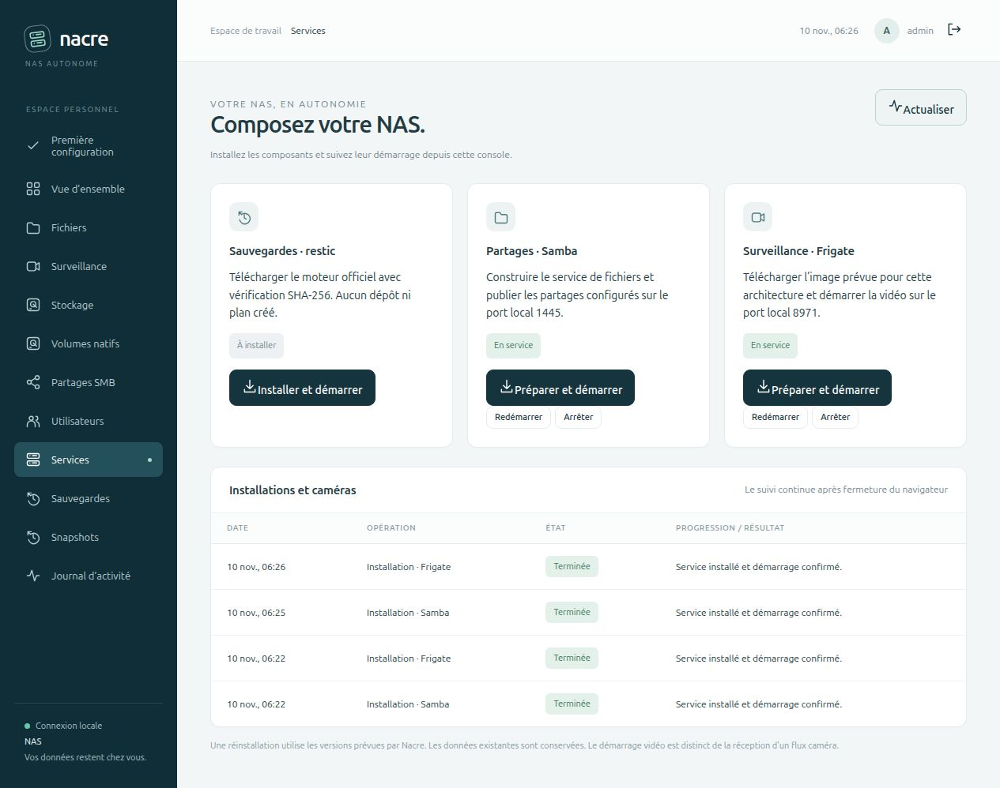

La page **Services** installe restic, Samba et Frigate avec suivi des tâches. **Surveillance** ajoute ou corrige les connexions Tapo/RTSP et permet de choisir la caméra à consulter. Docker reste un prérequis d’administration Linux pour les services conteneurisés. [Guide illustré et périmètre](docs/COMPONENTS-CAMERAS.md).

<details><summary>Voir les nouveaux écrans</summary>
<p>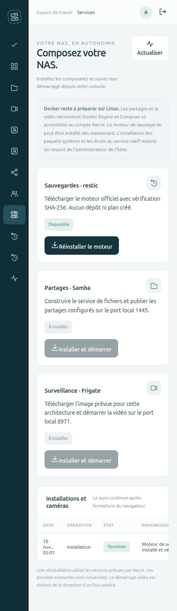 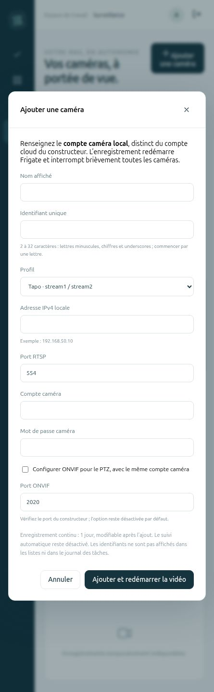</p>
</details>

### Gérer les fichiers d’un volume

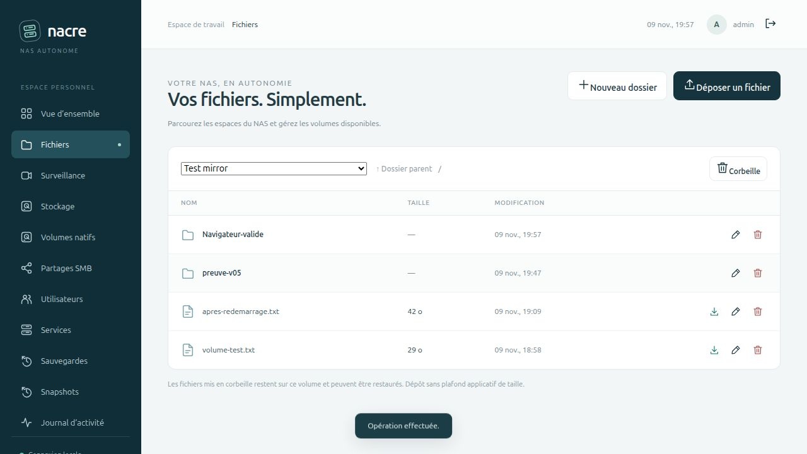

*Capture réelle du banc QEMU : volume synthétique « Test mirror », création et renommage vérifiés. Aucune image de caméra ni donnée personnelle dans cette capture.*

### Choisir les données à protéger

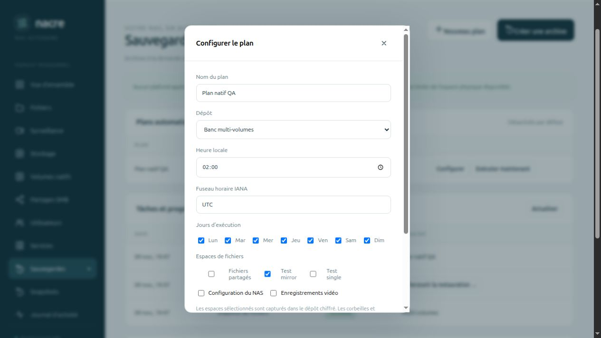

*Capture réelle du banc QEMU : choix des sources et plan désactivé. Les dépôts affichés sont des fixtures de test.*

### Reprendre une installation, ses clés et ses comptes

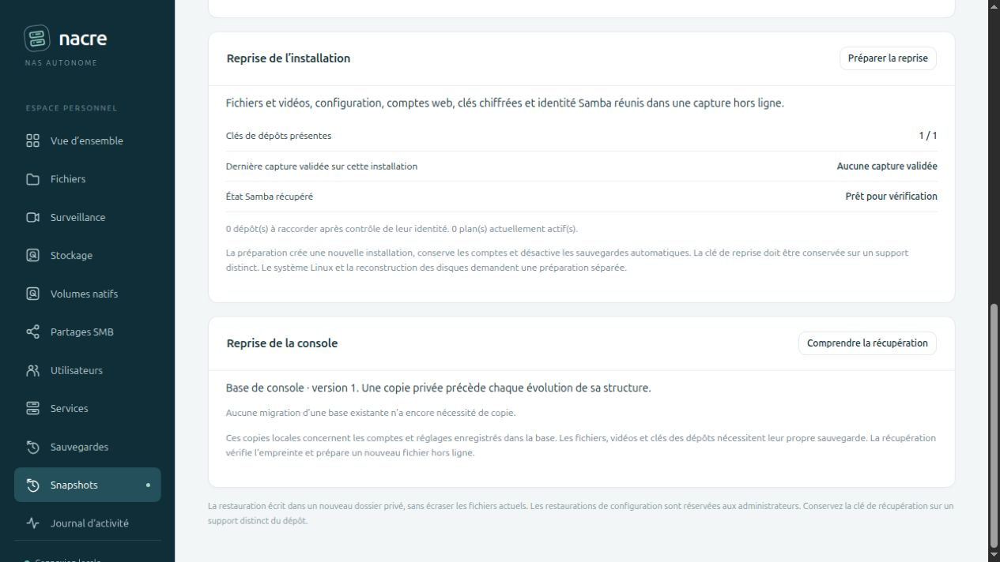

*Capture du banc de reprise : données synthétiques, compte et dépôt retrouvés. La [procédure complète](docs/SYSTEM-RECOVERY.md) distingue installation Nacre, archives historiques et système Linux.*

### Préparer une reprise après migration

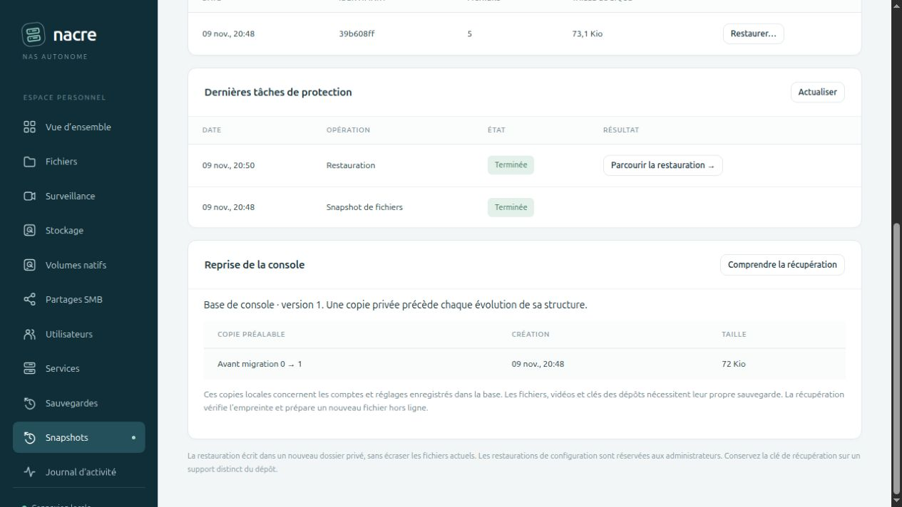

*Banc isolé 0.6 : migration 0 → 1 et restauration d’un fichier témoin depuis le navigateur. La reprise de la base ne remplace pas la sauvegarde des données du NAS.*

### Retrouver le NAS sur un Linux neuf

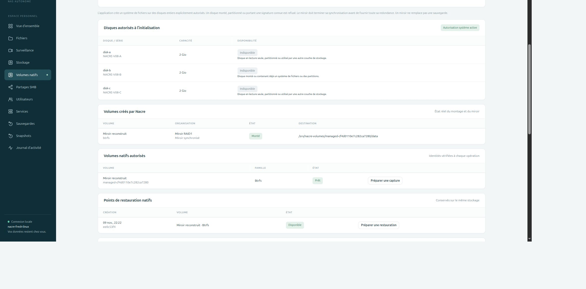

*Capture réelle après reconstruction et redémarrage : pool et snapshot synthétiques du banc QEMU.*

La [reprise sur Linux neuf](docs/FRESH-LINUX.md) retrouve données, clés et comptes, puis les raccorde à un nouveau pool. La [reconstruction RAID1](docs/POOL-RECOVERY.md) remplace un membre absent par un disque vierge avec confirmation et contrôle de synchronisation. Les deux parcours sont éprouvés sur images de disques isolées ; aucun disque de production n’est utilisé par les tests. La [qualification ARM64 et les coupures pendant reconstruction](docs/POWER-CUT-LAB.md) complètent ces preuves : reprise sur une seconde VM vierge et trois interruptions brutales par architecture avec vérification des données et snapshots. Les [écritures concurrentes et la reprise vidéo ARM64](docs/CONCURRENT-IO-CAMERA.md) ajoutent 72 fichiers écrits en reconstruction et le retour d’une vraie caméra sur un Linux vierge. Le [banc de coupures pendant écritures](docs/ACTIVE-WRITES-POWER-CUT.md) combine ensuite reconstruction, producteurs actifs et contrôle des confirmations conservées hors de la VM.

## Capacités et maturité

| Domaine | Disponible en 0.8 alpha | Limite actuelle |
| :--- | :--- | :--- |
| Fichiers | Transferts en flux, dossiers, renommage, téléchargement, corbeille, restauration | Accès HTTP aux volumes natifs réservé aux administrateurs |
| Partages SMB | Comptes, permissions, lecture seule, volumes gérés, reprise après perte de montage | Une modification des montages peut interrompre les connexions SMB |
| Protection | Restic chiffré et dédupliqué, sources multiples, restauration privée, plans horaires, rétention manuelle ou après réussite | Captures de fichiers non atomiques ; rétention calendaire et créneaux disponibles, quotas non gérés |
| Volumes | Inventaire, diagnostic SMART selon droits, disque entier ext4/Btrfs, miroir RAID1 | Opérations privilégiées validées en VM ; reconstruction RAID1 Btrfs qualifiée en VM ; pas de partitionnement |
| Snapshots natifs | Btrfs, ZFS, LVM classique/thin ; clones Btrfs/ZFS, copie LVM ext4/XFS | Clone ZFS non monté ; pas de programmation native |
| Surveillance | Inventaire multi-caméra, ajout et correction Tapo/RTSP, direct sélectionné, clips et PTZ ONVIF | Une Tapo C530WS validée historiquement ; charge et compatibilité multi-caméra réelles à qualifier |
| Composants | Installation web de restic, Samba et Frigate, progression persistante | Docker et droits natifs à préparer sur Linux |
| Administration | Sessions, rôles, CSRF, services, journal d’activité | Pas de MFA ni d’orchestration multi-NAS |

**Taille des fichiers et sauvegardes :** aucun plafond applicatif fixe ; les limites physiques du stockage et les contrôles de capacité restent applicables.

## Démarrer

Prévoir un hôte **Linux x86-64 ou ARM64**, Python 3.11+ et un compte dédié non root. Docker et Compose v2 seront nécessaires pour les partages et la vidéo ; ils ne sont pas requis pour ouvrir l’assistant. Lire le [guide d’installation](docs/INSTALLATION.md) avant toute activation sur une machine contenant des données.

```bash
git clone https://github.com/Tarzzan/nacre.git
cd nacre
python3 installer.py
```

La console écoute sur `http://127.0.0.1:8766/`. À distance, utiliser un tunnel SSH. Dans un second terminal, `python3 lab.py acces` affiche les identifiants provisoires générés localement. Le premier accès conduit à l’assistant, qui permet de choisir le mot de passe administrateur. Aucun mot de passe universel n’est fourni par le dépôt.

Le service natif privilégié est **optionnel** et demande une installation et une politique explicites. Il n’est pas activé par ces commandes. Aucun disque n’est initialisé et aucun plan de sauvegarde n’est créé automatiquement.

## Une architecture explicite

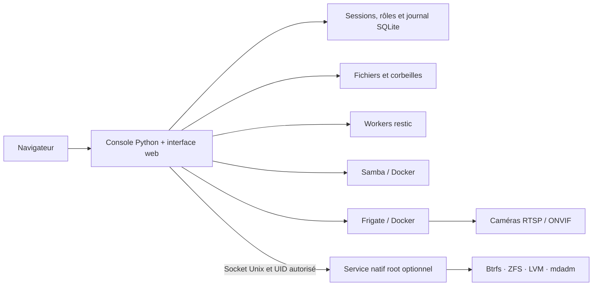

La console web tourne en utilisateur. Le service natif expose des opérations fermées et des plans à confirmer, liés à l’identité des disques. **L’accès au socket Docker reste un pouvoir élevé sur l’hôte** : voir les [frontières de confiance](docs/ARCHITECTURE.md).

## Ce qui est vérifié

- **193 tests Python et 20 tests JavaScript**, dont reprise après arrêt brutal, intégrité des copies, protection des clés, refus de reprise dangereuse, rétention sur dépôt chiffré et expiration de session. Un scénario QEMU distinct vérifie comptes web/Samba, SID, données et rattachement du dépôt.
- Dépôt HTTP de 257 Mio et archive contenant un fichier de 1 Gio + 7 octets.
- Sauvegarde chiffrée, restauration multivolume, droits SMB et exclusion des dossiers internes.
- Banc QEMU avec vrais systèmes de fichiers et disques images : snapshots, provisionnement, restauration LVM, perte/remontage d’un volume.
- Direct vidéo, clips et PTZ vérifiés sur une caméra réelle lors du développement.

La CI rejoue les tests ordinaires ; **les tests privilégiés QEMU et matériels ne sont pas exécutés en CI**. Le nombre de tests réussis n’équivaut pas à une certification de conservation des données. [Méthodes et limites de validation](docs/VALIDATION.md).

## Documentation

| Document | Contenu |
| :--- | :--- |
| [Vision](docs/VISION.md) | Positionnement, principes et ambition reformulée |
| [Composants et caméras](docs/COMPONENTS-CAMERAS.md) | Installation web, connexions, protection des secrets et limites |
| [Premier démarrage](docs/FIRST-RUN.md) | Assistant, composants optionnels et reprise du parcours |
| [Installation](docs/INSTALLATION.md) | Prérequis, accès, configuration et mise à jour |
| [Architecture](docs/ARCHITECTURE.md) | Composants, données persistantes, frontières de confiance |
| [Feuille de route](docs/ROADMAP.md) | Étapes et critères de sortie |
| [Linux neuf](docs/FRESH-LINUX.md) | Réinstallation, clés, comptes et nouveau pool |
| [Coupure et ARM64](docs/POWER-CUT-LAB.md) | Défaut détecté, correction, bancs et limites de la simulation |
| [Écritures et caméra ARM64](docs/CONCURRENT-IO-CAMERA.md) | Accès pendant reconstruction, fichiers privés Frigate et reprise vidéo |
| [Coupures avec écritures](docs/ACTIVE-WRITES-POWER-CUT.md) | Journal externe, confirmations HTTP/SMB et intégrité après trois coupures |
| [Reconstruction RAID1](docs/POOL-RECOVERY.md) | Remplacement contrôlé et vérification du miroir |
| [Reprise de console](docs/RECOVERY.md) | Migrations atomiques, copies préalables et récupération hors ligne |
| [Validation](docs/VALIDATION.md) | Tests locaux, CI et laboratoire privilégié |
| [Sécurité](SECURITY.md) | Signalement privé, secrets et limites |
| [Contribution](CONTRIBUTING.md) | Branches, revues, preuves et documentation |
| [Gouvernance du dépôt](docs/REPOSITORY.md) | Protections, CI, jalons et issues |
| [Changelog](CHANGELOG.md) | Évolution fonctionnelle et premier import Git |
| [Guide technique détaillé](LIRE-MOI.txt) | Politiques natives et comportements des moteurs |

## Statut et droits

Dépôt privé de développement. La licence de diffusion du code Nacre reste à décider par son propriétaire ; aucune licence open source n’est accordée implicitement. Les composants tiers conservent leurs propres licences : [inventaire](docs/DEPENDENCIES.md). Le projet n’est affilié ni à Synology, ni à QNAP, ni à TP-Link.
