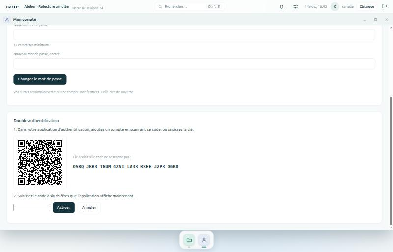
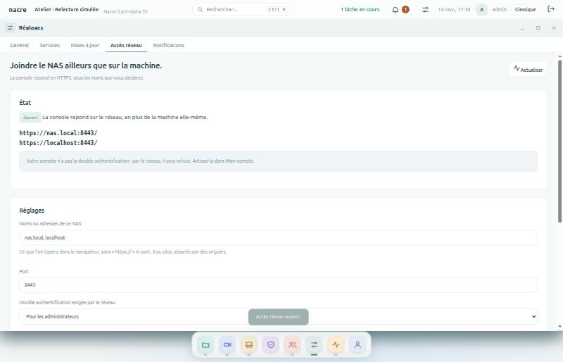

# Accès de partout

Deuxième brique de l’espace collaboratif : se connecter en sécurité ailleurs que sur la machine elle-même. Elle arrive en trois temps ; ce guide grandit avec eux.

| Temps | Contenu | État |
| --- | --- | --- |
| Double authentification | Un code du téléphone en plus du mot de passe | Depuis 0.8.0-alpha.55 |
| Accès par le réseau | Écoute en HTTPS, noms d’hôte reconnus | Depuis 0.8.0-alpha.56 |
| Téléphone | Interface adaptée, installation sur l’écran d’accueil | À venir |

## Double authentification

Chaque personne l’active pour son propre compte, quel que soit son rôle. Une fois active, un code à six chiffres donné par une application d’authentification est demandé à chaque connexion par mot de passe.

### Activer

1. **Mon compte → Double authentification** : saisir son mot de passe actuel.
2. Scanner le **code QR** avec l’application d’authentification du téléphone, ou saisir la clé affichée.
3. Saisir le code à six chiffres que l’application affiche : la double authentification n’est active qu’après ce premier code juste.
4. **Noter les dix codes de secours** et les ranger hors du NAS. Ils ne sont affichés qu’une fois.

*Banc local : compte fictif, clé jetée au lancement suivant.*

### Se connecter

L’identifiant et le mot de passe d’abord ; le champ du code n’apparaît que si le compte en demande un. Un code de secours se saisit dans le même champ et ne sert qu’une fois.

### À savoir

- **Compatible avec les applications courantes** : norme TOTP (RFC 6238), six chiffres, trente secondes. Le téléphone doit être à l’heure ; la période précédente et la suivante sont tolérées.
- **Un code ne sert qu’une fois** : le même code rejoué dans sa demi-minute est refusé.
- **Activer ferme les autres sessions** du compte.
- **Désactiver** demande le mot de passe et un code, du téléphone ou de secours.
- **Téléphone et codes perdus** : un administrateur retire la double authentification d’une autre personne dans **Personnes et espaces** ; ses sessions sont fermées et le geste est au journal. Pour son propre compte, il reste le lien de connexion locale.
- **Le lien de connexion locale ne demande pas de code.** Il se génère sur la machine elle-même, par quelqu’un qui en a déjà la maîtrise : c’est le recours, pas une porte dérobée du réseau.
- **Ce qui est gardé** : la clé, dans la base privée de la console, car elle est nécessaire pour vérifier les codes ; les codes de secours sous forme d’empreinte seulement.
- **Les tentatives sont limitées** à huit par minute, mot de passe et code confondus.

### Limites

- **Pas d’obligation par rôle** : un administrateur ne peut pas encore l’imposer aux autres.
- **Pas de clé matérielle** (FIDO2, WebAuthn).
- **Le code QR est dessiné par la console**, sans service extérieur ; il a été comparé module à module à une bibliothèque de référence sur 96 cas.

## Accès par le réseau

La console n’écoute d’abord que la machine elle-même. Depuis **0.8.0-alpha.56**, un administrateur peut l’ouvrir au réseau, en HTTPS. **Rien ne s’ouvre tout seul** : c’est un geste explicite, confirmé, et qui se referme d’un clic.

### Ouvrir

1. **Réglages → Accès réseau**.
2. Déclarer les **noms ou adresses** sous lesquels on tapera l’adresse du NAS : `nas.local`, `192.168.1.20`… Les adresses de la machine sont proposées.
3. Choisir le **port** (8443 par défaut) et qui doit avoir la double authentification par le réseau : les administrateurs, ou tout le monde.
4. **Ouvrir l’accès réseau**, puis confirmer. Les adresses à utiliser s’affichent, avec l’empreinte du certificat.

*Banc local.*

### Ce qui protège

- **HTTPS seulement** sur ce port, TLS 1.2 au minimum. Le port ne répond pas en clair.
- **Noms déclarés seulement** : une requête adressée à un autre nom est refusée, ce qui ferme la porte aux attaques par redirection de nom.
- **Un administrateur ne se connecte par le réseau qu’avec la double authentification.** Sans elle, il est refusé une fois son mot de passe reconnu, et le refus est au journal. Il l’active depuis la machine elle-même.
- **Le lien de connexion locale ne fonctionne pas par le réseau.**
- **Tentatives limitées** à huit par minute et par adresse.
- **Sessions marquées « Secure »** : le navigateur ne les renvoie qu’en HTTPS.
- **Connexions au journal** avec l’adresse d’origine.
- **Un client lent ne bloque personne** : la négociation TLS se fait dans le fil de chaque connexion, sous un délai.

### Le certificat

- **Autosigné par défaut**, produit par OpenSSL pour les noms déclarés, valable 825 jours. Le navigateur affiche un avertissement à la première visite : comparer l’empreinte qu’il montre à celle de la page.
- **Il suit les noms** : changer les noms le refait.
- **Fournir un certificat** : coller le certificat et sa clé au format PEM. Ils sont vérifiés ensemble avant de remplacer quoi que ce soit, et un certificat fourni n’est jamais remplacé d’office.
- La clé reste dans le dossier privé de la console.

### Derrière un relais

Un relais HTTPS (Nginx Proxy Manager, Caddy…) peut se placer devant : il se connecte au port de Nacre en HTTPS, et le nom public doit figurer dans les noms déclarés. Le nom est accepté avec ou sans le port.

### Limites

- **IPv4, toutes les interfaces** : pas de choix de l’interface, pas d’IPv6.
- **Pas de certificat public automatique** (Let’s Encrypt).
- **Le pare-feu de la machine n’est pas réglé par Nacre** : si le port est fermé, l’ouvrir est un geste d’administrateur du système.
- **Exposer ce port à Internet** se décide sur la box ou le pare-feu, pas ici. Nacre est en version alpha : préférer un réseau privé ou un VPN.
- **« Pour tout le monde »** : un membre doit alors activer sa double authentification depuis la machine avant sa première connexion par le réseau.
- **Changer un réglage relance l’écoute** : les connexions en cours par le réseau sont coupées un instant.

