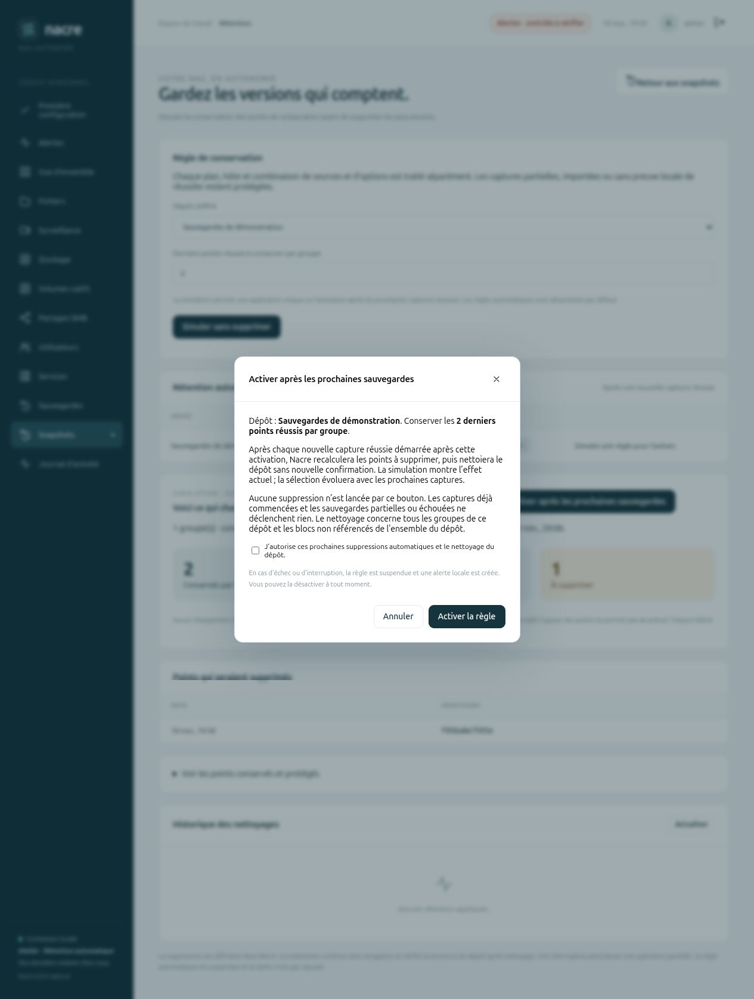
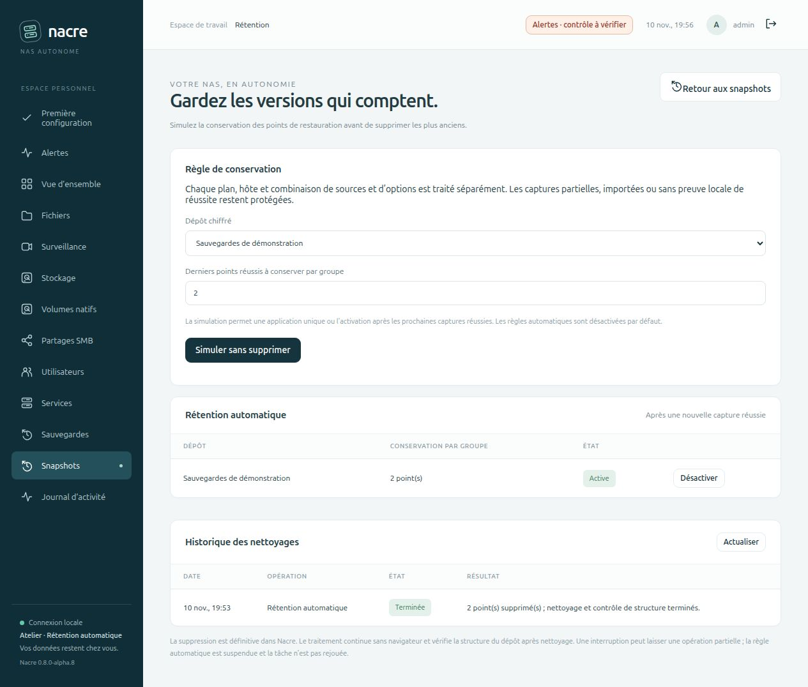

# Une règle après les sauvegardes réussies

Depuis **alpha.10**, les derniers points peuvent être complétés par des [règles journalières, hebdomadaires et mensuelles](CALENDAR-RETENTION.md), avec fuseau explicite et motifs de conservation. Les exemples et captures précédents restent applicables avec ces catégories à zéro.

Depuis **Snapshots → Gérer la rétention**, choisir le dépôt et le nombre de derniers points réussis à conserver par groupe. Lancer la simulation, puis choisir **Activer après les prochaines sauvegardes**. La confirmation distingue l’effet simulé aujourd’hui des suppressions qui seront recalculées lors des prochaines captures.

Les règles sont **désactivées par défaut**. L’activation ne supprime aucun point immédiatement. Elle concerne seulement les captures de fichiers Nacre demandées après l’activation, terminées avec succès dans ce dépôt. Les anciennes captures, les tâches déjà en attente, les captures partielles/échouées, les archives tar et les snapshots natifs ne déclenchent pas ce nettoyage.

## Ce qui s’exécute

Le planificateur de la console repère les nouvelles captures réussies, y compris celles terminées juste avant un redémarrage. Il enregistre une tâche de rétention distincte avec une identité déterministe par capture et version de règle. Une seule tâche automatique par dépôt peut être en attente ou en cours. Deux passages concurrents ne créent pas deux tâches pour la même capture.

Sous le verrou des tâches Nacre, le worker vérifie la règle, son auteur administrateur actif, l’identité du dépôt et la présence de la capture déclenchante. Il recalcule la sélection, effectue une simulation restic, puis utilise le parcours de [rétention explicite](BACKUP-RETENTION.md) : suppression des identifiants prévus, nettoyage des blocs non référencés et contrôle de structure. S’il n’y a rien à supprimer, il le signale sans lancer de nettoyage.

La règle s’applique à **tous les groupes du dépôt**, pas seulement au groupe de la capture déclenchante. Les groupes séparent plans, hôtes, sources et options configuration/vidéo. Les captures partielles, importées ou sans preuve locale de réussite restent protégées. Le nombre conservé peut donc être supérieur au nombre demandé.

## Désactiver, modifier, reprendre

- **Désactiver** invalide les tâches encore en attente et empêche les étapes suivantes. Une commande restic déjà lancée peut se terminer ; la désactivation ne recrée pas les points supprimés.
- **Modifier ou réactiver** demande une nouvelle simulation et confirmation. Une version de règle empêche un formulaire ancien de remplacer un changement récent. Les captures antérieures à cette nouvelle activation sont exclues des déclencheurs.
- **Erreur, annulation ou interruption** : la tâche peut être partielle et la règle courante est suspendue. Le centre Alertes signale cette suspension lors de ses prochains contrôles. La réussite de la sauvegarde déclenchante reste distincte de l’échec du nettoyage.
- **Arrêt entre l’échec et la suspension** : le planificateur retrouve l’incident avant de lancer un nouveau nettoyage. Aucun rejeu automatique de la tâche interrompue.
- **Reprise de base ou de NAS** : toutes les règles automatiques sont désactivées et les anciennes confirmations sont supprimées. Il faut vérifier les dépôts, simuler puis réactiver explicitement.

Le service de console doit fonctionner pour distribuer les tâches. Un worker déjà lancé peut continuer sans navigateur ni console ; après redémarrage, son état est contrôlé avant de distribuer d’autres tâches. La rétention partage la file des tâches de protection et peut retarder une prochaine sauvegarde pendant le nettoyage.

## Validation

Les tests utilisent des bases et dépôts temporaires. Ils couvrent les valeurs par défaut, les anciennes captures exclues, les captures partielles/échouées, les autorisations, l’auteur et la version de règle, la confirmation à usage unique, deux passages concurrents, la désactivation, un dépôt changé, un administrateur révoqué, la disparition du worker, la fenêtre entre échec et suspension, les alertes et la neutralisation lors des reprises.

Avec restic réel : nouvelle capture après activation, nettoyage automatique unique, contrôle `check --read-data`, restauration du fichier conservé et comparaison du contenu. Une interruption injectée pendant `prune` laisse la sauvegarde réussie et suspend la règle avec un résultat de nettoyage partiel.

Le banc web distinct comporte trois versions synthétiques. La simulation et la confirmation sont inspectées dans le navigateur ; l’activation passe par l’API authentifiée. Après un redémarrage réel de la console, une quatrième capture déclenche un seul nettoyage automatique : deux anciennes versions supprimées, deux points conservés, dernière version restaurée à l’identique. Le résultat et la règle active sont ensuite vérifiés dans le navigateur. Aucun dépôt ni réglage de Spark n’est utilisé.

## Limites

La politique actuelle conserve les derniers N points réussis par groupe. Les règles journalières, hebdomadaires et mensuelles sont disponibles depuis alpha.10. Le créneau horaire dédié au nettoyage et les règles basées sur un quota d’espace restent ouverts. Le [nettoyage seul](REPOSITORY-CLEANUP.md) est disponible depuis alpha.9 ; il ne réactive pas une règle suspendue. Le nettoyage concerne les blocs non référencés de l’ensemble du dépôt ; aucun gain d’espace n’est promis à partir de la taille logique des snapshots.

Les verrous restic protègent les commandes individuelles. Éviter toute maintenance externe simultanée du dépôt : il n’y a pas de transaction globale couvrant plusieurs clients et plusieurs commandes. Le contrôle structurel ordinaire ne remplace pas une lecture complète des données ou un exercice de restauration.
