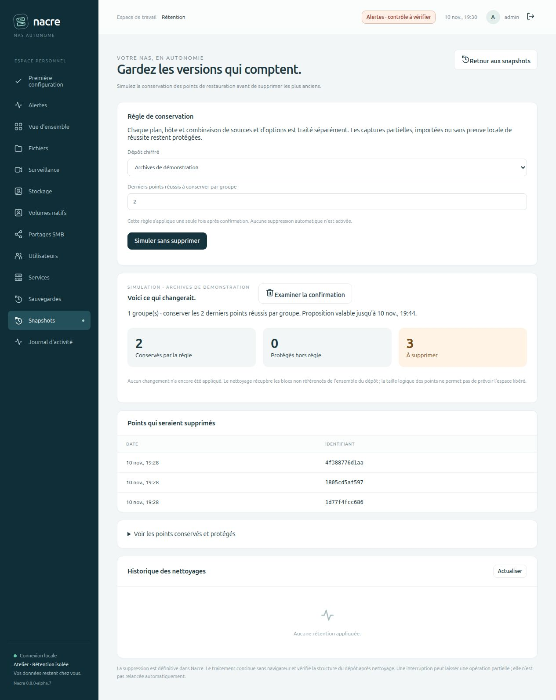
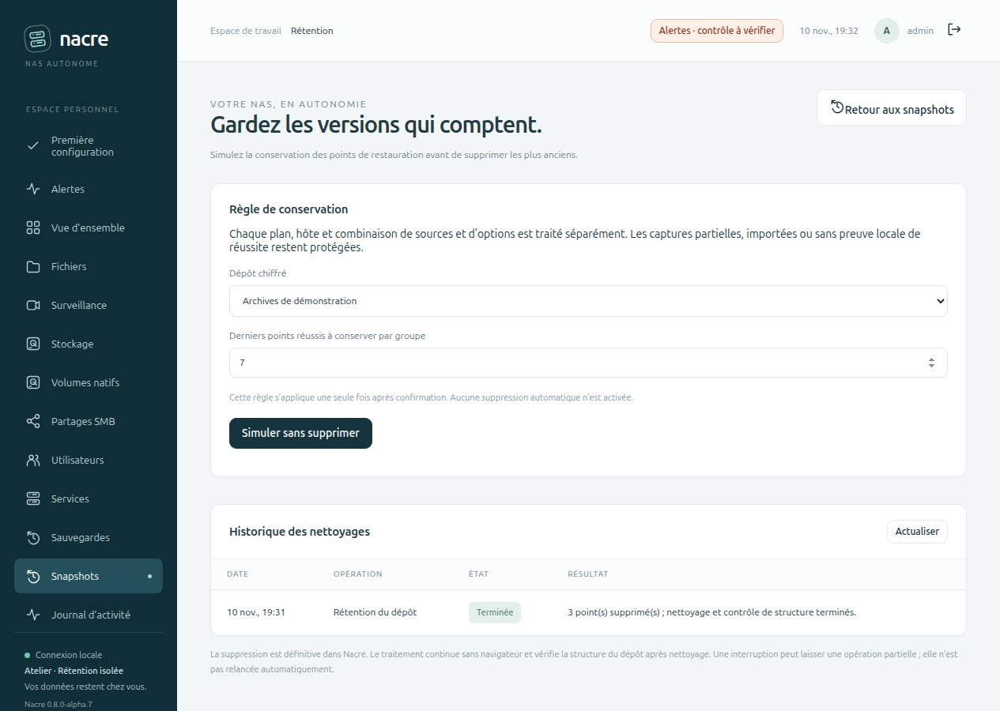

# Conserver les versions utiles

Depuis **0.8.0-alpha.8**, la simulation permet aussi d’activer une règle après les prochaines captures réussies. Le parcours ci-dessous décrit l’application unique ; voir le [guide de rétention automatique](AUTOMATIC-RETENTION.md) pour l’activation, la désactivation et la suspension après incident.

Depuis **Snapshots → Gérer la rétention**, choisir un dépôt et le nombre de derniers points réussis à conserver. **Simuler sans supprimer** affiche les points conservés, protégés et proposés à la suppression. Rien n’est effacé à cette étape.

Après examen, **Examiner la confirmation** présente le dépôt, le nombre de points et l’effet du nettoyage. Une case obligatoire confirme la suppression définitive et le nettoyage. La tâche continue sans navigateur ; son état apparaît dans l’historique de rétention et les tâches de protection.

## Comment les points sont choisis

La règle conserve au minimum un point réussi par groupe. Les groupes distinguent le plan (ou les captures manuelles), l’hôte, les espaces sources et les options configuration/vidéo. Ainsi, un changement de sources ou de plan ne conduit pas à effacer la seule version d’un autre ensemble de données. Le chemin temporaire de la copie de configuration ne crée pas un groupe distinct à chaque capture.

Seuls les points portant le marqueur Nacre et associés à une tâche locale `snapshot` terminée avec succès sont candidats. Les points partiels, importés, étrangers, datés dans le futur ou sans preuve locale de succès restent protégés. Des points peuvent donc rester au-delà du nombre demandé. Supprimer l’historique des tâches ne rend pas leurs points automatiquement éligibles.

Les snapshots natifs Btrfs/ZFS/LVM et les archives tar ne sont pas concernés. Le choix **Examiner la confirmation** applique une règle **une seule fois après confirmation** ; ce choix n’active pas la règle automatique proposée séparément.

## Effet et garanties

- Simulation restic `forget --dry-run` sur les identifiants sélectionnés ; aucun `prune` à cette étape.
- Proposition valable quinze minutes, réservée à son auteur et consommable une fois. Une nouvelle simulation du même administrateur pour le même dépôt remplace la précédente.
- Revalidation de l’identité du dépôt, des points et de leur sélection avant suppression. Une modification ou une proposition expirée exige une nouvelle simulation.
- Sérialisation avec les autres tâches Nacre. Seuls les identifiants explicitement prévus sont transmis à `forget`, par lots.
- `prune` nettoie ensuite les blocs non référencés de **l’ensemble du dépôt**, y compris ceux de suppressions antérieures. Les données référencées par les points conservés restent nécessaires.
- Contrôle final de structure par `restic check`. Ce contrôle ordinaire ne relit pas tous les blocs de données ; le test d’intégration ajoute `check --read-data` et une restauration témoin.

La taille logique des snapshots ne permet pas de prévoir l’espace libéré, car plusieurs points partagent des blocs. Aucun gain d’espace n’est annoncé avant mesure. Voir la [documentation officielle restic sur forget et prune](https://restic.readthedocs.io/en/stable/060_forget.html).

La suppression n’a pas de corbeille Nacre. Annuler une tâche avant son démarrage conserve tous les points. Après le début d’une suppression, une interruption peut laisser une opération partielle ; Nacre ne prétend pas l’avoir annulée sans effet et ne la rejoue pas automatiquement. Actualiser les points et examiner le résultat avant toute nouvelle action. Si les points ont disparu mais que le nettoyage n’est pas terminé, l’espace peut rester occupé ; utilisez alors [Reprendre le nettoyage](REPOSITORY-CLEANUP.md), disponible depuis alpha.9, sans oublier d’autres points.

Éviter toute maintenance externe du même dépôt pendant l’opération. Les verrous restic protègent chaque commande ; Nacre ne possède pas de transaction globale couvrant des clients externes et plusieurs commandes. Aucun déverrouillage forcé n’est effectué.

## Validation isolée

Les tests utilisent uniquement des bases, dépôts chiffrés et fichiers temporaires. Ils couvrent la sélection par groupe, les points protégés, les autorisations administrateur/CSRF, la confirmation et son auteur, l’expiration, la consommation unique, un dépôt occupé, un changement de points ou d’identité et l’annulation avant exécution.

Le scénario avec restic réel simule sans modifier les points, supprime l’ancienne version, nettoie, contrôle les données puis restaure la version conservée et compare son contenu. Une interruption injectée pendant `prune` produit un résultat partiel sans rejeu ; la reprise d’un worker disparu signale aussi l’incertitude.

Le banc navigateur distinct contient cinq versions d’un fichier synthétique. La simulation de conservation des deux dernières propose trois suppressions. Aucun disque, dépôt ou compte de Spark n’est utilisé pour ces essais.

La simulation et la fenêtre de confirmation ont été inspectées dans le navigateur. L’application par l’API authentifiée a ensuite supprimé les trois points proposés, conservé les deux autres et permis de restaurer exactement la cinquième version du fichier. L’historique affiché dans le navigateur confirme le résultat de la tâche.

