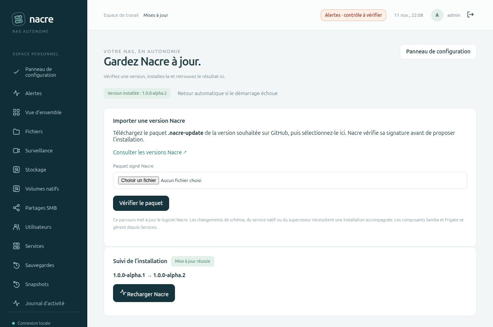
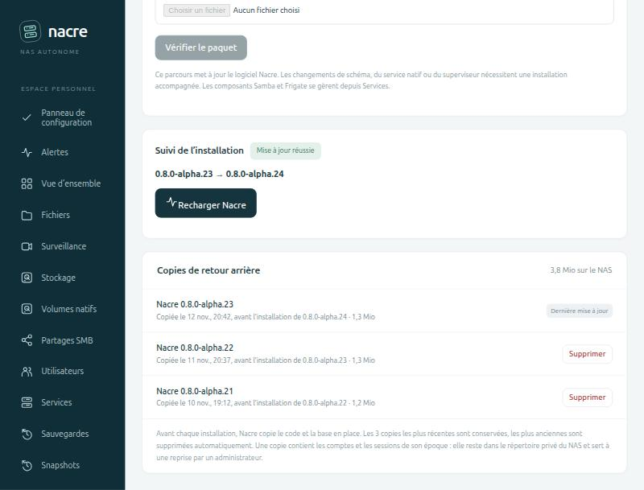
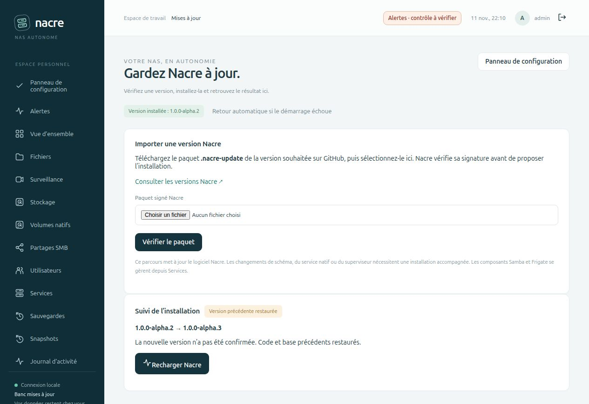

# Mises à jour depuis le navigateur

Depuis **Panneau de configuration → Mises à jour Nacre**, un administrateur importe un paquet signé, vérifie la version proposée et confirme son installation. La console se reconnecte au résultat. Le superviseur restaure le code et la base précédents si la nouvelle console ne réussit pas le contrôle de démarrage.

## Utilisation

1. Télécharger le fichier **`.nacre-update`** joint à une [version GitHub](https://github.com/Tarzzan/nacre/releases). Une archive source ZIP/TAR n’est pas un paquet de mise à jour. Le dépôt privé demande une connexion GitHub dans le navigateur ; aucun jeton GitHub n’est enregistré sur le NAS.
2. Sélectionner ce fichier dans **Mises à jour**, puis **Vérifier le paquet**. La préparation reste valable une heure. La même version peut être réinstallée ; les versions antérieures sont refusées.
3. Après la fin des tâches Nacre et des transferts web, choisir **Installer cette version** et confirmer. La console est brièvement interrompue. Samba et Frigate restent en fonctionnement.
4. Attendre **Mise à jour réussie** ou **Version précédente restaurée**, puis **Recharger Nacre**. Fermer le navigateur n’annule pas l’installation. En cas de connexion coupée, rouvrir `#updates` quand la console répond.



## Copies de retour arrière

Avant chaque installation, le superviseur copie le code et la base en place. La page **Mises à jour** liste ces copies sous le suivi de l’installation : version copiée, date, version installée ensuite, taille, et place totale occupée dans le répertoire des mises à jour.



- **Règle automatique.** Nacre garde les trois copies les plus récentes, celle de la dernière mise à jour comprise, et supprime les plus anciennes. La règle s’applique au démarrage de la console, donc juste après chaque mise à jour réussie, et après chaque import de paquet.
- **Restes.** Un paquet vérifié puis remplacé par un autre, ou jamais installé, est effacé par la même règle. Un import interrompu l’est après une heure.
- **Suppression manuelle.** Un administrateur peut supprimer une copie ancienne après confirmation. Une copie contient les comptes et les sessions de son époque : la retirer réduit ce que le NAS conserve.
- **Ce qui reste protégé.** Le dossier que désigne l’état du superviseur n’est jamais supprimé : copie de la dernière mise à jour, paquet en attente d’installation, ou copies d’une installation échouée. Rien n’est modifié pendant qu’une mise à jour est engagée ou en préparation.
- **Journal.** Les suppressions automatiques de copies et chaque suppression manuelle sont inscrites dans les événements de la console, avec les versions concernées.

Après validation d’une mise à jour, le superviseur ne relit plus ces copies : elles servent à une reprise par un administrateur, pas au retour automatique. La purge vit dans un module de la console, `console/update_copies.py`, séparé du superviseur figé ; elle prend le même verrou que la préparation d’un paquet.

## Préparer le service une première fois

Cette fonction apparaît à partir de **0.8.0-alpha.19**. Les installations antérieures doivent d’abord recevoir cette version par la procédure administrateur habituelle, puis actualiser leur service :

```sh
python3 console/install_service.py --port 8766
```

Exécuter sous le compte Nacre, sans sudo, après initialisation de l’installation. Le programme vérifie l’unité systemd et installe le superviseur indépendant dans `state/console/updates/runtime.py`. OpenSSL est requis ; il figure dans les prérequis Ubuntu de `scripts/prepare_host.py`. Un démarrage simple de `console/server.py` expose la page en lecture seule, avec une indication pour préparer le service. Le démarrage après extinction du NAS dépend du service utilisateur et du *linger* décrits dans [Préparation de l’hôte](HOST-BOOTSTRAP.md).

## Ce qui est protégé

| Étape | Vérification et comportement |
| --- | --- |
| Import | Signature Ed25519 du manifeste, empreintes SHA-256, chemins de code autorisés, absence de liens et de doublons, syntaxe Python, version et schéma compatibles |
| Avant arrêt | Droits administrateur et CSRF ; code local conforme à son inventaire ; aucune tâche Nacre en attente ou en cours |
| Copie préalable | Arrêt de la console ; verrou exclusif partagé avec les workers ; espace libre ; copie privée du code et sauvegarde SQLite contrôlée |
| Installation | Signature et empreintes revérifiées au moment d’utiliser le paquet ; remplacement atomique de chaque fichier ; état persistant entre les étapes |
| Vérification | Nouveau processus sans réutilisation du cache Python, accès de maintenance, initialisation et base cohérentes ; trois réponses HTTP successives portant la version et le schéma attendus, authentifiées par un nonce temporaire ; budget de 45 secondes |
| Validation | Inventaire mis à jour, résultat enregistré, reprise des tâches de fond de la console |
| Échec avant validation | Arrêt du candidat ; validation des copies ; restauration du code et de la base ; relance de la console précédente |
| Superviseur interrompu | À sa relance, arrêt de son ancien processus identifié par PID et date de création ; restauration avant démarrage si une installation n’avait pas été validée |

Les actions web et les tâches de fond sont suspendues pendant la vérification. La copie de base conserve les comptes et les sessions préexistants ; le code n’écrit pas dans les données, clés, configurations Samba ou Frigate. Une reprise complète du NAS exclut ce répertoire technique et neutralise les anciens journaux : aucun candidat ni ancien PID n’est rejoué sur le nouvel hôte.



## Périmètre et limites de cette première version

- Le paquet remplace le code Python, l’interface et le changelog de Nacre. Il ne remplace pas le système Linux, les images Samba/Frigate, Compose, les dépendances système ou le service privilégié de stockage.
- Le schéma SQLite, le superviseur, la clé publique et les modules liés au service natif doivent rester identiques. Leur évolution nécessite une installation accompagnée. La migration de données entre schémas n’est pas encore couverte par le retour arrière web.
- Le contrôle atteste le démarrage HTTP, l’initialisation et la cohérence de la base. Il ne certifie pas toutes les fonctions de la nouvelle version. Après validation, une panne ultérieure relance la version courante ; elle ne déclenche pas de retour arrière automatique. La qualification fonctionnelle reste nécessaire avant publication.
- Les paquets signés sont du code de confiance de l’éditeur, pas des extensions isolées. La convention de publication interdit les migrations et les effets sur les données avant validation. Le mécanisme ne peut pas annuler les effets arbitraires d’un paquet signé malveillant.
- Les modifications locales du code bloquent une mise à jour. Elles doivent être examinées et intégrées par un administrateur, sans effacer aveuglément l’inventaire de référence.
- Limites de l’import logiciel : 32 Mio compressés, 128 Mio décompressés, 1 024 entrées. Ces limites ne s’appliquent pas aux fichiers du NAS ni aux sauvegardes utilisateur.
- Les copies locales restent dans le répertoire privé `state/console/updates`. Depuis alpha.24, seules les trois plus récentes sont conservées ; ce nombre n’est pas réglable. Pas de restauration manuelle depuis le navigateur à ce stade : revenir à une copie après validation reste une opération d’administrateur. Elles ne remplacent pas une sauvegarde indépendante du NAS.
- La purge ne s’applique qu’aux installations déjà passées à alpha.24 : le paquet qui apporte cette version est le premier après lequel les anciennes copies sont supprimées.
- Si le disque, le journal ou les copies sont endommagés, le superviseur s’arrête plutôt que d’annoncer une restauration réussie. La reprise exige alors un administrateur.

## Diagnostic et reprise administrateur

Lire `systemctl --user status nacre-console.service`, `journalctl --user -u nacre-console.service` et le fichier privé `state/console/updates/status.json`. Ne pas effacer ce dernier pendant une installation. Après une interruption avec copies intactes, le redémarrage du service réexécute la reprise prévue.

Si les copies ne sont plus valides, arrêter le service, conserver le répertoire d’incident, puis utiliser une sauvegarde indépendante et les procédures de [reprise de base](RECOVERY.md) ou de [reprise complète](SYSTEM-RECOVERY.md). Une copie `before.sqlite3` peut contenir des secrets et des sessions : elle reste privée, comme le reste de l’état du NAS.

## Publier un paquet

La clé **publique** de confiance est versionnée dans `console/update-signing.pub`. La clé privée reste hors du dépôt et du NAS ; elle doit être sauvegardée séparément par le responsable des versions. Sa perte interdit de signer de nouveaux paquets pour les installations existantes, sans intervention administrateur. Sa compromission nécessite une rotation accompagnée.

Après validation CI du commit exact et intégration sur `main` :

```sh
python3 scripts/build_update.py \
  --key /chemin/prive/cle-de-signature \
  --commit COMMIT_COMPLET \
  --output nacre-VERSION.nacre-update
```

Le constructeur lit uniquement l’arbre Git indiqué, signe le manifeste et vérifie que la clé correspond à la clé publique de cette version. Joindre le paquet et son empreinte à la release. Avant d’annoncer une compatibilité web, comparer les modules figés à la version installée : un paquet valide peut nécessiter une installation accompagnée s’ils ont évolué. Aucun script d’installation fourni dans l’archive n’est exécuté.

## Premier usage réel

La version alpha.20 a été installée par ce parcours sur l’installation de développement, depuis alpha.19 : signature vérifiée, copie préalable, validation par le superviseur et session conservée. Le retour arrière n’y a pas été déclenché. Les versions alpha.21, alpha.22 et alpha.23 ont suivi le lendemain par le même parcours. [Comptes rendus](SPARK-DEPLOYMENT.md).

## Preuves isolées

`tests/test_updates.py` lance de véritables consoles et superviseurs dans des répertoires temporaires, avec clés de signature éphémères et données fictives. Il couvre la réussite, un candidat qui altère la base puis échoue, une copie interrompue, la mort du superviseur pendant la vérification, les paquets altérés ou ambigus, le plafond de décompression incluant les métadonnées TAR, les modifications après préparation, les tâches actives, l’expiration, le manque d’espace, le cache Python obsolète et les autorisations HTTP. Les comptes, sessions, clés et fichier témoin sont comparés après reprise.

Le parcours navigateur a importé et installé un candidat valide, rechargé sa nouvelle version, puis importé un candidat dont le démarrage échoue volontairement et constaté le retour automatique à la version précédente. Les captures montrent le banc local ; aucune caméra, donnée ou configuration réelle n’a servi à ces essais. Les tests JavaScript couvrent aussi la connexion perdue pendant la confirmation, la reconnexion, l’expiration de session et les réponses tardives après navigation.

`tests/test_update_copies.py` éprouve la purge sur un répertoire temporaire : ordre et tailles, règle des trois copies, dossier courant conservé dans chaque état, refus pendant une mise à jour ou une préparation, identifiants hors répertoire, liens symboliques et fichiers du superviseur jamais touchés, suppression interrompue rattrapée. Un essai de `tests/test_updates.py` rejoue la règle autour d’une vraie mise à jour, avec console et superviseur réels : copies anciennes supprimées au démarrage puis après la réussite, paquet remplacé effacé, suppression par un administrateur, refus pour un lecteur, journal vérifié.
