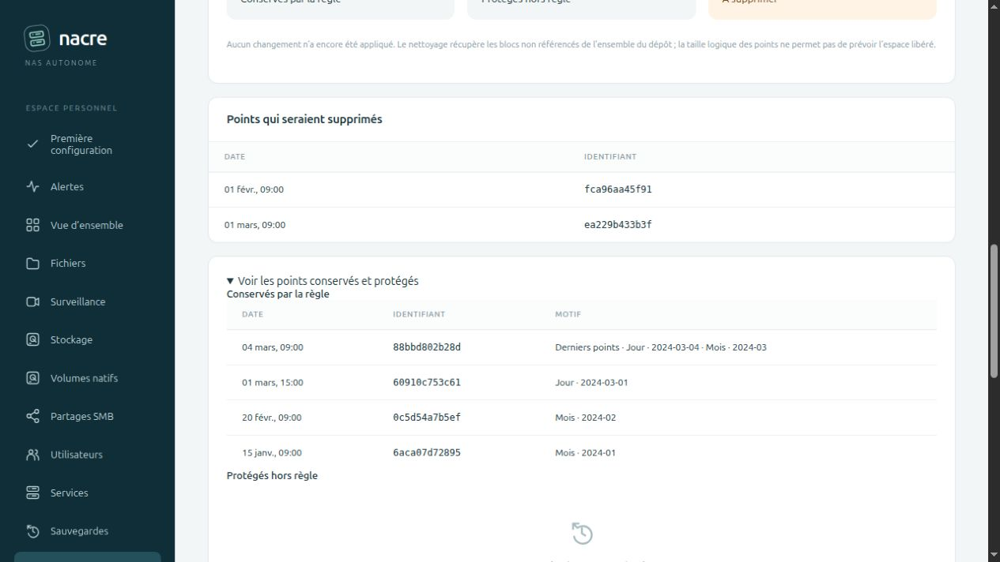

# Conserver des points par jour, semaine et mois

Depuis **0.8.0-alpha.10**, la règle « derniers points réussis » peut être complétée par des repères journaliers, hebdomadaires et mensuels. Le même calcul sert à la simulation, à l’application ponctuelle et à la rétention automatique après les prochaines captures réussies.

## Configurer depuis le navigateur

Dans **Snapshots → Gérer la rétention**, choisir le dépôt et le nombre de derniers points à conserver, puis ouvrir **Conservation par jour, semaine et mois**. Renseigner le nombre de périodes souhaitées et le fuseau, par exemple `America/Cayenne`, `Europe/Paris` ou `UTC`. Lancer **Simuler sans supprimer**, puis développer **Voir les points conservés et protégés** pour lire les motifs de conservation.

Les catégories calendaires sont à **0 par défaut**, ce qui les désactive. Le minimum d’un dernier point par groupe reste obligatoire. Une règle existante sans calendrier conserve son comportement. Changer le dépôt charge les valeurs de sa règle ; modifier un champ invalide la simulation affichée. Rien n’est appliqué par la seule saisie : il faut confirmer l’application ponctuelle ou l’activation automatique.

## Comment les points sont choisis

Chaque groupe de captures est traité séparément : plan ou capture manuelle, hôte, sources et options de configuration/vidéo. Seules les captures dont Nacre connaît la réussite peuvent être supprimées ; les captures importées, partielles, futures ou sans preuve locale restent protégées et ne consomment pas les périodes demandées.

Les protections s’ajoutent :

| Réglage | Points conservés par groupe |
| --- | --- |
| Derniers points : N | Les N captures réussies les plus récentes |
| Jours : J | Le dernier point de chacun des J derniers jours contenant une capture réussie |
| Semaines : S | Le dernier point de chacune des S dernières semaines ISO contenant une capture réussie, du lundi au dimanche |
| Mois : M | Le dernier point de chacun des M derniers mois contenant une capture réussie |

Un point peut satisfaire plusieurs catégories ; il ne figure qu’une fois dans la liste des points conservés. La simulation affiche ses motifs, comme « Derniers points », « Jour · 2024-03-04 », « Semaine ISO · 2024-W10 » ou « Mois · 2024-03 ».

**Il s’agit d’un nombre de périodes contenant des captures, pas d’un âge maximal.** Les périodes vides sont ignorées : trois mois demandés peuvent donc conserver un point très ancien si aucune capture n’existe entre les mois représentés. Ce réglage ne crée aucune sauvegarde manquante et ne garantit pas une capture tous les jours.

## Fuseau et confirmation

Le fuseau détermine les limites des jours, semaines et mois. Il est enregistré avec la simulation et la règle, indépendamment des changements ultérieurs du fuseau d’affichage de la console. Le classement des points utilise leur instant réel, y compris pendant une heure répétée au changement d’heure. Les semaines utilisent l’année ISO, qui peut différer de l’année civile début janvier ou fin décembre. La conversion repose sur les données de fuseaux du système via [ZoneInfo de Python](https://docs.python.org/3/library/zoneinfo.html).

La confirmation utilise les paramètres de la simulation enregistrée. Un client ne peut pas remplacer les nombres ou le fuseau en envoyant d’autres champs lors de l’activation. Pour modifier une règle, refaire une simulation puis confirmer. Les protections existantes demeurent : confirmation à usage unique et limitée dans le temps, vérification du dépôt et des points, suspension sur incident et désactivation lors d’une reprise de NAS.

## Vérifications et limites

Les essais portent sur des fichiers synthétiques et des dépôts chiffrés isolés. Ils couvrent les périodes vides, le cumul des catégories, les fuseaux, les semaines ISO, le changement d’heure, la compatibilité avec les anciennes règles, l’application ponctuelle et automatique ainsi que la restauration exacte d’une version historique après nettoyage. Le banc navigateur vérifie le formulaire, les motifs et la confirmation ; la proposition issue du navigateur est ensuite appliquée par l’API HTTP du banc, suivie d’une restauration historique exacte. Il montre six captures réparties sur trois mois : avec un dernier point, deux jours et trois mois, quatre points restent conservés et deux sont proposés à la suppression.

L’exécution automatique reste déclenchée par une nouvelle capture réussie, avec un [créneau quotidien optionnel](MAINTENANCE-WINDOW.md) depuis alpha.11. Aucun plafond de taille de fichier ou de sauvegarde n’est ajouté. Les nombres de périodes ne constituent pas un quota de stockage ; les données dédupliquées empêchent de déduire l’espace libéré de la taille logique des points.

Cette publication et l’aperçu local ne déploient pas la version sur Spark.
