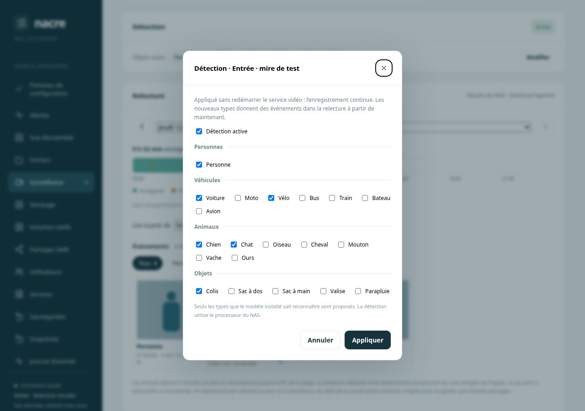

# Détection et objets suivis par caméra

Depuis **0.8.0-alpha.22**, la fiche d’une caméra dans **Surveillance** comporte une carte **Détection**. Elle indique si la détection est active et quels types d’objets Frigate suit pour cette caméra. Un administrateur peut activer ou mettre en pause la détection et choisir les types suivis, sans redémarrer le service vidéo : l’enregistrement continue.

Capture réalisée sur un banc local : console réelle, service vidéo simulé, mire et vignettes synthétiques.

## Utiliser

1. Ouvrir **Surveillance**, puis la caméra.
2. La carte **Détection** montre l’état appliqué par Frigate au moment de l’ouverture ou de l’actualisation de la page : **Active** ou **En pause**, et les types suivis.
3. **Modifier** (administrateurs) ouvre le réglage : une case **Détection active** et les types proposés, regroupés en personnes, véhicules, animaux et objets.
4. **Appliquer**. Le message de confirmation n’apparaît qu’une fois le réglage relu dans l’état de Frigate.

Les événements des nouveaux types apparaissent dans la [relecture](RECORDING-PLAYBACK.md) à partir de ce moment ; le filtre par type s’y affiche dès qu’un jour compte au moins deux types. Les événements déjà enregistrés d’un type retiré restent consultables.

## Ce que fait Nacre

- **Types proposés.** Seuls les types d’une liste utile à la surveillance que le modèle de détection installé sait reconnaître sont proposés. Un type déjà suivi hors de cette liste reste affiché pour pouvoir être retiré. Au moins un type doit rester coché.
- **État affiché.** C’est celui que Frigate applique, pas celui du fichier de configuration : une détection activée depuis Frigate apparaît donc active.
- **Enregistrement du réglage.** La configuration complète est d’abord validée par Frigate. Nacre conserve une copie privée de la précédente (`config-avant-detection.yml` dans son répertoire d’état), puis écrit lui-même le fichier.
- **Application sans redémarrage.** Les types suivis sont transmis à Frigate par sa mise à jour de configuration en mémoire ; chaque nouveau type reçoit les seuils par défaut qu’il aurait au démarrage. L’activation ou la pause passe par la commande de détection de Frigate, qu’il mémorise et rejoue à son prochain démarrage.
- **Confirmation.** Nacre relit l’état de Frigate jusqu’à y retrouver le réglage, filtres compris. Sinon il le dit et l’inscrit au journal ; il n’annonce jamais un réglage non relu.
- **Journal d’activité.** Chaque réglage y est inscrit avec la caméra, l’état et les types.

## Messages

| Message | Signification |
| --- | --- |
| Indisponible | Le service vidéo n’a pas fourni son état. Rien n’est supposé. |
| Détection en pause | La caméra enregistre, mais aucun événement n’est créé. |
| Frigate n’a pas accepté ce réglage. Rien n’a été modifié. | La validation a échoué ou le service vidéo est arrêté. |
| Frigate n’a pas appliqué ce réglage. La configuration précédente est rétablie. | Le fichier a été remis dans son état d’avant. |
| Réglage enregistré, mais son application par Frigate n’est pas confirmée. | Le fichier contient le réglage ; l’état relu ne le montre pas encore. Actualiser avant toute nouvelle action. |
| Aucun changement | Le réglage demandé est déjà enregistré et appliqué. |

## Limites

- La confirmation porte sur l’état annoncé par Frigate. Elle ne prouve pas qu’un objet du nouveau type sera reconnu : cela dépend du modèle, de la scène et de la résolution de détection.
- Pas de réglage des seuils, des zones, des masques ni de la résolution de détection. Les alertes de Frigate gardent leurs propres types.
- Activer la détection consomme du processeur ; Nacre ne mesure pas cette charge avant d’appliquer.
- Le choix se fait caméra par caméra ; pas de réglage commun à toutes.
- L’application en mémoire dépend de la version de Frigate fournie avec Nacre (0.18.2). Frigate ne sait pas enregistrer lui-même un fichier au format qu’écrit Nacre : c’est pourquoi Nacre reste le seul rédacteur du fichier.
- Si la détection a été basculée depuis Frigate, sa mémoire d’état prime sur le fichier au redémarrage. Un réglage appliqué depuis Nacre aligne les deux.

## Validation

Huit tests Python sur service vidéo simulé : état limité aux types connus et sans secret, réponses malformées, écriture du fichier et copie privée, absence de redémarrage, filtre par défaut pour chaque type, bascule par la commande de Frigate, choix invalides, validation ou application refusée avec fichier rétabli, application non confirmée, tâche en cours. Trois tests JavaScript : carte sans style en ligne et valeurs échappées, fiche maintenue sans état de détection, formulaire et envoi du choix.

Parcours navigateur sur banc local, en largeur d’ordinateur et de téléphone : ajout et retrait de types, mise en pause, reprise, refus d’une sélection vide.

Sur l’installation de développement, avant d’écrire le code : lecture du code de Frigate 0.18.2 et répétitions hors service, dans son conteneur, sur une copie temporaire de la configuration. Elles ont montré que Frigate refuse d’enregistrer un fichier au format de Nacre, que la mise à jour en mémoire remplace bien la liste et qu’un type ajouté sans filtre ferait échouer le suivi, d’où le filtre par défaut transmis. Un essai sur un second Frigate réel, temporaire, sans réseau ni caméra, a ensuite exercé le code de Nacre : il a montré que Frigate ignore un filtre vide, corrigé avant toute mise en service. Ajout, retrait, pause, reprise et réglage rejoué y ont ensuite été confirmés, avec des seuils identiques à ceux d’un démarrage et le même état après redémarrage de ce moteur d’essai. Aucune image n’y circulait : cet essai ne prouve pas la reconnaissance d’objets. Sur l’installation de développement, après mise à jour : un type ajouté puis retiré sur la caméra réelle, deux réglages confirmés en 9 secondes chacun, Frigate non redémarré, enregistrement continu et aucune erreur dans ses journaux. La bascule de la détection n’y a pas été exercée et aucun objet du type ajouté n’est passé pendant l’essai. [Compte rendu](SPARK-DEPLOYMENT.md).
