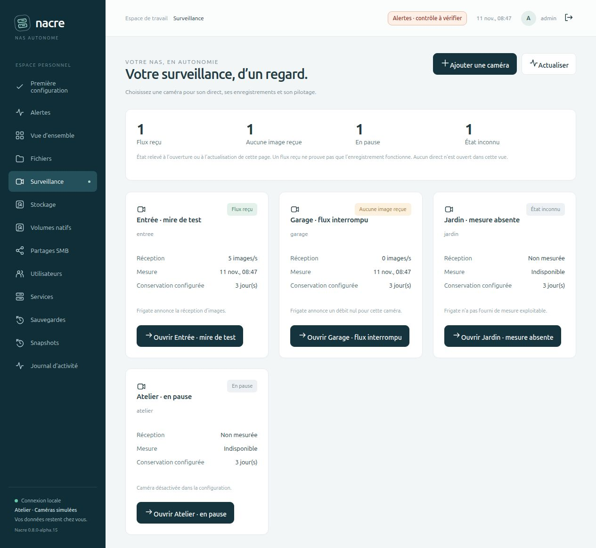
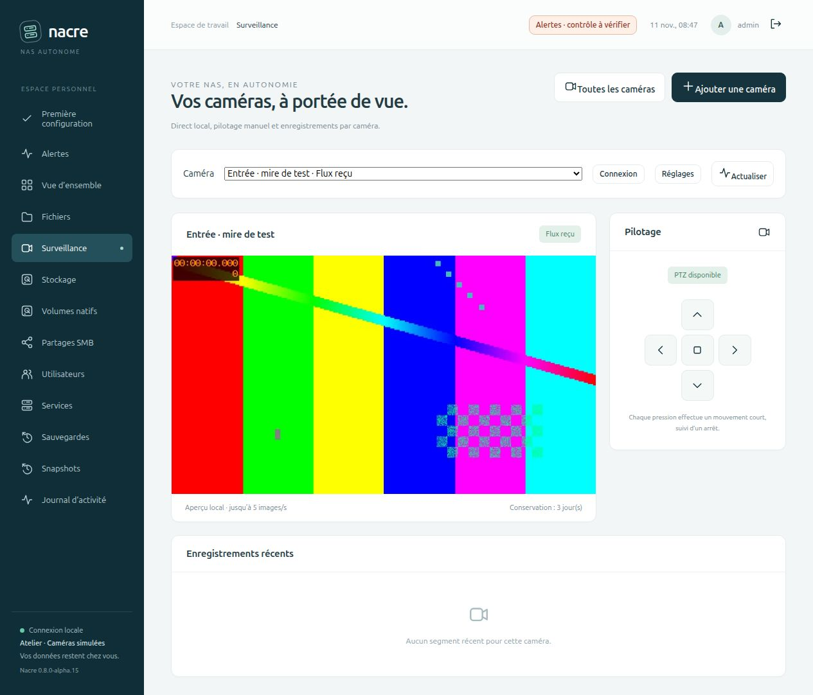

# Voir toutes les caméras

Depuis **0.8.0-alpha.15**, **Surveillance** s’ouvre sur un inventaire des caméras configurées. Les compteurs et les cartes permettent de repérer les flux à examiner, sans ouvrir plusieurs vidéos en parallèle.

## Comprendre les états

| État | Ce que Nacre a observé |
| --- | --- |
| **Flux reçu** | Frigate annonce un débit d’images strictement positif pour cette caméra active. |
| **Aucune image reçue** | Frigate annonce un débit nul pour cette caméra active. Ce constat ne désigne pas la cause de la coupure. |
| **En pause** | La caméra est désactivée dans la configuration, même si une ancienne mesure annonce encore des images. |
| **État inconnu** | Le service n’a pas répondu, la caméra est absente des mesures ou son débit n’est pas exploitable. Nacre n’en déduit pas une panne de caméra. |

Depuis alpha.16, la page affiche le débit confirmé par un échantillon récent, la date de cet échantillon Frigate et la durée de conservation configurée. Une mesure de plus de 90 secondes devient **Mesure périmée** ; un horodatage absent ou incohérent reste inconnu. Cette date n’est **pas** la date de dernière image ni un historique de disponibilité. [Correction de fraîcheur](VIDEO-FRESHNESS.md). **Actualiser** relit les mesures ; la vue d’ensemble reste manuelle. Le direct sélectionné vérifie son état toutes les 15 secondes et retire l’image si le flux n’est plus confirmé.

Un débit positif ne prouve ni la qualité des images ni le bon fonctionnement de l’enregistrement. La conservation affichée est un réglage, pas un inventaire des vidéos effectivement présentes.

## Ouvrir une caméra

**Ouvrir [nom]** affiche le direct de la seule caméra sélectionnée, la [relecture de ses enregistrements par jour](RECORDING-PLAYBACK.md) (depuis alpha.20, à la place des derniers segments ; événements en vignettes depuis alpha.21), sa [détection et ses objets suivis](CAMERA-DETECTION.md) (depuis alpha.22) et son pilotage disponible. Le sélecteur permet d’en choisir une autre. **Toutes les caméras** revient à l’inventaire et retire immédiatement le direct de la page. Les réponses arrivées après un changement de vue, de caméra ou de session ne peuvent pas réouvrir l’ancien direct.

Une caméra en pause conserve l’accès à ses enregistrements ; ses commandes PTZ restent désactivées. Les comptes en lecture seule peuvent consulter les caméras, mais n’accèdent ni aux réglages ni aux commandes de pilotage. L’inventaire ne transmet pas d’adresse RTSP, d’identifiant de connexion ou de secret ONVIF.

## Validation isolée

Le banc utilise quatre caméras fictives et un serveur vidéo HTTP local : débit positif, débit nul, mesure absente et caméra désactivée avec une ancienne mesure positive. La mire de couleur est générée localement ; aucune image réelle n’est publiée.

Le parcours navigateur contrôle l’inventaire sans vidéo, l’ouverture d’un unique flux de mire, le retour à la liste puis le passage du débit nul à un débit positif après actualisation. Le journal du serveur témoin confirme qu’aucune vidéo n’a été demandée pour les autres caméras et qu’aucune commande PTZ n’a été envoyée. Aucune tâche créée, aucun appel Docker ni connexion à la Tapo.

Les tests HTTP couvrent les quatre états, les mesures invalides et les erreurs du service, les permissions, le catalogue vide et l’absence de secrets ou de modification de configuration. Les tests JavaScript contrôlent les réponses concurrentes, la navigation, le direct unique, le retour à la liste, les textes échappés, le compte lecteur et le comportement à la mise en arrière-plan.

Cette livraison qualifie le parcours d’administration multi-caméra avec des sources simulées. Elle ne mesure pas la charge de plusieurs caméras réelles, la capacité d’enregistrement ni la compatibilité de nouveaux modèles.
