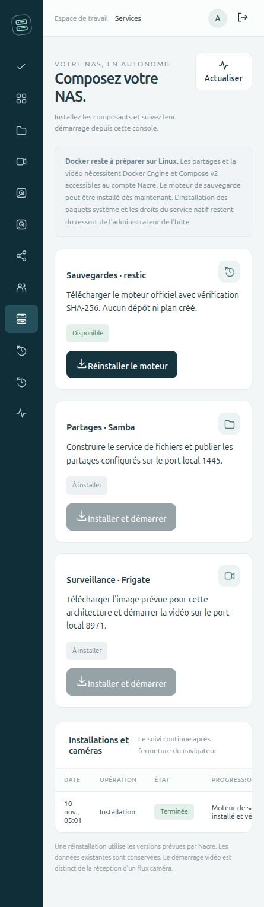
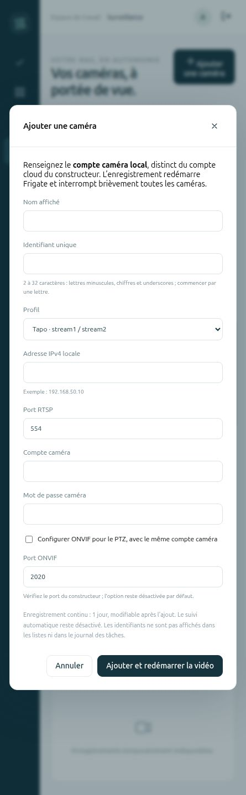

# Composants et caméras depuis le navigateur

La version **0.8.0-alpha.1** ajoute les composants applicatifs à la page **Services** et la gestion des connexions à **Surveillance**. Ces actions nécessitent un compte administrateur.

 

*Captures réelles du navigateur intégré sur une instance locale distincte. Le moteur restic a été installé dans son répertoire de test. Les caméras du banc sont fictives ; aucune image ni identité de la caméra de production n’est utilisée.*

## Installer les composants

Dans **Services**, choisir un composant et confirmer son installation. La tâche présente les étapes et son résultat ; elle continue dans un processus séparé après fermeture du navigateur. Les versions sont celles prévues par le code Nacre, pas une mise à jour arbitraire vers la dernière version Internet.

| Composant | Action disponible | Prérequis |
| --- | --- | --- |
| restic | Téléchargement officiel, vérification SHA-256 et installation dans `.tools` | Linux x86-64/ARM64, accès Internet et espace disponible |
| Samba | Construction de l’image du dépôt, démarrage et application des partages configurés | Docker Engine et Compose v2 accessibles au compte Nacre |
| Frigate | Téléchargement de l’image prévue pour l’architecture, démarrage et contrôle de santé | Docker Engine et Compose v2 accessibles au compte Nacre |
| Docker et service natif | Diagnostic et indication de la préparation nécessaire | Installation et autorisation explicites par l’administrateur Linux |

La console n’exécute ni `sudo`, ni commande libre provenant du navigateur. Elle ne peut pas installer les paquets système avec ses droits utilisateur. Le service natif conserve sa politique de disques séparée. Les ports des services restent liés à l’interface locale, comme dans le déploiement existant.

Aucun dépôt ou plan de sauvegarde n’est créé. Une image Samba récupérée est conservée au lieu d’être reconstruite. Le résultat « démarrage confirmé » exige un service en cours d’exécution ; Frigate doit aussi annoncer un état sain. Un téléchargement ou démarrage interrompu n’est pas rejoué automatiquement. Les tâches d’installation ne proposent pas d’annulation en cours d’exécution depuis l’interface.

## Ajouter une caméra

1. Installer et démarrer **Frigate** dans Services.
2. Dans **Surveillance**, cliquer sur **Ajouter une caméra**.
3. Choisir un nom et un identifiant unique. Fournir l’adresse IPv4 privée, le port RTSP, le compte caméra local et son mot de passe.
4. Choisir **Tapo** pour les chemins `/stream1` et `/stream2`, ou **RTSP** pour les chemins du constructeur. Le flux secondaire est optionnel pour RTSP.
5. Activer ONVIF uniquement si la caméra le prend en charge et indiquer son port. Ce parcours utilise le même compte pour RTSP et ONVIF ; les comptes distincts ne sont pas encore exposés.
6. Confirmer l’enregistrement et le redémarrage de Frigate. Cette opération interrompt brièvement toutes les caméras du service.

La nouvelle caméra enregistre en continu avec une conservation d’un jour, modifiable dans **Réglages**. La détection reste désactivée à l’ajout ; elle s’active ensuite, avec le choix des objets suivis, dans la carte [Détection](CAMERA-DETECTION.md). Le suivi automatique PTZ reste désactivé. Frigate valide la configuration avant publication. La disponibilité du flux est présentée séparément de l’acceptation de la configuration : un compte incorrect ne doit pas être présenté comme une caméra en ligne.

Le sélecteur choisit la caméra utilisée pour le direct, les enregistrements, les clips, les presets et le PTZ. Le pilotage n’est proposé que lorsque le moteur annonce la capacité correspondante. Le tableau de bord utilise une caméra disponible dans les statistiques au lieu d’imposer le nom `tapo`.

## Corriger une connexion

Sélectionner la caméra puis **Connexion**. Renseigner à nouveau son adresse, son profil et ses identifiants : ils ne sont pas préremplis depuis le serveur. Son identifiant, les enregistrements, la durée de conservation et son état actif/en pause sont conservés. La modification d’un flux partagé par une autre caméra est refusée pour éviter de changer indirectement sa connexion.

**Réglages** continue de contrôler l’activation et la durée de conservation. Il n’y a pas de suppression de caméra ni de ses vidéos dans ce nouveau parcours.

## Données et erreurs

- Liste blanche d’opérations, session administrateur, contrôle d’origine et CSRF.
- Les secrets temporaires sont enregistrés en fichier privé `0600`, sous le répertoire privé de console. Les options de tâche ne contiennent qu’un identifiant opaque. Les listes de caméras ne renvoient ni URL RTSP, ni adresse, ni compte ONVIF.
- Le fichier temporaire est effacé en fin de tâche, à l’annulation avant exécution ou quand la reprise détecte un worker interrompu. Une copie privée de l’ancienne configuration est conservée avant remplacement ; elle contient donc aussi ses anciens secrets et doit rester protégée.
- Une configuration refusée par Frigate laisse le fichier courant inchangé. Un changement externe détecté pendant la validation empêche son remplacement.
- Si le redémarrage échoue après enregistrement, la tâche l’indique explicitement et conserve la copie précédente. Aucun retour arrière automatique n’est annoncé. Contrôler Services et la configuration avant de relancer ; une reprise manuelle peut nécessiter l’administrateur de l’hôte.
- Les autres mutations de services, de partages et de configuration caméra sont suspendues pendant une tâche de déploiement. Une édition externe manuelle ne doit pas être faite en parallèle.
- Les formulaires sensibles utilisent POST même si le JavaScript ne s’exécute pas. Le traitement des formulaires ne dépend plus de la propriété `form.id`, qu’un champ nommé `id` peut masquer.

## Validation et périmètre

**126 tests Python et 8 JavaScript**, avec tests de permissions, collisions de noms, conservation des configurations existantes, connexion par caméra, erreurs avant et après publication, interruption sans rejeu, préservation d’une image Samba récupérée et refus d’annoncer un Frigate non sain comme prêt.

Essais exécutés pour cette version :

- Installation réelle de restic 0.19.1 depuis le navigateur dans un répertoire temporaire, avec suivi conservé après actualisation ; aucun dépôt ni plan créé.
- Ajout de caméra fictive envoyé par POST ; Frigate absent produit une erreur lisible sans remplacer la configuration. Le défaut initial de soumission GET, découvert avec des données fictives, est corrigé et couvert par une régression.
- Deux caméras fictives chargées comme fixtures : sélection, affichage d’état hors ligne et ouverture du formulaire de correction.
- Deux configurations contenant chacune deux caméras (Tapo puis RTSP, ONVIF optionnel) validées par le vrai Frigate 0.18.2 ARM64, dans un conteneur éphémère sans réseau, sans volume de production et sans redémarrage des services existants.

À ce jalon 0.8.0-alpha.1, le téléchargement/démarrage complet de Samba et Frigate était couvert par simulation. Il est désormais vérifié sur Linux ARM64 neuf dans le [banc 0.8.0-alpha.2](FRESH-WEB-INSTALL.md). Ce jalon ne mesure ni la charge multi-caméra, ni la compatibilité d’autres modèles, ni la reconnexion de caméras réelles. Adresses IPv4 privées seulement ; pas de découverte automatique, de résolution de noms ou d’IPv6. Le PTZ reste dépendant des capacités du constructeur.

Références du moteur : [configuration des caméras](https://docs.frigate.video/configuration/cameras/), [schéma ONVIF de Frigate 0.18.2](https://github.com/blakeblackshear/frigate/blob/v0.18.2/frigate/config/camera/onvif.py). Les capacités d’une documentation plus récente ne sont pas assimilées à celles de l’image épinglée par Nacre.
