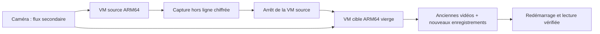

# Écritures en reconstruction et reprise vidéo ARM64

> **0.7.0-alpha.3 · Ubuntu 24.04 ARM64 dans deux VM QEMU/KVM successives.**
> Données de test et disques images pour le stockage ; lecture du flux secondaire d’une Tapo C530WS pour la vidéo. Aucun disque bloc de l’hôte n’est présenté aux VM.

## Ce que cette recette mesure

| Parcours | Contrôle |
| :--- | :--- |
| Reconstruction RAID1 Btrfs | 24 fichiers par HTTP authentifié, 24 par Samba, 24 en écriture locale, pendant `sync_action=recover` |
| Intégrité | 72 fichiers de 512 Kio, soit 36 Mio ; SHA-256 après reconstruction puis redémarrage normal |
| Snapshot antérieur | Témoin identique et absence des fichiers créés après sa capture |
| Accès | Compte Samba désactivé refusé ; partage en lecture seule non inscriptible |
| Vidéo source | Générateur synthétique, puis vraie caméra : direct, image JPEG, segments et clip décodé |
| Reprise vidéo | Configuration et fichiers privés conservés ; deux anciens segments comparés par SHA-256 et retrouvés dans l’index |
| Nouvelle cible | Linux ARM64 vierge, sans anciennes images ni volumes Docker, source arrêtée avant son démarrage |
| Après reprise | Connexion web, comptes Samba, clé du dépôt historique, nouveaux enregistrements et lecture d’un ancien clip ; vérifications vidéo après redémarrage |

## Trois corrections issues des essais

**Accès au miroir pendant sa reconstruction.** Le catalogue passait en phase `repairing` et la console cessait de publier le volume. Les accès HTTP et Samba perdaient alors leur destination. Nacre conserve désormais la ressource lorsque la politique, le journal, le montage, les UUID, la géométrie MD et les deux membres sont vérifiés. Un membre absent, étranger ou défaillant, ou un résultat incertain, empêche sa publication. Le contrôle ne lance aucune commande de réparation.

Les premières répétitions ont également révélé l’état transitoire MD `write-pending` au début d’une écriture. Il est reconnu avec les mêmes vérifications d’identité ; le noyau gère l’attente des écritures. Un état explicitement `readonly` ou un montage en lecture seule n’est pas exposé en écriture. La répétition finale utilise ces corrections dès le départ : les 72 opérations sont acquittées pendant la reconstruction, entre **6,25 % et 12,51 %** de progression.

**Fichiers privés de Frigate.** Le runtime crée notamment `.jwt_secret` en `root:0600`, illisible par le compte de console. Une simple sauvegarde restic lancée sous ce compte ne suffit donc pas. La capture hors ligne vérifie les montages du conteneur vidéo, récupère `/config` via Docker dans une archive privée et l’intègre au point chiffré. Elle ne change pas les permissions des fichiers en service.

Le kit vidéo utilise le **format 2**, avec empreinte SHA-256 de l’archive et refus des liens, chemins traversants, doublons normalisés et fichiers spéciaux. La préparation restaure les UID/GID et modes via un conteneur auxiliaire **jamais démarré**, sans réseau, dont seul le nouveau dossier vidéo est monté en écriture. Les anciens kits de format 1 restent lisibles. Un kit de format 2 nécessite cette version ou une version ultérieure compatible.

**Droits de la racine d’un volume récupéré.** Une restitution `snapshot:sous-dossier` conservait les fichiers, mais la nouvelle racine créée en `0700` gardait ce mode et bloquait les comptes Samba secondaires. La préparation lit maintenant les métadonnées du dossier dans le point restic, puis réapplique ses UID/GID et permissions, y compris les bits spéciaux, exclusivement à la nouvelle destination. La répétition finale repart d’une VM cible vierge. Les ACL/xattrs restent une qualification distincte. La conversion des bits de mode s’appuie sur le [format FileMode de Go](https://pkg.go.dev/io/fs#FileMode), exposé par la sortie JSON restic.

## Environnement et déroulement

- Ubuntu Minimal 24.04 ARM64 officiel ; empreinte de base `3dc8370d923978d4b610fa7964d1b36ba040eefb43198809ca5bc8ac51777b18`.
- QEMU 8.2.2 Ubuntu, KVM ARM64, 2 vCPU et 3 Gio par VM ; une seule VM du banc active à la fois.
- Trois images de données de 2 Gio, séries `NACRE-V08-A/B/C`, `cache=none`. Le disque de remplacement est limité à 16 Mio/s pour observer les écritures pendant la reconstruction.
- Image Frigate ARM64 0.18.2 épinglée par digest dans `platform_config.py`. Décodage CPU, détection d’objets désactivée, caméra nommée `tapo`, flux secondaire uniquement.
- Identifiants web/Samba synthétiques pour le banc. Le compte local existant de la caméra est repris dans un fichier privé ; aucune réinitialisation, rotation PTZ ni modification de ses réglages.

Le générateur synthétique utilise FFmpeg/go2rtc dans la VM. L’option permettant la source `exec` est limitée à une surcharge Compose du banc, retirée lors du passage à la caméra réelle. Elle n’est ajoutée ni au produit ni au profil récupéré.

La source est préparée avec `integration_fresh_linux_vm.py`. Le scénario `integration_concurrent_io_vm.py` injecte la perte d’un membre **uniquement après vérification des séries des disques virtuels**, lance les trois producteurs, attend la fin de reconstruction et compare les fichiers. Son mode `--after-reboot` revérifie les données et services.

`integration_camera_arm64_vm.py` vérifie les phases `synthetic`, `source`, `target` et `reboot`. Il contrôle le moteur ARM64, les images reçues, les entrées de l’index et le décodage de dix images d’un segment et d’un clip servi par Nacre. Aucune image de la caméra n’est affichée ou ajoutée à Git.

`integration_camera_recovery_vm.py capture` arrête les services de la VM source, exporte le catalogue natif et crée le point chiffré. Après transfert privé du kit et arrêt de cette VM, son mode `restore` prépare une seconde VM vierge : clés, comptes, SID Samba, données natives vers des dossiers ordinaires, configuration et base vidéo. Les sessions sont révoquées et les plans automatiques restent désactivés. L’image vidéo est téléchargée à nouveau avec le digest épinglé.

Les scripts exigent `NACRE_VM_LAB=1` et une machine QEMU. Ils supposent les chemins et fixtures documentés dans [FRESH-LINUX.md](FRESH-LINUX.md) et [POWER-CUT-LAB.md](POWER-CUT-LAB.md) : **ce ne sont pas des commandes d’exploitation à lancer sur un NAS réel**.

## Portée et limites

Ce scénario ne combine pas une coupure brutale avec des écritures en cours. Les [coupures en reconstruction](POWER-CUT-LAB.md) et les écritures concurrentes sont deux preuves distinctes. Un acquittement HTTP ou SMB n’est pas ici une promesse de conservation après perte d’alimentation ; les fichiers sont comparés après reconstruction et redémarrage normal.

La cible récupère les fichiers du pool dans des dossiers ordinaires ; la reconstruction d’un nouveau pool dispose de sa recette séparée. La compatibilité interarchitecture et le changement d’UID/GID ne sont pas qualifiés. Les VM ne couvrent ni les caches de contrôleurs physiques, ni le hotplug, ni l’endurance, ni les fortes charges multi-caméras/GPU. La reprise vidéo est qualifiée pour un flux Tapo secondaire sur ARM64 ; le PTZ n’est pas actionné pendant ces essais.

Les preuves structurées sont conservées dans [VALIDATION.json](../VALIDATION.json). Les images de VM, enregistrements réels, configurations privées, clés et archives de reprise restent hors du dépôt.

Références : [états MD — noyau Linux](https://docs.kernel.org/admin-guide/md.html), [stockage des enregistrements — Frigate](https://docs.frigate.video/configuration/record/), [restream et substitutions — Frigate](https://docs.frigate.video/configuration/restream/).
