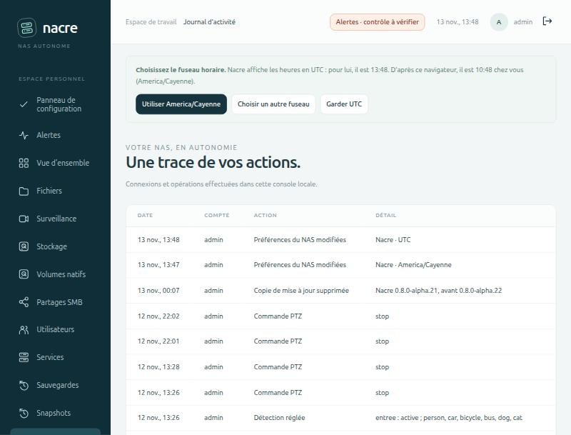

# Le panneau de configuration

Le **Panneau de configuration** remplace l’entrée « Première configuration » dans la navigation des administrateurs lorsque l’installation est terminée. L’assistant reste accessible par son adresse existante ; les nouvelles installations continuent de commencer par lui.

## Administrer au quotidien

Trois groupes donnent accès aux fonctions déjà disponibles :

- **Stocker et partager** : stockage, volumes et snapshots, partages SMB, comptes et permissions.
- **Protéger vos données** : sauvegardes, points de restauration et conservation.
- **Exploiter votre NAS** : services, caméras, alertes, notifications et journal d’activité.

Ces entrées ouvrent les pages correspondantes. Elles n’activent aucun service ni automatisme.

## Identité et horaires

L’administrateur peut modifier le nom affiché du NAS et le fuseau utilisé pour afficher les dates dans la console. Les changements persistent et sont consignés dans le journal. Le nom réseau Linux, l’horloge du serveur, les caméras et les fuseaux déjà enregistrés dans les calendriers ne sont pas modifiés.

Le champ du fuseau propose la liste des fuseaux géographiques connus du serveur : saisir une ville, par exemple Cayenne, la filtre. Sous le champ, Nacre affiche l’heure qu’il est dans le fuseau saisi et son décalage, pour vérifier le choix avant d’enregistrer. La saisie libre reste possible.

Le formulaire conserve la révision chargée. Si un autre onglet ou l’ancien assistant a enregistré des préférences entre-temps, Nacre refuse l’écrasement et conserve la saisie pour permettre sa vérification. Recharger la page permet de reprendre les préférences actuelles. L’actualisation des sessions ne recharge pas ce formulaire et ne perd pas sa saisie.

Une installation encore dans l’assistant doit d’abord terminer sa configuration. La page et ses API sont réservées aux administrateurs ; les écritures exigent la session et la protection CSRF habituelles.

## Fuseau horaire au premier accès

Une console installée avant l’assistant, ou dont le fuseau n’a jamais été choisi, affiche toutes ses heures en UTC : journal, sauvegardes, relecture des caméras. Tant que c’est le cas, un bandeau le signale aux administrateurs en haut de chaque page.

*Banc local à données synthétiques. Le journal est encore en UTC ; le navigateur est à l’heure de Cayenne.*

| Bouton | Effet |
| --- | --- |
| **Utiliser** le fuseau du navigateur | Enregistre ce fuseau. Les dates de la page sont redessinées aussitôt. |
| **Choisir un autre fuseau** | Ouvre le Panneau de configuration sur le champ du fuseau, sans rien enregistrer. |
| **Garder UTC** | Enregistre UTC comme un choix. |

Chaque choix est inscrit au journal (« Préférences du NAS modifiées ») et le bandeau ne revient pas, sur aucun navigateur. Le fuseau se modifie ensuite dans **Identité et horaires**.

Ce qu’il faut savoir :

- **La proposition vient du navigateur**, pas du serveur. Le fuseau système d’un serveur est souvent UTC ou hérité de son installation ; sur l’installation de développement il ne correspondait pas au lieu.
- **Sans proposition utile**, le bandeau n’offre que le choix dans la liste et UTC : navigateur lui-même en UTC, ou fuseau que le serveur ne connaît pas. Certains navigateurs annoncent un ancien nom (Asia/Calcutta) que les systèmes récents n’installent plus ; Nacre le dit et renvoie à la liste.
- **Les comptes en lecture seule ne voient pas le bandeau** : ils ne peuvent pas modifier les préférences.
- **Deux onglets** : si le fuseau est réglé ailleurs pendant que le bandeau est affiché, le clic n’écrase rien ; la console adopte le réglage existant.
- **Le fuseau ne change que l’affichage** et le découpage des jours de la relecture. L’horloge du serveur, les caméras et les calendriers de sauvegarde déjà enregistrés gardent leurs réglages.

### Noms de fuseau refusés

Le serveur refuse les fichiers techniques de sa base de fuseaux (`localtime`, `posixrules`, `Factory`, familles `posix/` et `right/`) : il sait les lire, mais aucun navigateur ne sait les afficher. Le navigateur refuse de son côté, avant l’envoi, un nom qu’il ne connaît pas. Si un tel nom est déjà enregistré, ou si un navigateur ancien ignore un fuseau récent, les dates s’affichent en UTC au lieu de bloquer toutes les pages.

## Sessions de la console

Le tableau indique le nombre de sessions **encore valides** pour chaque compte actif. Ce nombre ne prouve pas qu’une personne est actuellement connectée : fermer le navigateur ne termine pas nécessairement une session. Les sessions expirées et celles des comptes désactivés ne sont pas comptées comme valides. Aucun jeton, mot de passe, secret CSRF ou empreinte de session n’est exposé.

Après confirmation, **Déconnecter** révoque les sessions valides du compte choisi. Pour son propre compte, **Déconnecter les autres** conserve toujours la session qui effectue l’action. Nacre revalide les droits de cette session dans la transaction de modification.

La révocation prend effet aux prochaines requêtes authentifiées. Elle ne coupe pas les flux ou transferts déjà ouverts, ne change pas le mot de passe, n’empêche pas une nouvelle connexion et ne révoque pas les liens temporaires de connexion. Les comptes et connexions SMB restent distincts. Une désactivation de compte ou un changement de mot de passe reste disponible dans **Utilisateurs** selon le besoin.

## Validation et périmètre

Huit tests Python isolés couvrent les autorisations, les décomptes, l’absence de secrets, les révisions concurrentes, la persistance, les refus de validation et la révocation ciblée. Sept tests JavaScript supplémentaires couvrent les réponses tardives, l’expiration de session, l’échappement HTML, la conservation du formulaire et la sélection des sessions révocables.

Fuseau au premier accès (alpha.25) : trois tests Python sur HTTP et base temporaires (indicateur réservé aux administrateurs d’une console jamais réglée, « Garder UTC » enregistré, second onglet refusé, liste des fuseaux proposés, noms techniques refusés par les deux routes d’enregistrement) et sept tests JavaScript (repli sur UTC, contenu du bandeau selon le navigateur, enregistrement unique, refus du serveur, réglage fait ailleurs, réponses tardives, champ à liste et aperçu). Parcours navigateur sur le banc local en largeur d’ordinateur et de téléphone : les trois boutons, le journal redessiné dans le nouveau fuseau, la ligne de journal.

Le parcours navigateur a été exercé sur une base temporaire avec des comptes synthétiques : changement du nom et du fuseau, confirmation de déconnexion, refus de l’ancienne session et maintien de la session d’administration. Les tests ne changent aucun compte ni préférence de Spark. Cette étape ne fournit pas encore de sessions identifiées par appareil, de MFA ou d’administration de plusieurs NAS.
