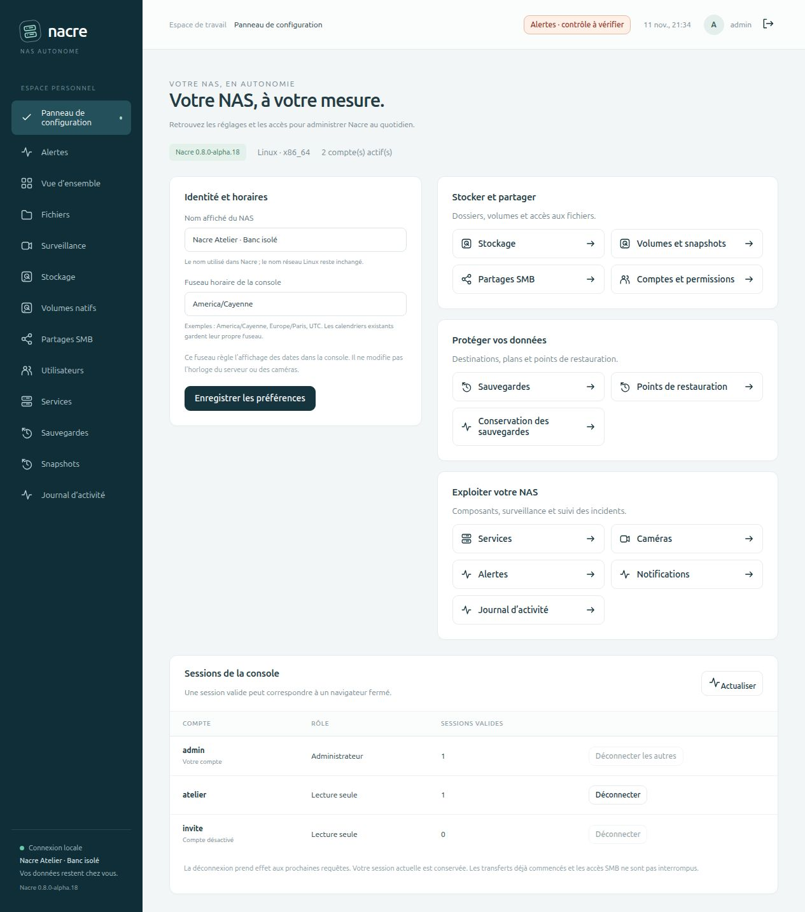

# Le panneau de configuration

Le **Panneau de configuration** remplace l’entrée « Première configuration » dans la navigation des administrateurs lorsque l’installation est terminée. L’assistant reste accessible par son adresse existante ; les nouvelles installations continuent de commencer par lui.

## Administrer au quotidien

Trois groupes donnent accès aux fonctions déjà disponibles :

- **Stocker et partager** : stockage, volumes et snapshots, partages SMB, comptes et permissions.
- **Protéger vos données** : sauvegardes, points de restauration et conservation.
- **Exploiter votre NAS** : services, caméras, alertes, notifications et journal d’activité.

Ces entrées ouvrent les pages correspondantes. Elles n’activent aucun service ni automatisme.

## Identité et horaires

L’administrateur peut modifier le nom affiché du NAS et le fuseau utilisé pour afficher les dates dans la console. Les changements persistent et sont consignés dans le journal. Le nom réseau Linux, l’horloge du serveur, les caméras et les fuseaux déjà enregistrés dans les calendriers ne sont pas modifiés.

Le formulaire conserve la révision chargée. Si un autre onglet ou l’ancien assistant a enregistré des préférences entre-temps, Nacre refuse l’écrasement et conserve la saisie pour permettre sa vérification. Recharger la page permet de reprendre les préférences actuelles. L’actualisation des sessions ne recharge pas ce formulaire et ne perd pas sa saisie.

Une installation encore dans l’assistant doit d’abord terminer sa configuration. La page et ses API sont réservées aux administrateurs ; les écritures exigent la session et la protection CSRF habituelles.

## Sessions de la console

Le tableau indique le nombre de sessions **encore valides** pour chaque compte actif. Ce nombre ne prouve pas qu’une personne est actuellement connectée : fermer le navigateur ne termine pas nécessairement une session. Les sessions expirées et celles des comptes désactivés ne sont pas comptées comme valides. Aucun jeton, mot de passe, secret CSRF ou empreinte de session n’est exposé.

Après confirmation, **Déconnecter** révoque les sessions valides du compte choisi. Pour son propre compte, **Déconnecter les autres** conserve toujours la session qui effectue l’action. Nacre revalide les droits de cette session dans la transaction de modification.

La révocation prend effet aux prochaines requêtes authentifiées. Elle ne coupe pas les flux ou transferts déjà ouverts, ne change pas le mot de passe, n’empêche pas une nouvelle connexion et ne révoque pas les liens temporaires de connexion. Les comptes et connexions SMB restent distincts. Une désactivation de compte ou un changement de mot de passe reste disponible dans **Utilisateurs** selon le besoin.

## Validation et périmètre

Huit tests Python isolés couvrent les autorisations, les décomptes, l’absence de secrets, les révisions concurrentes, la persistance, les refus de validation et la révocation ciblée. Sept tests JavaScript supplémentaires couvrent les réponses tardives, l’expiration de session, l’échappement HTML, la conservation du formulaire et la sélection des sessions révocables.

Le parcours navigateur a été exercé sur une base temporaire avec des comptes synthétiques : changement du nom et du fuseau, confirmation de déconnexion, refus de l’ancienne session et maintien de la session d’administration. Les tests ne changent aucun compte ni préférence de Spark. Cette étape ne fournit pas encore de sessions identifiées par appareil, de MFA ou d’administration de plusieurs NAS.
