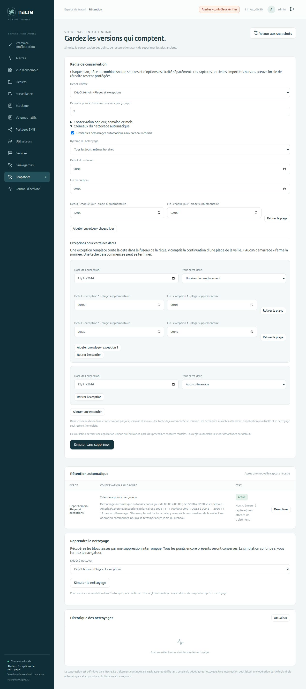

# Plusieurs plages et exceptions datées

Depuis **0.8.0-alpha.13**, Nacre propose plusieurs plages de démarrage dans une journée et des exceptions pour des dates précises. La configuration concerne la rétention automatique des sauvegardes. Les horaires de sauvegarde et de vidéosurveillance restent indépendants.

## Depuis le navigateur

Dans **Snapshots → Gérer la rétention → Créneaux du nettoyage automatique**, cocher la limitation et choisir le mode quotidien ou par jour de la semaine. **Ajouter une plage** complète les heures existantes ; **Retirer la plage** enlève une plage supplémentaire. En mode hebdomadaire, décocher un jour retire toutes ses plages de la prochaine simulation.

Dans **Exceptions pour certaines dates**, ajouter une date et choisir :

- **Aucun démarrage** : fermer la date entière aux nouveaux nettoyages automatiques.
- **Horaires de remplacement** : autoriser uniquement les plages indiquées pour cette date. Elles peuvent être multiples et passer minuit.

Lancer **Simuler sans supprimer**, examiner la sélection des points et le résumé complet, puis confirmer l’activation. Les horaires et exceptions sont enregistrés par la simulation ; modifier, ajouter ou retirer un élément invalide la proposition affichée. Le changement de dépôt recharge sa propre configuration et efface les champs de l’ancien dépôt. Les règles quotidiennes et hebdomadaires antérieures restent compatibles.

## Priorité et passage à minuit

Le calcul utilise la date et l’heure **dans le fuseau de la règle**, réglable dans « Conservation par jour, semaine et mois ». Les débuts sont inclus et les fins exclues. Les recouvrements sont réunis ; une même capture ne déclenche pas plusieurs nettoyages.

**Une exception remplace toute la date civile, y compris la continuation de la veille.** Une fermeture n’interrompt toutefois pas une tâche déjà commencée : elle interdit ses nouveaux démarrages.

| Configuration | Effet |
| --- | --- |
| Lundi 08:00–09:00 et 22:00–02:00 | Deux ouvertures ; la seconde continue mardi jusqu’avant 2 h |
| Mardi marqué « Aucun démarrage » | Aucun nouveau nettoyage mardi, même entre minuit et 2 h |
| Mardi remplacé par 10:00–11:00 et 15:00–16:00 | Seules ces deux plages ouvrent mardi ; les horaires habituels et la continuation du lundi sont ignorés |
| Exception du 31 décembre, 22:00–03:00 | Continue le 1er janvier avant 3 h, sauf si le 1er janvier possède sa propre exception |

Une date sans exception suit les horaires habituels et peut recevoir la continuation d’une exception de la veille. Une date fermée ne produit aucune continuation le lendemain. Les exceptions sont ponctuelles, année comprise : elles ne se répètent pas chaque année et ne sont pas supprimées automatiquement après leur date.

## Reprise, validation et limites

Les tâches attendent une plage autorisée et regroupent les captures réussies. Le contrôle horaire se répète sous verrou puis juste avant la première suppression. Un report conserve son identifiant après redémarrage. Une tâche ayant commencé peut terminer son nettoyage et son contrôle après la fermeture ; une interruption réelle reste un incident. Les applications ponctuelles et le nettoyage seul restent immédiats. [Détails de la reprise](MAINTENANCE-WINDOW.md).

La console doit fonctionner pour distribuer les tâches. Les créneaux limitent le démarrage sans garantir l’heure exacte ni la durée. La limitation doit être activée pour que ses plages et exceptions s’appliquent ; décocher la limitation autorise les démarrages sans restriction horaire.

Le moteur refuse les dates inexistantes, les dates répétées, les plages strictement identiques dans une journée et les débuts égaux aux fins. Les plages différentes qui se chevauchent sont acceptées. Une exception personnalisée doit avoir au moins une plage ; sinon choisir explicitement « Aucun démarrage ». Une configuration hebdomadaire sans jour est possible si une exception ouvre au moins une plage.

Pour borner la taille d’une règle, le format accepte 24 plages par journée et 366 exceptions datées. Ces bornes portent sur la configuration, pas sur la taille des fichiers ou des sauvegardes. Les jours fériés automatiques, exceptions annuelles et import de calendriers restent hors périmètre.

Le jour est calculé dans le calendrier local, sans ajouter 24 heures fixes : une heure manquante au changement d’heure n’est pas créée artificiellement, et une heure répétée ne rejoue pas les captures déjà traitées.

## Preuves isolées

Tests des multiples ouvertures et de leurs intervalles fermés, priorité des exceptions sur la veille, passage d’année, fuseaux, dates bissextiles, heures manquantes/répétées, validation avant accès au dépôt et compatibilité des règles existantes. Les tests d’interface couvrent la transmission des plages, l’ajout/retrait, les changements de dépôt, les résumés échappés et l’invalidation des simulations.

Un dépôt restic jetable vérifie une exception remplaçant une journée normalement ouverte, la fermeture juste avant la première suppression sans perte de point, le report après reprise, puis le nettoyage à la seconde plage avec contrôle intégral et restauration exacte. Aucune donnée ou règle de Spark n’est utilisée.

Banc navigateur séparé : formulaire et confirmation inspectés, activation par API authentifiée, deux nouvelles captures puis redémarrage réel de la console. L’exception bloque la continuation habituelle de la veille : quatre points restent intacts hors plage. À l’ouverture de la seconde plage de remplacement sur l’horloge réelle, une tâche traite les deux captures, conserve deux points et permet de restaurer le dernier fichier à l’identique. L’interface affiche zéro capture en attente et le nettoyage terminé. Ce banc et la publication ne déploient rien sur Spark.
