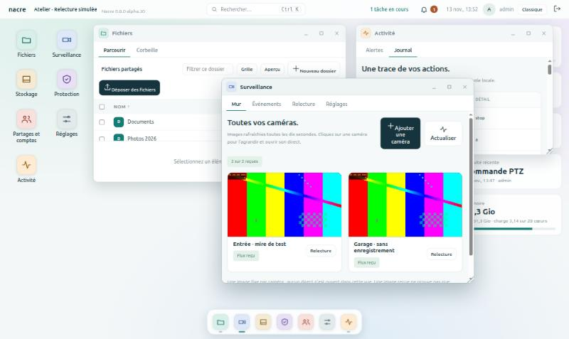
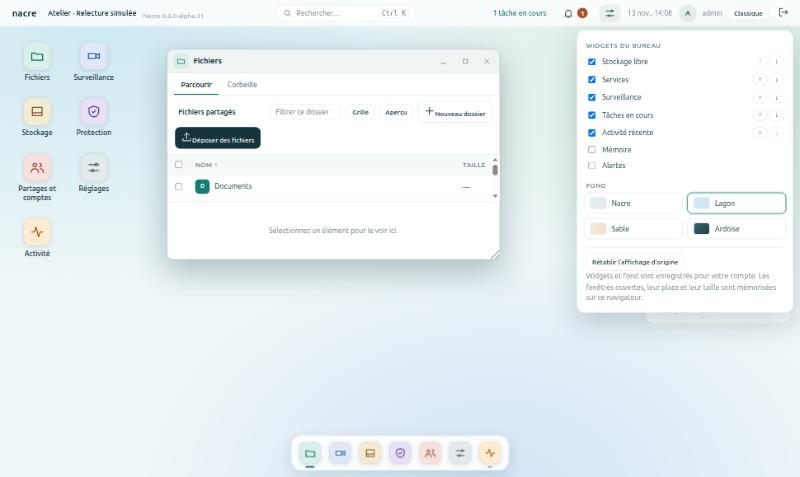
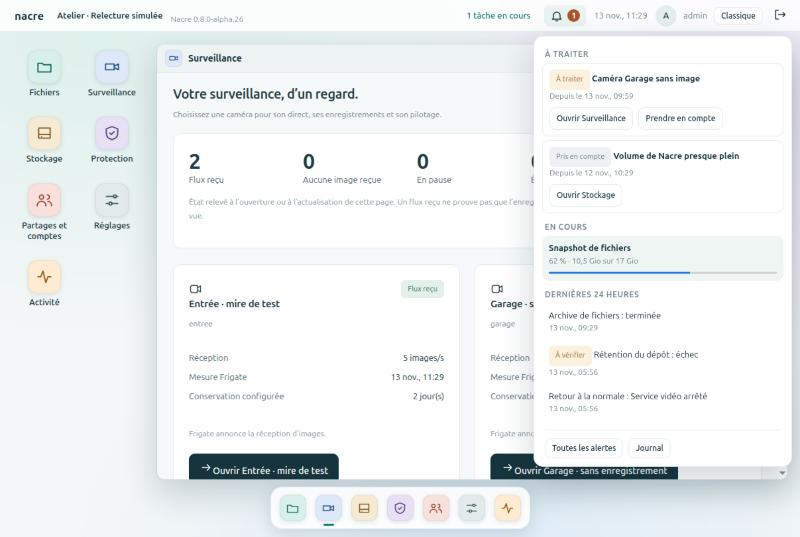
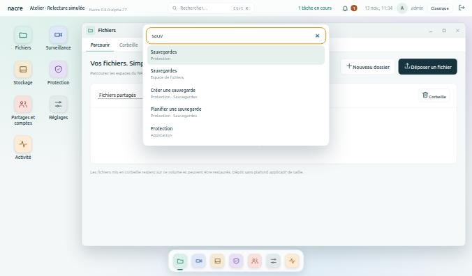
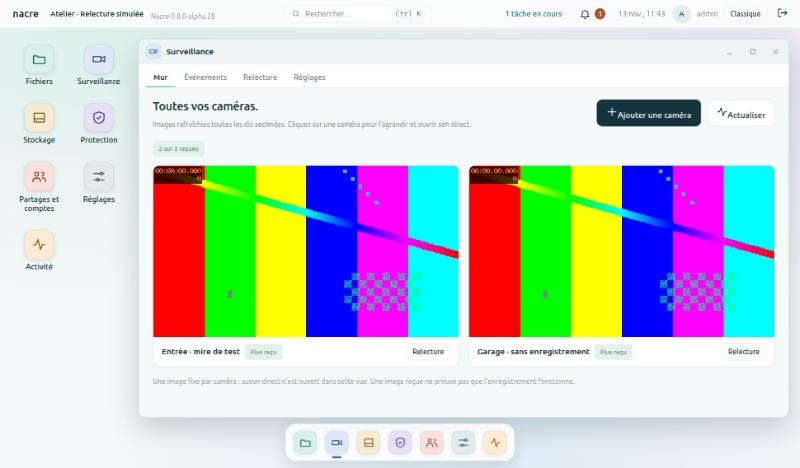
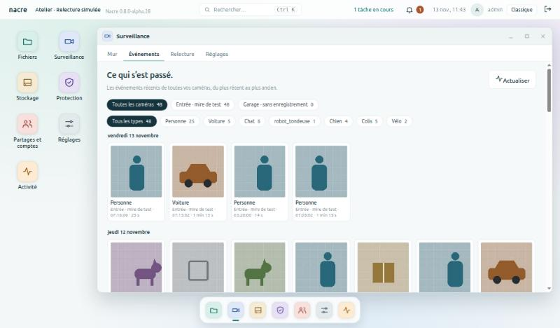
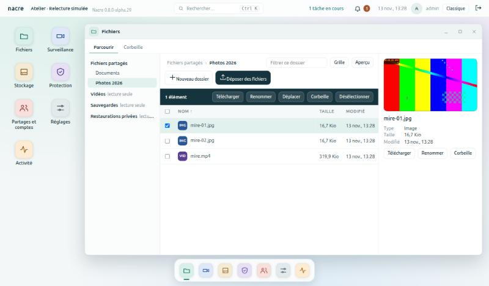

# Le Bureau

Depuis la version 0.8.0-alpha.26, Nacre s’ouvre sur un bureau, à la manière d’un système dans le navigateur. C’est la première étape d’un parcours en sept lots ; les pages de la console ne changent pas, seule leur organisation change.

*Banc local à données synthétiques : Fichiers, Surveillance et Activité ouvertes ensemble, le dock en bas.*

## Ce que l’on trouve

| Élément | Rôle |
| --- | --- |
| **Barre supérieure** | Le nom du NAS, les alertes, l’heure, le compte. Un clic sur « nacre » affiche le bureau. |
| **Icônes et dock** | Les sept applications. Un trait sous une icône du dock signale une application ouverte ; il est plus long et vert pour celle de devant. |
| **Widgets** | Stockage libre, services, surveillance, activité récente, mémoire. Un clic ouvre l’application concernée. |
| **Fenêtres** | Une par application, plusieurs à la fois. Chacune se déplace par sa barre de titre, se redimensionne par son coin, s’agrandit (bouton ou double-clic), se réduit ou se ferme. |
| **Onglets** | Les pages de l’application. Rouvrir une application réduite ramène au dernier onglet consulté. |

## Les sept applications

| Application | Onglets | Rubriques d’origine |
| --- | --- | --- |
| **Fichiers** | Parcourir, Corbeille | Fichiers |
| **Surveillance** | Caméras | Surveillance |
| **Stockage** | Disques, Volumes et snapshots | Stockage, Volumes natifs |
| **Protection** | Sauvegardes, Points de restauration, Conservation | Sauvegardes, Snapshots, Rétention |
| **Partages et comptes** | Partages, Utilisateurs | Partages SMB, Utilisateurs |
| **Réglages** | Général, Services, Mises à jour, Notifications | Panneau de configuration, Services |
| **Activité** | Alertes, Journal | Alertes, Journal d’activité |

La vue d’ensemble est devenue le bureau lui-même. Un compte en lecture seule ne voit pas les onglets réservés aux administrateurs.

## Plusieurs fenêtres

Depuis la version 0.8.0-alpha.31, chaque application s’ouvre dans sa propre fenêtre et plusieurs restent ouvertes ensemble.

| Geste | Effet |
| --- | --- |
| Clic sur une icône du bureau ou du dock | Ouvre l’application, ou ramène sa fenêtre devant. |
| Clic dans le dock sur l’application de devant | La réduit ; un nouveau clic la ramène. |
| Clic n’importe où dans une fenêtre | La met devant. |
| Glisser la barre de titre, ou le coin en bas à droite | Déplace, ou redimensionne. |
| Clic sur « nacre », en haut à gauche | Réduit tout et montre le bureau. |
| Fermer | Ferme cette application seulement ; elle repartira de sa première page. |

Une page demandée depuis une fenêtre et qui appartient à une autre application s’ouvre dans la fenêtre de celle-ci : un raccourci du panneau de réglages, le bouton « Ouvrir » d’une alerte, un résultat de la recherche.

Ce qu’il faut savoir :

- **Une fenêtre par application.** Deux dossiers côte à côte dans deux fenêtres Fichiers, ce n’est pas possible.
- **Chaque fenêtre est une console à part entière**, chargée dans un cadre : elle garde son état, ses rafraîchissements et ses boîtes de dialogue, qui restent à l’intérieur de sa fenêtre. Une application réduite continue de tourner, direct de caméra compris ; fermez-la pour l’arrêter.
- **Position et taille sont mémorisées par navigateur** depuis alpha.32 ; voir [Personnaliser le bureau](#personnaliser-le-bureau).
- **Sur téléphone**, une seule fenêtre est visible à la fois, en plein écran ; le dock fait passer de l’une à l’autre.
- **Session expirée ou préférences changées dans une fenêtre** : le bureau entier suit, et les autres fenêtres se rechargent pour prendre le nouveau fuseau.
- **Sécurité** : la console n’accepte d’être encadrée que par elle-même. Une page d’une autre origine ne peut toujours pas l’afficher dans un cadre.

## Personnaliser le bureau

Depuis la version 0.8.0-alpha.32, le bouton aux deux curseurs, à droite de la cloche, ouvre le panneau **Personnaliser**.

*Banc local à données synthétiques : fond Lagon, widget Tâches en cours ajouté.*

| Réglage | Effet |
| --- | --- |
| **Widgets du bureau** | Cocher pour afficher, décocher pour masquer ; les flèches changent l’ordre. Sept widgets au choix, dont Alertes et Tâches en cours. |
| **Fond** | Nacre, Lagon, Sable ou Ardoise. |
| **Rétablir l’affichage d’origine** | Revient aux cinq widgets de départ et au fond Nacre. |

Chaque changement s’applique et s’enregistre aussitôt.

Ce qu’il faut savoir :

- **Widgets et fond suivent le compte** : enregistrés sur le NAS, ils se retrouvent sur tout navigateur où ce compte se connecte. Chaque compte a les siens.
- **Les fenêtres suivent le navigateur** : applications ouvertes, place, taille, état agrandi ou réduit sont mémorisés sur ce poste et reviennent au rechargement. Une adresse qui demande une page précise l’ouvre devant, à côté des fenêtres retrouvées.
- **Un compte en lecture seule règle son propre bureau.** C’est la seule chose qu’il peut enregistrer ; le widget Alertes lui reste invisible.
- **Une fenêtre retrouvée est ramenée dans l’écran** si le navigateur est plus petit qu’au moment de l’enregistrement ; une page devenue inaccessible au compte est oubliée.
- **Ces réglages ne sont pas inscrits au journal** : ils ne changent que l’affichage.

Limites : pas de widget de caméra en image, pas de fond personnel ni d’icônes à déplacer, pas de disposition partagée entre navigateurs pour les fenêtres.

## Centre de notifications

Depuis la version 0.8.0-alpha.27, la cloche de la barre supérieure remplace le bouton d’alertes.

*Banc local : alertes, tâche et faits récents sont fictifs.*

| Repère | Signification |
| --- | --- |
| **Pastille chiffrée** | Nombre d’alertes à traiter. Un point d’exclamation signale que le contrôle des alertes n’est pas à jour. |
| **« n tâche(s) en cours »** | Affiché à gauche de la cloche tant qu’une sauvegarde, une restauration ou une installation tourne. |
| **À traiter** | Les incidents actifs. « Prendre en compte » agit comme dans la page Alertes, sans fermer le panneau ; « Ouvrir » mène à la page concernée. |
| **En cours** | Les tâches et leur progression. Un clic ouvre la page qui les détaille. |
| **Dernières 24 heures** | Tâches terminées, échecs à vérifier, incidents revenus à la normale. |

Quand une tâche vue en cours se termine, un message l’annonce en bas de l’écran, quelle que soit l’application ouverte. Le panneau se ferme par Échap, par un clic ailleurs ou en ouvrant une page.

Ce qu’il faut savoir :

- **Rafraîchissement toutes les dix secondes**, comme le reste de la console, et à chaque ouverture du panneau. Si une lecture échoue, le dernier état connu reste affiché.
- **Lecture seule** : les tâches sont visibles, pas les alertes ni leur prise en compte.
- **Prendre en compte ne répare pas** : l’incident reste actif tant que sa cause dure.
- **Rien n’est enregistré par la cloche** : pas de « lu / non lu », pas d’historique propre. L’annonce de fin de tâche ne vaut que pour le navigateur qui l’a vue en cours.
- **Pas de notification du système** (hors de l’onglet) ni de son. Les notifications externes par courriel ou webhook restent celles de Réglages → Notifications.

## Recherche globale

Depuis la version 0.8.0-alpha.28, la barre supérieure porte une recherche. Ctrl+K (ou Cmd+K) l’ouvre depuis n’importe où.

*Banc local à données synthétiques.*

| On tape | On obtient |
| --- | --- |
| Rien | Les sept applications. |
| Le nom d’une application ou d’un onglet | L’application, ses onglets et les réglages qui s’y trouvent. |
| Un besoin : « fuseau », « mot de passe », « restaurer » | Le réglage nommé, avec l’endroit où il se trouve. |
| Le nom d’une caméra | La fiche de cette caméra. |
| Le nom d’un espace de fichiers | L’application Fichiers ouverte sur cet espace. |

Les flèches déplacent la sélection, Entrée ouvre, Échap ferme. Les accents et les majuscules ne comptent pas ; chaque mot saisi doit commencer un mot du résultat.

Ce qu’il faut savoir :

- **La recherche ouvre, elle n’agit pas.** Elle mène à la page ; l’action reste à faire dans la page.
- **Seul ce que le compte peut ouvrir est proposé.** Un compte en lecture seule ne voit pas les réglages d’administration.
- **Pas de recherche dans les fichiers**, ni par nom ni par contenu, et pas de recherche dans les événements des caméras : la carte Recherche d’événements d’une caméra reste l’outil pour cela.
- **Les réglages nommés sont une liste tenue à la main**, pas un index de tous les champs de la console.
- **Absente de l’affichage classique.**

## Surveillance

Depuis la version 0.8.0-alpha.29, l’application Surveillance du bureau a quatre onglets.

*Banc local : les images sont une mire synthétique, pas des vues de caméra.*

| Onglet | Ce qu’on y fait |
| --- | --- |
| **Mur** | Voir toutes les caméras d’un coup, avec leur état. Un clic agrandit une caméra : direct et pilotage pour elle seule. « Revenir au mur » la referme. |
| **Événements** | Parcourir ce que toutes les caméras ont détecté sur sept jours, filtrer par caméra ou par type, ouvrir un événement dans la relecture. |
| **Relecture** | Choisir une caméra et un jour, lire depuis la frise. La frise commune, en dessous, montre le même jour pour chaque caméra. |
| **Réglages** | Régler la détection et les types suivis, la durée de conservation et la connexion de la caméra choisie. |

*Banc local : vignettes synthétiques.*

Ce qu’il faut savoir :

- **Le mur n’ouvre aucun direct.** Chaque caméra montre sa dernière image, redemandée toutes les dix secondes tant que l’onglet du navigateur est visible. Seule la caméra agrandie reçoit le flux en direct.
- **Une image reçue ne prouve pas l’enregistrement.** La frise de l’onglet Relecture fait foi.
- **Événements : les soixante plus récents par caméra sur sept jours.** Pour remonter plus loin ou choisir une période, la recherche de l’onglet Relecture reste l’outil.
- **Frise commune : une seule caméra lue à la fois.** Cliquer sur la ligne d’une autre caméra change de caméra et lit à l’heure cliquée ; s’il n’y a rien à cette heure, la lecture reprend à la plage suivante et le dit.
- **Si les événements d’une caméra sont indisponibles**, elle est nommée et les autres restent listées.
- **Lecture seule** : tout est consultable ; l’ajout de caméra et les réglages sont réservés aux administrateurs.

Limites de cette étape : pas de lecture synchronisée de plusieurs caméras, pas de zones, masques ni seuils de détection, pas de disposition du mur au choix. Une seule caméra réelle a été observée par le projet : le mur et la frise commune n’ont été éprouvés à plusieurs caméras que sur le banc.

## Fichiers

Depuis la version 0.8.0-alpha.30, l’application Fichiers du bureau est un gestionnaire à trois colonnes.

*Banc local : fichiers fictifs, l’image est une mire synthétique.*

| Geste | Effet |
| --- | --- |
| Clic sur une ligne | La sélectionne et l’affiche dans l’aperçu. Ctrl ajoute, Maj étend, Ctrl+A prend tout, Échap vide. |
| Double-clic sur un dossier, ou Entrée | L’ouvre. L’arborescence et le fil d’Ariane permettent de remonter. |
| Glisser des fichiers depuis l’ordinateur | Les envoie dans le dossier ouvert, l’un après l’autre, avec la progression habituelle. |
| Glisser une sélection sur un dossier | La déplace. Le bouton **Déplacer** fait la même chose sans glisser. |
| **Télécharger** | Un fichier seul se télécharge tel quel ; un dossier ou plusieurs éléments en une archive ZIP. |
| **Corbeille**, ou Suppr | Après confirmation ; tout reste récupérable dans l’onglet Corbeille. |

L’aperçu montre les images (JPEG, PNG, GIF, WebP), les vidéos (MP4, WebM) et le début des fichiers texte. Le bouton **Aperçu** masque le panneau ; **Grille** change de présentation ; le champ de filtre réduit la liste du dossier ouvert.

Ce qu’il faut savoir :

- **Rien n’est jamais remplacé.** Si un nom existe déjà à destination, le déplacement est refusé en entier et rien ne bouge ; un envoi sous un nom déjà pris est refusé pour ce fichier seulement.
- **Déplacer reste dans un espace.** D’un espace à l’autre, il faut télécharger puis envoyer.
- **Les liens symboliques ne sont jamais suivis** : ni ouverts, ni prévisualisés, ni mis dans une archive. Un lien déplacé reste un lien.
- **L’archive n’est pas compressée et n’a pas de plafond de taille** ; elle est produite pendant le téléchargement, sans copie temporaire sur le NAS. Les fichiers cachés n’y entrent pas. Son téléchargement est inscrit au journal.
- **Aperçu : types sûrs seulement.** Pages web et dessins vectoriels ne sont jamais affichés dans la console ; un texte est montré tel quel, limité à ses soixante-quatre premiers kilo-octets. Les PDF se téléchargent.
- **Changer de dossier pendant un envoi** arrête les fichiers restants, pour ne rien déposer au mauvais endroit.
- **Lecture seule** : un compte lecteur, ou un espace en lecture seule, garde la navigation, l’aperçu et le téléchargement.

Limites de cette étape : pas de recherche d’un fichier par son nom dans tout le NAS, pas de copie, pas de liens de partage, pas d’envoi de dossiers entiers par glisser-déposer, pas d’avance rapide dans l’aperçu vidéo. L’arborescence montre les dossiers déjà ouverts, pas tout le disque d’avance.

## Revenir à l’affichage classique

Le bouton **Classique** de la barre supérieure rend le menu à gauche tel qu’il était ; le bouton **Bureau** y ramène. Le choix est mémorisé dans le navigateur, pas sur le NAS : chaque poste garde le sien. L’assistant de première configuration utilise toujours l’affichage classique.

## Limites de cette étape

- **Widgets sans image de caméra.**
- **La taille des textes** n’a été relevée que pour les notes les plus petites.

## Validation

Cinq essais JavaScript : coquille et repères attendus par les pages, onglets selon le rôle, chaque page rangée dans une application et une seule, bascule vers l’affichage classique et retour, assistant toujours en classique, stockage du navigateur indisponible, fenêtre et onglets à chaque navigation, dernier onglet retrouvé depuis le dock, widgets échappés et réponses tardives ignorées. Les 93 essais existants passent sans modification dans les deux affichages.

Centre de notifications (alpha.27), cinq essais JavaScript : cloche à la place du bouton d’alertes et affichage classique intact ; compteurs, libellés et échappement de tout ce qui est listé ; page inconnue annoncée par le serveur renvoyée vers les alertes ; compte en lecture seule sans requête d’alertes ; annonce de fin de tâche, état conservé si une lecture échoue, réponses tardives et session expirée ; ouverture et fermetures du panneau. Sur le banc : alerte fictive prise en compte depuis le panneau, pastille retirée, panneau resté ouvert.

Recherche globale (alpha.28), quatre essais JavaScript : index limité aux pages que le compte peut ouvrir, chaque réglage nommé rattaché à une page existante ; correspondance au début des mots sans accents ni casse, libellé le plus proche en tête, noms de caméras échappés ; clavier (ouverture, flèches, Entrée, Échap, rien derrière une boîte de dialogue) ; ouverture d’une caméra, d’un espace de fichiers ou de l’affichage classique, lectures en échec ou tardives sans effet. Sur le banc : Ctrl+K, « gar », Entrée ouvre la fiche de la caméra Garage.

Surveillance (alpha.29), cinq essais JavaScript : mur en images fixes sans aucun direct, noms échappés, page classique conservée ; caméra agrandie seule à recevoir le direct, caméras inconnues et réponses tardives sans effet ; événements fusionnés du plus récent au plus ancien, caméra en échec nommée, filtres sans nouvelle requête, ouverture de la relecture au bon événement ; une ligne de frise par caméra et lecture à l’heure cliquée ; réglages sans boutons pour la lecture seule. Sur le banc à deux caméras simulées : mur, agrandissement avec direct et pilotage, 48 événements synthétiques filtrés, ouverture d’un événement dans la relecture avec lecture de l’extrait, clic sur la ligne de l’autre caméra, onglet Réglages.

Fichiers (alpha.30). Quatre essais Python sur espace temporaire : déplacement sans remplacement ni demi-mesure, refus des sélections et destinations invalides sans rien toucher, liens symboliques jamais suivis, lecteur et jeton absent refusés ; archive relue et vérifiée, sans liens ni fichiers cachés, noms accentués ; aperçu limité aux types sûrs et à un texte borné. Cinq essais JavaScript : arborescence, liste et aperçu, absence d’actions d’écriture pour un lecteur, dossier disparu, sélection au clic et au clavier, liens de téléchargement, texte jamais interprété, déplacement, corbeille et envoi limités à la sélection. Sur le banc, avec le vrai serveur : aperçu d’une image et d’une vidéo, archive de deux éléments relue, envoi de deux fichiers, déplacement par glisser-déposer, refus d’un dossier dans lui-même, corbeille de deux éléments, lignes de journal.

Plusieurs fenêtres (alpha.31), quatre essais JavaScript : une fenêtre par application et le bureau qui continue derrière ; dock, barre de titre et marque (réduire, ramener, agrandir, fermer) sans effet sur les autres ; le bureau n’écoute que ses propres fenêtres ; une fenêtre enfant n’affiche que son contenu, navigue dans son application et confie le reste au bureau, y compris la session expirée. Un essai Python : la console ne peut être encadrée que par elle-même. Un défaut attrapé par ces essais avant la fusion : après un passage en affichage classique, les fenêtres fermées restaient en mémoire et faussaient la page rouverte. Sur le banc : quatre applications ouvertes ensemble, lien d’une fenêtre ouvrant la fenêtre d’une autre application, déplacement et redimensionnement par-dessus les cadres, téléphone, Ctrl+K depuis une fenêtre, session expirée dans une fenêtre.

Bureau personnalisable (alpha.32). Deux essais Python : préférences par compte, lecteur autorisé pour cette seule route, choix invalides refusés sans rien écrire, valeurs abîmées ramenées à l’origine. Trois essais JavaScript : ordre des widgets et panneau, réponse du NAS assainie, sauvegarde en échec signalée, mémoire et restauration des fenêtres. Deux défauts attrapés par ces essais avant la fusion : au rechargement, la fenêtre retrouvée remplaçait la page demandée par l’adresse ; et un choix fait pendant une lecture en cours pouvait être écrasé par sa réponse. Sur le banc : widgets réordonnés, fond changé, relecture depuis le NAS, deux fenêtres retrouvées après rechargement avec une troisième demandée par l’adresse.

Parcours navigateur sur le banc local, avec la politique de sécurité réelle de la console : ouverture des sept applications, déplacement, agrandissement, réduction et fermeture de la fenêtre, bascule vers l’affichage classique et retour, largeur de téléphone sans défilement horizontal.
