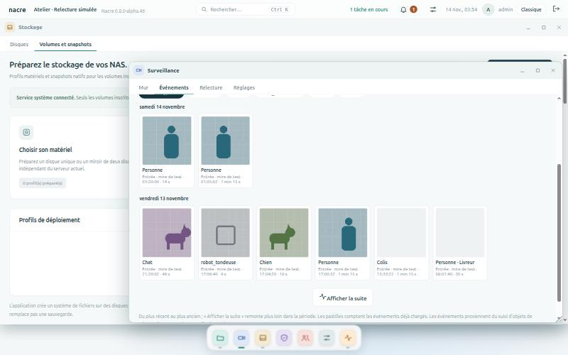
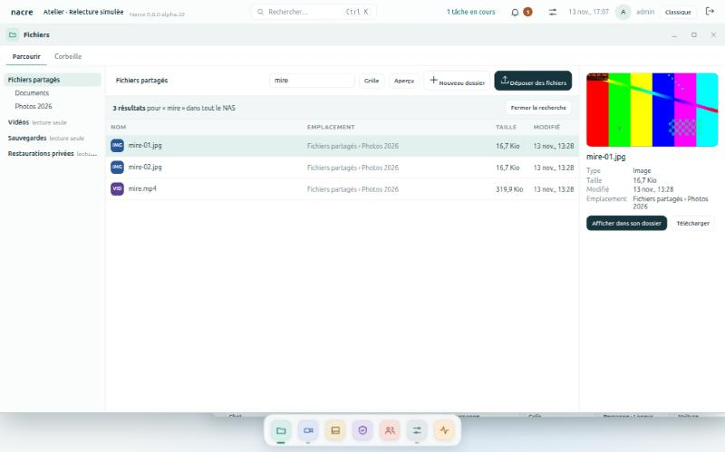
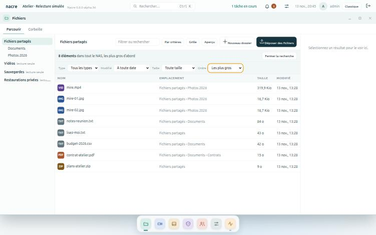
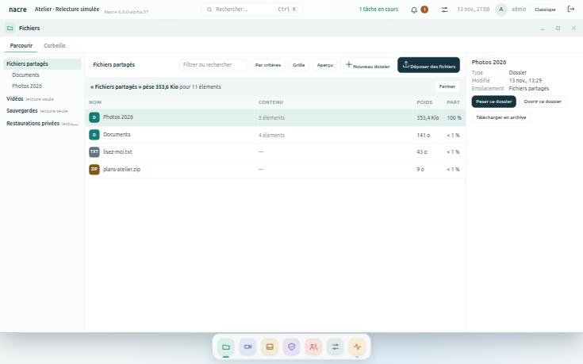
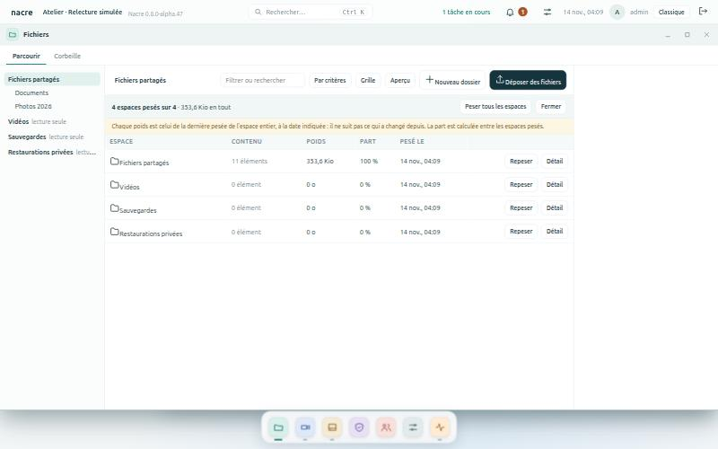

# Le Bureau

Depuis la version 0.8.0-alpha.26, Nacre s’ouvre sur un bureau, à la manière d’un système dans le navigateur. C’est la première étape d’un parcours en sept lots ; les pages de la console ne changent pas, seule leur organisation change.

*Banc local à données synthétiques : Fichiers, Surveillance et Activité ouvertes ensemble, le dock en bas.*

## Ce que l’on trouve

| Élément | Rôle |
| --- | --- |
| **Barre supérieure** | Le nom du NAS, les alertes, l’heure, le compte. Un clic sur « nacre » affiche le bureau. |
| **Icônes et dock** | Les huit applications. Un trait sous une icône du dock signale une application ouverte ; il est plus long et vert pour celle de devant. |
| **Widgets** | Stockage libre, services, surveillance, activité récente, mémoire. Un clic ouvre l’application concernée. |
| **Fenêtres** | Une par application, plusieurs à la fois. Chacune se déplace par sa barre de titre, se redimensionne par son coin, s’agrandit (bouton ou double-clic), se réduit ou se ferme. |
| **Onglets** | Les pages de l’application. Rouvrir une application réduite ramène au dernier onglet consulté. |

## Les huit applications

| Application | Onglets | Rubriques d’origine |
| --- | --- | --- |
| **Fichiers** | Parcourir, Corbeille | Fichiers |
| **Surveillance** | Caméras | Surveillance |
| **Stockage** | Disques, Volumes et snapshots | Stockage, Volumes natifs |
| **Protection** | Sauvegardes, Points de restauration, Conservation | Sauvegardes, Snapshots, Rétention |
| **Personnes et partages** | Personnes et espaces, Partages SMB, Comptes | Partages SMB, Utilisateurs ; [personnes, groupes et espaces](SPACES.md) depuis la version 0.8.0-alpha.52 |
| **Réglages** | Général, Services, Mises à jour, Notifications | Panneau de configuration, Services |
| **Activité** | Alertes, Journal | Alertes, Journal d’activité |
| **Mon compte** | Mon compte | Changer son mot de passe (depuis la version 0.8.0-alpha.52) |

La vue d’ensemble est devenue le bureau lui-même. Un compte en lecture seule ne voit pas les onglets réservés aux administrateurs. Un [membre](SPACES.md) n’a que Fichiers et Mon compte, plus Surveillance si elle lui est ouverte.

## Plusieurs fenêtres

Depuis la version 0.8.0-alpha.31, chaque application s’ouvre dans sa propre fenêtre et plusieurs restent ouvertes ensemble.

| Geste | Effet |
| --- | --- |
| Clic sur une icône du bureau ou du dock | Ouvre l’application, ou ramène sa fenêtre devant. |
| Clic dans le dock sur l’application de devant | La réduit ; un nouveau clic la ramène. |
| Clic n’importe où dans une fenêtre | La met devant. |
| Glisser la barre de titre, ou le coin en bas à droite | Déplace, ou redimensionne. |
| Clic sur « nacre », en haut à gauche | Réduit tout et montre le bureau. |
| Fermer | Ferme cette application seulement ; elle repartira de sa première page. |

Une page demandée depuis une fenêtre et qui appartient à une autre application s’ouvre dans la fenêtre de celle-ci : un raccourci du panneau de réglages, le bouton « Ouvrir » d’une alerte, un résultat de la recherche.

Ce qu’il faut savoir :

- **Une fenêtre par application.** Deux dossiers côte à côte dans deux fenêtres Fichiers, ce n’est pas possible.
- **Chaque fenêtre est une console à part entière**, chargée dans un cadre : elle garde son état, ses rafraîchissements et ses boîtes de dialogue, qui restent à l’intérieur de sa fenêtre. Une application réduite continue de tourner, direct de caméra compris ; fermez-la pour l’arrêter.
- **Position et taille sont mémorisées par navigateur** depuis alpha.32 ; voir [Personnaliser le bureau](#personnaliser-le-bureau).
- **Sur téléphone**, une seule fenêtre est visible à la fois, en plein écran ; le dock fait passer de l’une à l’autre.
- **Session expirée ou préférences changées dans une fenêtre** : le bureau entier suit, et les autres fenêtres se rechargent pour prendre le nouveau fuseau.
- **Sécurité** : la console n’accepte d’être encadrée que par elle-même. Une page d’une autre origine ne peut toujours pas l’afficher dans un cadre.

## Personnaliser le bureau

Depuis la version 0.8.0-alpha.32, le bouton aux deux curseurs, à droite de la cloche, ouvre le panneau **Personnaliser**.

*Banc local à données synthétiques : fond Lagon, widget Tâches en cours ajouté.*

| Réglage | Effet |
| --- | --- |
| **Widgets du bureau** | Cocher pour afficher, décocher pour masquer ; les flèches changent l’ordre. Sept widgets au choix, dont Alertes et Tâches en cours. |
| **Fond** | Nacre, Lagon, Sable ou Ardoise. |
| **Rétablir l’affichage d’origine** | Revient aux cinq widgets de départ et au fond Nacre. |

Chaque changement s’applique et s’enregistre aussitôt.

Ce qu’il faut savoir :

- **Widgets et fond suivent le compte** : enregistrés sur le NAS, ils se retrouvent sur tout navigateur où ce compte se connecte. Chaque compte a les siens.
- **Les fenêtres suivent le navigateur** : applications ouvertes, place, taille, état agrandi ou réduit sont mémorisés sur ce poste et reviennent au rechargement. Une adresse qui demande une page précise l’ouvre devant, à côté des fenêtres retrouvées.
- **Un compte en lecture seule règle son propre bureau.** C’est la seule chose qu’il peut enregistrer ; le widget Alertes lui reste invisible.
- **Une fenêtre retrouvée est ramenée dans l’écran** si le navigateur est plus petit qu’au moment de l’enregistrement ; une page devenue inaccessible au compte est oubliée.
- **Ces réglages ne sont pas inscrits au journal** : ils ne changent que l’affichage.

Limites : pas de widget de caméra en image, pas de fond personnel ni d’icônes à déplacer, pas de disposition partagée entre navigateurs pour les fenêtres.

## Centre de notifications

Depuis la version 0.8.0-alpha.27, la cloche de la barre supérieure remplace le bouton d’alertes.

*Banc local : alertes, tâche et faits récents sont fictifs.*

| Repère | Signification |
| --- | --- |
| **Pastille chiffrée** | Nombre d’alertes à traiter. Un point d’exclamation signale que le contrôle des alertes n’est pas à jour. |
| **« n tâche(s) en cours »** | Affiché à gauche de la cloche tant qu’une sauvegarde, une restauration ou une installation tourne. |
| **À traiter** | Les incidents actifs. « Prendre en compte » agit comme dans la page Alertes, sans fermer le panneau ; « Ouvrir » mène à la page concernée. |
| **En cours** | Les tâches et leur progression. Un clic ouvre la page qui les détaille. |
| **Dernières 24 heures** | Tâches terminées, échecs à vérifier, incidents revenus à la normale. |

Quand une tâche vue en cours se termine, un message l’annonce en bas de l’écran, quelle que soit l’application ouverte. Le panneau se ferme par Échap, par un clic ailleurs ou en ouvrant une page.

Ce qu’il faut savoir :

- **Rafraîchissement toutes les dix secondes**, comme le reste de la console, et à chaque ouverture du panneau. Si une lecture échoue, le dernier état connu reste affiché.
- **Lecture seule** : les tâches sont visibles, pas les alertes ni leur prise en compte.
- **Prendre en compte ne répare pas** : l’incident reste actif tant que sa cause dure.
- **Rien n’est enregistré par la cloche** : pas de « lu / non lu », pas d’historique propre. L’annonce de fin de tâche ne vaut que pour le navigateur qui l’a vue en cours.
- **Pas de notification du système** (hors de l’onglet) ni de son. Les notifications externes par courriel ou webhook restent celles de Réglages → Notifications.

## Recherche globale

Depuis la version 0.8.0-alpha.28, la barre supérieure porte une recherche. Ctrl+K (ou Cmd+K) l’ouvre depuis n’importe où.

*Banc local à données synthétiques.*

| On tape | On obtient |
| --- | --- |
| Rien | Les huit applications. |
| Le nom d’une application ou d’un onglet | L’application, ses onglets et les réglages qui s’y trouvent. |
| Un besoin : « fuseau », « mot de passe », « restaurer » | Le réglage nommé, avec l’endroit où il se trouve. |
| Le nom d’une caméra | La fiche de cette caméra. |
| Le nom d’un espace de fichiers | L’application Fichiers ouverte sur cet espace. |
| Deux caractères ou plus | En dernière ligne, **Chercher « … » dans les fichiers** : Fichiers s’ouvre et [cherche ce nom](#rechercher-un-fichier-par-son-nom) dans tout le NAS. |

Les flèches déplacent la sélection, Entrée ouvre, Échap ferme. Les accents et les majuscules ne comptent pas ; chaque mot saisi doit commencer un mot du résultat.

Ce qu’il faut savoir :

- **La recherche ouvre, elle n’agit pas.** Elle mène à la page ; l’action reste à faire dans la page.
- **Seul ce que le compte peut ouvrir est proposé.** Un compte en lecture seule ne voit pas les réglages d’administration.
- **Les fichiers ne sont parcourus que sur demande.** Tant que la ligne « Chercher dans les fichiers » n’est pas choisie, rien n’est lu sur les disques. Pas de recherche dans le contenu des fichiers ni dans les événements des caméras : la carte Recherche d’événements d’une caméra reste l’outil pour cela.
- **Les réglages nommés sont une liste tenue à la main**, pas un index de tous les champs de la console.
- **Absente de l’affichage classique.**

## Surveillance

Depuis la version 0.8.0-alpha.29, l’application Surveillance du bureau a quatre onglets.

*Banc local : les images sont une mire synthétique, pas des vues de caméra.*

| Onglet | Ce qu’on y fait |
| --- | --- |
| **Mur** | Voir toutes les caméras d’un coup, avec leur état. Un clic agrandit une caméra : direct et pilotage pour elle seule. « Revenir au mur » la referme. |
| **Événements** | Parcourir ce que toutes les caméras ont détecté sur sept jours ou sur une période choisie, ne garder qu’une tranche horaire, filtrer par caméra ou par type, ouvrir un événement dans la relecture. |
| **Relecture** | Choisir une caméra et un jour, lire depuis la frise. La frise commune, en dessous, montre le même jour pour chaque caméra. [Conserver un extrait](RECORDING-PLAYBACK.md#conserver-un-extrait) et retrouver les passages conservés (depuis la version 0.8.0-alpha.49). |
| **Réglages** | Régler la détection et les types suivis, la durée de conservation et la connexion de la caméra choisie. Lire l’[autonomie du volume vidéo](RECORDING-PLAYBACK.md#stockage-vidéo-et-autonomie) (depuis la version 0.8.0-alpha.49). |

*Banc local : vignettes synthétiques, recherche limitée à la nuit.*

Ce qu’il faut savoir :

- **Le mur n’ouvre aucun direct.** Chaque caméra montre sa dernière image, redemandée toutes les dix secondes tant que l’onglet du navigateur est visible. Seule la caméra agrandie reçoit le flux en direct.
- **Une image reçue ne prouve pas l’enregistrement.** La frise de l’onglet Relecture fait foi.
- **Événements : période et tranche horaire pour toutes les caméras** (depuis la version 0.8.0-alpha.35). **Du**, **au** et les deux heures facultatives **entre** et **et** s’appliquent à chaque caméra, avec les mêmes règles que la [recherche d’une caméra](RECORDING-PLAYBACK.md#ne-garder-quune-tranche-horaire) : de 22:00 à 06:00, seules les nuits sont gardées. **Sept derniers jours** revient à l’affichage d’origine.
- **Événements : la liste se prolonge** (depuis la version 0.8.0-alpha.47). Elle s’ouvre sur les plus récents ; **Afficher la suite** remonte plus loin dans la période, caméra par caméra, jusqu’à tout lister. La liste ne grandit que par la fin : tant qu’une caméra a encore des événements non chargés, rien de plus ancien que son dernier événement chargé n’est montré, pour qu’aucun ne vienne s’intercaler après coup. Filtrer sur une caméra montre tout ce qui est chargé pour elle. Le résumé donne le nombre compté sur la période pour toutes les caméras ; les pastilles comptent les événements déjà chargés.

  
- **Frise commune : une seule caméra lue à la fois.** Cliquer sur la ligne d’une autre caméra change de caméra et lit à l’heure cliquée ; s’il n’y a rien à cette heure, la lecture reprend à la plage suivante et le dit.
- **Si les événements d’une caméra sont indisponibles**, elle est nommée et les autres restent listées.
- **Lecture seule** : tout est consultable ; l’ajout de caméra et les réglages sont réservés aux administrateurs.

Limites de cette étape : pas de lecture synchronisée de plusieurs caméras, pas de zones, masques ni seuils de détection, pas de disposition du mur au choix. Une seule caméra réelle a été observée par le projet : le mur et la frise commune n’ont été éprouvés à plusieurs caméras que sur le banc.

## Fichiers

Depuis la version 0.8.0-alpha.30, l’application Fichiers du bureau est un gestionnaire à trois colonnes.

*Banc local : fichiers fictifs, l’image est une mire synthétique.*

| Geste | Effet |
| --- | --- |
| Clic sur une ligne | La sélectionne et l’affiche dans l’aperçu. Ctrl ajoute, Maj étend, Ctrl+A prend tout, Échap vide. |
| Double-clic sur un dossier, ou Entrée | L’ouvre. L’arborescence et le fil d’Ariane permettent de remonter. |
| Glisser des fichiers depuis l’ordinateur | Les envoie dans le dossier ouvert, l’un après l’autre, avec la progression habituelle. |
| Glisser une sélection sur un dossier | La déplace. Le bouton **Déplacer** fait la même chose sans glisser. |
| **Télécharger** | Un fichier seul se télécharge tel quel ; un dossier ou plusieurs éléments en une archive ZIP. |
| **Corbeille**, ou Suppr | Après confirmation ; tout reste récupérable dans l’onglet Corbeille. |

L’aperçu montre les images (JPEG, PNG, GIF, WebP), les vidéos (MP4, WebM) et le début des fichiers texte. Le bouton **Aperçu** masque le panneau ; **Grille** change de présentation ; le champ de filtre réduit la liste du dossier ouvert.

Ce qu’il faut savoir :

- **Rien n’est jamais remplacé.** Si un nom existe déjà à destination, le déplacement est refusé en entier et rien ne bouge ; un envoi sous un nom déjà pris est refusé pour ce fichier seulement.
- **Déplacer reste dans un espace.** D’un espace à l’autre, il faut télécharger puis envoyer.
- **Les liens symboliques ne sont jamais suivis** : ni ouverts, ni prévisualisés, ni mis dans une archive. Un lien déplacé reste un lien.
- **L’archive n’est pas compressée et n’a pas de plafond de taille** ; elle est produite pendant le téléchargement, sans copie temporaire sur le NAS. Les fichiers cachés n’y entrent pas. Son téléchargement est inscrit au journal.
- **Aperçu : types sûrs seulement.** Pages web et dessins vectoriels ne sont jamais affichés dans la console ; un texte est montré tel quel, limité à ses soixante-quatre premiers kilo-octets. Les PDF se téléchargent.
- **Changer de dossier pendant un envoi** arrête les fichiers restants, pour ne rien déposer au mauvais endroit.
- **Lecture seule** : un compte lecteur, ou un espace en lecture seule, garde la navigation, l’aperçu et le téléchargement.

### Rechercher un fichier par son nom

Depuis la version 0.8.0-alpha.33, le champ en haut de Fichiers sert à deux choses. Pendant la saisie, il **filtre le dossier ouvert**, comme avant. Dès deux caractères, une ligne propose de chercher ce nom ailleurs : **dans ce dossier et ses sous-dossiers** (ou dans l’espace entier, depuis sa racine), ou **dans tout le NAS**. Entrée lance la recherche dans tout le NAS.

*Banc local : fichiers fictifs, l’image est une mire synthétique.*

Chaque résultat donne son emplacement. Un clic le sélectionne : l’aperçu, le téléchargement et **Afficher dans son dossier** sont dans le panneau de droite ; un double-clic ouvre le dossier trouvé, ou le dossier qui contient le fichier, celui-ci sélectionné. Renommer, déplacer et mettre en corbeille se font là, pas dans la liste des résultats. Retoucher le champ, **Fermer la recherche**, Échap ou un clic dans l’arborescence ramènent au dossier.

#### Affiner les résultats

Depuis la version 0.8.0-alpha.36, trois listes suivent le titre des résultats. Un choix relance la même recherche, avec le même nom et la même portée.

| Liste | Choix | Ce qui est gardé |
| --- | --- | --- |
| **Type** | Dossiers, Images, Vidéos, Sons, Documents, Archives | Les éléments de cette famille, reconnue à l’extension du nom. |
| **Modifié** | Depuis 24 heures, 7 jours, 30 jours, un an | Les éléments modifiés depuis ce délai. |
| **Taille** | Plus de 1 Mio, 100 Mio, 1 Gio | Les fichiers au moins aussi gros ; jamais un dossier. |

Les filtres se combinent ; **Retirer les filtres** les enlève tous, et une nouvelle recherche repart sans filtre. Quand un nom très courant atteint le plafond de 200 résultats, un filtre permet de voir le reste.

- **Le type vient de l’extension**, pas du contenu : un fichier renommé change de famille. Un lien symbolique n’appartient à aucune famille.
- **La date d’un dossier est la sienne** : un dossier ancien est écarté par « Modifié », mais son contenu reste parcouru.
- **Sans nom**, les mêmes listes servent de critères : voir ci-dessous.

#### Chercher sans nom, par critères

Depuis la version 0.8.0-alpha.37, le bouton **Par critères**, à côté du champ, lance une recherche sans nom dans le dossier ouvert et ses sous-dossiers (ou dans l’espace entier, depuis sa racine). Elle montre d’abord **les plus gros fichiers** : c’est la réponse à « qu’est-ce qui prend de la place ici ? ».

Les trois listes resserrent ensuite le résultat, par exemple « Vidéos » et « Plus de 1 Gio ». Une quatrième liste, **Ordre**, choisit le classement :

| Ordre | Ce qui vient en premier |
| --- | --- |
| **Les plus gros** | Les fichiers les plus volumineux. Dossiers et liens n’y figurent pas. |
| **Les plus récents** | Les dernières modifications, dossiers compris. |
| **Par pertinence** | Avec un nom seulement : l’ordre habituel de la recherche par nom. |

**Étendre à tout le NAS** relance la même recherche, critères et ordre gardés, dans tous les espaces du compte ; le bouton existe aussi pour une recherche par nom. Dans la recherche globale (Ctrl+K), **Les plus gros fichiers** ouvre directement ce classement pour tout le NAS ; « place », « taille » ou « espace » le trouvent.

- **Un classement lit tout, puis garde les 200 premiers.** Quand il y a plus de correspondances, leur nombre est indiqué. Les bornes de parcours restent celles de la recherche par nom : au-delà de quatre secondes ou de 200 000 éléments, le classement ne porte que sur ce qui a été vu, et c’est dit.
- **La taille est celle de chaque fichier**, pas celle d’un dossier avec son contenu : pour savoir quel dossier pèse le plus, voir [Peser les dossiers](#peser-les-dossiers). Avec le type « Dossiers », l’ordre par taille n’est pas proposé.
- **Sans nom, chaque élément est examiné** : sur un très grand volume, la recherche est plus lente qu’avec un nom. La lancer depuis un dossier la raccourcit.
- **Restaurations et snapshots** ne sont classés que depuis leur espace, comme pour la recherche par nom.

#### Peser les dossiers

Depuis la version 0.8.0-alpha.38, Fichiers répond aussi à « quel dossier pèse le plus ? ». La pesée porte sur le dossier ouvert : chaque élément y est donné avec **tout ce qu’il contient**, du plus lourd au plus léger.

Trois entrées :

- **Peser ce dossier**, dans le panneau de droite d’un dossier sélectionné : on s’y rend et il est pesé ;
- **Poids des dossiers**, dans le titre d’une recherche par critères : le dossier ouvert est pesé ;
- **Poids des dossiers**, dans la recherche globale (Ctrl+K), que « place », « taille » ou « peser » trouvent.

| Colonne | Ce qu’elle dit |
| --- | --- |
| **Contenu** | Pour un dossier, le nombre de fichiers et de dossiers qu’il contient, à toutes les profondeurs. |
| **Poids** | La taille du fichier, ou la somme des tailles de tout ce que contient le dossier. |
| **Part** | Ce que l’élément représente dans le poids du dossier ouvert. |

Un double-clic sur un dossier le pèse à son tour, et **Peser le dossier parent** remonte d’un niveau : on descend ainsi vers ce qui occupe la place. Une ligne sélectionnée garde l’aperçu, le téléchargement et **Ouvrir ce dossier**. **Fermer**, Échap, le champ de recherche ou un clic dans l’arborescence ramènent au dossier.

- **Cachés et corbeille comptés, jamais nommés.** Les fichiers cachés pèsent dans le dossier qui les contient. Ceux du dossier ouvert, corbeille de l’espace comprise, sont réunis sur la ligne « Éléments cachés et corbeille » : le total est celui qui occupe réellement le disque.
- **Mêmes bornes que la recherche** : quatre secondes, 200 000 éléments, deux parcours à la fois pour tout le NAS. Un poids précédé de « au moins » est un minimum ; un dossier « non pesé » n’a pas été commencé. Peser un sous-dossier permet d’aller plus loin.
- **Rien n’est gardé** : chaque pesée relit le disque. Un grand dossier demande donc le même temps à chaque fois, et réveille des disques en veille.
- **Taille des fichiers, pas place sur le disque** : c’est la taille qu’affiche le gestionnaire. La compression d’un volume, les snapshots et les copies partagées entre fichiers ne sont pas pris en compte ; l’occupation réelle d’un volume se lit dans Stockage.
- **Liens symboliques jamais suivis** : un lien pèse quelques octets, pas ce qu’il désigne.
- **200 lignes au plus** : au-delà, les éléments les plus légers sont réunis sur une ligne « Autres éléments ».
- **Un espace à la fois** : la pesée ne compare pas les espaces entre eux.

Ce qu’il faut savoir :

- **Le nom seulement**, jamais le contenu. Accents et majuscules ne comptent pas ; chaque mot saisi doit figurer dans le nom, dans n’importe quel ordre. « .pdf » trouve les PDF.
- **Pas d’index** : le NAS est parcouru au moment de la demande. Rien n’est écrit ni tenu à jour, et un fichier déposé à l’instant est trouvé ; en contrepartie, une recherche sur des disques en veille les réveille.
- **Une recherche est bornée** : quatre secondes, 200 000 éléments parcourus, 200 résultats affichés. Arrêtée avant la fin, elle le dit, et chercher depuis un dossier permet d’aller plus loin. Deux recherches à la fois au plus pour tout le NAS.
- **« Tout le NAS » = les espaces que le compte peut ouvrir**, Fichiers partagés d’abord, puis les volumes, les vidéos et les sauvegardes. Les restaurations et snapshots ne sont parcourus que si l’on cherche depuis leur espace : ils répéteraient chaque fichier.
- **Liens symboliques jamais suivis, fichiers cachés ignorés** : un lien peut être nommé parmi les résultats, ce qu’il désigne n’est pas parcouru.
- **Un espace indisponible** n’empêche pas la recherche ; il est signalé au-dessus des résultats.

Limites de cette étape : pas de recherche dans le contenu, pas de dates ni de tailles libres, pas de poids gardé d’une pesée à l’autre, pas de copie, pas de liens de partage, pas d’envoi de dossiers entiers par glisser-déposer, pas d’avance rapide dans l’aperçu vidéo. L’arborescence montre les dossiers déjà ouverts, pas tout le disque d’avance.

#### Comparer les espaces

Depuis la version 0.8.0-alpha.48, la dernière pesée de chaque espace entier est gardée, et une vue les met côte à côte.

On y arrive par **Comparer les espaces**, dans le titre d’une pesée, ou par **Poids des espaces** dans la recherche globale (Ctrl+K).

| Colonne | Ce qu’elle dit |
| --- | --- |
| **Contenu**, **Poids** | Ce que l’espace contenait à sa dernière pesée ; « au moins » si elle s’était arrêtée avant la fin ; « non pesé » s’il ne l’a jamais été. |
| **Part** | Sa part parmi les espaces pesés. |
| **Pesé le** | La date de cette pesée. |

**Peser** ou **Repeser** pèse l’espace entier et met sa ligne à jour ; **Peser tous les espaces** le fait pour chacun, l’un après l’autre ; **Détail** ouvre l’espace et pèse ses dossiers.

Ce qu’il faut savoir :

- **Un poids gardé ne suit pas ce qui change ensuite** : c’est une photographie, datée. Rien n’est repesé tout seul.
- **Seule la pesée d’un espace entier est gardée**, pas celle d’un sous-dossier. Peser la racine d’un espace depuis la vue habituelle la met aussi à jour.
- **Mêmes bornes que la pesée** : un très grand espace peut s’arrêter avant la fin, et son poids est alors un minimum.
- **Chacun ne voit que ses espaces** : les restaurations privées et les volumes natifs restent réservés aux administrateurs.

## Revenir à l’affichage classique

Le bouton **Classique** de la barre supérieure rend le menu à gauche tel qu’il était ; le bouton **Bureau** y ramène. Le choix est mémorisé dans le navigateur, pas sur le NAS : chaque poste garde le sien. L’assistant de première configuration utilise toujours l’affichage classique.

## Limites de cette étape

- **Widgets sans image de caméra.**
- **La taille des textes** n’a été relevée que pour les notes les plus petites.

## Validation

Cinq essais JavaScript : coquille et repères attendus par les pages, onglets selon le rôle, chaque page rangée dans une application et une seule, bascule vers l’affichage classique et retour, assistant toujours en classique, stockage du navigateur indisponible, fenêtre et onglets à chaque navigation, dernier onglet retrouvé depuis le dock, widgets échappés et réponses tardives ignorées. Les 93 essais existants passent sans modification dans les deux affichages.

Centre de notifications (alpha.27), cinq essais JavaScript : cloche à la place du bouton d’alertes et affichage classique intact ; compteurs, libellés et échappement de tout ce qui est listé ; page inconnue annoncée par le serveur renvoyée vers les alertes ; compte en lecture seule sans requête d’alertes ; annonce de fin de tâche, état conservé si une lecture échoue, réponses tardives et session expirée ; ouverture et fermetures du panneau. Sur le banc : alerte fictive prise en compte depuis le panneau, pastille retirée, panneau resté ouvert.

Recherche globale (alpha.28), quatre essais JavaScript : index limité aux pages que le compte peut ouvrir, chaque réglage nommé rattaché à une page existante ; correspondance au début des mots sans accents ni casse, libellé le plus proche en tête, noms de caméras échappés ; clavier (ouverture, flèches, Entrée, Échap, rien derrière une boîte de dialogue) ; ouverture d’une caméra, d’un espace de fichiers ou de l’affichage classique, lectures en échec ou tardives sans effet. Sur le banc : Ctrl+K, « gar », Entrée ouvre la fiche de la caméra Garage.

Événements par période et tranche horaire (alpha.35), un essai JavaScript : aucune période envoyée par défaut, formulaire prérempli par la réponse, total additionné sur les caméras lues ; période à l’envers, tranche incomplète ou identique refusées sans requête ; période et tranche envoyées à chaque caméra et reprises dans le résumé ; refus du serveur expliqué une fois sans accuser les caméras ; retour aux sept derniers jours. Sur le banc à deux caméras simulées : 50 événements par défaut, 7 entre 22:00 et 06:00, refus d’une tranche à moitié remplie et d’une date trop ancienne.

Surveillance (alpha.29), cinq essais JavaScript : mur en images fixes sans aucun direct, noms échappés, page classique conservée ; caméra agrandie seule à recevoir le direct, caméras inconnues et réponses tardives sans effet ; événements fusionnés du plus récent au plus ancien, caméra en échec nommée, filtres sans nouvelle requête, ouverture de la relecture au bon événement ; une ligne de frise par caméra et lecture à l’heure cliquée ; réglages sans boutons pour la lecture seule. Sur le banc à deux caméras simulées : mur, agrandissement avec direct et pilotage, 48 événements synthétiques filtrés, ouverture d’un événement dans la relecture avec lecture de l’extrait, clic sur la ligne de l’autre caméra, onglet Réglages.

Poids des dossiers (alpha.38). Un essai Python sur espace temporaire : dossier pesé avec tout son contenu, fichiers cachés compris ; lien jamais suivi ; classement du plus lourd au plus léger ; cachés et corbeille comptés ensemble et jamais nommés ; total cohérent ; pesée d’un sous-dossier ; droits et chemins du gestionnaire de fichiers ; borne atteinte, avec dossier en cours donné comme minimum et dossiers suivants non pesés ; reste compté d’un bloc au-delà de la limite ; troisième parcours refusé. Un essai JavaScript : entrée depuis le panneau d’un dossier, titre et lignes, parts, lignes mal formées écartées, double-clic qui descend, retour au parent, minimums et dossiers non pesés, calcul en cours, refus annoncé, sorties par Fermer, Échap et le champ, entrée depuis la recherche par critères et depuis la recherche globale. Sur le banc, avec le vrai serveur : Fichiers partagés pèse 353,6 Kio pour 11 éléments, dont 353,4 Kio dans un dossier de 3 éléments ; descente dans ce dossier, retour au parent, ouverture par « poids » dans Ctrl+K.

Recherche par critères, sans nom (alpha.37). Un essai Python sur espace temporaire : plus gros fichiers d’abord tous espaces confondus, sans dossier, lien, fichier caché ni restauration ; un critère seul suffit ; dossiers classés par date ; plus récents d’abord ; portée et droits de la recherche par nom ; classement d’une recherche par nom ; au-delà de la limite, seuls les meilleurs sont gardés et le total est donné ; borne de parcours signalée ; sept demandes sans nom ni critère ou mal formées refusées. Un essai JavaScript : bouton de la barre d’outils, champ vidé, liste Ordre sans « pertinence », dossiers sans ordre par taille, retrait des filtres qui garde l’ordre, extension à tout le NAS, messages de classement partiel, ordre ajouté à une recherche par nom, ouverture depuis la recherche globale. Sur le banc, avec le vrai serveur : 8 fichiers classés par taille dans Fichiers partagés, 11 éléments par date, 3 dossiers, 2 images, puis les mêmes dans tout le NAS ; « place » dans Ctrl+K ouvre le classement.

Filtres de la recherche de fichiers (alpha.36). Un essai Python sur espace temporaire : famille de type d’après l’extension, dossiers à part, liens dans aucune famille ; modification récente, dossier ancien écarté mais parcouru ; taille minimale sans dossier ni lien ; filtres combinés entre eux et avec la portée ; douze demandes mal formées refusées. Un essai JavaScript : trois listes sous le titre, choix ajoutés à la même recherche, valeur non proposée ignorée, listes inactives pendant la recherche, affinage refusé sans perdre les résultats, retrait des filtres, nouvelle recherche sans filtre. Sur le banc, avec le vrai serveur : « mire » donne 3 résultats, 2 images et 1 vidéo ; « 2026 » donne 1 dossier, 1 document, aucun fichier de plus de 1 Mio.

Recherche de fichiers (alpha.33). Trois essais Python sur espace temporaire : noms trouvés sans accents ni casse dans tous les espaces du compte, ordre des résultats, liens nommés jamais suivis, fichiers cachés et restaurations hors du parcours ; portée par espace et par dossier, restaurations et volumes refusés au lecteur, chemins sortants et saisies trop courtes refusés ; arrêt annoncé à chaque borne, troisième recherche simultanée refusée, espace indisponible signalé. Trois essais JavaScript : filtre local sans requête, recherche à la demande ici ou partout, résultats mal formés ou hors des espaces du compte écartés, aperçu et téléchargement depuis l’emplacement du résultat, ouverture du dossier avec l’élément sélectionné ; arrêt anticipé annoncé, réponse tardive ou refusée sans effet ; entrée de la recherche globale. Sur le banc, avec le vrai serveur : « mire » dans tout le NAS, aperçu d’un résultat, affichage dans son dossier, « contrat » depuis Ctrl+K, « 2026 » dans les sous-dossiers de Documents, refus d’une saisie d’un caractère et d’un chemin sortant.

Fichiers (alpha.30). Quatre essais Python sur espace temporaire : déplacement sans remplacement ni demi-mesure, refus des sélections et destinations invalides sans rien toucher, liens symboliques jamais suivis, lecteur et jeton absent refusés ; archive relue et vérifiée, sans liens ni fichiers cachés, noms accentués ; aperçu limité aux types sûrs et à un texte borné. Cinq essais JavaScript : arborescence, liste et aperçu, absence d’actions d’écriture pour un lecteur, dossier disparu, sélection au clic et au clavier, liens de téléchargement, texte jamais interprété, déplacement, corbeille et envoi limités à la sélection. Sur le banc, avec le vrai serveur : aperçu d’une image et d’une vidéo, archive de deux éléments relue, envoi de deux fichiers, déplacement par glisser-déposer, refus d’un dossier dans lui-même, corbeille de deux éléments, lignes de journal.

Plusieurs fenêtres (alpha.31), quatre essais JavaScript : une fenêtre par application et le bureau qui continue derrière ; dock, barre de titre et marque (réduire, ramener, agrandir, fermer) sans effet sur les autres ; le bureau n’écoute que ses propres fenêtres ; une fenêtre enfant n’affiche que son contenu, navigue dans son application et confie le reste au bureau, y compris la session expirée. Un essai Python : la console ne peut être encadrée que par elle-même. Un défaut attrapé par ces essais avant la fusion : après un passage en affichage classique, les fenêtres fermées restaient en mémoire et faussaient la page rouverte. Sur le banc : quatre applications ouvertes ensemble, lien d’une fenêtre ouvrant la fenêtre d’une autre application, déplacement et redimensionnement par-dessus les cadres, téléphone, Ctrl+K depuis une fenêtre, session expirée dans une fenêtre.

Bureau personnalisable (alpha.32). Deux essais Python : préférences par compte, lecteur autorisé pour cette seule route, choix invalides refusés sans rien écrire, valeurs abîmées ramenées à l’origine. Trois essais JavaScript : ordre des widgets et panneau, réponse du NAS assainie, sauvegarde en échec signalée, mémoire et restauration des fenêtres. Deux défauts attrapés par ces essais avant la fusion : au rechargement, la fenêtre retrouvée remplaçait la page demandée par l’adresse ; et un choix fait pendant une lecture en cours pouvait être écrasé par sa réponse. Sur le banc : widgets réordonnés, fond changé, relecture depuis le NAS, deux fenêtres retrouvées après rechargement avec une troisième demandée par l’adresse.

Parcours navigateur sur le banc local, avec la politique de sécurité réelle de la console : ouverture des sept applications, déplacement, agrandissement, réduction et fermeture de la fenêtre, bascule vers l’affichage classique et retour, largeur de téléphone sans défilement horizontal.
