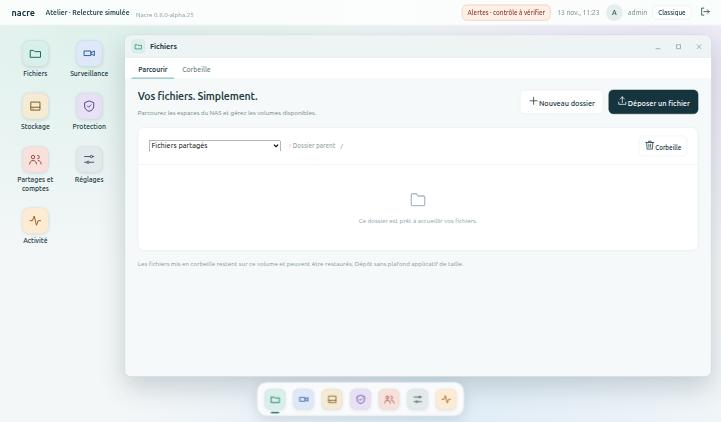

# Le Bureau

Depuis la version 0.8.0-alpha.26, Nacre s’ouvre sur un bureau, à la manière d’un système dans le navigateur. C’est la première étape d’un parcours en sept lots ; les pages de la console ne changent pas, seule leur organisation change.

*Banc local à données synthétiques : l’application Fichiers ouverte, le dock en bas.*

## Ce que l’on trouve

| Élément | Rôle |
| --- | --- |
| **Barre supérieure** | Le nom du NAS, les alertes, l’heure, le compte. Un clic sur « nacre » affiche le bureau. |
| **Icônes et dock** | Les sept applications. Un trait sous une icône du dock signale l’application ouverte ou réduite. |
| **Widgets** | Stockage libre, services, surveillance, activité récente, mémoire. Un clic ouvre l’application concernée. |
| **Fenêtre** | Elle se déplace par sa barre de titre, s’agrandit (bouton ou double-clic), se réduit ou se ferme. |
| **Onglets** | Les pages de l’application. Rouvrir une application réduite ramène au dernier onglet consulté. |

## Les sept applications

| Application | Onglets | Rubriques d’origine |
| --- | --- | --- |
| **Fichiers** | Parcourir, Corbeille | Fichiers |
| **Surveillance** | Caméras | Surveillance |
| **Stockage** | Disques, Volumes et snapshots | Stockage, Volumes natifs |
| **Protection** | Sauvegardes, Points de restauration, Conservation | Sauvegardes, Snapshots, Rétention |
| **Partages et comptes** | Partages, Utilisateurs | Partages SMB, Utilisateurs |
| **Réglages** | Général, Services, Mises à jour, Notifications | Panneau de configuration, Services |
| **Activité** | Alertes, Journal | Alertes, Journal d’activité |

La vue d’ensemble est devenue le bureau lui-même. Un compte en lecture seule ne voit pas les onglets réservés aux administrateurs.

## Centre de notifications

Depuis la version 0.8.0-alpha.27, la cloche de la barre supérieure remplace le bouton d’alertes.

*Banc local : alertes, tâche et faits récents sont fictifs.*

| Repère | Signification |
| --- | --- |
| **Pastille chiffrée** | Nombre d’alertes à traiter. Un point d’exclamation signale que le contrôle des alertes n’est pas à jour. |
| **« n tâche(s) en cours »** | Affiché à gauche de la cloche tant qu’une sauvegarde, une restauration ou une installation tourne. |
| **À traiter** | Les incidents actifs. « Prendre en compte » agit comme dans la page Alertes, sans fermer le panneau ; « Ouvrir » mène à la page concernée. |
| **En cours** | Les tâches et leur progression. Un clic ouvre la page qui les détaille. |
| **Dernières 24 heures** | Tâches terminées, échecs à vérifier, incidents revenus à la normale. |

Quand une tâche vue en cours se termine, un message l’annonce en bas de l’écran, quelle que soit l’application ouverte. Le panneau se ferme par Échap, par un clic ailleurs ou en ouvrant une page.

Ce qu’il faut savoir :

- **Rafraîchissement toutes les dix secondes**, comme le reste de la console, et à chaque ouverture du panneau. Si une lecture échoue, le dernier état connu reste affiché.
- **Lecture seule** : les tâches sont visibles, pas les alertes ni leur prise en compte.
- **Prendre en compte ne répare pas** : l’incident reste actif tant que sa cause dure.
- **Rien n’est enregistré par la cloche** : pas de « lu / non lu », pas d’historique propre. L’annonce de fin de tâche ne vaut que pour le navigateur qui l’a vue en cours.
- **Pas de notification du système** (hors de l’onglet) ni de son. Les notifications externes par courriel ou webhook restent celles de Réglages → Notifications.

## Revenir à l’affichage classique

Le bouton **Classique** de la barre supérieure rend le menu à gauche tel qu’il était ; le bouton **Bureau** y ramène. Le choix est mémorisé dans le navigateur, pas sur le NAS : chaque poste garde le sien. L’assistant de première configuration utilise toujours l’affichage classique.

## Limites de cette étape

- **Une fenêtre à la fois.** Ouvrir une application remplace la précédente. Plusieurs fenêtres côte à côte demandent de rendre chaque page indépendante : c’est un lot ultérieur.
- **Pas encore de recherche globale.**
- **Widgets fixes**, non personnalisables, et sans image de caméra.
- **Position et taille de la fenêtre** oubliées au rechargement de la page ; la fenêtre ne se redimensionne pas à la souris.
- **Surveillance** reste une seule page longue ; la taille des textes n’a été relevée que pour les notes les plus petites.

## Validation

Cinq essais JavaScript : coquille et repères attendus par les pages, onglets selon le rôle, chaque page rangée dans une application et une seule, bascule vers l’affichage classique et retour, assistant toujours en classique, stockage du navigateur indisponible, fenêtre et onglets à chaque navigation, dernier onglet retrouvé depuis le dock, widgets échappés et réponses tardives ignorées. Les 93 essais existants passent sans modification dans les deux affichages.

Centre de notifications (alpha.27), cinq essais JavaScript : cloche à la place du bouton d’alertes et affichage classique intact ; compteurs, libellés et échappement de tout ce qui est listé ; page inconnue annoncée par le serveur renvoyée vers les alertes ; compte en lecture seule sans requête d’alertes ; annonce de fin de tâche, état conservé si une lecture échoue, réponses tardives et session expirée ; ouverture et fermetures du panneau. Sur le banc : alerte fictive prise en compte depuis le panneau, pastille retirée, panneau resté ouvert.

Parcours navigateur sur le banc local, avec la politique de sécurité réelle de la console : ouverture des sept applications, déplacement, agrandissement, réduction et fermeture de la fenêtre, bascule vers l’affichage classique et retour, largeur de téléphone sans défilement horizontal.
