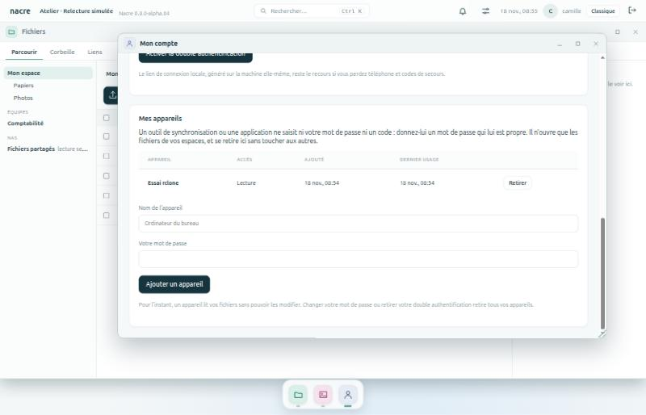

# Appareils et WebDAV

Premier lot du programme « appareils et communication » : **ouvrir ses fichiers depuis un outil ou une application**, sans passer par le navigateur. Depuis 0.8.0-alpha.65.



## Ce que cela donne

- Dans **Mon compte → Mes appareils**, chacun ajoute un appareil : Nacre produit un **mot de passe propre à cet appareil**, montré une seule fois.
- Avec ce mot de passe, un outil de synchronisation, un gestionnaire de fichiers ou une application **lit les fichiers de vos espaces** par WebDAV, à l’adresse de la console suivie de `/dav/`.
- L’appareil ne saisit jamais votre mot de passe ni un code de double authentification, et **n’ouvre que des fichiers** : rien de l’administration, ni les sauvegardes, ni les vidéos.
- Un appareil **se retire d’un geste**, sans toucher aux autres. Changer son mot de passe, activer ou retirer sa double authentification les retire tous : ce qui change vos moyens de connexion écarte aussi ce qui s’en servait.
- **Pour l’instant, en lecture seule** : l’écriture arrive dans une prochaine version.

## Ajouter un appareil

1. **Mon compte → Mes appareils** : donner un nom à l’appareil, ressaisir son mot de passe (et un code, si la double authentification est active).
2. Reporter les trois réglages affichés : l’adresse, l’identifiant, le mot de passe. Le mot de passe se saisit avec ou sans tirets, en majuscules ou non.
3. **C’est noté** : il n’est plus affiché nulle part. Perdu, on retire l’appareil et on en ajoute un autre.

Vingt appareils au plus par personne.

## Ce qu’on y trouve

```
/dav/files/Mon espace/…
/dav/files/<nom d’un espace d’équipe>/…
/dav/files/Fichiers partagés/…
```

Les espaces sont ceux que la personne ouvre dans la console, sous leur nom. « Mon espace » est celui de qui se connecte. Renommer un espace change son adresse.

## Avec quels outils

| Outil | Réglage | Éprouvé |
| --- | --- | --- |
| **rclone** | type `webdav`, fournisseur `rclone`, adresse `…/dav/files` | Oui, version 1.75, sur le banc : liste, copie d’un espace entier, contenus comparés un à un, seconde copie sans rien à transférer |
| Finder (Mac) | Aller → Se connecter au serveur | Non |
| Fichiers de GNOME | la même adresse en `davs://` | Non |
| Dolphin (KDE) | la même adresse en `webdavs://` (`davs://` sur les versions récentes) | Non |
| Cyberduck, WinSCP | WebDAV (HTTPS) | Non |
| Applications de téléphone (FolderSync, PhotoSync…) | WebDAV | Non |
| Explorateur de Windows | — | Déconseillé : son client WebDAV est limité et abandonné par Microsoft ; préférer un des outils ci-dessus |

Exemple avec rclone, pour copier un dossier du NAS vers l’ordinateur :

```bash
rclone config create nas webdav url=https://nas.local:8443/dav/files vendor=rclone user=camille pass=…
```

```bash
rclone copy "nas:Mon espace/Photos" ~/Photos-du-NAS
```

Par le réseau, l’outil doit reconnaître le certificat du NAS : installer d’abord l’[autorité locale](ACCESS.md#le-certificat) sur l’appareil.

## Ce qui protège vos fichiers

- **Aucun droit avant le mot de passe de l’appareil**, et aucun après un refus. Les droits sont ensuite ceux, vivants, de la personne : un accès retiré, un compte désactivé ou un rôle changé valent dès la requête suivante.
- Le mot de passe d’un appareil n’est gardé que sous forme d’empreinte. Il fait près de 120 bits : il ne se devine pas.
- **Dix refus en une minute** depuis une adresse, et elle n’obtient plus de réponse pendant une minute. Un mot de passe juste passe toujours : personne ne peut bloquer les appareils d’un compte en multipliant les refus à son nom. Ces refus ne consomment pas les tentatives de la connexion à la console.
- **Un navigateur est refusé** sans qu’on lui demande de mot de passe : les navigateurs actuels ne retiennent ainsi aucun mot de passe d’appareil pour l’adresse de la console.
- Aucun lien n’est suivi, les dossiers internes ne se voient pas, un fichier n’est jamais servi comme une page.
- **Une erreur n’est jamais déguisée en dossier vide** : un outil de synchronisation y lirait « tout a été supprimé ».
- Ajouter et retirer un appareil s’inscrit au journal. Un administrateur voit combien d’appareils a chacun, et peut tous les retirer.

## Limites

- **Lecture seule** dans cette version.
- **Pas de verrous** (WebDAV de classe 1) : certains logiciels de bureautique ouvriront les fichiers en lecture seule.
- La lecture d’un dossier s’arrête à 50 000 éléments.
- Un fichier dont le nom n’est pas lisible (ancien encodage) ou porte un caractère de contrôle n’apparaît pas : le renommer depuis la console.
- Deux espaces ne portent jamais la même adresse : un espace d’équipe nommé comme « Mon espace » ou « Fichiers partagés » reçoit une marque à la fin de son nom.
- Les lectures par un appareil ne s’inscrivent pas au journal, une par une : seuls l’ajout, le retrait et le dernier usage sont notés.
- Derrière un relais, tous les refus viennent de l’adresse du relais : la limite par adresse devient commune.
- Restaurer la base de Nacre depuis une sauvegarde fait revenir les appareils retirés depuis : les retirer de nouveau.
- **Seul rclone a été essayé.** Le reste du tableau repose sur le protocole, pas sur l’essai.

## Sous le capot

`console/devices.py` (mots de passe d’appareil, limite des refus), `console/dav.py` (OPTIONS, PROPFIND, GET avec plages et validation par marque ou par date, HEAD), bornes d’un appareil dans `spaces.level`. L’arborescence réserve `/dav/principals/`, `/dav/calendars/` et `/dav/addressbooks/` pour la suite. Réglages `device:<empreinte>` dans la table des réglages ; aucun changement de schéma.
