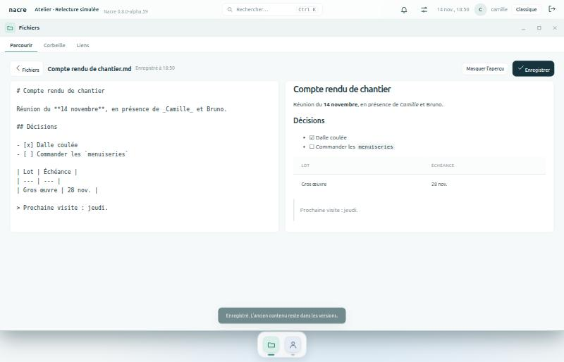
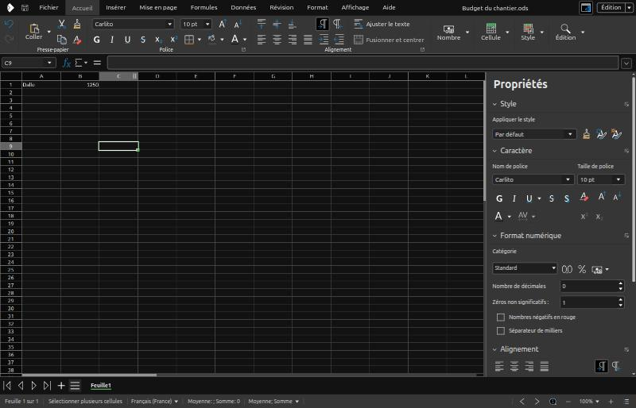
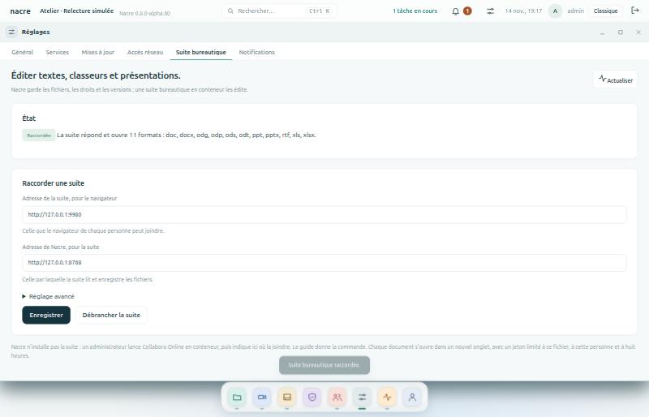

# Éditeur de documents

Quatrième brique de l’espace collaboratif : écrire et modifier un document sans quitter Nacre. Elle arrive en deux temps.

| Temps | Contenu | État |
| --- | --- | --- |
| Éditeur intégré | Texte et Markdown, dans la fenêtre Fichiers | Depuis 0.8.0-alpha.60 |
| [Suite bureautique](#suite-bureautique) | Traitement de texte, tableur et présentations, par une brique en conteneur | Depuis 0.8.0-alpha.61 |

## Éditeur intégré



*Banc local : compte et document fictifs.*

### Écrire

- **Nouveau document**, dans les outils de Fichiers : un nom en `.md` pour un document mis en forme, en `.txt` pour du texte simple. Il s’ouvre aussitôt.
- **Modifier**, dans l’aperçu d’un fichier texte : il s’ouvre dans la fenêtre, à la place de la liste.
- **Enregistrer**, ou Ctrl+S. **Fichiers**, en haut à gauche, referme le document.

Un document **Markdown** s’affiche en deux colonnes : le texte à gauche, son rendu à droite, qui suit la frappe. Titres, gras, italique, listes, cases à cocher, citations, tableaux, liens et code sont rendus.

### Ce qui protège votre travail

- **Chaque enregistrement garde l’ancien contenu** comme [version](VERSIONS.md). Vos enregistrements rapprochés, dans les dix minutes, n’en font qu’une : ils ne chassent pas les versions plus anciennes.
- **Un fichier modifié ailleurs n’est jamais écrasé en silence.** Si le fichier a changé depuis que vous l’avez ouvert, par une autre personne ou par le réseau, Nacre le dit ; « enregistrer mon contenu » range l’autre contenu parmi les versions.
- **« Aussi ouvert par… »** : une bannière nomme les autres personnes qui ont le même document ouvert. C’est une information, pas un verrou.
- **Fermer avec des modifications** demande confirmation.

### À savoir

- **Ce qui s’ouvre** : les fichiers texte lisibles (UTF-8) jusqu’à 2 Mio — notes, Markdown, CSV, JSON, YAML, fichiers de configuration, journaux. Le reste se télécharge.
- **Le texte n’est jamais interprété** : une page HTML s’ouvre comme du texte, et l’aperçu Markdown échappe tout ce qu’il affiche. Seuls les liens en `http` ou `https` deviennent cliquables.
- **Un PDF s’ouvre dans un nouvel onglet** du navigateur, depuis son aperçu.
- **Mêmes droits que l’espace** : qui lit l’espace lit le document ; qui y écrit l’enregistre.
- **Dans le bureau seulement** : l’affichage classique garde sa liste de fichiers simple.

### Limites

- **Pas de coédition en temps réel** : deux personnes ne voient pas la frappe de l’autre. Le dernier à enregistrer l’emporte, l’autre contenu reste dans les versions.
- **Markdown essentiel** : pas d’images, de notes de bas de page ni de formules.
- **Les documents bureautiques** (Word, Excel, PowerPoint, OpenDocument) ne s’ouvrent pas ici : c’est l’objet de la [suite bureautique](#suite-bureautique).

### Sous le capot

`console/editor.py` et `console/static/editor.js`. L’enregistrement écrit à côté puis échange les deux noms d’un coup ; une étiquette (date et taille du fichier) détecte un changement fait ailleurs. Le rendu Markdown est écrit pour Nacre, sans dépendance. Aucun changement de schéma.

## Suite bureautique

Nacre n’embarque pas de traitement de texte ni de tableur : il se raccorde à une suite bureautique qui tourne à côté de lui, en conteneur. **Nacre garde les fichiers, les droits et les versions ; la suite les édite.** Le dialogue suit le protocole WOPI, celui de [Collabora Online](https://www.collaboraonline.com/), suite libre fondée sur LibreOffice.



### Ce que cela donne

- Dans **Fichiers**, un document bureautique sélectionné propose **Ouvrir dans la suite bureautique** (ou **Lire…** si l’on n’a que la lecture). Il s’ouvre dans un nouvel onglet.
- **Nouveau document** propose en plus **Texte bureautique (.odt)** et **Classeur (.ods)** : le fichier vide est créé, puis ouvert.
- Formats proposés, s’ils sont annoncés par la suite : `odt`, `ods`, `odp`, `odg`, `docx`, `xlsx`, `pptx`, `doc`, `xls`, `ppt`, `rtf`. Le texte et le Markdown restent à l’éditeur intégré.
- **Chaque enregistrement garde l’ancien contenu comme [version](VERSIONS.md)** ; les enregistrements rapprochés d’une même personne n’en font qu’une.
- Un fichier **modifié ailleurs** pendant qu’il est ouvert n’est pas écrasé : la suite demande quoi faire. Si l’on choisit d’écraser, le contenu venu d’ailleurs est gardé comme version.
- Plusieurs personnes peuvent ouvrir le même document : la coédition en temps réel est alors celle de la suite.
- Si le navigateur bloque le nouvel onglet, une fenêtre **Document prêt** l’ouvre d’un clic.

### Raccorder une suite

Nacre **n’installe pas** la suite et ne la pilote pas : un administrateur la lance, puis indique où la joindre dans **Réglages → Suite bureautique**.



1. Lancer la suite sur la même machine, en écoute locale. Exemple avec Collabora Online (édition de développement), pour un Nacre joint en `http://127.0.0.1:8766` :

   ```bash
   docker run -d --name suite-bureautique --restart unless-stopped \
     --network host --cap-add MKNOD \
     -e "aliasgroup1=http://127.0.0.1:8766" \
     -e "extra_params=--o:ssl.enable=false --o:ssl.termination=false --o:net.listen=loopback --o:net.proto=IPv4" \
     collabora/code
   ```

   `aliasgroup1` désigne Nacre : la suite n’accepte de lire et d’enregistrer que chez lui. L’image pèse environ 1,3 Gio et demande de l’ordre de 1 Gio de mémoire.
2. Dans **Réglages → Suite bureautique**, donner deux adresses :
   - **l’adresse de la suite, pour le navigateur** : celle que le navigateur de chaque personne peut joindre (`http://localhost:9980` sur le poste même) ;
   - **l’adresse de Nacre, pour la suite** : celle par laquelle la suite lit et enregistre (`http://127.0.0.1:8766` sur la même machine).
3. **Raccorder la suite** : Nacre vérifie qu’elle répond et qu’elle annonce ses formats avant d’enregistrer le réglage. **Débrancher la suite** retire le bouton partout ; aucun fichier n’est touché.

Le réglage avancé donne une troisième adresse, celle par laquelle Nacre joint la suite, quand elle diffère de celle du navigateur.

### Ce qui protège les fichiers

- La suite ne voit **aucun mot de passe ni session** : pour chaque ouverture, Nacre lui remet un jeton tiré au hasard, valable **pour ce fichier, pour cette personne, pendant huit heures**. Nacre n’en conserve que l’empreinte.
- **Les droits sont revérifiés à chaque appel** de la suite : un accès retiré, un compte désactivé ou une suite débranchée coupent la lecture comme l’enregistrement, même document ouvert.
- Un document ouvert en lecture ne peut pas être enregistré, quoi que demande la suite.
- La suite n’apprend ni l’identifiant de l’espace ni le chemin du fichier : seulement son nom.
- Les pages de Nacre n’autorisent l’envoi d’un formulaire **que vers l’adresse de la suite déclarée** ; l’onglet de la suite ne garde aucune prise sur la fenêtre de Nacre.
- Chaque ouverture est inscrite au journal d’audit.
- Un redémarrage de Nacre (une mise à jour, par exemple) ne coupe pas les documents ouverts.

### Limites

- **Nacre n’installe pas la suite**, ne la met pas à jour et ne la surveille pas : c’est un conteneur de plus à tenir.
- **Écoute locale d’abord.** L’exemple ci-dessus sert le poste même. Pour ouvrir un document depuis un autre appareil, il faut que son navigateur joigne aussi la suite : en pratique un nom, un certificat reconnu et un relais HTTPS devant elle. Ce montage n’est pas fourni et n’a pas été éprouvé.
- La suite doit joindre Nacre sans erreur de certificat : sur la même machine, par l’adresse locale ; par le réseau, le certificat autosigné de Nacre serait refusé par la suite.
- **Nouvel onglet**, pas de fenêtre dans le bureau de Nacre.
- « Enregistrer sous » et le renommage depuis la suite ne sont pas proposés : cela se fait dans Fichiers.
- Les documents neufs sont au format OpenDocument (`.odt`, `.ods`). Les formats Microsoft s’ouvrent et s’enregistrent, avec la fidélité de la suite.
- Un visiteur d’un [lien de partage](SPACES.md) n’a pas accès à la suite.

### Sous le capot

`console/office.py` et `console/static/office.js`. Routes de la suite : `/wopi/files/<id>` (informations) et `/wopi/files/<id>/contents` (lecture, enregistrement), hors session, protégées par le jeton. L’enregistrement écrit à côté puis échange les deux noms d’un coup, comme l’éditeur intégré. Réglage `office` et documents en cours `office:open` dans la table des réglages ; aucun changement de schéma.

