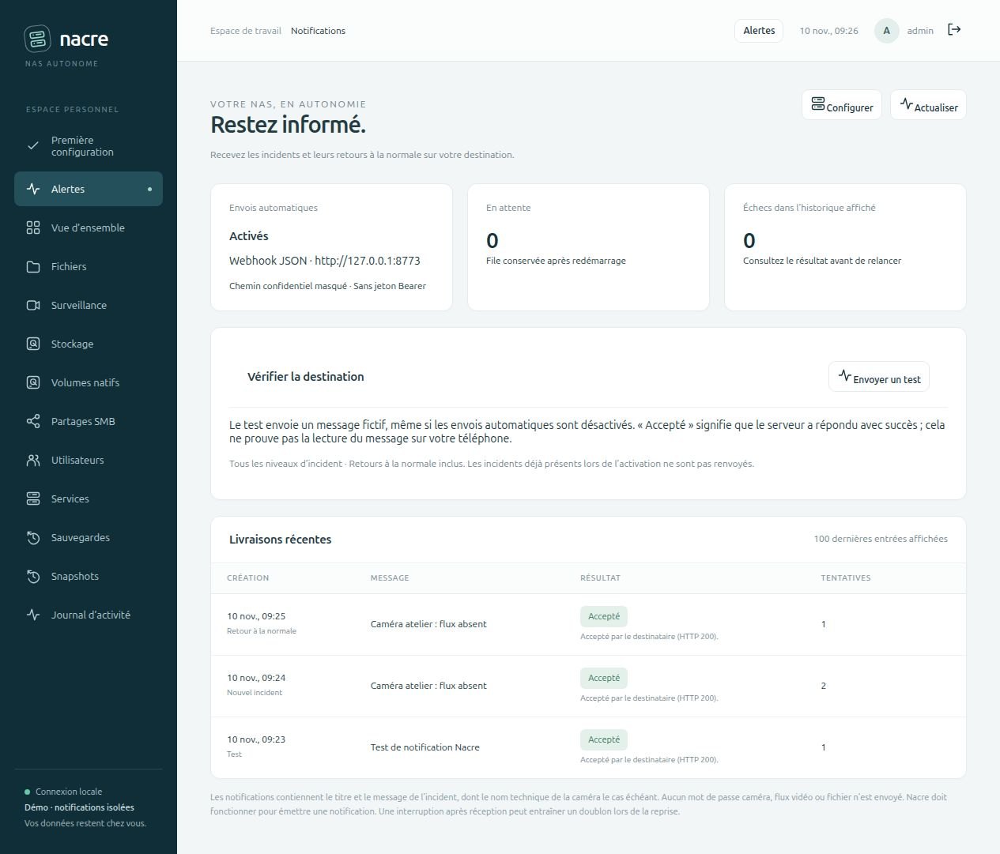
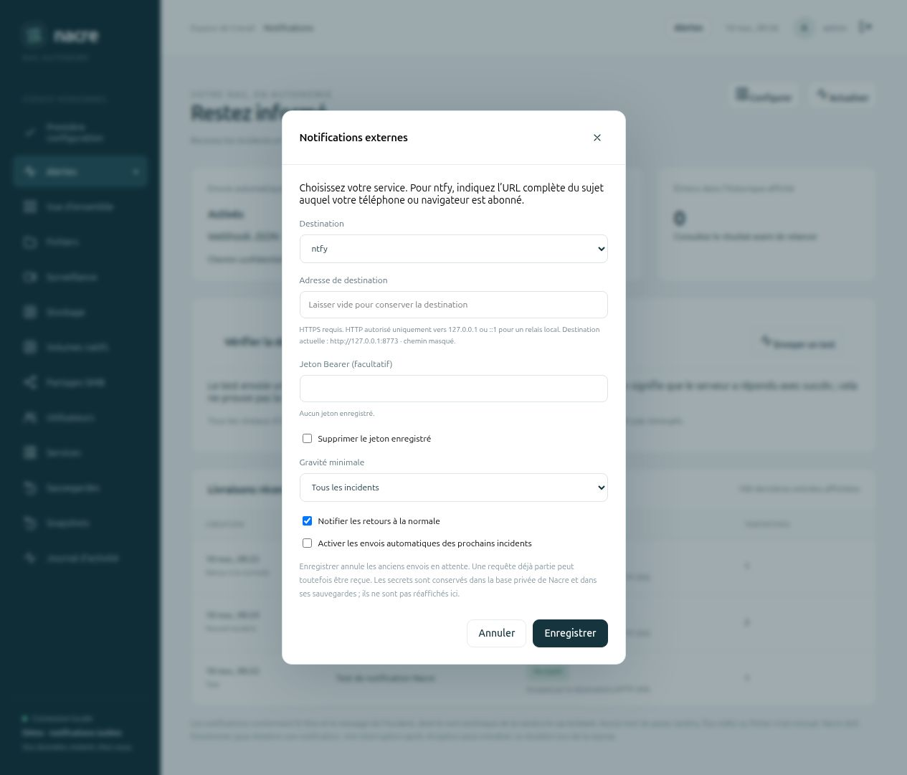

# Notifications externes · ntfy et webhook JSON

**0.8.0-alpha.5** permet de configurer une destination depuis **Alertes → Notifications**. Les envois automatiques sont désactivés par défaut. Une seule destination est active à la fois : serveur ntfy, y compris auto-hébergé, ou récepteur acceptant le format JSON Nacre. Aucun abonnement ni compte tiers n’est créé par Nacre.



## Configurer depuis le navigateur

1. Se connecter avec un compte administrateur, ouvrir **Alertes**, puis **Notifications → Configurer**.
2. Choisir **ntfy** ou **Webhook JSON**. Pour ntfy, renseigner l’URL complète du sujet, par exemple `https://ntfy.example/mon-sujet-prive`, et s’abonner à ce même sujet depuis son appareil. Pour un webhook, utiliser l’URL du récepteur de votre outil ou relais.
3. Renseigner éventuellement un jeton Bearer. Choisir tous les incidents ou seulement les critiques, ainsi que les retours à la normale.
4. Enregistrer, puis cliquer sur **Envoyer un test**. Le test utilise un message fictif et fonctionne même avec les envois automatiques désactivés. Consulter sa livraison avant d’activer les notifications des prochains incidents.
5. Activer les envois automatiques quand la destination convient. Les incidents déjà présents ne sont pas renvoyés ; une aggravation, une nouvelle sauvegarde échouée ou une récidive peuvent produire un nouvel événement.

Le chemin de destination et le jeton ne sont pas réaffichés. Laisser un champ vide conserve sa valeur ; l’option de suppression retire le jeton. Changer d’adresse avec un jeton existant exige de fournir le jeton adapté ou de choisir sa suppression. Toute sauvegarde des réglages annule les envois encore en attente, même si seuls les filtres changent. Une requête déjà partie peut cependant être reçue.



## Événements et filtre

| Événement | Déclenchement |
| --- | --- |
| `opened` | Incident confirmé par le collecteur local |
| `updated` | Passage au niveau critique ou nouvelle version de l’échec de sauvegarde |
| `resolved` | Retour à la normale confirmé, si cette option est active et si l’incident avait été mis en file avec la même version des réglages |
| `test` | Demande explicite depuis le navigateur ; aucun incident réel inclus |

Prendre en compte un incident ne produit pas de notification et ne résout pas cet incident. Un contrôle inconnu n’émet pas de faux retour à la normale. Avec le filtre critique, une résolution reste éligible si l’incident critique notifié était redescendu au niveau avertissement entre-temps.

La notification contient le titre, le message et l’heure de l’événement. Le nom technique de la caméra peut figurer dans le titre. Les identifiants de connexion caméra, URL RTSP, images, vidéos, fichiers, options des tâches et erreurs brutes ne sont pas inclus. Le jeton Bearer sert uniquement à l’authentification du destinataire choisi.

## Livraison et reprise

L’enregistrement de l’incident et sa mise en file utilisent **la même transaction SQLite**. Le navigateur n’a pas besoin de rester ouvert. Un travailleur séparé vérifie la file toutes les deux secondes, puis transmet un message à la fois, dans l’ordre. Le réseau ne bloque pas la transaction de collecte des incidents.

- Un HTTP `2xx` marque l’envoi **Accepté**. C’est l’acceptation du serveur, pas une preuve de lecture ni d’affichage sur un téléphone.
- Erreur réseau, erreur TLS, HTTP `408`, `425`, `429` ou `5xx` : jusqu’à cinq tentatives, avec attentes de 30 secondes, 2 minutes, 10 minutes et 30 minutes. Un envoi en attente retarde les suivants pour préserver leur ordre. `Retry-After` n’est pas interprété dans ce jalon.
- Autre réponse HTTP, notamment `3xx`, `400`, `401` et `403` : échec sans répétition automatique. Après correction côté destinataire, **Relancer** réutilise l’identifiant et replace l’envoi en fin de file, uniquement si les réglages Nacre n’ont pas changé.
- Un envoi interrompu en cours peut être repris après expiration de son bail de 60 secondes. Si la cinquième tentative est interrompue, son résultat devient un échec au résultat inconnu, avec possibilité de relance explicite.
- Une interruption après réception mais avant enregistrement du succès peut produire un doublon. Le webhook reçoit un identifiant stable pour permettre une déduplication chez le destinataire. ntfy ne bénéficie pas ici d’une garantie de déduplication.

La file conserve au maximum 1 000 envois en attente et les 100 dernières entrées terminées selon l’ordre de la file ; l’interface affiche les 100 dernières entrées. Une saturation incrémente un compteur visible de notifications non mises en file, sans supprimer l’incident local. Cette borne concerne les notifications, pas les fichiers ou sauvegardes du NAS. Le test manuel est limité à une demande toutes les 30 secondes.

## Transport et secrets

HTTPS utilise le magasin de certificats de confiance du système et vérifie le certificat et le nom du serveur. HTTP n’est admis que vers les adresses littérales `127.0.0.1` et `::1`, pour un relais sur le même hôte. Un service auto-hébergé sur le réseau doit utiliser HTTPS avec une chaîne de confiance reconnue par le système. Les identifiants intégrés dans l’URL et les fragments sont refusés. Les redirections sont refusées ; les proxys des variables d’environnement ne sont pas utilisés.

La configuration et la file se trouvent dans la clé `notifications_v1` de la table `settings`, dans la base privée existante. Aucun changement de schéma n’est nécessaire. Les secrets y sont **stockés en clair sous les permissions privées de Nacre**, et figurent donc dans une sauvegarde complète de cette base. L’API de consultation ne les renvoie pas. Après restauration d’une base, sa configuration et sa file sont également restaurées : démarrer toute copie de test ou second hôte avec le réseau isolé, puis vérifier la destination et désactiver les envois depuis la console avant de lever cette isolation, afin d’éviter des notifications indésirables ou doublonnées.

Les routes de lecture et de modification sont réservées aux administrateurs. Toute écriture exige une session, la protection CSRF et la version actuelle des réglages. Les erreurs réseau sont remplacées par des messages fixes ; URL secrètes, jetons et corps des réponses HTTP ne sont pas copiés dans l’historique ou le journal.

## Contrat du webhook

Une requête `POST`, `Content-Type: application/json`, porte l’en-tête `X-Nacre-Event-Id` et, si configuré, `Authorization: Bearer …`. Exemple fictif :

```json
{
  "schema": "nacre.alert.v1",
  "id": "identifiant-stable-de-l-envoi",
  "event": "opened",
  "incident_id": "identifiant-de-l-incident",
  "version": 1,
  "severity": "warning",
  "title": "Caméra atelier : flux absent",
  "message": "Vérifiez sa connexion locale.",
  "occurred_at": 1794312000
}
```

Le récepteur doit accepter ce contrat et répondre en `2xx`. Il ne s’agit pas d’un adaptateur universel pour les formats propres à Slack, Discord ou d’autres produits : utiliser un relais qui adapte le JSON si nécessaire.

Le profil ntfy publie un texte UTF-8 vers l’URL du sujet, avec titre `Nacre`, priorité 4 pour un incident critique et 3 pour les autres messages ou retours à la normale. L’heure UTC de l’événement est incluse pour distinguer un envoi retardé. Référence du protocole : [publication ntfy et authentification](https://docs.ntfy.sh/publish/).

## Validation et limites

161 tests Python et 14 JavaScript. Les 15 nouveaux cas Python couvrent événements transactionnels, filtres, absence de doublons à collecte inchangée, erreurs HTTP, reprise, épuisement des tentatives, accès concurrents, changement de destination, secrets, CSRF, débordement et TLS. Un serveur HTTPS local au certificat non approuvé est effectivement refusé ; la même connexion réussit lorsque le test lui accorde explicitement confiance, sans modifier la validation TLS du produit.

Le parcours navigateur utilise une base dédiée et un récepteur loopback jetable : configuration du webhook, test reçu, incident simulé avec premier HTTP 503, arrêt et redémarrage réels de la console avant reprise, puis résolution livrée après l’incident. Le même récepteur vérifie aussi le format ntfy configuré dans le navigateur, avec les envois automatiques désactivés. Il n’y a pas d’envoi à un service Internet, de push réel vers téléphone ou de modification de la caméra de production. Les preuves structurées sont dans `VALIDATION.json`, entrée `external_notifications_0_8_alpha5`.

Ce jalon ne comprend pas SMTP/email natif, plusieurs destinations simultanées, alertes répétées tant qu’un incident persiste, règles horaires ou suivi d’une lecture. Une panne complète du NAS ou de Nacre nécessite toujours un observateur externe. Les files et livraisons dépendent du processus Nacre en fonctionnement ; une sauvegarde de base restaurée peut réintroduire des envois anciens.
