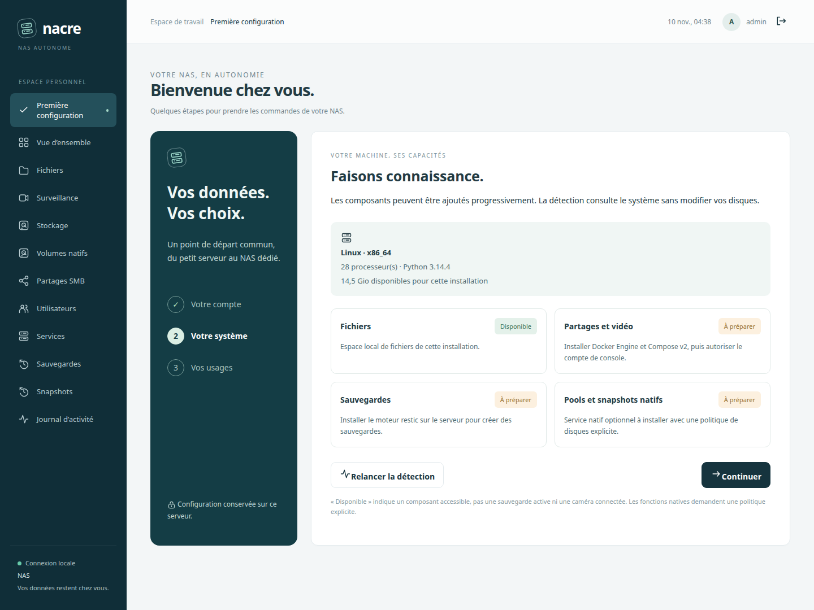

# Premier démarrage

## Ouvrir la console

Sur Linux x86-64 ou ARM64, avec Python 3.11+ et un compte non root, exécuter `python3 installer.py` depuis le dépôt. Le processus reste au premier plan ; l’arrêter avec Ctrl+C ferme la console, sans effacer la configuration. `python3 installer.py --prepare-only` prépare uniquement les fichiers. Cette commande n’installe pas Linux ni ses paquets.

Dans un second terminal, `python3 lab.py acces` affiche le compte provisoire. Ouvrir `http://127.0.0.1:8766/`. Pour un serveur distant, établir le tunnel indiqué par l’installateur : `ssh -N -L 8766:127.0.0.1:8766 votre-serveur`. La console reste liée à l’interface locale.

## Trois étapes dans le navigateur

1. **Votre compte.** Se connecter avec le compte provisoire `admin`, puis choisir et confirmer un mot de passe de 12 à 128 caractères, différent du provisoire. Les autres sessions et tickets sont révoqués ; le jeton CSRF de la session courante est renouvelé. Le mot de passe choisi est haché, jamais enregistré en clair dans le fichier d’accès. Le nom initial `admin` reste fixe ; les autres comptes se gèrent ensuite dans Utilisateurs. Les identités Samba et caméra restent distinctes.
2. **Votre système.** Consulter l’architecture, Python, le nombre de processeurs et l’espace disponible pour l’installation. Fichiers, accès Docker/Compose, moteur de sauvegarde et présence du service natif sont distingués. La présence du socket natif ne prouve pas ses permissions ni la disponibilité des volumes : l’assistant indique « À vérifier ». Les sondes de commande sont bornées et aucune opération de disque n’est lancée.
3. **Vos usages.** Enregistrer le nom affiché et un fuseau IANA disponible sur le système. Le nom réseau Linux ne change pas. Le fuseau règle les dates de la console ; les plans de sauvegarde existants conservent leur propre fuseau. Les raccourcis conduisent ensuite au stockage, aux sauvegardes et à la surveillance.

Une actualisation ou une déconnexion reprend après le mot de passe déjà enregistré ; les champs de la dernière étape ne sont persistés qu’à sa validation. L’assistant reste accessible dans le menu **Première configuration**.

## Installer les fonctions selon le matériel

| Fonction | Préparation nécessaire | Configuration suivante |
| --- | --- | --- |
| Fichiers locaux | Aucune dépendance supplémentaire | Ouvrir Fichiers |
| Partages Samba et vidéo | Docker Engine et Compose v2 accessibles au compte dédié, puis installation dans Services | Utilisateurs/Partages SMB, puis configuration caméra |
| Sauvegardes | Installer restic dans Services | Choisir une destination, créer le dépôt et décider de l’activation des plans |
| Pools et snapshots natifs | Service privilégié optionnel et politique explicite | Voir Stockage, Volumes natifs et le guide d’installation |
| Démarrage persistant | systemd utilisateur ; arrêter d’abord la console au premier plan | `python3 console/install_service.py` |

L’assistant ne télécharge aucun paquet, ne formate aucun disque, ne démarre aucun conteneur et ne crée aucun dépôt ou plan de sauvegarde. Une fonction « Disponible » signifie que son composant répond, pas que sa configuration métier est terminée. Le bouton **Installer les composants** ouvre Services ; **Surveillance → Ajouter une caméra** permet ensuite la connexion. Voir [le guide dédié](COMPONENTS-CAMERAS.md).

## Installation existante et migration

La base passe au schéma 2 avec une copie préalable vérifiée. La table `settings` contient l’état de l’assistant et ses préférences. Une base existante sans cet état est considérée comme déjà configurée ; aucun compte ni mot de passe n’est remplacé. L’assistant peut ensuite être ouvert volontairement. Le nom par défaut est Nacre et le fuseau UTC tant qu’aucune préférence n’a été enregistrée.

Les modifications de mot de passe, révocations et progression sont enregistrées dans une même transaction SQLite. L’API de configuration exige une session administrateur ; les modifications exigent aussi le contrôle d’origine et le jeton CSRF. Aucun point de création de compte anonyme n’est ajouté. L’assistant est une aide au parcours : les API existantes restent accessibles aux administrateurs authentifiés.

## Validation de cette version

113 tests Python et 7 JavaScript, dont six cas serveur pour le premier accès, les refus d’autorisation, la rotation du secret, la reprise, les préférences et la migration 1 → 2. Deux régressions JavaScript couvrent le retour depuis un ancien favori et une réponse tardive après navigation.

Chrome réel, instance temporaire distincte de la console en service : connexion, mot de passe, actualisation, préférences, fin du parcours, tableau de bord sans services Docker et réouverture de l’assistant. Affichage 1440 px et 390 px contrôlé, sans débordement horizontal ni erreur JavaScript. Préparation CLI exécutée deux fois avec un PATH sans outils externes : un compte, aucun dépôt ni plan. Aucun nouveau test de coupure ni accès à la caméra réelle n’a été nécessaire.
