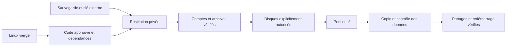

# Reprendre Nacre sur un Linux neuf

> **0.7.0-alpha.3 · parcours qualifié sur Ubuntu 24.04 x86-64 et ARM64, dans QEMU.**
> La reprise part d’une sauvegarde d’installation complète et de sa clé externe. Elle retrouve les comptes et les données, puis permet de créer un nouveau pool. Elle ne reconstitue pas les blocs des anciens disques ni leurs anciens snapshots.

## Deux situations distinctes

| Situation | Parcours |
| --- | --- |
| Installation Linux perdue, données sauvegardées | Installer Linux, restituer Nacre, créer un pool neuf et y recopier les données |
| Miroir Nacre encore monté avec un membre sain | [Reconstruire le RAID1](POOL-RECOVERY.md) sur un nouveau membre |
| Tous les membres perdus, ancien pool non montable ou catalogue absent | Restaurer depuis les sauvegardes ; pas d’assemblage forcé proposé par Nacre |



## 1. Préparer le nouvel hôte

Conserver la source arrêtée pendant la répétition. Installer un Linux de même architecture et recréer le compte opérateur avec les mêmes UID/GID. Prévoir Docker/Compose v2, Python 3.11+, rsync et, pour le miroir Btrfs qualifié, mdadm et btrfs-progs. Installer Nacre depuis une version approuvée, puis son runtime restic vérifié. Suivre [INSTALLATION.md](INSTALLATION.md) pour les services et les droits Docker.

Le dépôt de reprise, sa clé et les dépôts historiques doivent être disponibles sur des supports indépendants de l’ancien NAS. Les secrets ne doivent pas être copiés dans Git. Prévoir l’espace de la restitution privée **et** du nouveau pool : le parcours conserve la copie intermédiaire.

## 2. Retrouver les données et les identités

Exécuter les étapes 4 et 5 de [SYSTEM-RECOVERY.md](SYSTEM-RECOVERY.md) : `prepare`, `samba`, puis `attach` pour chaque dépôt historique. La destination doit être neuve, sous un parent privé. Vérifier fichiers témoins, propriétaires numériques, ancien compte web, comptes Samba secondaires et déchiffrement d’une archive historique.

Les anciennes sessions sont révoquées, les plans restent désactivés. L’import Samba crée un volume Docker distinct. Les données des anciennes zones natives sont restituées dans `data/fichiers/reprise-volumes/<zone>/`. Leur catalogue administratif est une référence à examiner ; il n’autorise aucun disque du nouvel hôte.

## 3. Créer le pool de remplacement

Installer explicitement le service natif selon [INSTALLATION.md](INSTALLATION.md) et la section native du [guide détaillé](../LIRE-MOI.txt). Relever les chemins persistants, séries et capacités du nouvel équipement, puis établir une **nouvelle politique root** limitée aux disques vierges choisis. Ne pas réutiliser aveuglément les chemins de la source.

Dans **Volumes natifs**, préparer le profil, vérifier chaque série et confirmer la création. Le banc qualifie un miroir mdadm RAID1 à deux disques entiers avec Btrfs. Attendre sa synchronisation initiale avant de poursuivre. Aucun disque système ne fait partie de cette sélection.

## 4. Repeupler et raccorder les partages

Maintenir les services écrivains arrêtés pendant la copie. Pour chaque ancienne zone, copier son contenu vers le dossier `data` du nouveau volume correspondant. Exemple à adapter après vérification des deux chemins :

```bash
sudo rsync -aHAX --numeric-ids --checksum \
  /reprise/nacre/data/fichiers/reprise-volumes/ANCIENNE_ZONE/ \
  /srv/nacre-volumes/NOUVEL_IDENTIFIANT/data/
```

Le slash final copie le contenu. Aucun `--delete` n’est nécessaire. Conserver la restitution intermédiaire jusqu’à validation. Vérifier plusieurs empreintes, propriétaires, droits et sous-dossiers. La préservation complète des ACL et attributs étendus reste à qualifier, malgré les options de copie utilisées.

Démarrer la console, puis modifier la destination des partages dans **SMB** pour sélectionner le nouveau volume et le bon sous-dossier. Revoir chaque source de sauvegarde et chaque destination : les anciennes références natives ne désignent pas automatiquement le nouveau pool. Cette association est administrative ; elle n’est pas une migration automatique en un clic.

## 5. Valider la remise en service

Vérifier la connexion avec l’ancien compte web, un accès Samba autorisé, le refus d’un compte désactivé et le refus d’écriture sur un partage en lecture seule. Au démarrage, la console peut répondre avant que Docker et la surveillance des montages aient rétabli les partages ; attendre leur disponibilité et vérifier les accès, pas seulement la page web. Créer un snapshot de test, restituer un fichier témoin, puis redémarrer Linux et vérifier à nouveau les montages et les accès. N’activer les plans qu’après validation de leurs sources et destinations.

Le banc neuf vérifie console, Samba, données, clés, pool et redémarrage. La reprise d’une vraie caméra et le décodage Frigate sur ARM64 disposent désormais de leur [recette séparée](CONCURRENT-IO-CAMERA.md). La reprise ARM64 sur une seconde VM vierge et les coupures pendant reconstruction sont détaillées dans [POWER-CUT-LAB.md](POWER-CUT-LAB.md). Le changement d’UID/architecture, les très gros volumes et les pannes électriques des contrôleurs physiques restent hors du périmètre qualifié.

Preuves : [VALIDATION.md](VALIDATION.md), [banc Linux neuf](../tests/integration_fresh_linux_vm.py), [banc reconstruction](../tests/integration_mirror_repair_vm.py).
