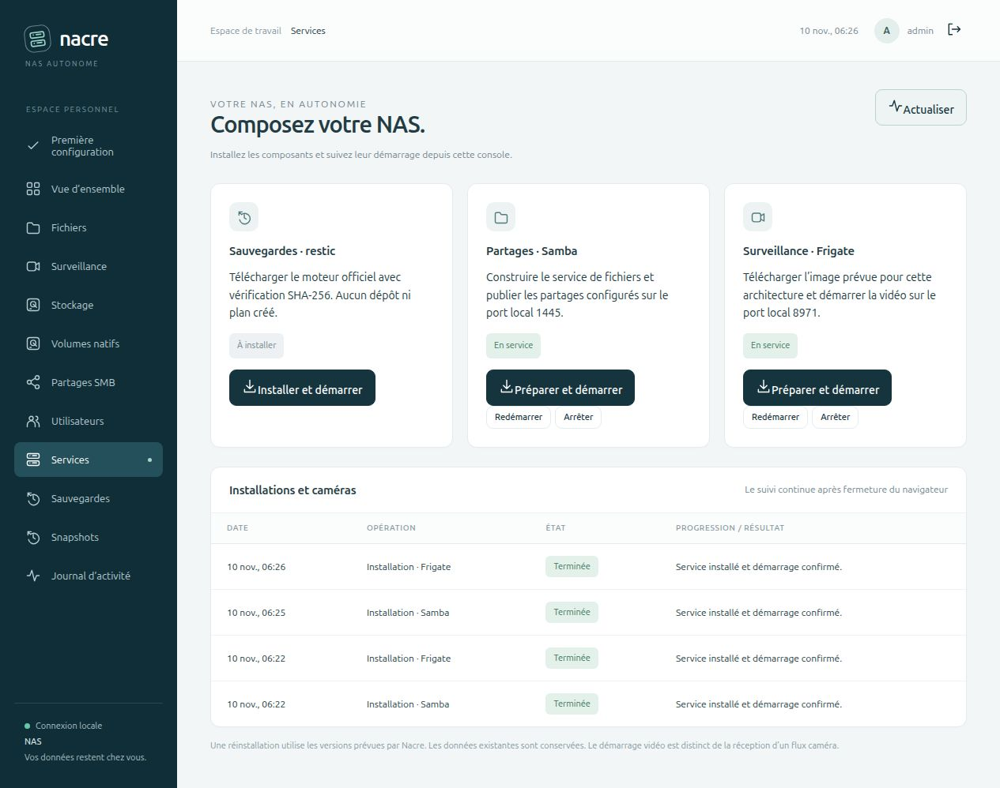

# Samba et Frigate : installation web sur Linux neuf

> **Vérifié le 10 novembre 2026 · 0.8.0-alpha.2**
> Installation réelle depuis Nacre sur Ubuntu 24.04 ARM64 vierge, puis relance avec conservation des données.



## Ce que fait le navigateur

Dans **Services**, choisir **Installer et démarrer** pour Samba, confirmer, puis attendre la fin de la tâche. Procéder de même pour Frigate. Nacre construit Samba, récupère l’image Frigate prévue pour l’architecture, démarre les services et contrôle leur disponibilité. Les tâches continuent lorsque le navigateur est fermé ; un rechargement retrouve leur résultat.

Samba doit répondre au contrôle de son démon avant l’application finale des partages. Frigate doit être déclaré `healthy`. L’interface distingue « Démarrage en cours », « À vérifier » et « En service » selon la santé remontée par Docker ; chaque installation nomme désormais son composant dans l’historique.

Une nouvelle demande **Préparer et démarrer** conserve les données et les configurations. Elle peut reconstruire l’image Samba et réappliquer ses partages ; prévoir une interruption possible des accès correspondants. Ce n’est pas une mise à niveau transactionnelle avec retour arrière.

## Préparer un Linux neuf

1. Utiliser un compte dédié non root, Python 3.11 ou supérieur et le dépôt Nacre.
2. Installer Docker Engine et le plugin Compose, puis rendre Docker accessible au compte dédié. Pour Ubuntu, suivre la [procédure officielle du dépôt APT Docker](https://docs.docker.com/engine/install/ubuntu/). Le droit Docker donne un accès privilégié à l’hôte ; Nacre ne l’attribue pas depuis le navigateur.
3. Lancer `python3 installer.py`, consulter les accès provisoires dans un second terminal avec `python3 lab.py acces`, puis terminer l’assistant.
4. Ouvrir **Services** et effectuer les installations ci-dessus.
5. Configurer les partages et ajouter les caméras selon les besoins. Le démarrage de Frigate ne signifie pas qu’une caméra fournit un flux.

L’installation des paquets système, le lancement initial de Nacre et son éventuelle unité systemd restent une préparation administrative. Ce parcours ne prétend pas installer Linux ou Docker depuis une page web. La console reste en boucle locale ; utiliser le [tunnel SSH documenté](INSTALLATION.md). SMB reste sur `127.0.0.1:1445`, Frigate sur le port local `8971` : aucune ouverture automatique au LAN.

## Banc exécuté

| Élément | Environnement observé |
| --- | --- |
| Système invité | Ubuntu 24.04 ARM64, image cloud minimale vierge |
| Isolation | QEMU/KVM, disque virtuel 16 Gio, 2 vCPU, 3 Gio RAM |
| Docker Engine | 29.9.3 |
| Plugin Compose | 5.7.0, commande `docker compose` |
| Samba construit | 4.22.10, image Alpine épinglée dans le dépôt |
| Frigate | 0.18.2-cfa08c5, image ARM64 épinglée par digest |
| Données | Fichiers aléatoires, compte de test, aucune caméra réelle |

Le disque invité n’a aucun montage des données de production. Le réseau invité est en NAT pour les téléchargements ; seule son entrée SSH est redirigée sur la boucle locale de l’hôte. Le navigateur rejoint Nacre par tunnel SSH. Aucune image ni aucun conteneur Docker ne préexistait dans l’invité avant les clics.

L’image de base utilisée porte le SHA-256 `3dc8370d923978d4b610fa7964d1b36ba040eefb43198809ca5bc8ac51777b18`. La première installation utilise le code 0.8.0-alpha.1 ; les améliorations de disponibilité et d’affichage de cette version sont ensuite déployées et contrôlées par une nouvelle demande web pour chaque composant. Les caches de téléchargement sont conservés pour cette seconde demande.

## Résultats

- Quatre tâches web terminées : première installation Samba et Frigate, puis une nouvelle demande pour chacun.
- Fichier de 1 Mio écrit et relu par SMB3, comparaison intégrale et SHA-256 identiques.
- Le premier fichier témoin reste identique après les deux nouvelles demandes.
- Écriture sur le partage vidéo refusée avec `NT_STATUS_ACCESS_DENIED`, aucun fichier créé.
- Frigate `healthy`, statistiques consultables par Nacre, aucune caméra configurée.
- Résultats visibles après redémarrage de la console et rechargement de la page.
- Aucun dépôt ni plan de sauvegarde créé ; services de production et caméra existante inchangés.
- 129 tests Python et 9 JavaScript, dont les refus Samba sans démon prêt, son attente avant application des partages et la confidentialité des options de tâche.

Le script [`tests/integration_web_install_vm.py`](../tests/integration_web_install_vm.py) vérifie les résultats après les actions du navigateur. Il exige une VM QEMU et `NACRE_VM_LAB=1`, utilise des fichiers synthétiques et retire sa session temporaire. Il nécessite le client `smbclient` dans l’invité et ne déclenche aucune installation à la place du navigateur :

```bash
NACRE_VM_LAB=1 NAS_PORT=8769 python3 tests/integration_web_install_vm.py
```

Les mesures structurées sont dans [`VALIDATION.json`](../VALIDATION.json), entrée `fresh_web_install_0_8_alpha2`. Les disques virtuels, comptes, clés SSH, configurations privées et journaux bruts ne sont pas publiés.

## Portée

Ce banc qualifie une installation neuve ARM64 et une relance conservant les données. Il ne constitue pas une matrice d’installation réelle de toutes les distributions ou de tous les matériels. Les tests unitaires CI couvrent x86-64 et ARM64 ; aucun nouveau déploiement intégral x86-64 n’est revendiqué ici. La caméra réelle, le GPU, la charge multi-caméra, les coupures et le redémarrage de l’hôte ne sont pas retestés dans ce parcours.
