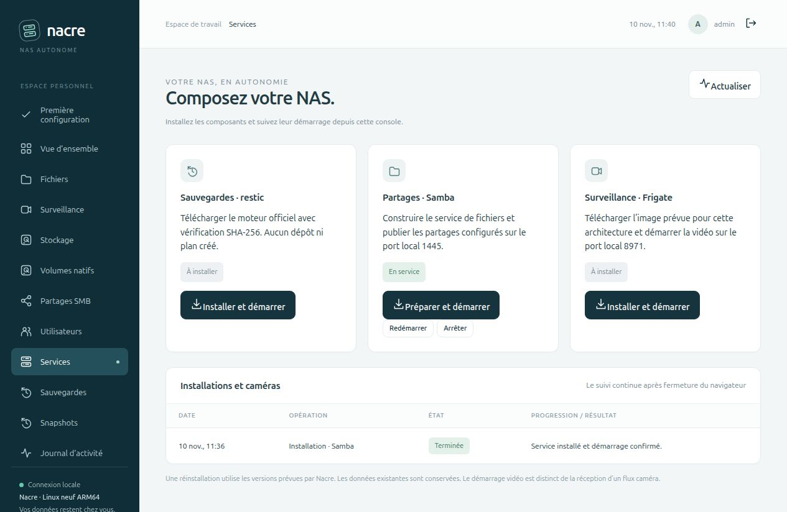

# Préparer Ubuntu et conserver Nacre après redémarrage

La version **0.8.0-alpha.3** réduit la préparation à un plan administrateur et une installation de service utilisateur. La préparation automatique cible Ubuntu 24.04 x86-64 ou ARM64 ; le banc réel de ce jalon est ARM64.

## Parcours

Depuis le dépôt, sous le compte existant qui exécutera Nacre :

```bash
# Examiner le plan ; aucune modification système.
python3 scripts/prepare_host.py --user "$USER"

# Appliquer explicitement sous ce même compte.
sudo python3 scripts/prepare_host.py --user "$USER" --apply

# Préparer la console et la démarrer comme service utilisateur, sans sudo.
python3 installer.py --service
```

Le compte doit disposer d’une session et d’un UID d’au moins 1000. Le script ne crée aucun compte et n’attribue aucun mot de passe. Il installe les paquets Ubuntu manquants `ca-certificates`, `dbus-user-session`, `docker.io`, `docker-compose-v2` et `docker-buildx`, active Docker, ajoute le compte au groupe Docker et active son maintien systemd avec `loginctl enable-linger`.

**Le groupe Docker confère un accès privilégié à l’hôte.** Cette préparation se fait dans le terminal de l’administrateur, jamais par une élévation depuis le navigateur. Les nouveaux groupes doivent être repris par la session **et par le gestionnaire systemd utilisateur**. Après une préparation neuve, prévoir un redémarrage de l’hôte à un moment choisi ; le script ne redémarre jamais la machine. Une simple nouvelle connexion SSH peut laisser le gestionnaire utilisateur existant avec ses anciens groupes.

Après ce redémarrage, Nacre revient automatiquement. Ouvrir `http://127.0.0.1:8766/`, afficher les accès provisoires avec `python3 lab.py acces` et terminer l’assistant. À distance :

```bash
ssh -N -L 8766:127.0.0.1:8766 votre-serveur
```

Dans **Services**, installer Samba et Frigate selon les besoins. Ce bootstrap ne crée aucun dépôt, aucun plan de sauvegarde et aucune caméra ; il ne provisionne aucun disque. Le parcours de composants est décrit dans [la recette Linux neuf](FRESH-WEB-INSTALL.md).

## Une préparation bornée

- Le plan est le comportement par défaut ; seul `--apply` avec les droits administrateur exécute les commandes.
- Les paquets viennent des dépôts Ubuntu déjà configurés, notamment `universe`. Aucun dépôt tiers ni script téléchargé n’est exécuté. APT vérifie les signatures selon sa configuration système.
- Un Docker CE, `containerd.io`, Podman compatible Docker, ancien Compose ou binaire Docker hors paquet Ubuntu provoque un refus avant toute modification. Le parcours manuel reste disponible : cette commande ne migre pas une installation Docker existante.
- Les paquets présents ne sont pas redemandés ; une seconde préparation complète réapplique seulement l’activation de Docker, le groupe et le maintien de session. APT utilise `--no-remove` ; les dépendances nécessaires peuvent être mises à jour.
- Un échec interrompt les étapes suivantes. La préparation système n’est pas transactionnelle : des paquets peuvent déjà être installés. Corriger la cause puis relancer ; aucune désinstallation automatique n’est tentée.
- Les autres distributions et architectures sont refusées par ce script. Nacre conserve son [installation manuelle](INSTALLATION.md).

Références des paquets : [Docker Ubuntu](https://packages.ubuntu.com/noble/docker.io), [Compose Ubuntu](https://packages.ubuntu.com/noble/docker-compose-v2). Les versions effectivement installées dépendent des mises à jour des dépôts ; le banc consigne celles qu’il a utilisées.

## Service et port local

`python3 installer.py --service --port 8769` choisit un autre port local. `--service` et `--prepare-only` sont exclusifs. Les ports acceptés sont 1024 à 65535 ; le serveur écoute toujours sur la boucle locale. Le port est conservé dans l’unité systemd. Pour produire un lien local sur ce port : `NAS_PORT=8769 python3 lab.py web`. Ce lien est un secret temporaire.

L’installateur valide l’unité avant publication, refuse une unité liée à une autre racine Nacre ou un lien symbolique, et détecte un port occupé avant le démarrage. Il garde une copie privée de la première unité remplacée, puis restaure l’unité et l’état d’activation antérieurs si son démarrage échoue. La validation systemd a notamment révélé puis permis de corriger un format invalide de `WorkingDirectory` pendant ce développement.

Le service utilise un compte non root, `UMask=0077`, `NoNewPrivileges=true` et une limite mémoire de 384 Mio pour la console. Ses tâches sont exécutées dans des unités utilisateur séparées. L’accès au socket Docker conserve sa portée privilégiée ; ces réglages ne constituent pas une isolation du compte vis-à-vis de l’hôte.

Pour consulter et arrêter le service :

```bash
systemctl --user status nacre-console.service
journalctl --user -u nacre-console.service
systemctl --user stop nacre-console.service
```

Arrêter la console au premier plan avant de la passer en service. `console/install_service.py --port PORT` reste disponible pour une installation déjà préparée. Les commandes n’ajoutent aucun accès LAN, règle de pare-feu applicative ou service système de stockage natif.

## Preuve exécutée le 10 novembre 2026

Sur Ubuntu 24.04 ARM64 vierge, dans QEMU/KVM avec 2 vCPU, 3 Gio de RAM et un disque virtuel de 16 Gio :

1. Le plan est affiché sans modification, puis la préparation s’exécute avec les paquets Ubuntu.
2. Nacre est installé comme service utilisateur sur le port 8769. Un nouveau plan ne demande plus de paquets.
3. Un premier redémarrage confirme le démarrage de Nacre avant la connexion SSH de contrôle, le maintien du service et Docker accessible depuis le gestionnaire utilisateur.
4. Samba est installé depuis le navigateur ; la tâche s’exécute dans une unité `nacre-task-*` et termine avec succès.
5. Un second redémarrage conserve le service actif, la tâche terminée et le fichier témoin, relu par SMB3 avec la même empreinte.
6. La connexion par lien local, le port personnalisé et l’état affiché dans le navigateur sont revérifiés.

Docker observé : **29.1.3** ; Compose : **2.40.3**. **136 tests Python et 9 JavaScript** couvrent notamment refus de plateformes et de conflits, plan sans exécution, arrêt après erreur APT, chemin de service, port occupé et restitution de l’unité après échec.



Le script [`integration_host_bootstrap_vm.py`](../tests/integration_host_bootstrap_vm.py) vérifie le démarrage avant SSH, l’accès HTTP authentifié, la tâche et la lecture SMB. Il exige QEMU, un compte non root et `NACRE_VM_LAB=1`. Avant puis après un redémarrage choisi par l’opérateur :

```bash
NACRE_VM_LAB=1 NAS_PORT=8769 python3 tests/integration_host_bootstrap_vm.py
NACRE_VM_LAB=1 NAS_PORT=8769 python3 tests/integration_host_bootstrap_vm.py --after-reboot
```

Les mesures sont publiées dans `VALIDATION.json`, entrée `host_bootstrap_0_8_alpha3`. Les clés, comptes, disques et journaux privés du banc sont exclus du dépôt. Ce parcours ne reteste pas Frigate, les caméras, la reconstruction des pools ou les coupures ; leurs validations restent celles des jalons précédents. Aucun hôte ni service de production n’est modifié.
