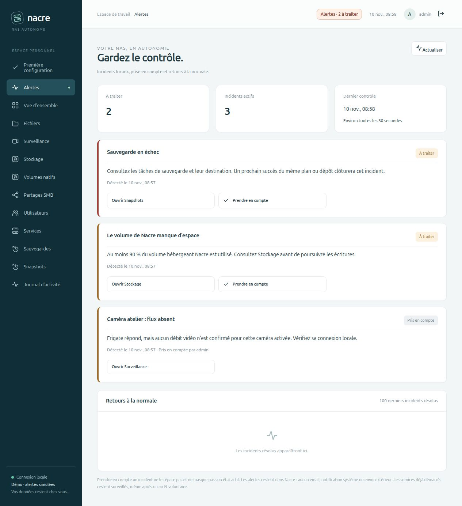
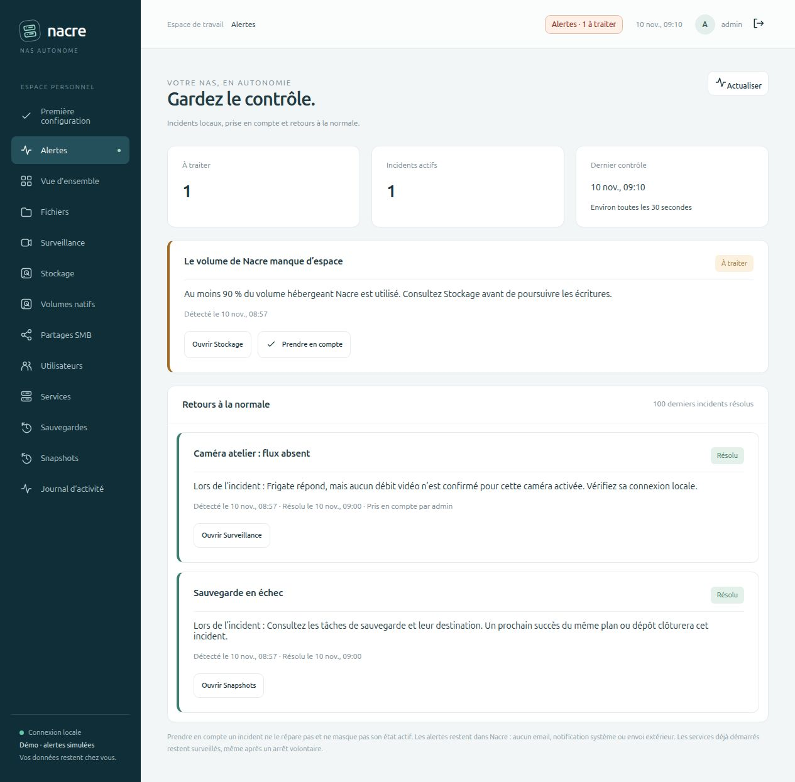

# Alertes locales et suivi des incidents

**0.8.0-alpha.4** ajoute un centre **Alertes** réservé aux administrateurs et un compteur accessible depuis toutes les pages. Le contrôle continue tant que le processus Nacre fonctionne, même sans navigateur ouvert. Aucun envoi extérieur, notification du système, email ou action corrective automatique n’est déclenché.

*Banc de démonstration distinct : les trois incidents affichés proviennent de sources simulées. Aucun flux caméra réel n’a été interrompu et aucun disque n’a été rempli.*

## Parcours

1. Ouvrir **Alertes** pour distinguer les incidents à traiter et ceux déjà pris en compte.
2. Utiliser le lien vers Services, Surveillance, Stockage ou les sauvegardes pour consulter le contexte.
3. **Prendre en compte** enregistre le compte administrateur et la date. L’incident reste actif ; ce bouton ne répare rien et ne masque pas la panne.
4. Quand le contrôle confirme un retour à la normale, l’incident rejoint l’historique. Les 100 derniers incidents résolus sont conservés, ainsi que tous les incidents actifs.

Une aggravation vers le niveau critique ou une nouvelle sauvegarde échouée dans le même groupe demande à nouveau une prise en compte. Une ancienne page ne peut pas acquitter silencieusement cette nouvelle version : elle doit être actualisée. Une nouvelle panne après résolution crée un nouvel incident.

## Périmètre surveillé

| Source | Déclenchement | Retour à la normale |
| --- | --- | --- |
| Samba / Frigate | Service déjà observé démarré, ou installation terminée dans Nacre, désormais arrêté ou non sain | Service à nouveau en fonctionnement, sans santé `starting` ou `unhealthy` |
| Accès Docker | Docker ne répond plus alors que des services étaient connus | Lecture de l’état des services à nouveau possible |
| Caméra activée | Frigate répond et les statistiques ne confirment aucun débit `camera_fps` positif | Débit positif, caméra désactivée ou retirée d’une configuration lisible |
| Configuration / statistiques vidéo | Frigate tourne, mais la configuration ou les statistiques ne sont pas lisibles | Configuration et statistiques de nouveau accessibles |
| Sauvegarde | Dernier résultat terminé `failed` ou `partial`, regroupé par type et par plan, sinon dépôt | Résultat terminé `done` dans le même groupe |
| Volume de Nacre | Occupation d’au moins 90 %, critique à partir de 97 % | Occupation inférieure à 90 % |

Les tâches en cours et annulées ne remplacent pas le dernier résultat terminé d’une sauvegarde. Les archives locales historiques forment leur propre groupe. Les échecs de restauration, de mise à jour ou d’installation ne sont pas assimilés à des échecs de sauvegarde dans ce jalon ; ils restent visibles dans leurs tâches.

Un composant jamais installé et jamais observé démarré ne provoque pas d’alerte. Un service déjà utilisé reste surveillé après un arrêt volontaire ; la prise en compte permet de reconnaître cet état attendu. Les caméras désactivées ne produisent pas de nouveaux incidents de flux. La surveillance d’espace concerne **le système de fichiers hébergeant Nacre**, pas tous les pools, volumes natifs, quotas ou destinations de sauvegarde.

## Confirmation et incertitude

La collecte tourne dans un fil dédié, avec une pause de 30 secondes entre les passages. Les contrôles prennent eux-mêmes du temps : ce n’est pas une garantie de délai de détection. Hors sauvegardes, ouverture et résolution demandent deux observations concordantes séparées d’au moins 30 secondes. Les résultats terminés de sauvegarde sont traités au prochain passage sans confirmation supplémentaire.

Un contrôle inconnu conserve les incidents correspondants et remet à zéro leur confirmation en cours. Les familles de contrôles sont indépendantes : une panne de lecture Docker n’efface pas une panne caméra, et une installation en cours ne suffit pas à déclarer le contrôle vidéo rétabli. Les contrôles de services et vidéo sont suspendus pendant les tâches d’installation et de configuration caméra.

Après plus de 90 secondes sans collecte enregistrée, la page indique un contrôle périmé. Un redémarrage après une longue interruption repart avec des confirmations neuves. Si la console ou l’hôte est totalement arrêté, **Nacre ne peut pas lui-même prévenir de son indisponibilité** : il faut un observateur externe pour cette fonction.

## Données et accès

L’état se trouve dans la table `settings` de la base privée existante, sous la clé `alerts_v1`. Aucune migration de schéma supplémentaire n’est nécessaire. Incidents, prises en compte et historique survivent au redémarrage et sont inclus dans la sauvegarde de cette base. Les retours à la normale, apparitions, actualisations et prises en compte laissent une trace dans le journal.

`GET /api/alerts` lit uniquement cet état persistant, sans interroger Docker ni les caméras. Il est réservé aux administrateurs. `POST /api/alerts/acknowledge` exige une session administrateur, le contrôle CSRF et la version courante de l’incident. La collecte et la prise en compte utilisent des transactions pour préserver leurs mises à jour respectives.

Les messages sont construits à partir d’un vocabulaire fixe et des identifiants de caméra validés. Les réponses ne contiennent ni options de tâches, ni URL RTSP, ni identifiants de connexion, ni messages bruts des services. Les groupes de sauvegarde sont représentés par des empreintes internes. La lecture YAML de la configuration via le conteneur est bornée à 20 secondes ; une erreur devient un contrôle inconnu.

## Validation

**146 tests Python et 11 JavaScript.** Les nouveaux cas couvrent confirmation temporelle, déduplication, résolution, récidive, prise en compte persistante, version périmée, changement de gravité, sources inconnues, contrôle périmé, suspension pendant déploiement, caméras désactivées, regroupement des sauvegardes, seuils disque, historique borné, autorisations, CSRF, échappement HTML et réponse reçue après navigation ou déconnexion.

Le banc HTTP local utilise une base et des fichiers dédiés, avec sources simulées :

- Trois incidents présentés dans le navigateur ; prise en compte de la caméra, compteur ramené de trois à deux sans supprimer l’incident actif.
- Redémarrage réel du processus de console ; même incident et même prise en compte retrouvés.
- Retour simulé de la caméra et de la sauvegarde ; le collecteur périodique clôture les deux incidents, conserve la prise en compte dans l’historique et laisse l’alerte d’espace active.

Les preuves structurées sont dans `VALIDATION.json`, entrée `local_alerts_0_8_alpha4`. Les contrôles système, la caméra réelle et les coupures matérielles ne sont pas rejoués dans ce banc. Aucune panne de production n’est injectée et aucun message externe n’est envoyé. Un faible débit positif ne prouve pas la fraîcheur des images, l’intégrité des enregistrements ou la disponibilité du PTZ ; ces diagnostics restent hors de cette première surveillance.
