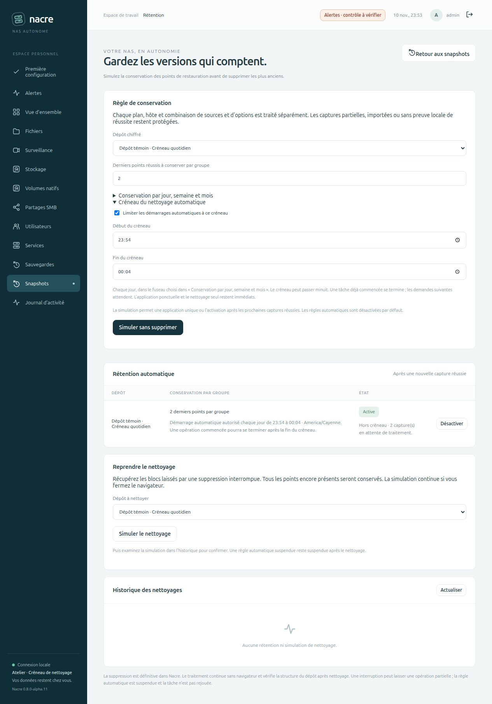

# Choisir le créneau du nettoyage automatique

Depuis **0.8.0-alpha.11**, chaque dépôt peut limiter le démarrage de sa rétention automatique à une plage quotidienne. Cette option est désactivée par défaut ; une règle existante reste sans restriction horaire tant qu’un administrateur n’a pas simulé puis confirmé son changement.

## Depuis le navigateur

Dans **Snapshots → Gérer la rétention**, ouvrir **Créneau du nettoyage automatique**, cocher la limitation et choisir le début et la fin. Le fuseau est celui de la règle, réglable dans **Conservation par jour, semaine et mois**, même si les catégories calendaires sont à zéro. Lancer la simulation puis **Activer après les prochaines sauvegardes**. La confirmation reprend le créneau exact ; les paramètres envoyés directement au bouton d’activation ne peuvent pas le remplacer.

Le tableau des règles indique le créneau, le fuseau et le nombre de captures réussies encore en attente. Son actualisation préserve les champs en cours de saisie. Pour arrêter les prochains traitements, utiliser **Désactiver** ; pour changer le créneau, refaire une simulation et confirmer la nouvelle règle.

## Ce que le créneau autorise

Le début est inclus et la fin exclue. Par exemple, 22:00–05:00 autorise les démarrages à partir de 22 h jusqu’avant 5 h le lendemain. Des heures égales sont refusées lorsque la limitation est activée. Le contrôle se fait dans le fuseau enregistré, pas dans celui du navigateur.

Après une ou plusieurs nouvelles captures réussies, la console attend l’ouverture avant de lancer le worker. Elle regroupe les captures disponibles dans une seule tâche de rétention et mémorise précisément les identifiants couverts par son succès. Une capture terminée plus tard reste éligible, même si sa demande est plus ancienne. Une règle désactivée puis réactivée repart de ses nouvelles captures, comme auparavant.

Le worker recontrôle le créneau après avoir obtenu le verrou des tâches, puis juste avant la première suppression. Si le créneau est fermé, il devient **En attente du créneau** : aucun point n’a été supprimé. Ce report survit au redémarrage de la console et reprend le même identifiant de tâche ; la sélection est recalculée au moment du prochain essai. Désactiver ou remplacer la règle annule ces tâches reportées. Une reprise de base ou de NAS les annule également et désactive les règles.

**Le créneau limite le démarrage, pas la durée.** Après la première commande de suppression, la tâche peut terminer les suppressions prévues, le nettoyage et le contrôle de structure après l’heure de fin. La fin du créneau ne coupe pas restic en cours d’opération. Une interruption réelle reste un incident qui suspend la règle ; elle n’est pas confondue avec un simple report avant suppression.

Les applications ponctuelles de rétention et le nettoyage seul démarrent dès disponibilité, même hors du créneau automatique. La confirmation ponctuelle l’indique explicitement. Le créneau ne modifie pas les horaires de sauvegarde, ni les tâches de stockage ou de vidéosurveillance.

## Changement d’heure et disponibilité

Les heures sont évaluées dans le fuseau de la règle. Si un changement d’heure supprime toute la plage, aucun démarrage n’a lieu durant cette plage inexistante ; les captures attendent un créneau suivant. Une heure répétée peut être admissible deux fois, mais les identifiants persistants empêchent de retraiter les captures déjà couvertes par un succès. Aucun rattrapage n’est forcé hors créneau.

La console doit fonctionner pour distribuer les tâches. Une plage courte, des sauvegardes longues ou une console arrêtée peuvent reporter le traitement au lendemain. Cette option ne garantit pas un horaire exact de démarrage, une durée maximale ou un quota d’espace disponible.

## Preuves isolées

Les tests vérifient les frontières horaires, minuit, fuseaux et changement d’heure, la validation, le report et sa reprise, la désactivation, la reprise hors ligne, le regroupement et la concurrence. Sur un dépôt restic chiffré jetable, le traitement est reporté avant toute suppression lorsque le créneau se ferme, puis termine normalement lorsque la fermeture survient après la première suppression. Un contrôle `check --read-data` et une restauration exacte complètent ce scénario.

Le banc web utilise un dépôt distinct et un créneau proche sur l’horloge réelle. Le formulaire et la confirmation sont vérifiés dans le navigateur ; l’activation et les captures passent par son API HTTP. Les captures attendent hors créneau, la console est redémarrée, puis le traitement se déclenche à l’ouverture. Aucune donnée ni règle de Spark n’est utilisée. La publication GitHub et l’aperçu local ne déploient pas cette version sur Spark.

Résultat du banc : quatre points avant ouverture, deux captures regroupées en une tâche, deux points conservés et dernier fichier restauré à l’identique. L’interface affiche ensuite zéro capture en attente et le nettoyage terminé.
