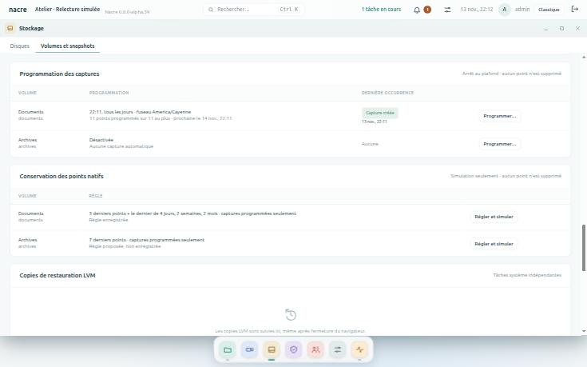
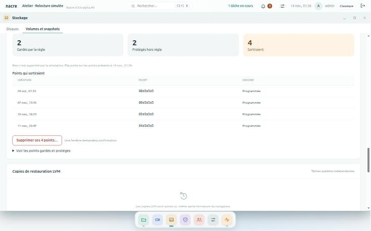
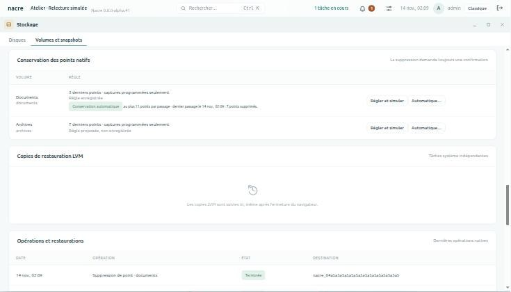

# Conservation et programmation des points natifs

Ce document répond à l’[issue 4](https://github.com/Tarzzan/nacre/issues/4) : il dit ce qui existe et ce que chaque lot apporte. Les quatre lots sont livrés, de 0.8.0-alpha.39 à alpha.42.

## Point de départ

Le service natif savait **créer** un point (Btrfs, ZFS, LVM) et le **restaurer** dans une nouvelle destination, pas le supprimer : les points s’accumulaient jusqu’à une intervention manuelle sur le stockage. Les quatre lots y répondent par étapes, la suppression en dernier.

| Lot | Contenu | Distribution | État |
| --- | --- | --- | --- |
| 1 | Règle de conservation par volume et simulation | Paquet signé | Livré en alpha.39 |
| 2 | Programmation des captures, avec plafond | Paquet signé | Livré en alpha.40 |
| 3 | Suppression explicite des points sortants | Paquet signé pour la console ; service natif à réinstaller par root | Livré en alpha.41 |
| 4 | Conservation appliquée automatiquement | Paquet signé | Livré en alpha.42 |

## Lot 1 — Règle et simulation

Dans **Stockage → Volumes et snapshots**, la carte **Conservation des points natifs** liste les volumes inscrits avec leur règle. **Régler et simuler** ouvre la règle d’un volume.

Une règle dit ce qu’il faut garder :

| Champ | Effet |
| --- | --- |
| **Derniers points à garder** | Les points les plus récents, de 1 à 1 000. Le plus récent est donc toujours gardé. |
| **Jours, semaines, mois avec capture** | En plus, le dernier point de chacune des dernières périodes qui contiennent une capture. 0 désactive la période. |
| **Appliquer aussi la règle aux captures manuelles** | Sans cette case, une capture faite à la main n’est jamais proposée à la suppression. |

**Simuler** répartit les points présents en trois listes :

- **Gardés par la règle**, avec le ou les motifs de chacun ;
- **Sortiraient** : exactement les points que la règle ne garde pas, du plus ancien au plus récent ;
- **Protégés hors règle**, avec la raison.

Sont toujours protégés : un point en cours de création, à vérifier ou invalide ; un point dont la date est absente ou dans le futur ; tous les points d’un volume sur lequel une restauration est en cours ou à vérifier ; une capture manuelle, tant que la case n’est pas cochée.

**Enregistrer la règle** la conserve pour le volume. Elle ne déclenche rien. Pour supprimer les points sortants, voir le [lot 3](#lot-3--suppression-explicite).

Ce qu’il faut savoir :

- **Rien n’est supprimé par la règle ni par la simulation.** La simulation lit l’état du service natif et calcule ; aucune commande n’est envoyée au stockage. Enregistrer une règle est inscrit au journal, avec la mention « aucune suppression ».
- **La simulation ne s’enregistre pas** et ne vaut que pour les points présents à l’instant indiqué.
- **Les périodes se comptent dans le fuseau de la console** au moment où la règle est enregistrée ; les semaines vont du lundi au dimanche.
- **Seuls les points créés par la [programmation](#lot-2--programmation-des-captures) sont « programmés »** ; tous les autres sont des captures manuelles, que la simulation ne propose de sortir que si la case est cochée.
- **Réservé aux administrateurs**, comme toute la page.
- **Sans service natif, la carte n’apparaît pas.**

La règle vit dans la table de réglages existante, une clé par volume : aucun changement de schéma.

## Lot 2 — Programmation des captures

Dans la même page, la carte **Programmation des captures** liste les volumes inscrits. **Programmer…** ouvre le réglage d’un volume.

| Réglage | Effet |
| --- | --- |
| **Heure** et **Jours** | Une capture par jour choisi, à cette heure, dans le fuseau de la console. |
| **Plafond de points programmés** | De 1 à 500, 30 par défaut. Atteint, la programmation s’arrête et le signale. |
| **Activer la programmation** | Demande de recopier « PROGRAMMER » suivi du nom du volume. Cette phrase vaut accord durable pour les captures de ce volume. |

Chaque ligne montre la programmation, le nombre de points programmés présents, la prochaine occurrence, et la dernière avec son résultat.

**Ce que fait une occurrence.** À l’heure dite, la console demande la capture au service natif par ses deux étapes habituelles, préparation puis validation, sous le compte « programmation ». Le service revérifie identité, politique et capacité, comme pour une capture faite à la main. Le point créé est noté comme programmé : la [règle de conservation](#lot-1--règle-et-simulation) le traite, sans toucher aux captures manuelles.

**Quand une occurrence ne crée pas de point :**

| Résultat | Cause | Suite |
| --- | --- | --- |
| **Occurrence sautée** | Une capture, une restauration ou une copie est en cours sur le volume ; le volume ou le service natif est indisponible. | Rien n’est mis en attente. Alerte. |
| **Capture refusée** | Le service natif a refusé la préparation ou la validation, par exemple faute de capacité. | Rien n’est réessayé. Alerte. |
| **Plafond atteint** | Le volume porte déjà autant de points programmés que le plafond. | Aucune capture tant qu’un point n’est pas retiré ou le plafond relevé. Alerte. La [conservation automatique](#lot-4--conservation-automatique), si elle est activée, libère la place pour l’occurrence suivante. |
| **Occurrence manquée** | La console était arrêtée à l’heure dite, depuis plus de quinze minutes. | Aucun rattrapage. Pas d’alerte : la suivante a lieu à son heure. |

L’alerte apparaît dans le centre de notifications et se clôt à la prochaine capture réussie, ou quand la programmation est réglée de nouveau ou désactivée. Chaque occurrence est inscrite au journal.

Ce qu’il faut savoir :

- **Jamais de suppression par la programmation elle-même.** Elle ne retire aucun point, même au plafond. Pour faire de la place, [supprimer les points sortants](#lot-3--suppression-explicite) de la règle de conservation, ou activer la [conservation automatique](#lot-4--conservation-automatique).
- **Une occurrence n’a lieu qu’une fois.** Elle est consommée avant d’être tentée : une réponse perdue ou un redémarrage ne la rejouent pas.
- **Changement d’heure.** Une heure locale qui n’existe pas le jour du passage à l’heure d’été est sautée ; une heure qui existe deux fois ne déclenche qu’une capture.
- **Une capture par jour au plus par volume** : pas encore d’intervalle en heures.
- **LVM classique** : chaque point réserve de la place dans le groupe de volumes. Choisir un plafond que le groupe peut porter ; sinon le service refuse la capture et l’alerte le dit.
- **Si la note des points programmés est perdue**, par exemple après une restauration de la base de la console, ces points redeviennent des captures manuelles, donc protégées.
- **Désactiver** arrête les captures et conserve tous les points.

La programmation vit dans la table de réglages existante, une clé par volume : aucun changement de schéma ni de module figé.

**Prouvé sur banc VM**, avec de vrais volumes Btrfs, ZFS, LVM classique et LVM thin et le vrai service natif : une capture programmée par famille, présente sur le stockage et en lecture seule ; plafond atteint, occurrence manquée et programmation désactivée sans aucune capture ; plan déjà validé refusé. Voir [la validation](VALIDATION.md).

## Lot 3 — Suppression explicite

Une simulation dit quels points sortiraient ; ce lot permet de les supprimer, après confirmation.

### Activer la suppression sur un matériel

La suppression demande deux gestes de l’administrateur du système, sur chaque machine. Sans eux, la console garde règle et simulation, et dit que la suppression n’est pas accordée.

1. **Réinstaller le service natif** depuis le code de cette version, puis le redémarrer :
   `sudo python3 console/install_native.py --install --uid UID_CONSOLE`, puis `sudo systemctl restart nacre-storage`. La politique existante n’est pas touchée. Le redémarrage interrompt le service quelques secondes ; ne pas le faire pendant une restauration.
2. **Accorder la suppression** : ajouter `"deletion": true` à `/etc/nacre-storage/policy.json`. Retirer la ligne retire l’accord, sans redémarrage.

Une mise à jour de la console ne donne donc jamais, à elle seule, le pouvoir de supprimer.

### Supprimer les points sortants

Dans **Stockage → Volumes et snapshots**, ouvrir la règle d’un volume et **Simuler**. Sous la liste « Points qui sortiraient », **Supprimer ces points…** ouvre une fenêtre qui :

- liste les points un par un, du plus ancien au plus récent ;
- rappelle qu’un point supprimé ne se récupère pas ;
- demande de recopier la phrase du service, qui nomme le nombre de points et le volume : « SUPPRIMER 3 POINTS DE documents ».

Le bouton rouge ne s’active qu’une fois la phrase recopiée à l’identique. Après l’opération, un bilan s’affiche et la simulation est recalculée.

Ce qu’il faut savoir :

- **On supprime depuis une simulation, jamais point par point.** Pour retirer une capture manuelle, cocher « Appliquer aussi la règle aux captures manuelles », puis simuler.
- **La liste supprimée est celle qui était affichée.** Si les points ont changé entre la simulation et le clic, la console refuse et demande de simuler de nouveau.
- **Cinquante points par opération**, les plus anciens d’abord. Au-delà, le bilan dit combien il en reste ; chaque tranche demande sa confirmation.
- **Arrêt en cours de liste.** Au premier point que le système refuse de supprimer, l’opération s’arrête : ce point reste prêt, les suivants ne sont pas touchés, et rien n’est retenté. Il en va de même après quarante-cinq secondes.
- **Chaque opération est inscrite au journal**, et chaque point supprimé apparaît dans « Opérations et restaurations ».
- **Réservé aux administrateurs.**

### Ce que vérifie le service natif

La console ne supprime rien elle-même. Elle demande un plan au service, qui revérifie tout :

1. **Préparation.** Chaque point appartient au volume, est prêt, et son identité est inchangée. Refus si une restauration est en cours ou à vérifier sur le volume ; pour ZFS, si une copie dépend du point ou s’il est retenu ; pour LVM, si le point est ouvert ou n’est pas issu du volume. Un seul refus annule le plan entier.
2. **Plan.** Lié au compte, valable deux minutes, utilisable une fois.
3. **Validation.** Tout le plan est revérifié avant le premier effet. Puis, point par point : le point est marqué et journalisé, supprimé, son absence est relue sur le stockage, et il est retiré du catalogue. La commande n’est jamais récursive ni forcée.

**Interruption.** Un point marqué dont la suppression n’est pas confirmée passe « à vérifier ». Rien n’est rejoué. À la lecture d’état suivante, le service relit le stockage : le point est là, identité intacte, il redevient prêt ; son absence est prouvée, il quitte le catalogue ; sinon il reste à vérifier.

**Refus.** Politique sans accord de suppression ; plan expiré, déjà utilisé, d’un autre compte ; phrase inexacte ; politique ou identité modifiée depuis la préparation ; point devenu protégé entre-temps.

L’action vit dans un nouveau module, `console/native_service.py`, qui devient le point d’entrée du service et étend le moteur existant sans le modifier : aucun module figé ni schéma ne change, et la console se met à jour par paquet signé.

### Une restauration restée « à vérifier »

Une restauration interrompue, par une coupure du service ou une copie tuée en route, reste « à vérifier » : le service ne sait pas si sa copie existe. Tant qu’elle le reste, elle protège tous les points de son volume, donc bloque la suppression et fait sauter chaque passage de la conservation automatique.

Depuis alpha.46, le service la relit de lui-même, deux minutes au moins après son lancement, sans rien créer ni supprimer :

| Ce que le stockage montre | La restauration devient | Suite |
| --- | --- | --- |
| La copie existe, entière pour le stockage | **Terminée**, avec sa destination | Elle est utilisable comme une restauration réussie. Pour ZFS, le point dont elle dépend reste protégé, à juste titre. |
| La copie n’existe pas | **Échec** | Rien à nettoyer. |
| Copie de fichiers LVM dont le processus a disparu | **Échec** | Le dossier partiel reste privé, et n’est pas publié. |
| Le service ne peut pas trancher | Reste « à vérifier » | Volume indisponible, emplacement de restauration modifié, copie encore en cours. |

Dans les trois premiers cas, la suppression n’est plus bloquée. Comme pour le reste de ce lot, cela demande que root ait [réinstallé le service natif](#activer-la-suppression-sur-un-matériel) depuis cette version.

**Prouvé sur banc VM** (`tests/integration_native_review_vm.py`) : restaurations Btrfs et ZFS coupées juste avant puis juste après la création de la copie, restauration LVM dont la copie est tuée en route. Blocage constaté tant qu’elles sont « à vérifier » ; puis échec quand la copie n’existe pas, terminée avec sa destination quand elle existe, copie Btrfs reconnue lisible, copie ZFS toujours non montée, dossier LVM partiel resté privé ; rien de créé ni de supprimé par la relecture ; suppression de points de nouveau acceptée.

### Preuves et limites

**Prouvé sur banc VM** (`tests/integration_native_delete_vm.py`), avec de vrais volumes Btrfs, ZFS, LVM classique et LVM thin et le vrai service, installé par `install_native.py` et joint par son socket sous le compte non privilégié :

- refus sans accord dans la politique ;
- deux points supprimés par volume : exactement ceux-là disparaissent du stockage, les autres points et les fichiers du volume sont intacts ;
- plan rejoué, autre compte et phrase inexacte refusés ;
- plan entier refusé pour un point d’un autre volume, un point inconnu, un point ZFS dont dépend une copie, un point ZFS retenu ;
- politique modifiée après le plan : refus ;
- coupure juste avant et juste après la commande de suppression, pour chaque famille : « à vérifier » au redémarrage, rien de rejoué, puis point intact redevenu prêt dans un cas, point absent retiré du catalogue dans l’autre ;
- point remplacé par un autre objet de même nom après le plan : refus, l’objet de remplacement n’est pas supprimé ;
- point LVM pendant une vraie restauration : refus ; copie terminée et vérifiée, point monté ailleurs : refus ; point refermé : suppression acceptée ;
- toute la chaîne depuis la console sous son compte : simulation, liste non affichée refusée, plan, validation, journal.

Quatorze points supprimés au total, exactement ceux annoncés. Ces preuves ne se font jamais sur une installation en service.

**Limites connues :**

- **Un dossier de restauration LVM partiel** n’est pas supprimé par le service : il reste sur le disque, privé, jusqu’à une intervention manuelle.
- **Coupure de courant de la machine entière** : non essayée. Seul l’arrêt brutal du service autour de la commande l’a été.
- **Thin pool saturé** : non essayé. La suppression ne demande pas de capacité libre, mais ce cas n’a pas été reproduit.
- **Un point invalide**, par exemple une réserve LVM saturée, n’est pas supprimable par le service : il reste une intervention manuelle sur le stockage.

## Lot 4 — Conservation automatique

Sur demande, la règle enregistrée d’un volume s’applique d’elle-même après chaque capture programmée : les points programmés qu’elle ne garde plus sont supprimés, sans autre confirmation. Avec elle, une programmation ne s’arrête plus à son plafond.

### Activer

Trois conditions : le matériel [accorde la suppression](#activer-la-suppression-sur-un-matériel), la règle du volume est **enregistrée**, et le volume a une [programmation](#lot-2--programmation-des-captures) active, sans quoi rien ne déclenche de passage.

Dans **Stockage → Volumes et snapshots**, carte **Conservation des points natifs**, **Automatique…** ouvre le réglage du volume :

| Réglage | Effet |
| --- | --- |
| **Maximum de points supprimés par passage** | De 1 à 50. Si davantage de points sortaient, rien ne serait supprimé et la conservation automatique se suspendrait. La valeur proposée dépasse de cinq ce que la règle ferait sortir aujourd’hui. |
| **Activer la conservation automatique** | Demande de recopier « AUTOMATISER » suivi du nom du volume. Cette phrase vaut accord durable pour les suppressions de ce volume, selon cette règle. |

La fenêtre rappelle la règle enregistrée et dit combien de points programmés sortiraient au prochain passage.

### Ce que fait un passage

Un passage a lieu après une capture programmée réussie, et quand la programmation bute sur son plafond. La console recalcule ce que la règle garde, puis demande au service natif de supprimer les points programmés qui sortent, par son plan habituel et sous le compte « programmation ». Le service revérifie tout, comme pour une suppression faite à la main.

| Résultat | Cause | Suite |
| --- | --- | --- |
| **Appliquée** | Les points sortants ont été supprimés. | Inscrit au journal ; l’état du volume montre le dernier passage. |
| **Rien à supprimer** | La règle garde tous les points programmés. | Aucune. |
| **Passage sauté** | Une restauration est en cours ou à vérifier sur le volume ; le service natif ne répond pas. | Rien n’est supprimé, rien n’est mis en attente. La conservation reste activée. |
| **Suspendue** | Plus de points sortants que le maximum ; accord de suppression retiré ; plan refusé ; suppression arrêtée en cours de liste. | La conservation automatique se désactive, lève une alerte et attend d’être réactivée. Rien n’est rejoué. |

Ce qu’il faut savoir :

- **Une capture manuelle n’est jamais supprimée automatiquement**, même si la règle enregistrée s’applique aux captures manuelles. Seul le [bouton de suppression](#supprimer-les-points-sortants) peut la retirer.
- **La règle appliquée est celle qui était enregistrée à l’activation.** En enregistrer une autre désactive la conservation automatique, sans alerte : il faut la réactiver pour la nouvelle règle.
- **Pas de passage sans capture programmée.** Une capture manuelle n’en déclenche pas.
- **Le premier passage suit une capture de plus** que la simulation du jour : garder de la marge dans le maximum.
- **L’alerte de suspension** apparaît dans le centre de notifications et se clôt quand la conservation est réactivée ou désactivée.
- **Après une récupération de l’installation**, toute conservation automatique est désactivée et attend une réactivation.
- **Désactiver** arrête les suppressions et conserve tous les points.

Un nouveau module de la console, `console/native_auto.py`, et la table de réglages existante, une clé par volume : aucun changement de schéma, de module figé ni du service natif.

**Prouvé sur banc VM** (`tests/integration_native_auto_vm.py`), avec de vrais volumes Btrfs, ZFS, LVM classique et LVM thin, le vrai service et la console sous son compte non privilégié : activation refusée sans règle enregistrée puis sans la phrase ; pour chaque famille, quatre captures programmées et la règle « 2 derniers » appliquée après chacune, les deux plus anciens points programmés disparus du stockage, le point manuel intact ; programmation au plafond libérée par le passage, capture suivante réussie ; trois points sortants pour un maximum de un : rien de supprimé, suspension et alerte ; accord retiré de la politique par root : capture faite, aucune suppression, suspension.

**Non prouvé :** le déclenchement par l’horloge sur plusieurs jours ; un passage sauté pendant une vraie restauration ; l’alerte vue à l’écran.

## Ce qui ne change pas

- **Aucune suppression implicite** : ni la règle, ni la simulation, ni la programmation ne suppriment un point. Seules le font la suppression confirmée du lot 3 et la conservation automatique du lot 4, activée volume par volume, sur un matériel où root a accordé la suppression.
- **Un point natif n’est pas une sauvegarde** : il vit sur le même support que les données.
- **Les opérations natives ne se valident que sur banc VM** ; aucune donnée ni clé d’une installation en service n’y entre.
