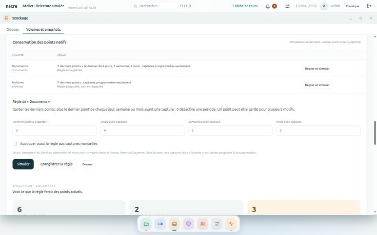

# Conservation et programmation des points natifs

Ce document répond à l’[issue 4](https://github.com/Tarzzan/nacre/issues/4) : il dit ce qui existe, ce que chaque lot apporte, et les règles que les lots suivants devront respecter. Le premier lot est livré en 0.8.0-alpha.39 ; les autres sont spécifiés ici et ne sont pas codés.

## Point de départ

Le service natif sait **créer** un point (Btrfs, ZFS, LVM) et le **restaurer** dans une nouvelle destination. Il ne sait **pas supprimer** un point, et rien ne crée de point sans qu’un administrateur recopie une confirmation. Les points s’accumulent donc jusqu’à une intervention manuelle sur le stockage.

Deux conséquences guident le découpage :

- **Supprimer demande une nouvelle action du service natif.** Ses modules sont figés : cette action ne peut pas être distribuée par paquet. Elle demande une campagne sur banc VM et une installation accompagnée.
- **Tout le reste se fait dans la console**, sans toucher au service natif, et se distribue par paquet signé.

| Lot | Contenu | Distribution | État |
| --- | --- | --- | --- |
| 1 | Règle de conservation par volume et simulation | Paquet signé | Livré en alpha.39 |
| 2 | Programmation des captures, avec plafond | Paquet signé | Spécifié |
| 3 | Suppression explicite des points sortants | Installation accompagnée, banc VM | Spécifié |
| 4 | Conservation appliquée automatiquement | Après le lot 3 | Spécifié |

## Lot 1 — Règle et simulation

Dans **Stockage → Volumes et snapshots**, la carte **Conservation des points natifs** liste les volumes inscrits avec leur règle. **Régler et simuler** ouvre la règle d’un volume.

Une règle dit ce qu’il faut garder :

| Champ | Effet |
| --- | --- |
| **Derniers points à garder** | Les points les plus récents, de 1 à 1 000. Le plus récent est donc toujours gardé. |
| **Jours, semaines, mois avec capture** | En plus, le dernier point de chacune des dernières périodes qui contiennent une capture. 0 désactive la période. |
| **Appliquer aussi la règle aux captures manuelles** | Sans cette case, une capture faite à la main n’est jamais proposée à la suppression. |

**Simuler** répartit les points présents en trois listes :

- **Gardés par la règle**, avec le ou les motifs de chacun ;
- **Sortiraient** : exactement les points que la règle ne garde pas, du plus ancien au plus récent ;
- **Protégés hors règle**, avec la raison.

Sont toujours protégés : un point en cours de création, à vérifier ou invalide ; un point dont la date est absente ou dans le futur ; tous les points d’un volume sur lequel une restauration est en cours ou à vérifier ; une capture manuelle, tant que la case n’est pas cochée.

**Enregistrer la règle** la conserve pour le volume. Elle ne déclenche rien.

Ce qu’il faut savoir :

- **Rien n’est supprimé.** La simulation lit l’état du service natif et calcule ; aucune commande n’est envoyée au stockage. Enregistrer une règle est inscrit au journal, avec la mention « aucune suppression ».
- **La simulation ne s’enregistre pas** et ne vaut que pour les points présents à l’instant indiqué.
- **Les périodes se comptent dans le fuseau de la console** au moment où la règle est enregistrée ; les semaines vont du lundi au dimanche.
- **Tant que la programmation n’existe pas, tous les points sont des captures manuelles** : la simulation ne propose de sortie que si la case est cochée.
- **Réservé aux administrateurs**, comme toute la page.
- **Sans service natif, la carte n’apparaît pas.**

La règle vit dans la table de réglages existante, une clé par volume : aucun changement de schéma.

## Lot 2 — Programmation des captures

**Une programmation par volume**, désactivée par défaut : une heure, des jours de la semaine, et un fuseau, comme un plan de sauvegarde. L’activer demande de recopier une confirmation, qui vaut consentement durable pour les captures de ce volume.

**Fuseau et changement d’heure.** L’heure s’entend dans le fuseau de la programmation. Une heure locale qui n’existe pas le jour du passage à l’heure d’été est sautée ; une heure qui existe deux fois ne déclenche qu’une capture.

**Chevauchements.**

- Une seule opération native à la fois par volume. Si une capture, une restauration ou une reconstruction est en cours à l’heure prévue, l’occurrence est **sautée**, pas mise en attente.
- **Aucun rattrapage** après un arrêt : les occurrences manquées ne sont pas rejouées. La suivante a lieu à son heure.
- Une occurrence sautée ou refusée par le service natif est inscrite au journal et signalée par une alerte ; elle n’est pas réessayée.

**Plafond.** Tant que la suppression n’existe pas, la programmation s’arrête d’elle-même quand le volume atteint un nombre de points programmés fixé à l’activation, et le signale. Elle ne supprime jamais pour faire de la place.

**Origine des points.** La console note les points qu’elle a programmés ; ce sont les seuls que la règle traite comme « programmés ». Si cette note est perdue, les points redeviennent des captures manuelles, donc protégées.

La console appelle le service natif par les deux étapes existantes, préparation puis validation : le service revérifie identité, politique et capacité à chaque capture, et aucun module figé n’est modifié.

## Lot 3 — Suppression explicite

Nouvelle action du service natif, sur le modèle des actions existantes :

1. **Préparation.** La console envoie le volume et la liste exacte des points sortants d’une simulation. Le service vérifie chaque point : il appartient au volume, il est prêt, son identité est inchangée, il n’est lu par aucune restauration et, pour ZFS, aucun clone n’en dépend. Un seul refus annule le plan entier.
2. **Plan.** Le service renvoie la liste, valable deux minutes, et une confirmation à recopier qui nomme le volume et le nombre de points.
3. **Validation.** Chaque point est marqué avant sa suppression, supprimé, puis retiré du catalogue. Le journal garde une ligne par point.

**Interruption.** Un point marqué dont la suppression n’est pas confirmée passe « à vérifier ». Rien n’est rejoué automatiquement : une nouvelle simulation repart de l’état réel.

**Refus.** Plan expiré, déjà utilisé, d’un autre compte ; politique ou identité modifiée depuis la préparation ; point devenu protégé entre-temps.

**Preuves attendues sur banc VM**, pour Btrfs, ZFS et LVM : suppression nominale ; coupure pendant la suppression ; point lu par une restauration ; clone ZFS dépendant ; identité modifiée ; plan rejoué. Aucune de ces preuves ne se fait sur une installation en service.

## Lot 4 — Conservation automatique

Après le lot 3 seulement, et sur demande explicite par volume : la règle enregistrée est appliquée après une capture programmée réussie, par la même action de suppression, dans la limite de ce que la dernière simulation affichée a montré. Désactivée d’office après une interruption ou un refus, comme la rétention automatique des sauvegardes.

## Ce qui ne change pas

- **Aucune suppression implicite** : ni la règle, ni la simulation, ni la programmation ne suppriment un point.
- **Un point natif n’est pas une sauvegarde** : il vit sur le même support que les données.
- **Les opérations natives ne se valident que sur banc VM** ; aucune donnée ni clé d’une installation en service n’y entre.
