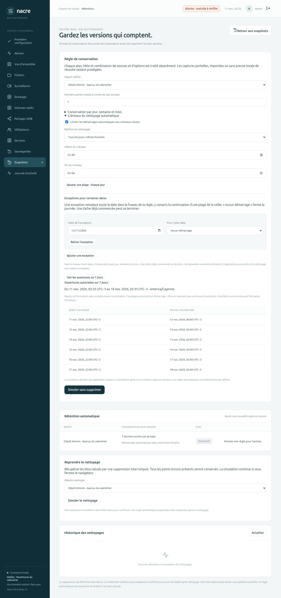

# Voir les prochaines ouvertures du calendrier

Depuis **0.8.0-alpha.14**, le bouton **Voir les ouvertures sur 7 jours**, dans **Snapshots → Gérer la rétention → Créneaux du nettoyage automatique**, affiche les périodes pendant lesquelles un nettoyage automatique pourrait commencer.

L’aperçu utilise les valeurs actuelles du formulaire, y compris les plages supplémentaires, les jours choisis et les exceptions datées. Il ne demande aucun accès au dépôt, ne crée pas de tâche et n’enregistre ni n’active la règle. Il reste réservé à un administrateur authentifié, avec protection CSRF. Pour appliquer une règle, utiliser ensuite le parcours de simulation et de confirmation habituel.

## Lire le résultat

Les heures sont affichées dans le **fuseau de la règle**, avec leur décalage UTC. Les plages qui se recouvrent sont réunies. L’exception d’une date reste prioritaire sur les horaires habituels et sur la continuation de la veille.

- **Déjà ouvert** indique que le calendrier autorise un démarrage au moment du calcul. Le début affiché est alors celui de l’aperçu, pas le début historique de la plage.
- **Ouverture prolongée au-delà de cet aperçu** indique que la période reste ouverte après la borne de consultation ; cette borne n’est pas présentée comme sa fermeture réelle.
- **Aucune ouverture** signifie qu’aucune plage n’est autorisée pendant les sept jours consultés. Une exception plus lointaine peut encore exister.
- **Limitation désactivée** signifie que ce calendrier ne restreint pas les démarrages ; cela n’active pas la rétention automatique.

La période consultée couvre 168 heures à partir du calcul. Les changements d’heure sont parcourus sur l’axe UTC : une heure locale répétée peut produire deux ouvertures distinctes avec deux décalages différents ; une heure inexistante n’est pas inventée. Les horaires sont configurés à la minute.

Modifier les champs, ajouter ou retirer une plage ou une exception efface l’aperçu. Une réponse arrivée après une modification, une navigation ou un changement de session n’est pas affichée. Utiliser le bouton à nouveau pour recalculer ; le calendrier ne s’actualise pas automatiquement pendant la saisie.

## Portée

Il s’agit d’autorisations de démarrage, pas de réservations d’exécution. La console doit être en marche, une nouvelle capture réussie doit être à traiter et les verrous doivent être disponibles. Une tâche commencée peut finir après la plage. L’aperçu ne prédit ni la durée du nettoyage, ni l’espace libéré, ni les heures effectives de sauvegarde.

## Validation isolée

Tests des intervalles en cours, des trous, des recouvrements, de la borne des sept jours, de la priorité des exceptions sur la nuit précédente et des transitions d’heure. L’API est contrôlée sur un serveur local temporaire : authentification, rôle administrateur, CSRF, refus des paramètres invalides, absence d’accès au stockage et absence de modification des règles, tâches, plans ou journal. Tests JavaScript des données transmises, résultats tardifs et affichage des offsets UTC distincts.

Parcours navigateur sur un banc temporaire sans ordonnanceur : plage 22 h–2 h et fermeture du 12 novembre 2026. Le résultat coupe la nuit précédente à minuit et reprend le 13 au soir. Après consultation : zéro tâche et aucune règle de rétention enregistrée. La capture ci-dessus provient de ce banc ; aucun nettoyage réel n’y a été demandé.
