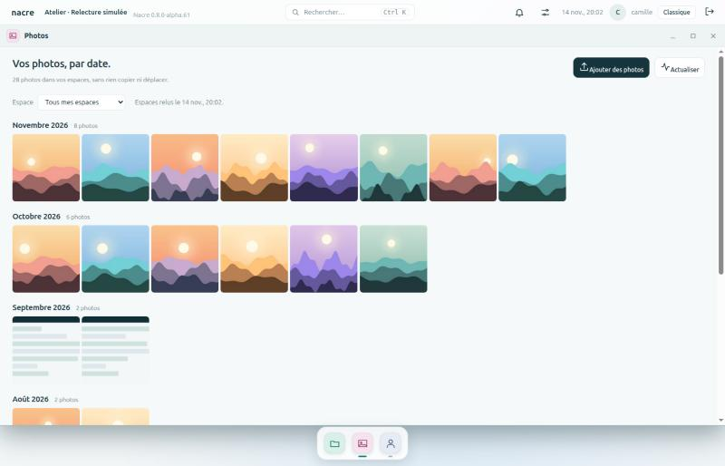
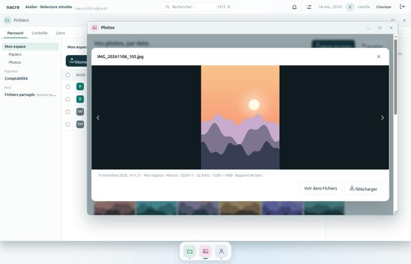
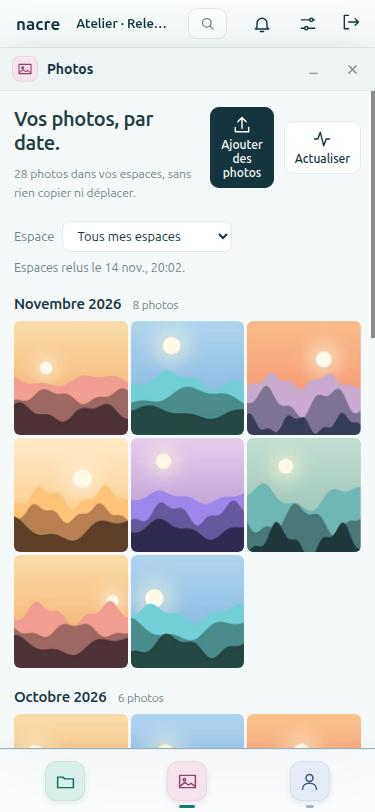

# Photos

Cinquième brique de l’espace collaboratif : **les images de tous vos espaces, réunies et rangées par date**, et un envoi depuis le téléphone qui ne crée pas de doublon. Depuis 0.8.0-alpha.62.

## Ce que cela donne

- L’application **Photos** du bureau montre, des plus récentes aux plus anciennes, les images de **tous les espaces que vous pouvez lire** : le vôtre, ceux de vos équipes, les fichiers partagés, les volumes. Un menu limite la vue à un seul espace.
- **Rien n’est copié, déplacé ni transformé** : une photo reste le fichier qu’elle est, là où elle est. La retirer de la galerie, c’est la mettre en corbeille dans Fichiers.
- La date est celle de la **prise de vue**, lue dans le fichier ; à défaut, celle du fichier, et la légende le dit.
- Un clic ouvre la photo en grand, avec sa date, son emplacement, sa taille et l’appareil. Les flèches, à l’écran ou au clavier, passent à la suivante. **Voir dans Fichiers** ouvre son dossier, fichier sélectionné.
- Formats montrés : JPEG, PNG, WebP, GIF, AVIF.

## Depuis le téléphone

**Ajouter des photos** ouvre la pellicule de l’appareil. Les photos choisies sont déposées dans **votre espace personnel**, rangées par mois : `Photos/2026-11`, `Photos/2026-10`…

- **Renvoyer toute sa pellicule ne crée pas de doublon** : une photo de même nom et de même taille dans son dossier est tenue pour déjà envoyée, et n’est pas renvoyée.
- Deux photos différentes qui portent le même nom sont gardées toutes les deux, la seconde avec un numéro.
- L’écran reste allumé pendant l’envoi quand le navigateur le permet ; **Arrêter** l’interrompt, ce qui est déjà envoyé reste.
- Sont acceptées : les images ci-dessus, plus HEIC/HEIF et les vidéos MP4, MOV et WebM, qui sont rangées avec les photos sans paraître dans la galerie.

Nacre s’[installe sur l’écran d’accueil](ACCESS.md) du téléphone ; l’envoi se fait alors comme depuis une application.

## Ce qui protège vos photos

- **Chacun ne voit que ses espaces.** L’index est commun, la réponse ne l’est jamais : un administrateur ne voit pas les photos de l’espace personnel d’un membre, un membre ne voit pas celles d’une équipe dont il n’est pas.
- Une vignette obéit aux mêmes droits que le fichier dont elle vient, à chaque demande.
- Aucune image n’est décodée par le serveur : il lit quelques champs au début du fichier, sans jamais exécuter ni interpréter son contenu. Un fichier abîmé reste une photo sans date.
- Les noms de fichiers et d’appareils sont échappés partout où ils s’affichent.

## À savoir

- **Vignettes.** Nacre montre la vignette que l’appareil photo glisse dans le fichier, relue à sa place. Une image qui n’en a pas (capture d’écran, image retouchée, PNG) est montrée elle-même si elle pèse moins de 3 Mio ; au-delà, la galerie affiche son nom et la photo s’ouvre au clic.
- **Mise à jour.** La galerie relit vos espaces quand on l’ouvre, au plus toutes les deux minutes, sans rouvrir les fichiers qui n’ont pas changé. **Actualiser** relance la lecture. Une photo déposée par le réseau apparaît donc à l’ouverture suivante, pas à la seconde.
- **Rien ne tourne quand personne ne regarde** : aucune lecture de fond au démarrage ni la nuit.

## Limites

- **Pas de sauvegarde automatique en arrière-plan** : un navigateur ne peut pas envoyer la pellicule sans qu’on ouvre Nacre et qu’on choisisse les photos. Cela demanderait une application installée par un magasin d’applications.
- **HEIC** (format par défaut de certains téléphones) : rangé et sauvegardé, mais absent de la galerie, la plupart des navigateurs ne sachant pas l’afficher. Un téléphone qui envoie par le navigateur convertit en général de lui-même en JPEG.
- **Vidéos** : rangées, pas encore montrées dans la galerie.
- Pas d’albums, de visages, de lieux ni de retouche. Pas de recherche par contenu de l’image.
- Un seul passage lit au plus 500 000 fichiers ; au-delà, la galerie le dit et montre ce qui a été lu.
- La vignette d’un appareil est petite : nette en grille, elle ne remplace pas la photo.

## Sous le capot

`console/photos.py`, `console/library.py` et `console/static/photos.js`. L’index est une base à part, `state/console/photos.db`, **reconstructible** : la supprimer ne perd rien. Le lecteur de champs d’appareil (EXIF) est écrit pour Nacre, sans dépendance. Le schéma de la base de Nacre ne change pas.
