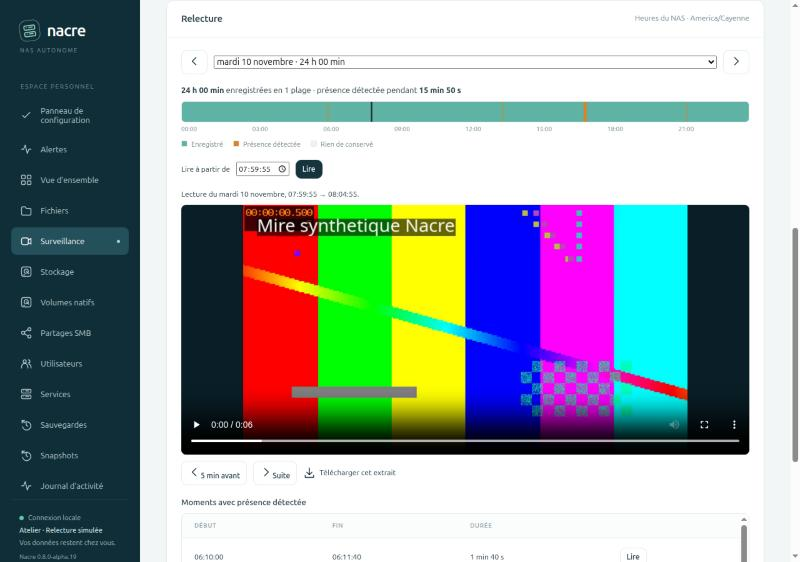

# Relire les enregistrements par jour

Depuis **0.8.0-alpha.20**, la fiche d’une caméra dans **Surveillance** comporte une carte **Relecture**. Elle remplace la liste des derniers segments : tous les enregistrements encore conservés par Frigate deviennent accessibles depuis le navigateur, jour par jour.

## Utilisation

1. Ouvrir **Surveillance**, puis une caméra.
2. Choisir le **jour** dans la liste. Seuls les jours pour lesquels Frigate annonce des enregistrements sont proposés, avec leur durée conservée. Les flèches passent au jour enregistré voisin. Le jour choisi est gardé quand on change de caméra.
3. Lire la **frise** de minuit à minuit : vert pour ce qui est enregistré, orange pour une présence détectée, gris pour ce qui n’est pas conservé, blanc pour les heures à venir du jour en cours.
4. Lancer la lecture, au choix :
   - cliquer sur la frise à l’instant voulu ;
   - saisir une heure dans **Lire à partir de**, puis **Lire** ;
   - choisir une ligne de **Moments avec présence détectée** (la lecture commence cinq secondes avant).
5. Utiliser **5 min avant**, **Suite** ou **Télécharger cet extrait**. La lecture enchaîne seule l’extrait suivant jusqu’à la fin des enregistrements du jour.

Un clic ou une heure dans une période sans enregistrement ne produit pas d’erreur : Nacre l’annonce et reprend au début de la plage suivante. Après la dernière plage, il indique qu’il n’y a plus rien à lire ce jour-là.

## Ce que montrent les indications

| Indication | Origine et portée |
| --- | --- |
| **Enregistré** | Segments présents dans l’inventaire de Frigate pour ce jour. Deux segments séparés de moins de trois secondes forment une même plage. |
| **Présence détectée** | Segments pour lesquels le suivi d’objets de Frigate compte au moins un objet actif. Ce n’est ni une alarme ni une liste exhaustive ; rien n’apparaît si la détection est désactivée. |
| **Rien de conservé** | Aucun segment dans l’inventaire. Nacre ne dit pas pourquoi : caméra coupée, service arrêté ou segment supprimé par la conservation. |
| **Sans enregistrement** | Les trois premières périodes vides entre deux plages, puis leur nombre. |
| **Heures du NAS** | Le fuseau réglé dans le Panneau de configuration. Les jours de 23 ou 25 heures suivent le changement d’heure ; une heure répétée désigne sa première occurrence. |

Au-delà de la durée de conservation continue, Frigate ne garde que certains passages. Un jour ancien affiche donc normalement quelques plages courtes, et non une journée interrompue par des pannes.

## Périmètre et limites

- **Lecture seule.** Aucune configuration, tâche ou vidéo n’est écrite. Frigate n’est ni redémarré ni reconfiguré. Un téléchargement est inscrit au journal d’activité avec le compte et le nom du fichier.
- **Extraits de cinq minutes au plus**, produits à la demande par Frigate dans la qualité enregistrée. Sur la caméra mesurée, cinq minutes représentent environ 120 Mo. Ce volume transite par la console ; aucun plafond de taille n’est ajouté.
- **Déplacement dans un extrait.** Frigate diffuse l’extrait sans plages d’octets : le curseur du lecteur ne permet pas toujours d’avancer dans la partie non encore reçue. La frise et l’heure saisie servent de déplacement.
- **Fin d’extrait.** Un extrait s’arrête à la fin de sa plage. S’il manque un segment à l’intérieur, la vidéo obtenue est plus courte que l’intervalle annoncé.
- **Jour en cours.** La frise reflète l’inventaire au chargement. **Actualiser** relit les enregistrements récents.
- **Période consultable.** Dates jusqu’à 400 jours en arrière pour la frise, extraits jusqu’à 31 jours : la conservation réglable s’arrête à 30 jours.
- **Comptes en lecture seule.** Ils consultent et téléchargent les extraits, comme ils consultaient déjà les clips. Les réglages et le pilotage restent réservés aux administrateurs.
- **Non couvert.** Vignettes, recherche par type d’objet, export de longues périodes, lecture synchronisée de plusieurs caméras, protection d’un passage contre la suppression et contrôle d’intégrité des fichiers vidéo.

## Erreurs affichées

| Message | Signification |
| --- | --- |
| Enregistrements temporairement indisponibles | Le service vidéo n’a pas répondu ou a renvoyé une réponse inexploitable. Aucun enregistrement n’est inventé. |
| Date hors de la période consultable | Jour futur ou trop ancien. Le choix est oublié à l’actualisation suivante. |
| Cette heure n’existe pas ce jour-là | Saisie invalide, ou heure sautée par un passage à l’heure d’été. |
| Extrait indisponible | Frigate n’a pas fourni la plage demandée, par exemple si elle vient d’être supprimée par la conservation. |

## Validation

Huit tests Python sur inventaire simulé : fusion des segments, bornage au jour civil, réponses malformées ou trop volumineuses, jours de 23 et 25 heures, fuseau inconnu, dates refusées avant toute requête vidéo, droits, bornes des extraits, nom du fichier téléchargé et trace au journal. Sept tests JavaScript : déplacement dans les plages et les trous, heure saisie lors des changements d’heure, frise sans style en ligne, valeurs échappées, réponses tardives écartées après un autre choix.

Parcours navigateur sur un banc local : console réelle, service vidéo simulé, mire générée localement, trois jours dont un avec un trou et un ne gardant que des passages. Clic dans un trou, heure saisie, moment détecté, enchaînement automatique, retour de cinq minutes, changement de jour, téléchargement et date refusée y ont été contrôlés. Aucune image réelle n’est publiée.

Sur l’installation de développement, seules des lectures de l’API de Frigate ont servi à mesurer le format des réponses, le poids d’un extrait et l’absence de plages d’octets. Ces mesures concernent une caméra et une version de Frigate ; elles ne qualifient ni d’autres modèles ni une charge multi-caméra.
