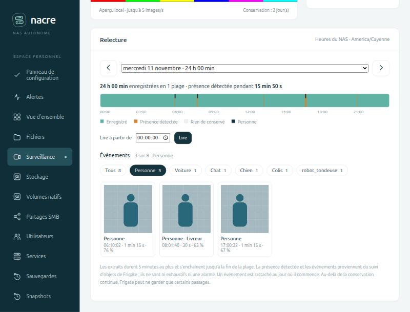
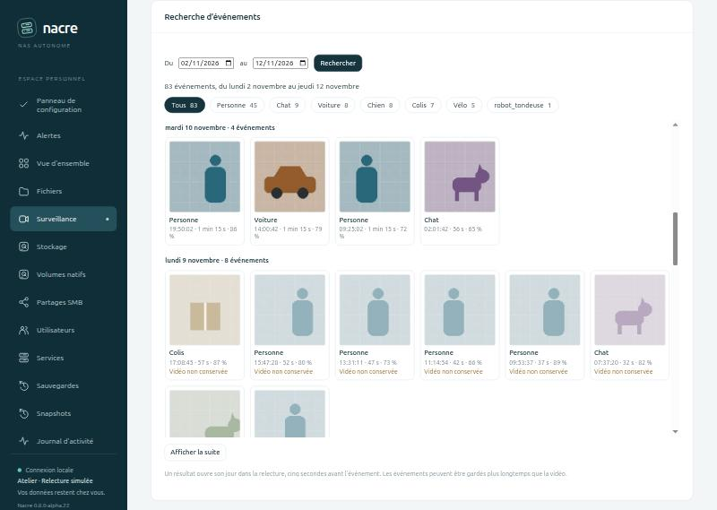
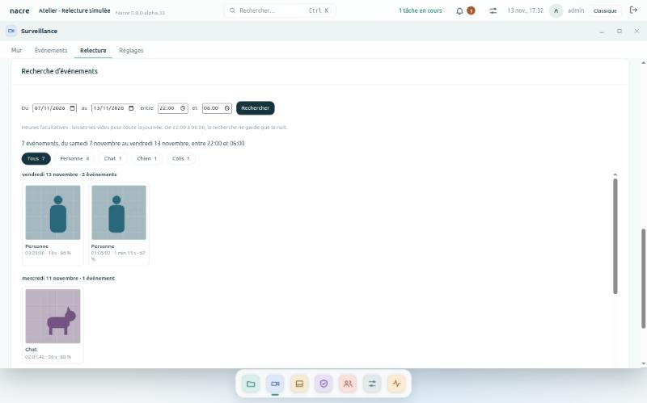
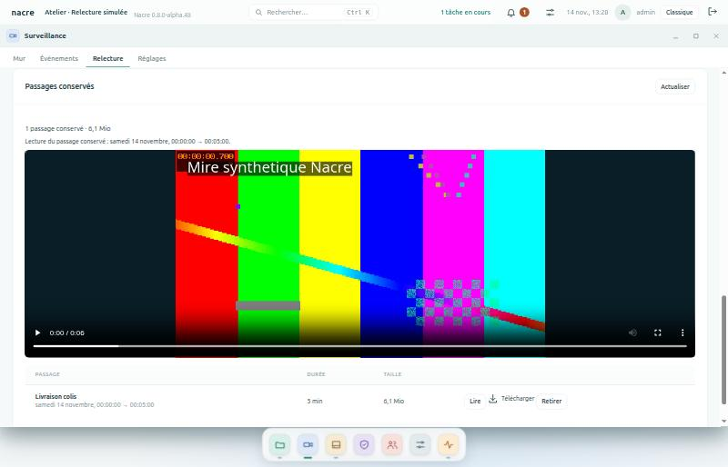

# Relire les enregistrements par jour

Depuis **0.8.0-alpha.20**, la fiche d’une caméra dans **Surveillance** comporte une carte **Relecture**. Elle remplace la liste des derniers segments : tous les enregistrements encore conservés par Frigate deviennent accessibles depuis le navigateur, jour par jour. Depuis **0.8.0-alpha.21**, les événements du jour y apparaissent en vignettes, avec un filtre par type d’objet. Depuis **0.8.0-alpha.23**, une carte **Recherche d’événements** retrouve un passage [sur plusieurs jours](#rechercher-sur-plusieurs-jours).

Les vignettes de cette capture sont des pictogrammes générés pour le banc ; aucune image de caméra n’est publiée.

## Utilisation

1. Ouvrir **Surveillance**, puis une caméra.
2. Choisir le **jour** dans la liste. Seuls les jours pour lesquels Frigate annonce des enregistrements sont proposés, avec leur durée conservée. Les flèches passent au jour enregistré voisin. Le jour choisi est gardé quand on change de caméra.
3. Lire la **frise** de minuit à minuit : vert pour ce qui est enregistré, orange pour une présence détectée, gris pour ce qui n’est pas conservé, blanc pour les heures à venir du jour en cours.
4. Lancer la lecture, au choix :
   - cliquer sur la frise à l’instant voulu ;
   - saisir une heure dans **Lire à partir de**, puis **Lire** ;
   - cliquer sur la vignette d’un **événement** (la lecture commence cinq secondes avant) ;
   - à défaut d’événements, choisir une ligne de **Moments avec présence détectée**.
5. Sous **Événements**, choisir un type d’objet pour ne garder que ses vignettes. Des repères sombres marquent alors ces événements en haut de la frise. Le filtre ne coupe pas la lecture en cours et reste appliqué en changeant de jour ; il est ignoré les jours où ce type n’apparaît pas. Les boutons de filtre ne s’affichent que si au moins deux types sont présents ce jour-là.
6. Utiliser **5 min avant**, **Suite** ou **Télécharger cet extrait**. La lecture enchaîne seule l’extrait suivant jusqu’à la fin des enregistrements du jour.

Un clic ou une heure dans une période sans enregistrement ne produit pas d’erreur : Nacre l’annonce et reprend au début de la plage suivante. Après la dernière plage, il indique qu’il n’y a plus rien à lire ce jour-là.

## Rechercher sur plusieurs jours

Sous la relecture, la carte **Recherche d’événements** évite de parcourir les jours un à un.

1. Choisir la période avec **Du** et **au** (les sept derniers jours par défaut), puis **Rechercher**. Rien n’est demandé au service vidéo avant ce clic.
2. Lire le total, puis les vignettes regroupées par jour, du plus récent au plus ancien. Chaque jour indique son nombre d’événements.
3. Choisir un **type d’objet** pour ne garder que lui sur toute la période. Les compteurs des autres types restent affichés.
4. **Afficher la suite** ajoute les soixante événements suivants à la liste.
5. Cliquer sur une vignette : son jour s’ouvre dans la carte **Relecture** et la lecture commence cinq secondes avant l’événement. Les résultats restent affichés pour en ouvrir un autre.

Les événements peuvent être gardés plus longtemps que la vidéo. Quand Frigate n’annonce plus aucun enregistrement pour l’heure d’un événement, sa vignette porte **Vidéo non conservée** et ne s’ouvre pas. Cet indice est donné à l’heure près : si l’heure est encore en partie enregistrée mais que le passage ne l’est plus, la relecture l’annonce à l’ouverture au lieu de lire un autre moment.

Les résultats sont gardés tant que la caméra reste ouverte, y compris après **Actualiser** ; ils ne sont pas relus automatiquement. Relancer **Rechercher** pour y voir les événements les plus récents.

### Ne garder qu’une tranche horaire

Depuis la version 0.8.0-alpha.34, deux champs d’heure suivent la période : **entre** et **et**. Laissés vides, ils ne changent rien. Remplis, ils ne gardent que les événements commencés dans cette tranche, **chaque jour de la période**.

*Banc local : caméra, événements et vignettes simulés.*

| Tranche | Ce qui est gardé |
| --- | --- |
| entre 22:00 et 06:00 | Les nuits : la fin précède le début, la tranche enjambe minuit. |
| entre 08:00 et 18:00 | Les journées. |
| entre 12:00 et 14:00 | La pause de midi, sur tous les jours de la période. |

Le résumé rappelle la tranche ; le total, les compteurs par type et par jour ne portent que sur elle. Choisir un type ou **Afficher la suite** la conserve. Pour revenir à toute la journée, vider les deux champs et relancer **Rechercher**.

Ce qu’il faut savoir :

- **L’heure de début décide.** Un passage commencé à 05:59 appartient à la nuit, même s’il se termine après 06:00. Le début de la tranche est compris, la fin exclue.
- **Les heures sont celles de la console**, dans le fuseau choisi au Panneau de configuration, pas celles du navigateur.
- **Un événement de nuit est rangé sous son jour civil** : celui de 01:00 figure sous le jour qui commence, pas sous la veille.
- **Les deux heures ou aucune** : une tranche à moitié remplie, ou dont le début égale la fin, est refusée avant toute recherche.
- **Période très chargée** : au-delà de dix mille événements, les compteurs portent sur les plus récents ; la suite reste accessible, et une page de suite peut alors n’ajouter aucun événement de la tranche avant la suivante.

## Conserver un extrait

Depuis **0.8.0-alpha.49**, un extrait peut être mis à l’abri de l’effacement automatique.

1. Lire l’extrait dans la relecture, depuis la frise, une heure ou un événement.
2. Sous le lecteur, **Conserver cet extrait** (administrateurs). La fenêtre rappelle le jour, les heures et la durée de ce qui sera gardé, et propose un **nom facultatif** pour le retrouver.
3. Sous la recherche, la carte **Passages conservés** liste ceux de la caméra choisie, du plus récent au plus ancien : **Lire**, **Télécharger**, **Retirer**.

*Banc local : la vidéo est une mire synthétique.*

Ce qu’il faut savoir :

- **C’est une copie à part.** Le service vidéo (Frigate) copie l’extrait dans son dossier d’exports. Ni la durée de conservation ni le nettoyage d’un volume plein n’y touchent. Nacre ne lit ni n’écrit lui-même aucun fichier vidéo.
- **Elle occupe de la place** sur le volume vidéo tant qu’elle n’est pas retirée. Son poids est affiché, et le total figure dans [Stockage vidéo](#stockage-vidéo-et-autonomie).
- **Cinq minutes au plus**, comme tout extrait de la relecture. Pour un passage plus long : **Suite**, puis conserver l’extrait suivant.
- **La copie se termine en arrière-plan.** La ligne porte « Copie en cours » quelques secondes ; la liste se relit d’elle-même quelques fois, puis **Actualiser**.
- **Retirer supprime la copie définitivement**, après confirmation. Si l’enregistrement d’origine a déjà été effacé, il n’en reste rien.
- **Un compte en lecture seule** lit et télécharge les passages conservés ; il ne peut ni en conserver ni en retirer.
- **500 passages au plus par caméra.** Au-delà, il faut en retirer.
- **Les exports faits ailleurs** (dans l’interface de Frigate) apparaissent aussi, puisqu’ils occupent le même volume ; seule leur date de début est connue.
- **Pourquoi pas le marquage « à conserver » de Frigate.** Lu dans le code de Frigate 0.18.2 : ce marquage garde la fiche et la vignette d’un événement, mais sa vidéo suit quand même la durée de conservation. Seule une copie met la vidéo à l’abri.

## Stockage vidéo et autonomie

Depuis **0.8.0-alpha.49**, **Surveillance → Réglages** comporte une carte **Stockage vidéo**, commune à toutes les caméras.

| Indication | Signification |
| --- | --- |
| **Autonomie** | Temps d’enregistrement que l’espace libre représente au débit actuel, toutes caméras actives confondues. |
| **Espace libre** | Espace libre et taille du volume qui porte les enregistrements. |
| **Débit d’enregistrement** | Débit mesuré par Frigate sur les derniers segments de chaque caméra, par jour. |
| **Enregistrements** | Place prise par les enregistrements de toutes les caméras. |
| **Passages conservés** | Nombre et poids des copies gardées à part. |

Quatre états :

- **Espace suffisant** : l’espace libre couvre la durée de conservation réglée.
- **Conservation hors de portée** : la durée réglée demande plus de place que le volume n’en offre. La carte dit jusqu’où les enregistrements remontent réellement au débit actuel.
- **Volume plein** : il reste moins d’une heure d’enregistrement.
- **Débit non mesuré** : Frigate n’a pas encore de mesure ; l’autonomie n’est pas estimée.

**Ce qui se passe quand le volume est plein.** L’enregistrement ne s’arrête pas. Lu dans Frigate 0.18.2 : dès qu’il reste moins d’une heure d’enregistrement d’espace libre, il efface les enregistrements les plus anciens, environ une heure à la fois. Les passages conservés ne sont pas concernés.

Limites :

- **C’est une estimation.** Le débit varie avec l’activité, et le calcul porte sur l’enregistrement continu ; les passages que Frigate garde plus longtemps autour des événements ne sont pas prévus.
- **Volume partagé.** Si le volume reçoit d’autres fichiers, ils réduisent l’autonomie sans que cette carte sache lesquels.
- **Pas d’alerte dédiée.** L’alerte d’espace existante porte sur le volume de Nacre, à 90 % puis 97 %.

## Ce que montrent les indications

| Indication | Origine et portée |
| --- | --- |
| **Enregistré** | Segments présents dans l’inventaire de Frigate pour ce jour. Deux segments séparés de moins de trois secondes forment une même plage. |
| **Événements** | Objets suivis par Frigate ayant commencé ce jour-là, du plus ancien au plus récent : vignette, type, nom reconnu s’il existe, heure de début, durée et meilleur score. Un événement est rattaché au jour où il commence. Les types courants sont traduits ; un type inconnu est affiché tel que Frigate le nomme. |
| **Vidéo non conservée** | L’événement ne recoupe aucune plage enregistrée : la vignette reste, la lecture est désactivée. |
| **Présence détectée** | Segments pour lesquels le suivi d’objets de Frigate compte au moins un objet actif. Ce n’est ni une alarme ni une liste exhaustive ; rien n’apparaît si la détection est désactivée. |
| **Rien de conservé** | Aucun segment dans l’inventaire. Nacre ne dit pas pourquoi : caméra coupée, service arrêté ou segment supprimé par la conservation. |
| **Sans enregistrement** | Les trois premières périodes vides entre deux plages, puis leur nombre. |
| **Heures du NAS** | Le fuseau réglé dans le Panneau de configuration, [proposé au premier accès](CONTROL-PANEL.md#fuseau-horaire-au-premier-accès) tant qu’il n’a jamais été choisi. Les jours de 23 ou 25 heures suivent le changement d’heure ; une heure répétée désigne sa première occurrence. |

Au-delà de la durée de conservation continue, Frigate ne garde que certains passages. Un jour ancien affiche donc normalement quelques plages courtes, et non une journée interrompue par des pannes.

## Périmètre et limites

- **Types d’objets.** Nacre montre ce que Frigate suit. Une installation qui ne suit que les personnes n’affiche qu’un type, donc pas de filtre ; depuis alpha.22, les types suivis se choisissent dans la carte [Détection](CAMERA-DETECTION.md) de la caméra.
- **Volume.** Mille événements au plus sont présentés par jour ; au-delà, la carte le signale. La recherche compte les dix mille événements les plus récents de la période ; au-delà, elle l’indique et la suite reste accessible page par page. Les vignettes sont chargées à mesure du défilement et ne sont pas mises en cache par le navigateur.
- **Vignettes.** Ce sont celles que Frigate produit (175 × 175 pixels sur l’installation mesurée). Chaque demande vérifie que l’événement appartient à la caméra consultée. Les instantanés en pleine résolution ne sont pas proposés.
- **Lecture seule.** Aucune configuration, tâche ou vidéo n’est écrite. Frigate n’est ni redémarré ni reconfiguré. Un téléchargement est inscrit au journal d’activité avec le compte et le nom du fichier.
- **Extraits de cinq minutes au plus**, produits à la demande par Frigate dans la qualité enregistrée. Sur la caméra mesurée, cinq minutes représentent environ 120 Mo. Ce volume transite par la console ; aucun plafond de taille n’est ajouté.
- **Déplacement dans un extrait.** Frigate diffuse l’extrait sans plages d’octets : le curseur du lecteur ne permet pas toujours d’avancer dans la partie non encore reçue. La frise et l’heure saisie servent de déplacement.
- **Fin d’extrait.** Un extrait s’arrête à la fin de sa plage. S’il manque un segment à l’intérieur, la vidéo obtenue est plus courte que l’intervalle annoncé.
- **Jour en cours.** La frise reflète l’inventaire au chargement. **Actualiser** relit les enregistrements récents.
- **Période consultable.** Dates jusqu’à 400 jours en arrière pour la frise et la recherche, extraits jusqu’à 31 jours : la conservation réglable s’arrête à 30 jours.
- **Comptes en lecture seule.** Ils consultent et téléchargent les extraits, comme ils consultaient déjà les clips. Les réglages et le pilotage restent réservés aux administrateurs.
- **Non couvert.** Recherche par nom reconnu, par jour de la semaine, filtre par zone ou par score, export de longues périodes, lecture synchronisée de plusieurs caméras, protection d’un passage contre la suppression et contrôle d’intégrité des fichiers vidéo.

## Erreurs affichées

| Message | Signification |
| --- | --- |
| Enregistrements temporairement indisponibles | Le service vidéo n’a pas répondu ou a renvoyé une réponse inexploitable. Aucun enregistrement n’est inventé. |
| Date hors de la période consultable | Jour futur ou trop ancien. Le choix est oublié à l’actualisation suivante. |
| Cette heure n’existe pas ce jour-là | Saisie invalide, ou heure sautée par un passage à l’heure d’été. |
| Événements indisponibles | Le service vidéo n’a pas fourni la liste des événements. La frise et les moments détectés restent utilisables. |
| Recherche indisponible | Le service vidéo n’a pas fourni les événements de la période. Les résultats précédents restent affichés. |
| Période invalide | La date de début suit la date de fin, ou une date est future ou trop ancienne. Rien n’est demandé au service vidéo. |
| La vidéo de l’événement n’est plus conservée | Le jour s’est ouvert, mais aucune plage enregistrée ne recoupe l’événement. Aucun autre moment n’est lu à sa place. |
| Vignette indisponible | Frigate ne fournit plus l’image de cet événement. La lecture reste possible si la vidéo est conservée. |
| Extrait indisponible | Frigate n’a pas fourni la plage demandée, par exemple si elle vient d’être supprimée par la conservation. |

## Validation

Huit tests Python sur inventaire simulé : fusion des segments, bornage au jour civil, réponses malformées ou trop volumineuses, jours de 23 et 25 heures, fuseau inconnu, dates refusées avant toute requête vidéo, droits, bornes des extraits, nom du fichier téléchargé et trace au journal. Sept tests JavaScript : déplacement dans les plages et les trous, heure saisie lors des changements d’heure, frise sans style en ligne, valeurs échappées, réponses tardives écartées après un autre choix.

Parcours navigateur sur un banc local : console réelle, service vidéo simulé, mire générée localement, trois jours dont un avec un trou et un ne gardant que des passages. Clic dans un trou, heure saisie, moment détecté, enchaînement automatique, retour de cinq minutes, changement de jour, téléchargement et date refusée y ont été contrôlés. Aucune image réelle n’est publiée.

Événements (alpha.21) : trois tests Python supplémentaires sur le bornage au jour et à la caméra, les entrées malformées, le plafond, la relecture maintenue quand les événements manquent, et la vignette refusée pour un identifiant invalide ou une autre caméra. Trois tests JavaScript sur les vignettes, l’échappement, le filtre appliqué sans reconstruire la carte et le repli sur les moments détectés. Parcours navigateur sur le banc avec vignettes synthétiques, en largeur d’ordinateur et de téléphone.

Tranche horaire (alpha.34) : deux tests Python sur le même service simulé : nuit enjambant minuit avec bornes comprise et exclue, tranche complémentaire sans recouvrement, compteurs limités à la tranche, type choisi, huit demandes mal formées refusées avant tout appel au service vidéo ; pages qui se suivent sans trou ni répétition, y compris quand le comptage est plafonné et qu’une page du service ne contient rien de la tranche. Un test JavaScript : champs facultatifs, tranche reprise dans le résumé, refus local d’une tranche incomplète, identique ou illisible, tranche conservée au changement de type et à la page suivante, type remis à zéro quand la tranche change. Sur le banc, avec le vrai serveur : 50 événements simulés sur sept jours, 7 la nuit et 43 le jour, soit le compte entier ; refus d’une tranche à moitié remplie.

Recherche (alpha.23) : six tests Python sur un service simulé qui applique les filtres demandés : période par défaut, compteurs par type et par jour, type choisi, pages qui se suivent sans trou ni doublon, événements simultanés jamais séparés entre deux pages, plafond de comptage avec suite accessible, indice de vidéo à l’heure près, demandes refusées avant toute requête vidéo, comptes en lecture seule et service indisponible. Quatre tests JavaScript : carte et résultats sans style en ligne, valeurs échappées, page suivante ajoutée sans recharger les vignettes, réponses tardives ou malformées écartées, ouverture d’un résultat dans la relecture et message quand la vidéo manque. Parcours navigateur sur le banc : quinze jours, 112 événements, deux pages, filtre, ouverture d’un résultat, en largeur d’ordinateur et de téléphone.

Sur l’installation de développement, seules des lectures de l’API de Frigate ont servi à mesurer le format des réponses, le poids d’un extrait, l’absence de plages d’octets, puis la forme des événements et la taille des vignettes. Ces mesures concernent une caméra et une version de Frigate ; elles ne qualifient ni d’autres modèles ni une charge multi-caméra.
