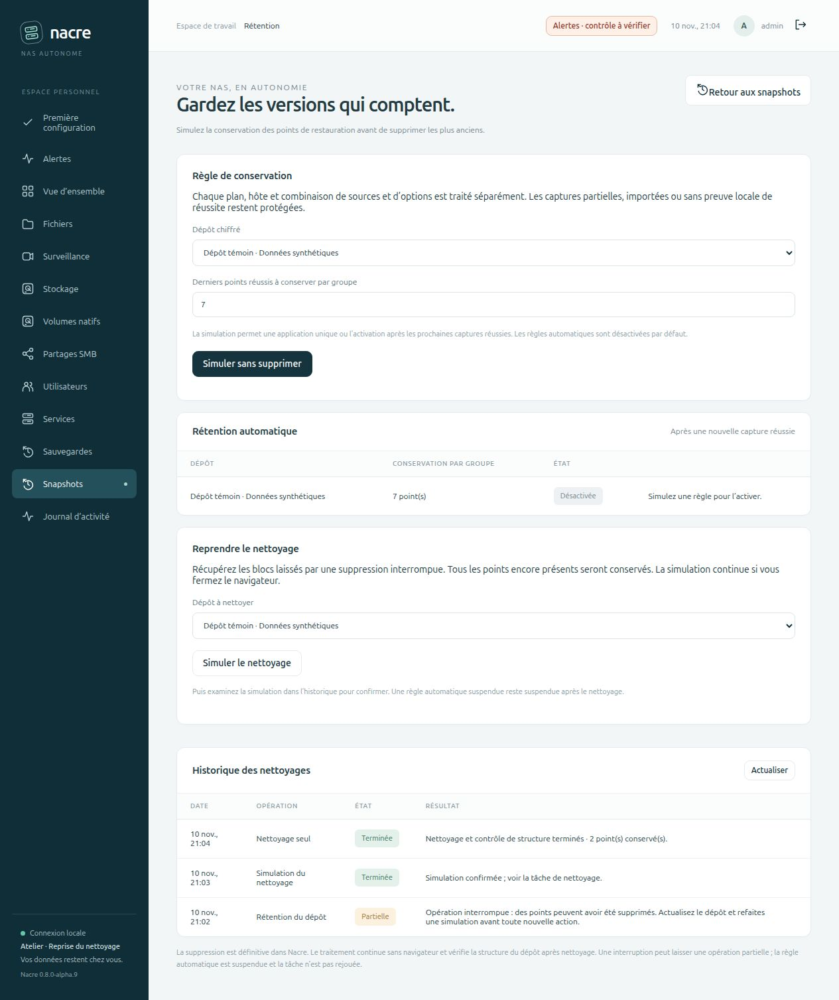

# Reprendre un nettoyage interrompu

Depuis **0.8.0-alpha.9**, un administrateur peut nettoyer les blocs non référencés d’un dépôt sans supprimer de nouveau point de restauration. Cette action est utile lorsqu’une rétention a déjà oublié des points, mais que le nettoyage a été interrompu.

## Depuis le navigateur

1. Ouvrir **Snapshots → Gérer la rétention → Reprendre le nettoyage**.
2. Choisir le dépôt, puis **Simuler le nettoyage**. La tâche continue sans navigateur ; son résultat apparaît dans l’historique.
3. Cliquer sur **Examiner la simulation**. La confirmation détaille le dépôt et les points conservés ; elle expire quinze minutes après la fin de la simulation.
4. Confirmer le nettoyage des blocs non référencés. Nacre exécute le nettoyage puis un contrôle de structure. L’historique se rafraîchit sans effacer une règle en cours de saisie.

Le parcours n’appelle jamais `forget`. Les points encore présents sont conservés ; les points déjà oubliés ne sont pas recréés. Le nettoyage concerne tous les blocs non référencés du dépôt, y compris ceux d’anciennes suppressions. Aucune estimation d’espace libéré n’est déduite de la taille logique des snapshots. Une règle automatique suspendue reste suspendue : son éventuelle réactivation demande une nouvelle simulation de rétention.

## Garde-fous et interruptions

La simulation utilise `restic prune --dry-run`. Son résultat privé est lié à son auteur, au dépôt (identifiant restic, chemin résolu, périphérique et inode) et à la liste complète des points. La confirmation à usage unique est consommée transactionnellement avec la création de la tâche. L’accès est réservé aux administrateurs, avec protection CSRF pour les actions.

Avant de nettoyer, Nacre revalide l’identité et les points. Si une sauvegarde a ajouté un point entre-temps, il faut refaire une simulation. Les commandes partagent le verrou des tâches Nacre ; une maintenance peut donc retarder une sauvegarde. Restic conserve son propre verrou, et Nacre n’effectue aucun déverrouillage forcé. Éviter une maintenance concurrente depuis un autre client : les contrôles Nacre ne constituent pas une transaction couvrant les autres applications.

Une annulation avant le début du nettoyage n’exécute aucune commande destructive. Dès que le nettoyage a commencé, un échec, une interruption ou un contrôle final échoué produit un résultat **Partielle**, sans prétendre que l’opération est revenue à son état initial. Un worker disparu est également signalé, sans rejeu automatique. Refaire une simulation pour reprendre. Les confirmations sont supprimées lors d’une reprise de base ou d’installation.

## Preuves et portée

Les tests utilisent exclusivement des dépôts chiffrés jetables et des fichiers synthétiques. Le scénario réel crée deux versions, interrompt la rétention après l’oubli de l’ancienne, puis simule et applique le nettoyage seul. Il vérifie que les identifiants restants n’ont pas changé, exécute `check --read-data` et restaure exactement le fichier conservé. Les commandes observées pour ce parcours sont `prune --dry-run`, `prune`, puis `check`.

Le banc navigateur utilise une installation distincte et un dépôt avec trois captures synthétiques, réduit à deux par une rétention interrompue. Le bouton de simulation et la fenêtre de confirmation sont vérifiés dans le navigateur ; l’application et la restauration passent par l’API HTTP du banc. Le résultat final est ensuite vérifié dans l’interface. Les captures ne contiennent ni secret ni image de caméra.

Le contrôle de structure proposé par le produit n’est pas une lecture exhaustive des blocs : celle-ci est effectuée en complément dans les tests. Ce parcours ne répare pas un dépôt corrompu, ne récupère pas les points oubliés et ne garantit pas un gain d’espace. Il reste soumis aux besoins d’espace et au comportement de nettoyage du moteur restic. Voir la [documentation officielle de suppression et nettoyage](https://restic.readthedocs.io/en/stable/060_forget.html).

La publication GitHub et l’aperçu local ne déploient pas cette version sur Spark.
