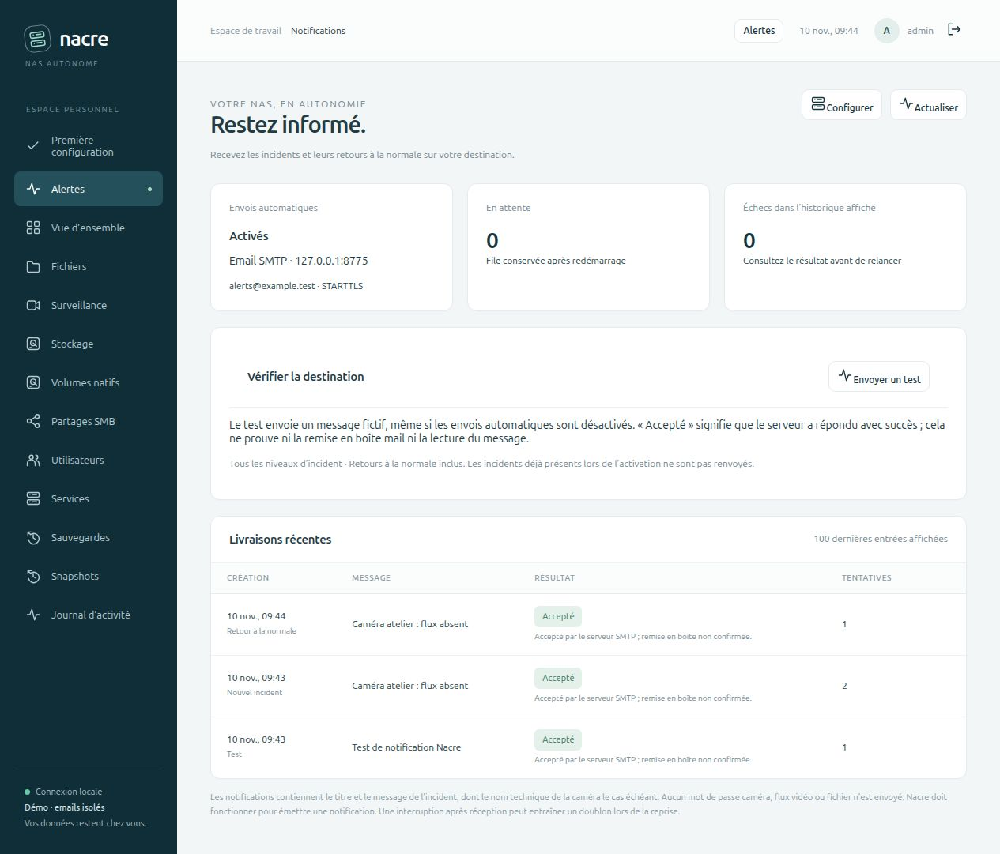
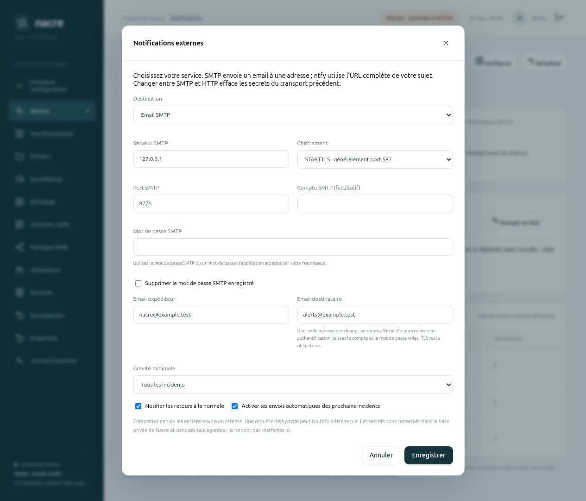

# Emails d’alerte depuis le navigateur

**0.8.0-alpha.6** ajoute **Email SMTP** aux destinations de notifications. Les emails utilisent la même file persistante, les mêmes filtres et le même suivi que ntfy et les webhooks. Une destination reste active à la fois, avec un seul destinataire email. Les envois automatiques sont désactivés par défaut.

## Configurer l’email

Dans **Alertes → Notifications → Configurer**, choisir **Email SMTP**, puis renseigner :

| Champ | Valeur attendue |
| --- | --- |
| Serveur SMTP | Nom DNS ou adresse IP, sans préfixe `smtp://` ni port intégré |
| Chiffrement | STARTTLS ou TLS direct, selon le serveur |
| Port | Port fourni par l’administrateur du serveur ; les suggestions de l’interface sont 587 pour STARTTLS et 465 pour TLS direct |
| Compte et mot de passe | Accès SMTP ou mot de passe d’application accepté par le fournisseur ; les deux champs peuvent rester vides pour un relais autorisé sans authentification |
| Expéditeur | Une adresse autorisée par le serveur |
| Destinataire | Une seule adresse, sans nom affiché, virgule ou liste |

Les adresses, comptes et mots de passe acceptés par ce premier profil sont ASCII. Le contenu et l’objet des messages peuvent contenir des accents. Les comptes qui exigent OAuth2 ne sont pas pris en charge ; ne pas désactiver les protections d’un fournisseur pour contourner cette limite.

Enregistrer, puis utiliser **Envoyer un test** avant d’activer les prochains incidents. Ce test fonctionne aussi lorsque les envois automatiques sont désactivés. **Accepté** signifie que le serveur SMTP a accepté le message : cela ne confirme ni sa remise en boîte, ni son absence du dossier indésirable, ni sa lecture.

## Protection des accès

TLS est obligatoire, même avec un relais local sans authentification. Nacre vérifie la chaîne de confiance et le nom du certificat avec le magasin de confiance du système. STARTTLS n’est jamais facultatif : si le serveur ne l’annonce pas ou si la négociation échoue, ni authentification ni email ne sont envoyés. Le produit ne propose pas d’option pour ignorer un certificat invalide. Pour un serveur privé, installer sa chaîne de confiance selon les règles de votre système.

Le mot de passe n’est jamais renvoyé par l’API ou prérempli dans le navigateur. Un champ vide conserve le secret enregistré. Changer le serveur, le port, le mode TLS ou le compte exige un nouveau mot de passe ou la suppression explicite de l’ancien. Le compte et le mot de passe doivent être renseignés ensemble, ou tous deux vides pour un relais sans authentification.

Passer de SMTP à ntfy/webhook efface les réglages et le secret SMTP. Passer de ntfy/webhook à SMTP efface l’URL et le jeton HTTP. Comme auparavant, enregistrer les réglages annule les envois en attente ; une requête déjà partie peut être reçue. Les configurations ntfy/webhook existantes restent lisibles sans réinitialisation ni changement de leur activation.

Les réglages SMTP sont conservés dans la base privée `notifications_v1`, sans migration de schéma. Le mot de passe y est stocké en clair sous les permissions privées de Nacre et entre dans une sauvegarde complète de la base. Les précautions de restauration et les limites du [guide des notifications externes](EXTERNAL-NOTIFICATIONS.md) s’appliquent également.

## Contenu et livraison

Chaque email contient un objet `[Nacre]` avec le type d’événement et le titre, puis un corps texte avec le message, la gravité et l’heure UTC d’origine. Il ne contient ni pièce jointe, ni image, ni flux vidéo, ni mot de passe. L’identifiant technique de la caméra peut figurer dans le titre. Les adresses expéditeur/destinataire sont les adresses configurées ; l’identité interne du système n’est pas utilisée comme nom de connexion SMTP.

Le `Message-ID` et l’en-tête `X-Nacre-Event-Id` restent stables lors des reprises. Cela permet de corréler les tentatives ; ce n’est pas une garantie de déduplication par le serveur ou le client mail.

- SMTP `4xx`, perte de connexion, délai dépassé ou certificat invalide : reprises selon les délais existants, jusqu’à cinq tentatives.
- SMTP `5xx`, dont refus d’authentification ou de destinataire : échec sans répétition automatique, visible dans l’historique.
- STARTTLS ou authentification requise non disponibles : échec explicite, sans repli en clair.
- La réponse brute du serveur n’est pas enregistrée ; les messages d’erreur sont fixes et peuvent inclure le code SMTP.
- Si le serveur accepte `DATA`, une fermeture incorrecte pendant `QUIT` ne transforme pas cet envoi en échec.
- Si la réponse finale à `DATA` est perdue, une reprise peut créer un doublon. Une interruption du processus pendant l’envoi utilise un bail de 180 secondes avant réclamation ; les opérations réseau ont un délai de 10 secondes chacune, pas une garantie de durée totale de la transaction.

Les envois restent séquentiels. Une tentative différée retarde les suivantes ; une relance explicite rejoint la fin de la file. La surveillance locale des incidents continue dans son propre travailleur.

Le transport utilise la bibliothèque standard [smtplib de Python](https://docs.python.org/3/library/smtplib.html), avec `EmailMessage` pour construire les en-têtes et le texte.

## Validation isolée

**170 tests Python et 16 JavaScript.** Les neuf nouveaux cas SMTP utilisent un récepteur de test lié au loopback, un certificat éphémère et des adresses `example.test` :

- STARTTLS et TLS direct réellement négociés ; authentification après chiffrement, relais sans authentification également couvert.
- Certificat non approuvé et absence de STARTTLS : aucun compte ni message transmis.
- Refus d’authentification `535`, destinataire `550`, erreur temporaire `451`, relance explicite et conservation du `Message-ID`.
- Acceptation de `DATA` suivie d’une rupture pendant `QUIT`, maintien du succès.
- Validation des adresses, défense contre l’injection d’en-têtes, protection des secrets lors d’un changement de serveur, ancienne configuration et accès API protégés.
- Formulaire sans mot de passe prérempli, champs non pertinents désactivés et port personnalisé préservé.

Le parcours navigateur configure le relais local, lance un test réellement reçu sous STARTTLS, puis un incident simulé. Le serveur répond `451`, la console est arrêtée et redémarrée pendant l’attente ; le second envoi est accepté avec le même `Message-ID`. La résolution est ensuite livrée. Seul le processus de ce banc fait confiance à son certificat temporaire, sans modifier la confiance du système ni celle du produit. Voir `VALIDATION.json`, entrée `smtp_notifications_0_8_alpha6`.

Aucun fournisseur de messagerie, boîte Internet, identifiant réel ou caméra de production n’est utilisé. La délivrabilité chez un fournisseur réel, OAuth2, les destinataires multiples, les accusés de réception et les alertes d’arrêt complet du NAS restent hors de ce jalon.
