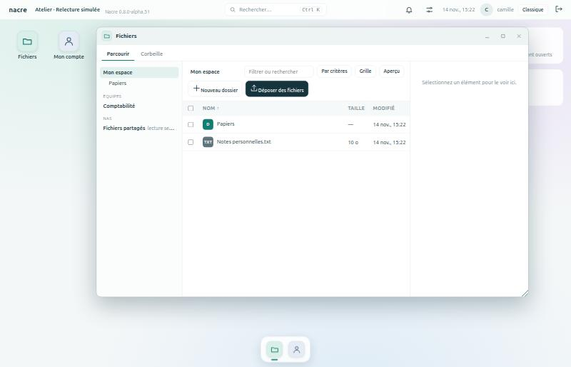
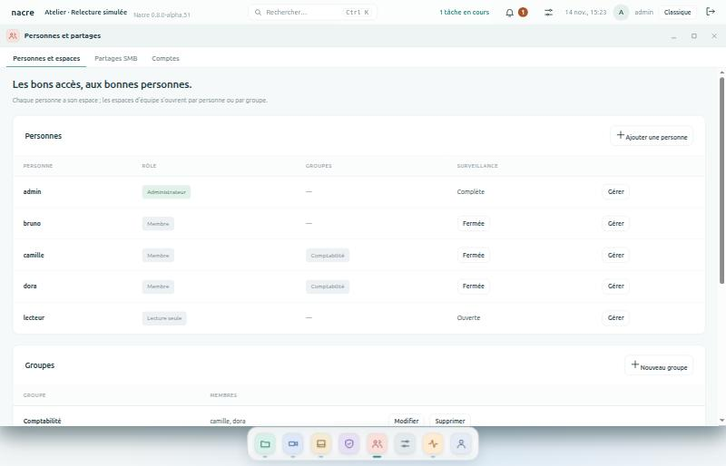

# Personnes, groupes et espaces

Depuis **0.8.0-alpha.52**, chaque personne a son compte, son espace, et n’ouvre que ce qui lui est ouvert. C’est la première brique de l’espace collaboratif.

## Trois rôles

| Rôle | Ce qu’il voit | Ce qu’il modifie |
| --- | --- | --- |
| **Administrateur** | Tout le NAS, sauf l’espace personnel des autres | Tout, y compris les comptes et les accès |
| **Membre** | Son espace personnel, les espaces qui lui sont ouverts, son compte | Les fichiers des espaces où il a l’écriture |
| **Lecture seule** | Tout le NAS en consultation, comme avant | Rien |

Un membre n’a ni le journal, ni les services, ni le stockage, ni les sauvegardes. La **surveillance** s’ouvre personne par personne, en lecture.

*Banc local : comptes et fichiers fictifs.*

## Trois sortes d’espaces

- **Mon espace** : un par administrateur et par membre, créé la première fois qu’il ouvre Fichiers. Personne d’autre ne l’ouvre depuis la console, administrateurs compris.
- **Espaces d’équipe** : créés par un administrateur, ouverts à des personnes ou à des groupes, en **lecture** ou en **écriture**.
- **Fichiers partagés** : l’espace commun d’origine. Les membres y sont en lecture par défaut ; un administrateur peut leur donner l’écriture, ou le leur fermer.

Dans **Fichiers**, l’arbre les range dans cet ordre : Mon espace, **Équipes**, puis **NAS**. Un espace en lecture porte « lecture seule » et n’offre aucun outil d’écriture. Chaque espace a sa corbeille, visible de ceux qui y écrivent.

## Administrer

**Personnes et partages → Personnes et espaces** (administrateurs).

*Banc local : comptes fictifs.*

1. **Ajouter une personne** : identifiant, mot de passe d’au moins douze caractères, rôle. Elle le change ensuite elle-même dans **Mon compte**.
2. **Nouveau groupe** : un nom et des membres. Un groupe ouvre un espace à plusieurs personnes d’un coup.
3. **Nouvel espace d’équipe** : un nom, puis un niveau par groupe et par personne. L’espace apparaît aussitôt dans Fichiers pour elles.
4. **Fichiers partagés → Modifier** : le niveau de tous les membres, et des exceptions par groupe ou par personne.

À savoir :

- **Le meilleur niveau l’emporte** : une personne en lecture, membre d’un groupe en écriture, écrit.
- **Un accès retiré tombe aussitôt** : sortie d’un groupe, groupe supprimé ou niveau remis à « Aucun accès ».
- **Un compte en lecture seule reste en lecture**, quel que soit le niveau qu’on lui donne dans un espace.
- **Un espace ne se supprime que vide**, corbeille comprise. Rien n’est effacé à votre place.
- **Un espace personnel se reprend une fois le compte désactivé** : il devient un espace d’équipe ouvert aux administrateurs, sans déplacer un fichier, et la reprise est au journal.

## Ce que le journal garde

Les gestes faits dans un espace d’équipe portent le nom de l’espace et du fichier. Ceux d’un espace personnel sont notés « espace personnel », sans aucun nom de fichier ou de dossier.

## Limites

- **Les droits sont appliqués par la console**, à l’ouverture de tout dossier. Ce ne sont pas des permissions du système : une personne qui a la main sur la machine lit les fichiers sur le disque.
- **Droits par espace, pas par dossier.** Pour des droits différents, créer un autre espace.
- **Pas encore par le réseau.** Les espaces ne sont pas exposés en SMB ; les partages SMB existants ne changent pas.
- **Pas de quota par espace.** La [pesée des espaces](DESKTOP.md#comparer-les-espaces) dit ce que chacun occupe.
- **Les espaces ne sont pas encore proposés aux plans de sauvegarde.**
- **Pas encore d’invitation** : l’administrateur choisit le premier mot de passe et le transmet.

## Sous le capot

Aucun changement du schéma de la base : le rôle « membre » tient dans la colonne existante, et les groupes, les espaces et les accès vivent dans la table de réglages (`person:`, `group:`, `space:`). Un espace est un dossier sous `data/espaces/`. Le contrôle est fait en un seul point, à l’ouverture d’un dossier (`resolve_area` dans `console/server.py`, règles dans `console/spaces.py`) : aucune route de fichiers ne peut l’oublier. Un membre est refusé par défaut partout ailleurs ; un essai balaie toutes les routes de la console pour le prouver.
