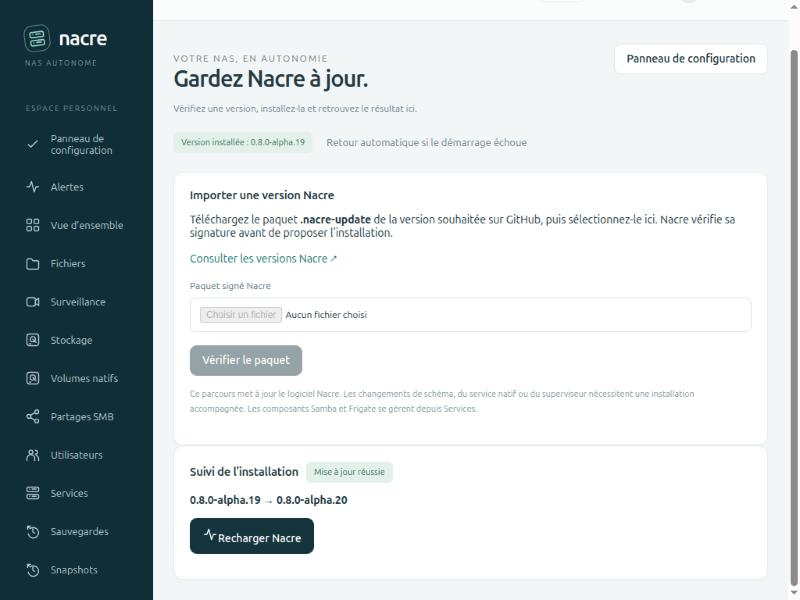
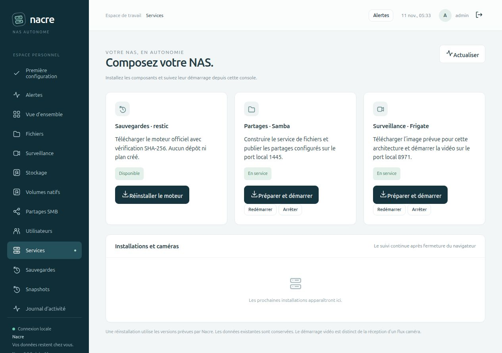
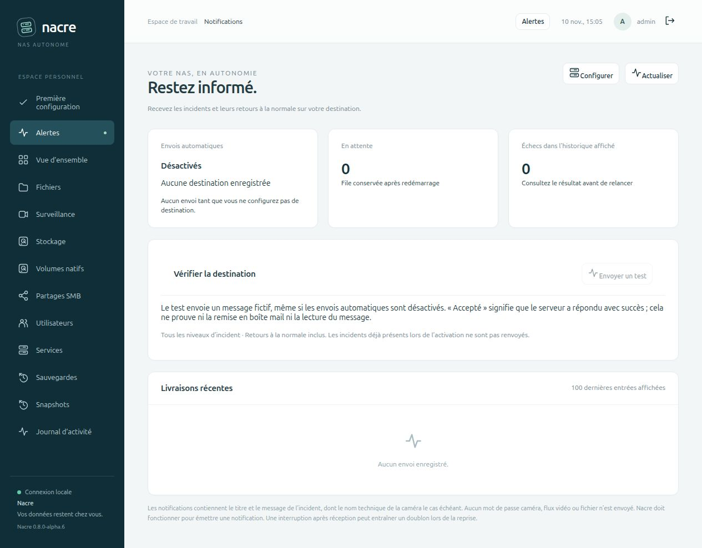

# Déploiements de la console sur Spark

## 13 novembre 2026 — alpha.29, le Bureau

L’installation alpha.25 a reçu le paquet `nacre-0.8.0-alpha.29.nacre-update` de la [version publiée](https://github.com/Tarzzan/nacre/releases/tag/v0.8.0-alpha.29), construit depuis le commit [`2f6903f`](https://github.com/Tarzzan/nacre/commit/2f6903feb60d7632996ab9ee7da271fbc96c2269) après validation CI x86-64/ARM64, par le même [parcours de mise à jour](BROWSER-UPDATES.md). Cette mise à jour apporte d’un coup les quatre lots du [Bureau](DESKTOP.md), d’alpha.26 à alpha.29.

Avant l’import : neuf modules figés identiques entre l’installation et le paquet, aucune tâche active. La mise à jour alpha.25 → alpha.29 a été répétée sur une console et son superviseur en répertoire temporaire. Le fichier importé est celui téléchargé depuis la release, empreinte contrôlée. Il a été envoyé par une session administrateur temporaire, refermée ensuite ; l’installation a été confirmée et suivie dans le navigateur jusqu’à **Mise à jour réussie**, session conservée.

Le superviseur a enregistré la préparation à 12 h 18 min 10 s et la validation à 12 h 18 min 35 s, heure de Guyane, confirmation humaine comprise. Schéma SQLite 2 conservé et `quick_check` réussi. Comptes, clés, configuration Samba et configuration Frigate identiques avant et après. Conteneurs Samba et Frigate inchangés (identifiants et heures de démarrage), service systemd non relancé. Trois copies de retour arrière restent après la purge automatique.

Constaté dans le navigateur après rechargement, sans capture d’image :

- Le bureau s’affiche : sept applications, dock, widgets alimentés par les mesures réelles (stockage, deux services en ligne, réception de la caméra), cloche sans alerte, recherche dans la barre.
- **Surveillance → Mur** : une tuile pour la caméra, dernière image reçue, aucun direct ouvert.
- **Événements** : soixante événements du jour, tous du type suivi.
- **Relecture** : la carte du jour ; pas de frise commune, l’installation n’ayant qu’une caméra.
- **Réglages** : détection active, type suivi et conservation relus.

Limites de ce contrôle : aucun clic n’a modifié l’installation. L’agrandissement d’une caméra, la prise en compte d’une alerte et la frise commune n’ont été exercés que sur le banc. Le fuseau n’étant toujours pas choisi, son bandeau reste affiché et les heures restent en UTC. Aucune panne n’a été injectée.

## 13 novembre 2026 — alpha.25

L’installation alpha.24 a reçu le paquet `nacre-0.8.0-alpha.25.nacre-update` de la [version publiée](https://github.com/Tarzzan/nacre/releases/tag/v0.8.0-alpha.25), construit depuis le commit [`9088038`](https://github.com/Tarzzan/nacre/commit/9088038d9602b6190d87e4e6be2378ec2d244bf2), par le même [parcours de mise à jour](BROWSER-UPDATES.md).

Validation du commit : les quatorze contrôles de la PR 53 sont verts sur x86-64 et ARM64, et le commit fusionné a exactement le même arbre de fichiers que le commit contrôlé. La CI de `main` n’a pas tourné sur ce commit : GitHub a refusé de démarrer les tâches pour une raison de facturation du compte. Aucun test n’a échoué ; la suite complète a aussi été rejouée localement sur ce code (308 tests).

Avant la fusion, le nouveau module de préférences a été exécuté en lecture seule sur la base réelle de Spark, sans rien y installer ni y écrire : console reconnue comme jamais réglée (aucune préférence enregistrée), 449 fuseaux proposés, noms techniques refusés. Le fuseau système de Spark a été relevé au passage : il ne correspond pas au lieu, ce qui a écarté l’idée de s’en servir comme proposition.

Avant l’import : neuf modules figés identiques entre Spark et le paquet, aucune tâche active. La mise à jour alpha.24 → alpha.25 a été répétée sur une console et son superviseur en répertoire temporaire, sans préférences enregistrées comme sur Spark : fuseau proposé après la mise à jour, nom technique refusé, choix enregistré, second onglet refusé. Le fichier importé est celui téléchargé depuis la release, empreinte contrôlée. Il a été envoyé par une session administrateur temporaire, refermée ensuite ; l’installation a été confirmée et suivie dans le navigateur jusqu’à **Mise à jour réussie**, session conservée.

Le superviseur a enregistré la préparation à 11 h 08 min 47 s et la validation à 11 h 09 min 11 s, heure de Guyane, confirmation humaine comprise. Schéma SQLite 2 conservé et `quick_check` réussi. Comptes, clés, configuration Samba et configuration Frigate identiques avant et après. Conteneurs Samba et Frigate inchangés (identifiants et heures de démarrage), service systemd non relancé.

Constaté dans le navigateur après rechargement :

- Le [bandeau du fuseau](CONTROL-PANEL.md#fuseau-horaire-au-premier-accès) s’affiche en haut de chaque page et propose le fuseau du navigateur, America/Cayenne, avec les deux heures côte à côte.
- La purge des copies s’est appliquée une seconde fois d’elle-même : la copie d’alpha.21 a été supprimée et inscrite au journal, trois copies restent.

Limites de ce contrôle : aucun des trois boutons du bandeau n’a été cliqué sur Spark. Le choix du fuseau est laissé à l’administrateur ; il a été exercé sur le banc et dans la répétition isolée. Tant qu’il n’est pas fait, les heures de Spark restent en UTC. Aucune panne n’a été injectée sur Spark.

## 12 novembre 2026 — alpha.24

L’installation alpha.23 a reçu le paquet `nacre-0.8.0-alpha.24.nacre-update` de la [version publiée](https://github.com/Tarzzan/nacre/releases/tag/v0.8.0-alpha.24), construit depuis le commit [`6ea9e74`](https://github.com/Tarzzan/nacre/commit/6ea9e74c8a8f26268bb9fb879c5eecd87b9d2cda) après validation CI x86-64/ARM64, par le même [parcours de mise à jour](BROWSER-UPDATES.md).

Avant la fusion, l’inventaire des copies a été exécuté en lecture seule sur le répertoire réel des mises à jour de Spark, sans rien y installer ni y écrire : quatre copies décrites avec leurs versions, dates et tailles, 5,3 Mo au total.

Avant l’import : neuf modules figés identiques entre Spark et le paquet, aucune tâche active. La mise à jour alpha.23 → alpha.24 a été répétée sur une console et son superviseur en répertoire temporaire, avec quatre copies fictives déjà présentes : trois dossiers après la mise à jour, deux anciennes copies supprimées et inscrites au journal, copie courante refusée à la suppression. Le fichier importé est celui téléchargé depuis la release, empreinte contrôlée. Il a été envoyé par une session administrateur temporaire, refermée ensuite ; l’installation a été confirmée et suivie dans le navigateur jusqu’à **Mise à jour réussie**, session conservée.

Le superviseur a enregistré la préparation à 21 h 24 min 35 s et la validation à 21 h 24 min 57 s, heure de Guyane, confirmation humaine comprise. Schéma SQLite 2 conservé et `quick_check` réussi. Comptes, clés, configuration Samba et configuration Frigate identiques avant et après. Conteneurs Samba et Frigate inchangés (identifiants et heures de démarrage), service systemd non relancé. Samba a répondu à `smbcontrol smbd ping` ; les journaux de Frigate ne comptent aucune erreur sur les vingt minutes encadrant la mise à jour.

La [purge des copies](BROWSER-UPDATES.md#copies-de-retour-arrière) s’est appliquée d’elle-même au démarrage de la nouvelle console, à 21 h 24 min 57 s :

- Cinq copies existaient après l’installation : celles prises avant alpha.20, alpha.21, alpha.22, alpha.23 et alpha.24.
- Les deux plus anciennes ont été supprimées. Le journal de la console porte une ligne « Anciennes copies de mise à jour supprimées » qui nomme les versions alpha.19 et alpha.20.
- Trois copies restent : alpha.23 (dernière mise à jour, sans bouton de suppression), alpha.22 et alpha.21. Le répertoire des mises à jour occupe 4,1 Mo, superviseur compris.
- Le superviseur, sa clé de vérification, son inventaire et ses verrous sont intacts ; l’installation suivante reste possible.
- La page **Mises à jour** affiche ces trois copies avec leurs dates et tailles.

Limites de ce contrôle : la suppression manuelle d’une copie n’a pas été déclenchée sur Spark ; elle l’a été sur le banc et dans la répétition isolée. Les copies de Spark n’ont pas servi à une reprise. Les dates de la carte sont en UTC, le fuseau de la console n’étant toujours pas réglé. Aucune panne n’a été injectée sur Spark.

## 12 novembre 2026 — alpha.23

L’installation alpha.22 a reçu le paquet `nacre-0.8.0-alpha.23.nacre-update` de la [version publiée](https://github.com/Tarzzan/nacre/releases/tag/v0.8.0-alpha.23), construit depuis le commit [`6578550`](https://github.com/Tarzzan/nacre/commit/65785505d7dfd79a48edb0b3a9d6460e6fcf1408) après validation CI x86-64/ARM64, par le même [parcours de mise à jour](BROWSER-UPDATES.md).

Avant la fusion, le code de recherche a été exécuté en lecture seule contre les événements réels de Spark, sans rien y installer ni y écrire : 527 événements lus en neuf pages. Cet essai a montré que deux objets vus sur la même image partagent leur instant de début (quatre cas sur cette caméra) et qu’un événement pouvait être sauté entre deux pages ; le défaut a été corrigé et couvert par un test avant la fusion.

Avant l’import : neuf modules figés identiques entre Spark et le paquet, aucune tâche active, répétition de la mise à jour alpha.22 → alpha.23 sur une console et son superviseur en répertoire temporaire. Le fichier importé est celui téléchargé depuis la release, empreinte contrôlée. Il a été envoyé par une session administrateur temporaire, refermée ensuite ; l’installation a été confirmée et suivie dans le navigateur jusqu’à **Mise à jour réussie**, session conservée.

Le superviseur a enregistré la préparation à 19 h 25 min 41 s et la validation à 19 h 26 min 15 s, heure de Guyane, confirmation humaine comprise. Schéma SQLite 2 conservé et `quick_check` réussi. Comptes, clés, configuration Samba et configuration Frigate identiques avant et après. Conteneurs Samba et Frigate inchangés (identifiants et heures de démarrage), service systemd non relancé. Samba a répondu à `smbcontrol smbd ping` ; les journaux de Frigate ne comptent aucune erreur sur les quarante minutes encadrant la mise à jour.

La [recherche d’événements](RECORDING-PLAYBACK.md#rechercher-sur-plusieurs-jours) a ensuite été contrôlée sur la caméra réelle, depuis le navigateur :

- Période proposée : les sept derniers jours. Aucune requête de recherche avant le clic.
- 532 événements sur quatre jours (142, 115, 183 et 92), lus en neuf pages : 532 vignettes distinctes, aucun doublon ni manque par rapport aux compteurs par jour.
- Deux types présents : le filtre **Enregistrement manuel** réduit la liste à son seul événement, du 9 novembre ; **Personne** en garde 532 sur 533, un événement étant survenu entre-temps.
- Recherche réduite à une seule journée : 92 événements annoncés pour le 9 novembre.
- Un résultat du 9 novembre a ouvert ce jour dans la relecture, alors réglée sur le 12, et la lecture a démarré cinq secondes avant l’événement, sans erreur. Les résultats sont restés affichés.

Limites de ce contrôle : sur cette installation, toutes les heures portant un événement gardent encore de la vidéo. L’indication **Vidéo non conservée** et le message d’un passage disparu n’ont donc été observés que sur le banc simulé. Le plafond de comptage (dix mille événements) n’est pas atteignable ici. Frigate ne suivant que les personnes, le filtre n’a que deux types à proposer. Aucune image de surveillance n’a été capturée ni publiée.

Les copies de retour arrière occupent 6,1 Mo pour quatre mises à jour dans `state/console/updates/`, toujours sans purge automatique. Le fuseau de la console n’est toujours pas réglé (heures UTC). Aucune panne n’a été injectée sur Spark.

## 12 novembre 2026 — alpha.22

L’installation alpha.21 a reçu le paquet `nacre-0.8.0-alpha.22.nacre-update` de la [version publiée](https://github.com/Tarzzan/nacre/releases/tag/v0.8.0-alpha.22), construit depuis le commit [`55050b7`](https://github.com/Tarzzan/nacre/commit/55050b75f69cf9a428945392409f6d0826965e96) après validation CI x86-64/ARM64, par le même [parcours de mise à jour](BROWSER-UPDATES.md).

Avant l’import : neuf modules figés identiques entre Spark et le paquet, aucune tâche active, répétition de la mise à jour alpha.21 → alpha.22 sur une console et son superviseur en répertoire temporaire. Le fichier importé est celui téléchargé depuis la release, empreinte contrôlée. Il a été envoyé par une session administrateur temporaire, refermée ensuite ; l’installation a été confirmée et suivie dans le navigateur jusqu’à **Mise à jour réussie**, session conservée.

Le superviseur a enregistré la préparation à 10 h 41 min 40 s et la validation à 10 h 42 min 15 s, heure de Guyane, confirmation humaine comprise. Schéma SQLite 2 conservé et `quick_check` réussi. Comptes, clés et configuration Samba identiques avant et après. Conteneurs Samba et Frigate inchangés (identifiants et heures de démarrage), service systemd non relancé. Samba a répondu à `smbcontrol smbd ping`.

La carte [Détection](CAMERA-DETECTION.md) a ensuite été éprouvée sur la caméra réelle, depuis le navigateur :

- État lu : détection active, personnes suivies, dix-neuf types proposés d’après le modèle installé.
- **Voiture** ajoutée puis retirée, par deux réglages confirmés en 9 secondes chacun, validation par Frigate comprise. Entre les deux, Frigate annonçait bien les deux types, chacun avec son filtre aux seuils par défaut.
- Un troisième envoi du réglage déjà appliqué a répondu **Aucun changement**.
- Frigate n’a pas redémarré (même heure de démarrage, état sain). Dans les dix minutes suivant le premier réglage, l’enregistrement est resté continu (66 segments, aucun trou) et les journaux de Frigate ne comptent aucune erreur. Sur quatorze relevés en sept minutes, la caméra est restée à 5 images par seconde, sans image ignorée, et le détecteur est resté sollicité.
- Les deux réglages figurent au journal d’activité.

La configuration Frigate a donc changé, et seulement ainsi : le fichier indique désormais la détection active et les personnes suivies. Avant, il indiquait la détection désactivée alors qu’elle était active par la seule mémoire d’état de Frigate ; le fichier et l’état appliqué concordent maintenant. Nacre ne garde qu’une copie, celle d’avant le dernier réglage : la configuration d’avant le premier n’y figure plus, le second l’ayant remplacée. Les types suivis sont revenus à leur état d’origine : le choix de ce que la caméra doit suivre reste à faire par son propriétaire.

Limites de ce contrôle : aucune voiture n’étant passée pendant les trente secondes de suivi, la reconnaissance d’un nouveau type n’a pas été observée. Personne n’est passé non plus dans les dix minutes suivantes : la scène était calme depuis vingt-cinq minutes avant eux. Un événement « personne » a été créé à 11 h 05, heure de Guyane, vingt-deux minutes après le dernier réglage : le suivi continuait. La bascule de la détection (pause puis reprise) n’a pas été exercée sur Spark pour ne pas suspendre la détection en service ; elle l’a été sur un second Frigate temporaire, sans réseau ni caméra, lancé puis retiré de Spark avant la fusion. Aucune image de surveillance n’a été capturée ni publiée.

Les copies de retour arrière occupent 4,6 Mo pour trois mises à jour dans `state/console/updates/`, toujours sans purge automatique. Le fuseau de la console n’est toujours pas réglé (heures UTC). Aucune panne n’a été injectée sur Spark.

## 12 novembre 2026 — alpha.21

L’installation alpha.20 a reçu le paquet `nacre-0.8.0-alpha.21.nacre-update` de la [version publiée](https://github.com/Tarzzan/nacre/releases/tag/v0.8.0-alpha.21), construit depuis le commit [`8d603df`](https://github.com/Tarzzan/nacre/commit/8d603df60f4fab492fa8b03d220a4c09717ce225) après validation CI x86-64/ARM64, par le même [parcours de mise à jour](BROWSER-UPDATES.md) qu’alpha.20.

Avant l’import : neuf modules figés identiques entre Spark et le paquet, aucune tâche active, répétition de la mise à jour alpha.20 → alpha.21 sur une console et son superviseur en répertoire temporaire. Le fichier importé est celui téléchargé depuis la release, empreinte contrôlée. Il a été envoyé à la route d’import par une session administrateur temporaire, refermée ensuite ; l’installation a été confirmée et suivie dans le navigateur jusqu’à **Mise à jour réussie**, session conservée.

Le superviseur a enregistré la préparation à 8 h 49 min 24 s et la validation à 8 h 49 min 59 s, heure de Guyane, confirmation humaine comprise. Schéma SQLite 2 conservé et `quick_check` réussi. Comptes, clés, configuration Samba et configuration Frigate identiques avant et après ; seul l’horodatage du collecteur d’alertes a changé dans les réglages, sans alerte active. Conteneurs Samba et Frigate inchangés (identifiants et heures de démarrage), service systemd non relancé. Samba a répondu à `smbcontrol smbd ping`.

Les [événements de la relecture](RECORDING-PLAYBACK.md) ont été contrôlés sur la caméra réelle : 47 événements le jour même, 115 la veille, 183 l’avant-veille, 92 le 9 novembre, tous rattachés à une plage conservée. Seul le 9 novembre compte deux types (personnes et un enregistrement manuel) : le filtre y apparaît, réduit la liste à une vignette et place un repère sur la frise. Un événement a été lu sans erreur en 2880 × 1620, sans message de reprise. Douze vignettes ont été chargées par la page en 175 × 175 ; un identifiant inconnu est refusé. Aucune image de surveillance n’a été capturée ni publiée.

Limite de ce contrôle : le navigateur de pilotage ne dessinait pas la page, son panneau étant masqué. Le chargement des vignettes au défilement n’a donc pas été observé sur Spark ; il l’a été sur le banc simulé, et les vignettes de Spark ont été chargées en le forçant. Sur cette caméra, Frigate ne suit que les personnes : le filtre par type reste absent des jours ordinaires.

Les copies de retour arrière occupent désormais 3 Mo pour deux mises à jour dans `state/console/updates/`, toujours sans purge automatique. Le fuseau de la console n’est toujours pas réglé (heures UTC). Aucune panne n’a été injectée sur Spark.

## 11 novembre 2026 — alpha.20, première mise à jour par paquet signé

L’installation alpha.19 a reçu le paquet `nacre-0.8.0-alpha.20.nacre-update` de la [version publiée](https://github.com/Tarzzan/nacre/releases/tag/v0.8.0-alpha.20), construit depuis le commit [`82b65ea`](https://github.com/Tarzzan/nacre/commit/82b65ea21e885eafb80c8ef06179b9073111ee3b) après validation CI x86-64/ARM64. C’est le premier usage réel du [parcours de mise à jour](BROWSER-UPDATES.md) : aucun script de déploiement accompagné n’a servi.

Avant l’import, les neuf modules figés de Spark ont été comparés à ceux du paquet (identiques), et la même mise à jour a été répétée sur une console alpha.19 et son superviseur dans un répertoire temporaire. Sur Spark, le paquet a été envoyé à la route d’import de la page Mises à jour par une session administrateur temporaire, refermée ensuite ; le navigateur de pilotage ne pouvait pas sélectionner un fichier local. La signature a été vérifiée par Spark, puis l’installation confirmée et suivie dans le navigateur jusqu’à **Mise à jour réussie** et au rechargement, session conservée.

Le superviseur a enregistré la préparation à 23 h 51 min 17 s et la validation à 23 h 51 min 53 s, heure de Guyane, confirmation humaine comprise. Schéma SQLite 2 conservé et `quick_check` réussi. Comptes, configuration Samba et configuration Frigate identiques avant et après ; seul l’horodatage du collecteur d’alertes a changé dans les réglages, sans alerte active. Les conteneurs Samba et Frigate gardent leurs identifiants et heures de démarrage ; le service systemd n’a pas été relancé, le superviseur ayant remplacé la console lui-même. Samba a répondu à `smbcontrol smbd ping`.

La [relecture](RECORDING-PLAYBACK.md) a ensuite été contrôlée sur la caméra réelle : quatre jours proposés, journée en cours en une plage avec sept moments détectés, jour ancien réduit à 127 passages conservés. Un extrait du jour et un extrait de l’avant-veille ont été lus sans erreur en 2880 × 1620. Aucune image de surveillance n’a été capturée ni publiée.

Deux observations pour l’exploitation : le fuseau de la console de Spark n’a jamais été réglé, la relecture y affiche donc des heures UTC tant qu’il n’est pas choisi dans le Panneau de configuration ; les copies de retour arrière (code et base précédents, 1,5 Mo) restent dans `state/console/updates/`, sans purge automatique. Aucune panne n’a été injectée sur Spark : le retour arrière automatique reste prouvé sur bancs isolés uniquement.

## 11 novembre 2026 — alpha.13

L’installation alpha.6 a reçu les 46 fichiers de console et modules associés du commit [`b52d6c8`](https://github.com/Tarzzan/nacre/commit/b52d6c8f7af77de067e35076f52bc1ee63105507), après validation CI x86-64/ARM64. Empreintes du paquet et des fichiers contrôlées ; code Python compilé avant remplacement.

La console a été seule relancée. Comptes, empreintes des mots de passe, clés, configurations, dépôts, plans et profils de stockage comparés avant/après ; identités et dates de démarrage de Samba et Frigate inchangées. Schéma SQLite 2 conservé et `quick_check` réussi. Neuf routes authentifiées contrôlées, dont la liste des règles de rétention. Aucune tâche active, aucun plan activé et aucune règle de rétention préexistante au moment de cette mise à jour. Notifications externes désactivées.

Samba a répondu au contrôle `smbcontrol smbd ping` ; Frigate a signalé une caméra recevant des images. Le navigateur a affiché alpha.13. L’intervalle mesuré entre arrêt de console terminé et fin des contrôles du script est de 0,63 seconde, sans mesure d’interruption vidéo ni redémarrage de ses conteneurs.

Les copies privées de retour arrière restent sur Spark dans `.updates/alpha13-20261111/` : ancien code, copie cohérente SQLite, fichiers ajoutés, manifeste et résultat. Le script prévoit un retour au code précédent si les contrôles échouent. Comme le schéma reste 2, la base vivante est conservée lors de ce retour pour éviter d’effacer d’éventuelles écritures après relance ; la copie privée reste disponible pour une reprise manuelle contrôlée. Cette branche d’échec n’a pas été déclenchée en production.

Ce document conserve les observations de chaque déploiement ; les notes des versions publiées complètent cette chronologie. Les essais de panne restent isolés.

## 10 novembre 2026 — alpha.6

Le 10 novembre 2026, l’installation existante de Spark (Linux ARM64, Python 3.12.3) est passée de **0.7.0-alpha.1** à **0.8.0-alpha.6**. Le code déployé est le commit [`c453124`](https://github.com/Tarzzan/nacre/commit/c45312410406fb871588fea3ac6bf34978454ae6), qui inclut le correctif d’affichage ajouté après le tag alpha.6.

La version de Spark a été vérifiée par son API authentifiée et dans le navigateur. Le port local **8766** donne accès à Spark via le tunnel SSH existant ; **8768** reste une console de test distincte.

## Résultats observés

| Contrôle | Résultat |
| --- | --- |
| Sources installées | 40 fichiers, empreintes SHA-256 conformes au commit déployé |
| Base SQLite | Schéma 1 → 2 ; `quick_check` réussi |
| Comptes, droits, empreintes des mots de passe | Identiques avant et après |
| Clés de sauvegarde et configurations contrôlées | Empreintes identiques |
| Dépôts, plans et profils de stockage | Enregistrements identiques |
| Tâches actives / plans activés au déploiement | 0 / 0 |
| Samba et Frigate | Identifiants de conteneurs et dates de démarrage identiques |
| Samba après déploiement | Réponse au contrôle `smbcontrol smbd ping` |
| Caméra existante | Une caméra dans les statistiques Frigate ; réception d’images positive |
| Accès web | Huit routes authentifiées contrôlées ; vues Notifications et Services vérifiées |
| Notifications externes | Désactivées, aucune destination ni livraison en attente |

Les huit routes sont `/api/me`, `/api/notifications`, `/api/setup`, `/api/alerts`, `/api/smb`, `/api/storage`, `/api/protection/plans` et `/api/protection/migrations`. La session temporaire utilisée pour ces contrôles a été supprimée après vérification.

Seule la console a été arrêtée et relancée. La durée mesurée entre son arrêt terminé et la fin des contrôles du script est de 0,82 seconde ; ce chiffre ne mesure pas une interruption vidéo. Aucun disque, pool, compte ou destination de sauvegarde n’a été créé. Le fichier Compose existant et les configurations privées ont été conservés.

## Préparation et retour arrière

Les 11 tests de migration SQLite ont été exécutés sur des bases temporaires locales et ont réussi. Le commit produit disposait également d’une [CI réussie](https://github.com/Tarzzan/nacre/actions/runs/42820854577) avant son installation.

Un paquet limité aux sources de la console, aux modules Python nécessaires et au changelog a été préparé depuis Git. Son empreinte a été vérifiée sur Spark, puis les fichiers Python ont été compilés avant de remplacer le code installé. Un verrou exclusif a protégé la copie de base et le remplacement des sources pendant l’arrêt de la console.

Dans le répertoire privé `.updates/alpha6-20261110/` de l’installation restent :

- `before-code.tar.gz` : versions précédentes des fichiers remplacés ;
- `before.sqlite3` : copie cohérente de la base avant migration ;
- `added.json` : fichiers introduits par la mise à jour ;
- `manifest.json` : commit et empreintes du paquet ;
- `result.json` : résultat synthétique des contrôles.

Ces copies restent sur Spark. La base contient des informations privées et ne doit pas être publiée. Un retour au code précédent exige aussi le retour à son schéma de base, avec console et tâches arrêtées. Il faut examiner les changements intervenus depuis la mise à jour avant de restaurer cette copie : elle ne contient pas les opérations ultérieures.

Le script de déploiement prévoyait un retour au code et à la base précédents en cas d’échec de ses contrôles. Cette branche de retour arrière n’a pas été déclenchée sur Spark ; aucun échec n’a été injecté sur l’installation réelle.

## Portée

Ce compte rendu atteste la mise à jour de la console et la continuité des services observée. Il ne constitue pas une nouvelle qualification destructive des pools, un test de remise d’email externe ou une installation de l’agent de stockage privilégié. Cet agent n’était pas actif sur Spark. Les essais de coupure et de reconstruction restent documentés dans les laboratoires isolés.
