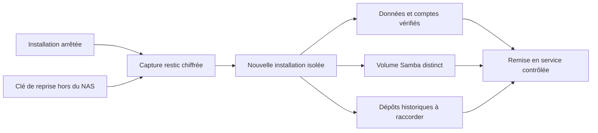

# Reprendre une installation Nacre

> **0.6.0-alpha.2 · reprise hors ligne, qualifiée en VM x86-64.**
> Fichiers, vidéos, configuration, comptes web, clés restic et identité Samba peuvent être récupérés dans une nouvelle installation. Linux doit être installé séparément. Les disques, pools RAID et anciens snapshots natifs ne sont pas reconstruits par cette procédure.



## Ce qui est conservé

| Élément | Capture et reprise |
| --- | --- |
| Comptes web et mots de passe | Empreintes conservées ; anciennes sessions et tickets révoqués |
| Fichiers, vidéos, corbeille, restitutions | Contenu sous `data/` et racines externes déclarées ; propriétaires numériques conservés |
| Configuration caméra et base Frigate | Fichiers sous `state/frigate/`, service vidéo arrêté pendant la capture |
| Comptes Samba | `passdb.tdb`, identité/SID, comptes secondaires, indicateurs de désactivation, configuration et UID |
| Image Samba | Image exacte exportée, chiffrée dans le dépôt puis importée ; nom d’hôte conservé pour préserver l’identité |
| Clés des dépôts restic | Incluses dans le point chiffré ; chaque clé doit ouvrir son dépôt avant validation de la capture |
| Dépôts historiques | Leur contenu reste sur son support séparé ; rattachement par identité cryptographique, jamais par le seul chemin |
| Plans automatiques | Conservés **désactivés** ; tâches interrompues marquées en échec |
| Politique et catalogue natifs | Export administratif séparé, embarqué dans la capture ; conservé comme référence, jamais réappliqué automatiquement |

Les sous-répertoires `.nacre-repos`, `.git`, `.tools`, les tâches temporaires et le cache restic sont exclus. Les archives historiques doivent donc être protégées séparément. La clé qui ouvre **le dépôt de reprise** doit rester accessible hors du NAS : les clés contenues dans une sauvegarde verrouillée ne permettent pas de l’ouvrir.

## Conditions du parcours actuel

- Hôte Linux avec Docker/Compose, Python et le binaire restic vérifié. Même architecture CPU et mêmes UID/GID du compte principal que la capture. Le remappage entre UID ou architectures n’est pas qualifié.
- Dépôt restic **local ou déjà monté**, dédié à la reprise, hors de toutes les sources. Les URL S3/SFTP ne sont pas acceptées par cet outil. Ne pas modifier/pruner le dépôt pendant une restitution : le conteneur y accède en lecture seule, sans verrou restic.
- Sources lisibles par le compte de capture. Toute erreur de lecture fait échouer le point ; aucun succès partiel n’est annoncé. Aucune limite applicative de taille des fichiers ou du total ; espace et capacité du système restent nécessaires, notamment pour l’image Samba temporaire.
- Arrêt de la console et de ses workers, Samba, Frigate et de tout autre processus écrivant dans ces données. Les verrous Nacre ne contrôlent pas les écritures d’applications externes.
- Aucun travail natif en cours. Si le service natif est installé, le conserver disponible pour l’inventaire et interdire toute opération de stockage pendant la capture. Un volume indisponible empêche la validation.
- La destination est un **nouveau dossier** sous un parent privé 0700 appartenant à l’opérateur. Les chemins utilisés comme montages Docker ne doivent pas contenir de virgule.

## 1. Préparer les supports et la clé

Les chemins ci-dessous sont des exemples à remplacer. Ils ne créent aucune planification et ne désignent pas le stockage interne de Spark.

```bash
umask 077
mkdir -m 700 /chemin/prive-cles
python3 -c 'import secrets; print(secrets.token_urlsafe(48))' > /chemin/prive-cles/reprise.key
python3 console/install_restic.py
export NAS_RESTIC_BIN="$PWD/.tools/restic"
"$NAS_RESTIC_BIN" --repo /support-distinct/reprise \
  --password-file /chemin/prive-cles/reprise.key init
```

Conserver une copie de cette clé sur un support indépendant et vérifier sa lecture avant un incident. Ne pas la publier dans Git, les journaux ou une capture d’écran. Prévoir aussi le code approuvé de Nacre et le runtime restic : `.tools` et `.git` ne sont pas sauvegardés.

## 2. Déclarer les données externes

Pour chaque volume externe, créer le fichier privé `state/console/recovery-volumes.json`, par exemple :

```json
{
  "native_documents": "/srv/nacre-volumes/documents/data"
}
```

Les identifiants correspondent aux zones `native_…` de Nacre. Inclure toutes les racines à protéger, y compris celles sans partage. Les sources imbriquées sont refusées. Les volumes référencés par les partages, plans, dépôts et corbeilles doivent être présents. Avec le service natif connecté, tous ses volumes doivent être disponibles et déclarés ; les chemins des volumes exposés sont comparés à l’inventaire autorisé.

Pour un volume de politique qui n’est pas exposé comme zone de fichiers — notamment certains volumes LVM — l’administrateur doit fournir une racine montée, cohérente et lisible. Le parcours ne fabrique pas un montage pour contourner cette exigence. Vérifier manuellement la correspondance de cette racine avec le volume annoncé.

Si le service natif est installé, exporter sa politique et son catalogue :

```bash
umask 077
sudo python3 console/system_recovery.py native-export > state/native-recovery.tar
```

Cette archive contient des métadonnées administratives privées. Le catalogue SQLite est copié avec son WAL validé ; un travail de copie natif en attente/en cours empêche l’export. L’export ne copie pas les blocs des disques. Suspendre toute intervention de stockage jusqu’à la fin de la capture.

## 3. Arrêter puis capturer

Arrêter le service utilisateur de console, attendre l’arrêt de ses workers et arrêter les conteneurs. Sur une installation utilisant les unités fournies :

```bash
systemctl --user stop nacre-console.service
python3 lab.py stop
python3 console/system_recovery.py capture \
  --root "$PWD" \
  --repository /support-distinct/reprise \
  --key-file /chemin/prive-cles/reprise.key
```

Les workers doivent également avoir terminé ou être arrêtés ; le verrou refuse la capture tant qu’un processus Nacre l’occupe. La capture contrôle les conteneurs avant et après et refuse un changement d’identité des racines sources. Le tag `nacre-installation-v1` n’est ajouté qu’après succès et vérifications finales. Un point seulement marqué `nacre-installation-pending-v1` n’est pas restaurable par cet outil.

Noter l’identifiant **complet de 64 caractères** retourné. `state/console/last-system-recovery.json` contient le reçu sans clé. Si une capture a été interrompue brutalement, examiner puis déplacer le dossier temporaire `state/recovery-kit` avant une nouvelle tentative ; l’outil refuse de supprimer implicitement un kit préexistant.

La capture ne redémarre pas les services. Après contrôle de son résultat, remettre l’installation source en service selon sa procédure habituelle.

## 4. Préparer sur la cible

Installer le code approuvé et le runtime restic sur l’hôte de remplacement. Depuis ce code :

```bash
mkdir -m 700 /chemin/prive-reprise
python3 console/system_recovery.py prepare \
  --repository /support-distinct/reprise \
  --key-file /chemin/prive-cles/reprise.key \
  --snapshot IDENTIFIANT_COMPLET_64_HEXADECIMAUX \
  --destination /chemin/prive-reprise/nacre
```

La préparation vérifie le manifeste, les empreintes et les fichiers restaurés. Elle restitue avec les UID/GID d’origine dans un conteneur sans réseau : dépôt, clé et binaire en lecture seule, seule la nouvelle destination est accessible en écriture. Elle charge l’image Samba sauvegardée sans démarrer son service. Utiliser uniquement une sauvegarde de confiance.

Le code exécuté dans la nouvelle installation vient de la version approuvée qui réalise la préparation. Les sessions/tickets sont révoqués ; tous les plans sont désactivés et les dépôts détachés. Les partages natifs sont redirigés vers `data/fichiers/reprise-volumes/<zone>/`. La corbeille native est réindexée. Aucun disque n’est formaté et aucune politique root n’est installée.

## 5. Importer Samba et raccorder les dépôts

```bash
python3 console/system_recovery.py samba --root /chemin/prive-reprise/nacre
python3 console/system_recovery.py attach \
  --root /chemin/prive-reprise/nacre \
  --id IDENTIFIANT_NACRE_DU_DEPOT_24_HEXADECIMAUX \
  --path /support-historique/depot-existant
```

Samba est importé dans un **nouveau volume Docker**. Un nom de projet distinct empêche de récupérer les volumes de la source par accident. L’image et le nom d’hôte d’origine préservent le SID et les comptes. Le kit temporaire local est supprimé après import réussi ; il reste disponible dans le point chiffré. En cas d’échec, les volumes nouvellement créés sont conservés pour diagnostic et ne sont jamais nettoyés globalement.

Pour chaque dépôt historique, `attach` utilise la clé récupérée et compare l’identité restic à celle enregistrée lors de la capture. Un chemin ressemblant ou une clé d’un autre dépôt ne suffit pas. Les plans restent désactivés. Cette opération exige une console arrêtée.

## 6. Contrôler puis remettre en service

Avant de lancer les services, vérifier les chemins, propriétaires, fichiers témoins, comptes et partages. Sur le même hôte, les ports locaux des deux installations entreraient en conflit : arrêter la source ou utiliser une VM séparée pour la répétition.

```bash
cd /chemin/prive-reprise/nacre
python3 lab.py start
python3 console/server.py
```

Le démarrage réutilise l’image Samba importée, sans la reconstruire. Le lancement normal est refusé tant que l’état Samba n’est pas importé. La console retrouve les comptes existants ; elle ne génère pas de nouveau mot de passe administrateur. Recréer ensuite le service utilisateur avec le chemin de la nouvelle installation selon [INSTALLATION.md](INSTALLATION.md).

Contrôler la connexion web avec le compte antérieur, un accès SMB autorisé, un compte désactivé, un partage en lecture seule et une restauration témoin depuis chaque dépôt. Vérifier séparément le flux caméra, la base vidéo et la rétention. Ne réactiver les plans qu’après choix de leurs destinations et examen des sources : les anciennes zones natives ont été regroupées sous `fichiers`.

La reconstruction des pools et l’import de snapshots natifs demandent une qualification distincte. `state/native-recovery.tar` sert d’inventaire, pas de commande à réappliquer aveuglément sur d’autres disques.

## Preuves et limites

Le scénario [integration_system_recovery_vm.py](../tests/integration_system_recovery_vm.py) rend l’ancienne installation et sa racine externe inaccessibles par leurs chemins, puis récupère données, clés, comptes et configuration. Il ouvre l’ancien dépôt, vérifie les UID, le SID Samba, les mots de passe secondaires, un compte désactivé, la lecture seule et la persistance après recréation du conteneur. Il teste aussi la connexion HTTP avec le mot de passe administrateur initial. Les vidéos sont des octets synthétiques ; ce test ne valide pas le décodage d’un enregistrement réel ni la remise en route d’une caméra.

Le banc est QEMU x86-64, avec Docker et un système de fichiers ordinaire pour le volume externe. Les reprises intégrales sur ARM64, les ACL/POSIX étendues, les très gros volumes, la panne pendant l’import Docker et la reconstruction complète du système Linux restent à qualifier. Les tests ordinaires et leur CI couvrent séparément x86-64/ARM64.

Références : [restic — restauration](https://restic.readthedocs.io/en/stable/050_restore.html), [Docker — copie de fichiers](https://docs.docker.com/reference/cli/docker/container/cp/), [Docker — export d’image](https://docs.docker.com/reference/cli/docker/image/save/).
