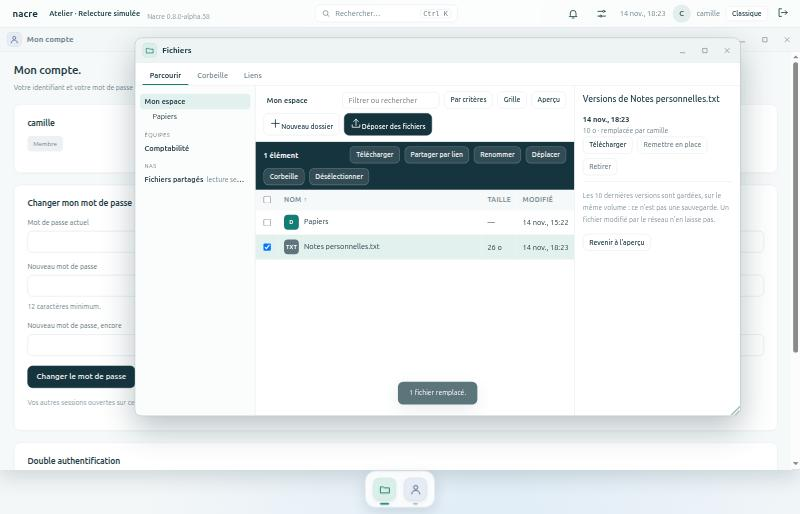

# Versions d’un fichier

Depuis **0.8.0-alpha.59**, un fichier remplacé depuis Nacre garde ce qu’il contenait avant. C’est la troisième brique de l’espace collaboratif.

## Remplacer sans perdre

Déposer un fichier dont le nom existe déjà ne remplace rien d’office : Nacre demande **Remplacer ce fichier ?**. Si l’on confirme, le nouveau contenu prend la place, et l’ancien devient une **version**.

## Retrouver et remettre en place

1. Dans **Fichiers**, sélectionner un fichier.
2. Dans le panneau d’aperçu, **Versions**.
3. Pour chaque version : **Télécharger**, **Remettre en place** ou **Retirer**.

*Banc local : compte et fichiers fictifs.*

Remettre une version en place ne perd rien : le contenu actuel devient à son tour une version, donc le retour se défait.

## À savoir

- **Quand une version est gardée** : à chaque remplacement fait par la console. Un fichier modifié **par le réseau (SMB)** n’en laisse pas : la console ne voit pas ce changement.
- **Les dix dernières** versions d’un fichier sont gardées ; la onzième chasse la plus ancienne.
- **Ce n’est pas une sauvegarde.** Les versions vivent sur le même volume que le fichier, dans un dossier interne, et ne partent pas dans les sauvegardes. Elles occupent de la place.
- **Elles suivent le fichier** quand il est renommé ou déplacé depuis Nacre, dossier compris. Renommé par le réseau, un fichier perd le lien avec ses versions.
- **Mêmes droits que l’espace** : qui lit l’espace consulte et télécharge les versions ; qui y écrit les remet en place ou les retire. Les versions d’un espace personnel restent fermées aux autres.
- **Le remplacement est d’un seul tenant** : à aucun instant le fichier n’est absent. Si l’ancienne version ne peut pas être rangée, elle reste à côté sous un nom visible plutôt que d’être perdue.
- **Un dossier ou un lien n’est jamais remplacé** par un fichier.

## Limites

- **Pas de comparaison** entre deux versions.
- **Nombre fixe** de versions, non réglable.
- **Pas de version à la mise en corbeille** : la corbeille joue ce rôle.
- **Les points de restauration** (sauvegardes, points natifs) restent le recours pour ce que la console n’a pas vu changer.

## Sous le capot

`console/versions.py`. Chaque espace a un dossier interne privé (`.nacre-versions` dans l’espace ; `data/.versions` pour l’espace commun, hors du dossier partagé en SMB) avec un index. Le remplacement échange les deux noms d’un coup (`renameat2`, échange), puis range l’ancien contenu. Aucun changement de schéma.
