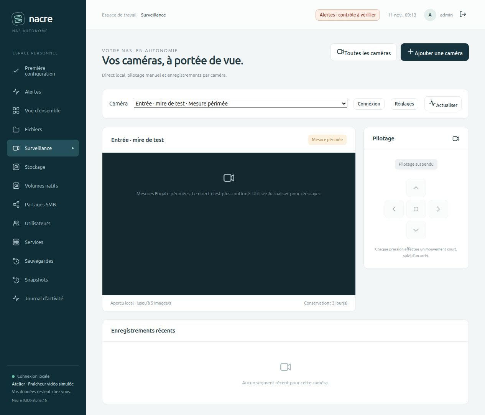

# Un débit positif peut être ancien

## Incident constaté sur Spark

Le 11 novembre 2026, la page Surveillance montrait encore une image nocturne alors qu’il faisait jour. Frigate répondait aux requêtes HTTP, mais son échantillon de statistiques était resté figé depuis environ onze heures. Le débit positif de cet ancien échantillon suffisait à tort à afficher « Flux reçu » dans Nacre alpha.15.

Le relais RTSP fournissait pourtant de nouvelles images décodables sur les flux principal et secondaire. La relance du seul service Frigate a rétabli une image de jour horodatée, des images successives différentes et un débit proche de 5 images/s. Des segments récents étaient de nouveau consultables. Les identifiants et la configuration caméra n’ont pas changé ; Samba et le système hôte n’ont pas été redémarrés.

La relance a d’abord rétabli le traitement Frigate. L’analyse complémentaire a ensuite identifié une exception WebSocket capable d’arrêter son lecteur IPC ; elle est corrigée en [alpha.17](FRIGATE-WEBSOCKET.md). Cette correction ciblée ne garantit pas l’absence de tout autre blocage. Aucune image réelle de surveillance n’est publiée dans le dépôt.

## Correction dans 0.8.0-alpha.16

Nacre vérifie désormais `service.last_updated` de Frigate avant de croire son débit :

- Un échantillon datant de plus de **90 secondes** devient **Mesure périmée**, même si son débit était positif.
- Un horodatage absent, invalide ou situé plus de 30 secondes dans le futur donne **État inconnu**. Une horloge cohérente entre les services est nécessaire.
- La date affichée est celle de l’échantillon Frigate, et non plus celle de la requête Nacre. Ce n’est pas l’heure de la dernière image.
- Une caméra désactivée conserve l’état **En pause**.
- Le collecteur d’alertes signale les statistiques indisponibles ou périmées et n’en déduit pas un retour à la normale des caméras.

L’émetteur de statistiques de Frigate 0.18.2 publie normalement un échantillon toutes les 15 secondes. Le seuil de 90 secondes est une marge choisie par Nacre, pas une garantie du moteur. Sources : [émetteur](https://github.com/blakeblackshear/frigate/blob/v0.18.2/frigate/stats/emitter.py), [horodatage des mesures](https://github.com/blakeblackshear/frigate/blob/v0.18.2/frigate/stats/util.py), [période](https://github.com/blakeblackshear/frigate/blob/v0.18.2/frigate/const.py).

## Pendant le direct

La vue détaillée vérifie l’état toutes les **15 secondes**, sans requêtes superposées. Si le flux n’est plus confirmé, si la requête échoue ou si l’image signale une erreur de chargement, l’image est retirée et le pilotage suspendu. **Actualiser** relit les mesures et permet de reprendre le direct. Aucun redémarrage automatique de Frigate ou de la caméra n’est ajouté.

Les réponses arrivées après une navigation ou un changement de caméra sont ignorées. La vue d’ensemble reste à actualisation manuelle.

Ce contrôle ne compare pas les pixels et ne garantit pas la fraîcheur de chaque image : un moteur qui continuerait à publier des mesures récentes malgré une image figée pourrait encore échapper à cette détection. Il ne garantit pas non plus l’intégrité des enregistrements.

## Validation isolée

Les tests couvrent le débit positif ancien, les horodatages absents/invalides/futurs, la limite de 90 secondes, la pause prioritaire, les alertes qui ne se résolvent pas sur un ancien échantillon, le retrait du direct, les requêtes non superposées et les réponses tardives. Le banc navigateur utilise une mire locale et des mesures volontairement figées ; aucune panne n’est injectée dans la caméra réelle.

