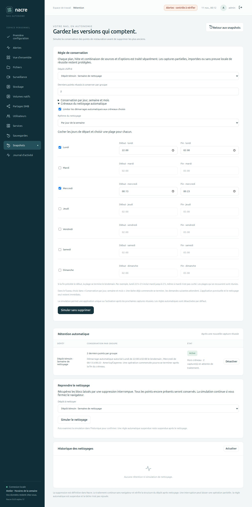

# Des horaires de nettoyage pour chaque jour

Depuis **0.8.0-alpha.12**, le créneau automatique peut être quotidien ou hebdomadaire. Le mode hebdomadaire propose une plage indépendante pour chaque jour coché. Les règles existantes restent quotidiennes ; aucun jour n’est ajouté à une règle ni aucune rétention activée automatiquement.

Depuis **0.8.0-alpha.13**, les [plages multiples et exceptions datées](DATE-EXCEPTIONS.md) complètent ce fonctionnement.

## Régler depuis le navigateur

Dans **Snapshots → Gérer la rétention**, ouvrir **Créneaux du nettoyage automatique**, cocher la limitation puis choisir **Par jour de la semaine**. Cocher les jours souhaités et renseigner leurs débuts et fins. Le fuseau reste celui de la règle, modifiable dans **Conservation par jour, semaine et mois**, même lorsque ses compteurs sont à zéro.

Lancer **Simuler sans supprimer**, examiner les points et le résumé des horaires, puis **Activer après les prochaines sauvegardes**. La confirmation affiche chaque jour et signale les fins le lendemain. Elle utilise les horaires enregistrés par la simulation ; toute modification du formulaire invalide la proposition affichée. Pour modifier une règle déjà active, simuler puis confirmer à nouveau. Le changement de dépôt recharge sa propre règle.

## Quel jour porte une plage nocturne ?

Le jour choisi est **le jour de départ**, dans le fuseau de la règle. Début inclus, fin exclue.

| Réglage | Démarrages autorisés |
| --- | --- |
| Lundi 22:00–02:00 | Lundi à partir de 22 h et mardi avant 2 h, même si mardi n’est pas coché |
| Vendredi 10:00–12:00 | Vendredi de 10 h jusqu’avant midi |
| Dimanche 23:00–03:00 | Dimanche soir et lundi avant 3 h |

Un jour non coché n’ouvre aucune nouvelle plage ; il peut recevoir la continuation de la veille. Les plages qui se recouvrent sont réunies. Par exemple lundi 22:00–03:00 et mardi 02:00–04:00 autorisent un démarrage sans interruption de lundi 22 h à mardi 4 h. Cela ne crée pas deux nettoyages pour une même capture.

Sans exception ouvrant une plage, au moins un jour est nécessaire lorsque la limitation hebdomadaire est activée. Les débuts et fins identiques, plages identiques répétées et heures invalides sont refusés avant l’accès au dépôt. Plusieurs plages par jour sont disponibles depuis alpha.13. Le mode quotidien conserve les mêmes horaires tous les jours.

## Reprise et limites

Les garanties du [créneau de maintenance](MAINTENANCE-WINDOW.md) restent applicables : captures réussies regroupées, report persistant, revalidation sous verrou puis avant la première suppression, neutralisation des attentes lors d’une reprise du NAS. La console doit fonctionner pour distribuer les tâches. Les créneaux sont des autorisations de démarrage, sans promesse d’heure exacte ni de durée maximale.

Une opération déjà commencée peut finir après la plage. Les applications ponctuelles et le nettoyage seul restent immédiats. Les horaires des sauvegardes et de la vidéosurveillance sont indépendants.

Le calcul utilise le jour et l’heure locaux, sans ajouter une durée fixe de 24 heures. Une heure manquante au changement d’heure n’ouvre pas une plage inexistante ; une heure répétée peut être admissible deux fois, mais les captures déjà traitées ne sont pas rejouées. Les exceptions datées et plages multiples sont proposées depuis alpha.13 ; aucun calendrier automatique de jours fériés n’est proposé.

## Validation isolée

Tests des jours locaux, limites horaires, dimanche vers lundi, chevauchements, changements d’heure, compatibilité des anciennes règles et refus avant accès au dépôt. Une règle hebdomadaire est conservée depuis la simulation malgré des paramètres d’activation différents ; une tâche reportée survit à la reprise et attend le prochain jour choisi sans changer d’identifiant.

Un dépôt restic chiffré jetable vérifie le refus hors jour, le nettoyage durant la continuation nocturne, le contrôle intégral des données et la restauration exacte. L’interface est testée pour les jours transmis, les champs désactivés, le chargement des règles, l’invalidation et l’échappement du résumé de confirmation.

Le banc web distinct vérifie le formulaire et la confirmation dans le navigateur ; l’activation et les captures utilisent l’API authentifiée. Aucune donnée ni règle de Spark n’est utilisée. La publication GitHub et l’aperçu local ne constituent pas un déploiement sur Spark.

Résultat du banc sur horloge réelle : quatre points intacts avant l’ouverture du mercredi, deux captures en attente conservées après redémarrage, une tâche automatique à l’ouverture, deux points conservés et dernier fichier restauré à l’identique. L’interface affiche le nettoyage terminé et zéro capture en attente.
